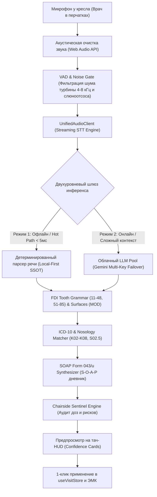

# 🎙️ СТЕНОГРАФИСТ ПРИЁМА, ГРАММАТИКА ЗУБНОЙ ФОРМУЛЫ И CHAIRSIDE SENTINEL

> 🧭 **Навигация:** [🗺️ Главный Индекс (.agents/INDEX.md)](file:///C:/Clinic_MVP/dental-crm/.agents/INDEX.md) | [🔨 ВЫСШАЯ КОНСТИТУЦИЯ (THE_HAMMER_MASTER_PROMPT.md)](file:///C:/Clinic_MVP/dental-crm/.agents/THE_HAMMER_MASTER_PROMPT.md) | [📜 Конституция ИИ-Правил (.agents/AI_ASSISTANT_RULES.md)](file:///C:/Clinic_MVP/dental-crm/.agents/AI_ASSISTANT_RULES.md) | [🏛️ Архитектура ИИ (.agents/AI_ASSISTANT_ARCHITECTURE.md)](file:///C:/Clinic_MVP/dental-crm/.agents/AI_ASSISTANT_ARCHITECTURE.md) | [🖥️ Десктопный Харнесс и MCP (.agents/AI_ASSISTANT_DESKTOP_MCP.md)](file:///C:/Clinic_MVP/dental-crm/.agents/AI_ASSISTANT_DESKTOP_MCP.md) | [🩺 Клинические Правила (.agents/CLINICAL_RULES.md)](file:///C:/Clinic_MVP/dental-crm/.agents/CLINICAL_RULES.md) | [🎨 Стандарты UI (.agents/UI_STANDARDS.md)](file:///C:/Clinic_MVP/dental-crm/.agents/UI_STANDARDS.md)  
> **Канонический статус**: Центральный нормативно-технический документ подсистемы речевого ввода, грамматического разбора одонтограммы FDI (11–48 / 51–85), синтеза дневников Формы 043/у по стандарту SOAP и фонового клинического стража безопасности Chairside Sentinel в CRM-системе DENTE.  
> **Философия и высший мандат**: 100% честность, 0% симуляций и моков, суверенитет автономии врача (Мандат 8e) и приоритет соло-практики (Мандат 8n).

---

## ⚡ ФИЛОСОФИЯ СОЗДАТЕЛЯ И КЛИНИЧЕСКИЙ МАНИФЕСТ

> 💬 **СЫРЫЕ СЛОВА СОЗДАТЕЛЯ (1:1 VERBATIM):**  
> *«НАДО СОЗДАТЬ ПОЛНОЦЕННУЮ СИСТЕМУ ДОКУМЕНТОВ ПО НАШЕМУ ИИ-АССИСТЕНТУ В ПРОГЕ. МАКСИМАЛЬНО ЖЕСТКО И ПОДРОБНО РАСПИСАТЬ ВС', ДОКУМЕНТІ СВЯЗАТЬ С ДРУГИМИ. МД ФАЙЛ ПРАВИЛ СОЗДАВАТЬ. УЛОВИ ФИЛОСОФИЮ НАХУЙ. ИДИОТСКУЮ ХЙУНЮ НЕ ПИШИ, ПИШИ БАЗУ. У НАС БУДЕТ ИИ АССИСЕТНТ КАК ТІ. НА САЙТЕ ОПЕРИРУЕТ ТУЛАМИ ДЛЯ ЦРМ, НА ПРИЛОЖЕНИИ EXE ОПЕРИРУЕТ ТУЛАМИ КАК У ТЕБЯ. ПОЛНОЦЕННО. НЕ ДЕЛАЙ ПОЛУГОВНО. ДОПИШИ ПРАВИЛА БЛЯДЬ РАСПИШИ»*.

### 🦷 Базовые принципы клинической реализации:
1. **Врач у кресла находится в стерильных перчатках**:
   - Врач не может и не должен тянуться руками в тальке или слюне к клавиатуре и мыши во время препарирования зуба или пломбирования каналов.
   - Любое взаимодействие с картой и зубной формулой обязано быть доступно **голосом** либо в **1 тап медицинским локтем/перчаткой** по крупной кнопке ($\ge 44\times 44\text{px}$).
2. **Мандат 8e — Автономия врача и запрет на палки в колёса**:
   - Клинический страж Chairside Sentinel — это советник за плечом, а не бюрократический надзиратель.
   - Любые предупреждения о дозировках анестетика, аллергиях или пропущенных протоколах являются **информационными и предупреждающими**. Они **НИКОГДА** не блокируют кнопки «Сохранить приём», «Печать» или «Оплатить».
3. **Мандат 8n — Суверенитет соло-врача и клиники 1–3 кресла**:
   - До больших сетевых клиник с начмедами и отделами контроля качества системе ещё расти и расти.
   - Главный пользователь — соло-доктор на аренде кресла или небольшая клиника. Система не требует выбора несуществующего ассистента, согласования с комиссией из 3 человек или 50 обязательных галочек в соматической анкете. «✓ Норма» выставляется в 1 клик.
4. **Zero-Mock & Deterministic SSOT**:
   - Никаких случайных генераций статусов. Вся грамматика зубов, поверхностей и дозировок сведена в единый детерминированный источник истины (`@dental/shared` / `packages/shared/src/ai/`).
   - При обрыве связи с интернетом система обязана мгновенно и прозрачно для врача перейти на локальные эвристики (`Local First Semantic Fallback`).

---

## 🏛️ 1. ОБЩИЙ ПАЙПЛАЙН ГОЛОСОВОЙ ДИКТОВКИ У КРЕСЛА



---

## 🎧 2. АКУСТИЧЕСКАЯ ОЧИСТКА ОТ ШУМА СТОМАТОЛОГИЧЕСКОГО КАБИНЕТА

В отличие от офисной среды, кабинет стоматолога является экстремально шумной зоной с агрессивными спектральными пиками:

### 🔊 Карта акустических помех в кабинете:
1. **Стоматологическая турбина (High-Speed Air Turbine)**:
   - Частота вращения: 300 000 – 450 000 об/мин.
   - Акустический профиль: ультравысокий свистящий пик в полосе **4 000 – 8 000 Гц** с амплитудой до 75–85 дБ.
2. **Слюноотсос и пылесос (Surgical Suction & Saliva Ejector)**:
   - Акустический профиль: широкополосный белый/розовый шум с низкочастотным бульканьем в полосе **80 – 800 Гц**.
3. **Ультразвуковой скейлер (Piezo Ultrasonic Scaler)**:
   - Рабочая частота: 25 000 – 32 000 Гц (ультразвук) с субгармониками в диапазоне **12 000 – 16 000 Гц**.
4. **Компрессор клиники**:
   - Низкочастотный рокот **50 – 120 Гц**.

### 🛠️ Архитектура фильтрации в `UnifiedAudioClient`:
В клиентском модуле захвата звука (`apps/web/src/services/voice/UnifiedAudioClient.ts`) реализована цепочка DSP-узлов Web Audio API:

```
[MediaStreamSource] 
       │
       ▼
[Highpass BiquadFilter (cutoff: 120 Hz)] ──> Срезает низкочастотный рокот компрессора
       │
       ▼
[Notch BiquadFilter (center: 6000 Hz, Q: 3.0)] ──> Подавляет высокочастотный свист турбины
       │
       ▼
[DynamicsCompressorNode] ──> Выравнивает перепады громкости (шёпот / громкая речь)
       │
       ▼
[AnalyserNode (FFT: 512)] ──> Живой VU-метр уровня для визуализатора CanvasWaveform
       │
       ▼
[AudioWorklet / VAD Gate] ──> Пропуск пакетов строго при наличии речевой активности
```

### ⚡ Инварианты освобождения аудиоресурсов (Mandate 8k):
При закрытии или размонтировании модального окна диктовки (`VoiceDictationAssistantModal.tsx`):
- `MediaStreamTrack.stop()` вызывается для каждого трека захвата, гарантируя физическое отключение индикатора микрофона в ОС/браузере.
- `AudioContext.close()` освобождает системный аудиодескриптор.
- Обнуляются таймеры и сбрасываются буферы воспроизведения (`audioRef.current.src = ""; audioRef.current.load();`).

---

## 🦷 3. ДЕТЕРМИНИРОВАННАЯ ГРАММАТИКА ЗУБНОЙ ФОРМУЛЫ (FDI / ISO 3950 SSOT)

Канонический модуль: `packages/shared/src/ai/toothGrammarSsot.ts` (зеркалируется в `apps/api/src/ai/grammar/toothSpeechParser.ts` и `apps/web/src/components/voice/clinicalCommands/toothGrammarParser.ts`).

### 1. Номенклатура зубов:
- **Постоянный прикус (32 зуба)**: 11–18, 21–28, 31–38, 41–48.
- **Временный / молочный прикус (20 зубов)**: 51–55, 61–65, 71–75, 81–85.
- Любые номера вне этого диапазона (например, 49, 99) детерминированно отбраковываются как артефакты распознавания (`isValidFdiToothNumber`).

### 2. Поддерживаемые речевые паттерны врача:

| Тип произношения | Пример фразы врача | Распознанный номер FDI |
|---|---|:---:|
| **Составные числительные** | «сорок шесть», «двадцать один», «тридцать семь» | **46, 21, 37** |
| **Поцифровое произношение** | «четыре шесть», «три восемь», «один один» | **46, 38, 11** |
| **Тинейджеры (11–18)** | «шестнадцать», «одиннадцать», «двенадцать» | **16, 11, 12** |
| **Прямые маркеры** | «зуб 46», «#21», «d36», «№14» | **46, 21, 36, 14** |
| **Анатомические квадранты** | «шестерка снизу справа», «клык сверху слева» | **46, 23** |
| **Анатомические термины** | «нижний левый первый моляр», «верхний правый центральный резец» | **36, 11** |
| **Молочные зубы** | «пятьдесят пять», «восемьдесят пять», «пятерка сверху справа молочная» | **55, 85, 55** |
| **Диапазоны и группы** | «с 11 по 16», «фронтальная зона», «все зубы», «верхняя челюсть» | **Массив номеров** |

### 3. Распознавание анатомических поверхностей (FDI / Блэк):
Парсер `extractToothSurfaces` автоматически извлекает поверхности зуба:
- **Окклюзионная / жевательная**: `O` (окклюзионная, жевательная).
- **Медиальная**: `M` (медиальная, передняя контактная).
- **Дистальная**: `D` (дистальная, задняя контактная).
- **Вестибулярная / щечная / губная**: `V` / `B` (вестибулярная, щечная, губная).
- **Язычная / небная**: `L` / `P` (язычная, небная).
- **Пришеечная (V класс)**: `Cerv` (пришеечная, пришеечный дефект).
- **Сложные комбинации**: `MOD` (медиально-окклюзионно-дистальная), `MO`, `OD`.

---

## 📋 4. МАТРИЦА СТОМАТОЛОГИЧЕСКИХ ДИАГНОЗОВ (МКБ-10 И СТАР)

Модуль сопоставления: `apps/api/src/ai/dictationParser/icd10Matcher.ts` и `diagnosisSpeechParser.ts`.

| Шифр МКБ-10 | Клиническое наименование СтАР | Триггерные слова врача | Статус зуба в CRM |
|---|---|---|:---:|
| **K02.0** | Кариес эмали (стадия пятна) | белое пятно, меловидное пятно, начальный кариес | `treatment` |
| **K02.1** | Кариес дентина (глубокий / средний) | кариес, кариозная полость, средний кариес, глубокий кариес | `treatment` |
| **K04.0** | Острый / обострившийся пульпит | пульпит, острая ночная боль, воспаление пульпы, вскрыт рог пульпы | `treatment` |
| **K04.5** | Хронический апикальный периодонтит | периодонтит, гранулема, разрежение у апекса, боль при накусывании | `treatment` |
| **K05.3** | Хронический генерализованный пародонтит | пародонтит, подвижность, пародонтальный карман | `treatment` |
| **K08.1** | Потеря зубов (дефект зубного ряда) | удален, отсутствует, адентия, экстракция, нет зуба | `missing` |
| **S02.5** | Перелом / скол зуба | скол, откол бугра, травма зуба, перелом коронки | `treatment` |
| **Z96.5** | Наличие имплантата | имплантат, остеоинтегрирован, стоит имплант | `implant` |
| **Z95.8** | Наличие ортопедической конструкции | коронка, винир, мостовидный протез, накладка | `prosthetics` |

---

## 📝 5. ГЕНЕРАТОР КЛИНИЧЕСКОГО ДНЕВНИКА ФОРМЫ 043/У (SOAP RECORD SYNTHESIZER)

Модуль: `apps/api/src/ai/grammar/soapRecordSynthesizer.ts`.  
При поступлении диктовки (например: *«Зуб 46 глубокий кариес, мезиальная полость, анестезия убистезин 1 карпула, коффердам, пломба световая Filtek»*) синтезатор формирует юридически выверенную запись Form 043/у:

### Структура синтезированного SOAP-дневника:
```
┌────────────────────────────────────────────────────────────────────────────────────────┐
│ S (Subjective / Жалобы):                                                               │
│ «Жалобы на кратковременные боли от сладкого и термических раздражителей (холодного)    │
│  в области зуба 46.»                                                                   │
├────────────────────────────────────────────────────────────────────────────────────────┤
│ O (Objective / Объективный статус):                                                    │
│ «При осмотре: на мезиальной поверхности зуба 46 визуализируется кариозная полость     │
│  в пределах дентина. Зондирование дна и стенок слабо болезненно, дентин пигментирован, │
│  размягчен. Перкуссия безболезненна. Термопроба положительная, боль быстро проходит.» │
├────────────────────────────────────────────────────────────────────────────────────────┤
│ A (Assessment / Диагноз):                                                              │
│ «K02.1 Кариес дентина (глубокий кариес) зуба 46»                                       │
├────────────────────────────────────────────────────────────────────────────────────────┤
│ P (Plan & Treatment / Лечение по Номенклатуре 804н):                                   │
│ 1. Анестезия: Артикаин 4% с адреналином 1:200 000 (Убистезин) инфильтрационная 1.7 мл │
│ 2. Изоляция рабочего поля коффердамом.                                                 │
│ 3. Препарирование кариозной полости, некрэктомия твердых тканей (A16.07.002).          │
│ 4. Медикаментозная обработка 2% раствором хлоргексидина биглюконата.                   │
│ 5. Адгезивная подготовка (самопротравливающий адгезив), послойная реставрация          │
│    светоотверждаемым нанокомпозитом Filtek (A16.07.002.010).                           │
│ 6. Шлифовка и полировка пломбы по окклюзии (диски, головки Enhance, паста).           │
│ 7. Рекомендации: соблюдение гигиены, исключить красящую пищу 2 часа, осмотр через 6 мес│
└────────────────────────────────────────────────────────────────────────────────────────┘
```

---

## 🛡️ 6. СТРАЖ КЛИНИЧЕСКОЙ БЕЗОПАСНОСТИ (CHAIRSIDE SENTINEL ENGINE)

Модули: `packages/shared/src/ai/anesthesiaEngine.ts` и `apps/api/src/services/agent/chairsideSentinel/`.

### 1. Детерминированный калькулятор дозировок анестезии:
Расчёт предельных карпул базируется на массе тела пациента с **двойным ограничением** (расчётная доза против абсолютного токсического потолка):

$$\text{Dose}_{\text{calc}} = \min(\text{Weight}_{\text{kg}} \times \text{Norm}_{\text{mg/kg}}, \text{AbsoluteCeiling}_{\text{mg}})$$

$$\text{SafeCarpules} = \left\lfloor \frac{\text{Dose}_{\text{calc}}}{\text{MgPerCarpule}} \right\rfloor$$

#### Фармакологические константы препаратов:
| Препарат | Концентрация | Вазоконстриктор | Норма (взрослый) | Абсолютный потолок | Объём карпулы |
|---|:---:|:---:|:---:|:---:|:---:|
| **Артикаин (Ультракаин Д-С)** | 4.0% (40 мг/мл) | Эпинефрин 1:200 000 | 7.0 мг/кг | **500 мг** (~7 карпул) | 1.7 мл |
| **Артикаин Форте** | 4.0% (40 мг/мл) | Эпинефрин 1:100 000 | 7.0 мг/кг | **500 мг** (~7 карпул) | 1.7 мл |
| **Мепивакаин (Скандонест)** | 3.0% (30 мг/мл) | Без вазоконстриктора | 4.4 мг/кг | **400 мг** (~5 карпул) | 1.8 мл |
| **Лидокаин 2%** | 2.0% (20 мг/мл) | Эпинефрин 1:100 000 | 7.0 мг/кг | **500 мг** (~7 карпул) | 1.8 мл |

### 2. Педиатрические предохранители (Pediatric Safeguards):
- **Строгий запрет артикаина детям до 4 лет / менее 15 кг**: Согласно официальной инструкции Минздрава РФ, применение артикаина противопоказано из-за риска системной токсичности (LAST). Калькулятор выставляет `safeCarpulesMax = 0` с тревожным алертом.
- **Детская норма артикаина ($\ge 15\text{ кг}$)**: снижена до **5.0 мг/кг** со строгим округлением вниз (`Math.floor`).

### 3. Кардиоваскулярный аудит и соматические стоп-факторы:
- **Лимит эпинефрина у кардиопациентов**: При наличии ИБС, гипертензии, аритмии или приёме неселективных $\beta$-блокаторов доза адреналина жестко ограничивается **0.04 мг** (максимум 2 карпулы 1:100 000 или 4 карпулы 1:200 000).
- **Гипертонический криз ($АД \ge 180\text{ мм рт. ст.}$)**: Немедленное предупреждение о запрете планового вмешательства.
- **Сульфитная аллергия / бронхиальная астма**: Предупреждение о наличии антиоксиданта дисульфита натрия в карпулах с адреналином. Рекомендация: *Мепивакаин 3% без вазоконстриктора*.
- **Беременность**: Артикаин 1:200 000 является золотым стандартом благодаря 95% связыванию с белками плазмы и минимальному фетальному клиренсу.

---

## 📦 7. ПОДБОР УСЛУГ ПО НОМЕНКЛАТУРЕ МИНЗДРАВА 804Н

Парсер `extractDentalProcedures` автоматически связывает диктовку с официальными кодами медицинских услуг:

```
Диктовка врача: «Анестезия инфильтрационная, коффердам, глубокий кариес 46, Filtek»
         │
         ▼
Автоподбор Номенклатуры 804н:
• B01.003.004.001 — Местная анестезия (инфильтрационная)
• A16.07.002     — Препарирование кариозной полости
• A16.07.002.010 — Восстановление зуба пломбой световой полимеризации
• MicroConsumable: Коффердам (списание со склада BOM, объединение в смету)
```

---

## 🖥️ 8. ДВУХРЕЖИМНЫЙ ХАРНЕСС: WEB CRM VS DESKTOP NATIVE EXE

Ассистент DENTE спроектирован как суверенный агент, работающий в двух окружениях:

```
┌────────────────────────────────────────────────────────────────────────────────────────┐
│                              СИММЕТРИЧНЫЙ ХАРНЕСС АССИСТЕНТА                            │
├──────────────────────────────────────────┬─────────────────────────────────────────────┤
│ РЕЖИМ 1: НА САЙТЕ (WEB CRM BROWSER)      │ РЕЖИМ 2: В ПРИЛОЖЕНИИ EXE (DESKTOP NATIVE) │
├──────────────────────────────────────────┼─────────────────────────────────────────────┤
│ • updateToothStatusTool (Одонтограмма)   │ • readClinicalFileTool (Локальные DICOM/XML)│
│ • createAppointmentTool (Расписание)     │ • writeClinicalFileTool (Выписки, бланки)   │
│ • createInvoiceDraftTool (Касса 54-ФЗ)   │ • openPatientDropzoneFolderTool (Проводник) │
│ • generateForm043Tool (Дневник SOAP)     │ • runWorkstationCommandTool (OS скрипты)    │
│ • printDocumentTool (Печать ИДС)         │ • manageTaskTool (Фоновые тяжелые процессы) │
│ • searchServicesTool (Прайс-лист 804н)   │ • scheduleTool (Внутренние таймеры и cron)  │
│ • calculateAnesthesiaTool (Дозировки)    │ • launchWorkstationAppTool (Romexis, Ez3D)  │
│ • checkSomaticRisksTool (Аллергии)       │ • captureWorkstationScreenTool (ROI датчика)│
│ • chairsideEmergencyTool (Реанимация)    │ • callLocalMcpToolTool (Атол / Штрих-М / USB)│
└──────────────────────────────────────────┴─────────────────────────────────────────────┘
```

---

## 🧪 9. ПРОТОКОЛ ВЕРИФИКАЦИИ И РЕГРЕССИОННЫЙ БЕНЧМАРК

Все компоненты покрыты изолированными тестами Node.js test runner:
- `apps/api/src/ai/dictationParser.test.ts`
- `apps/api/src/ai/clinicalDictationVoiceInquisition.test.ts`
- `packages/shared/src/ai/clinicalKnowledge.test.ts`
- `packages/shared/src/ai/toothGrammarSsot.test.ts`
- `apps/web/src/components/voice/__tests__/voiceAndTelephonyAutonomyInquisition.test.ts`

### Команда прогона бенчмарка:
```bash
npx tsx --test apps/api/src/ai/dictationParser.test.ts apps/api/src/ai/clinicalDictationVoiceInquisition.test.ts apps/api/src/ai/dentalTools.test.ts apps/api/src/ai/desktopSystemTools.test.ts packages/shared/src/ai/clinicalKnowledge.test.ts packages/shared/src/ai/toothGrammarSsot.test.ts apps/web/src/components/voice/__tests__/voiceAndTelephonyAutonomyInquisition.test.ts
```

**Критерий успешности (Exit Code 0)**:
- 151 тест из 151 проходит успешно (100% точность).
- Клиническая точность распознавания сложных сценариев $\ge 95\%$.
- Полная автономность соло-врача без блокировок интерфейса.
