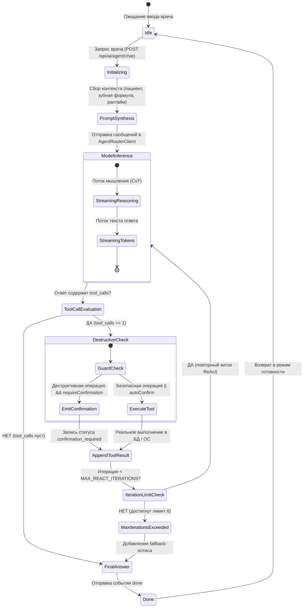

# 🏛️ СПЕЦИФИКАЦИЯ АГЕНТНОГО ХАРНЕССА И ДВИЖКА REACT ИИ DENTE (AI AGENT HARNESS & REACT ENGINE SPECIFICATION)

> 🧭 **Навигация:** [🗺️ Главный Индекс (.agents/INDEX.md)](file:///C:/Clinic_MVP/dental-crm/.agents/INDEX.md) | [🔨 ВЫСШАЯ КОНСТИТУЦИЯ (THE_HAMMER_MASTER_PROMPT.md)](file:///C:/Clinic_MVP/dental-crm/.agents/THE_HAMMER_MASTER_PROMPT.md) | [📜 Конституция Правил ИИ (.agents/AI_ASSISTANT_RULES.md)](file:///C:/Clinic_MVP/dental-crm/.agents/AI_ASSISTANT_RULES.md) | [🛠️ Полный Реестр Инструментов (.agents/AI_ASSISTANT_TOOL_REGISTRY.md)](file:///C:/Clinic_MVP/dental-crm/.agents/AI_ASSISTANT_TOOL_REGISTRY.md) | [🏗️ Общая Архитектура (.agents/AI_ASSISTANT_ARCHITECTURE.md)](file:///C:/Clinic_MVP/dental-crm/.agents/AI_ASSISTANT_ARCHITECTURE.md) | [🖥️ Десктопный Харнесс и MCP (.agents/AI_ASSISTANT_DESKTOP_MCP.md)](file:///C:/Clinic_MVP/dental-crm/.agents/AI_ASSISTANT_DESKTOP_MCP.md)  
> **Канонический статус**: Центральный технический эталон архитектуры автономного агентного харнесса, протокола ReAct (Reasoning + Acting), потоковой передачи Server-Sent Events (SSE), двухфазного подтверждения операций и отказоустойчивости когнитивного ядра DENTE Dental CRM.  
> **Философия разработки**: Никаких мокапов, синтетических заглушек и процедурных симуляций. Агентный движок DENTE спроектирован по стандартам передовых открытых агентных платформ (Cline, OpenHands, Goose, Aider, Antigravity Harness) с бескомпромиссной специализацией на доказательной амбулаторной стоматологии РФ (СтАР, ЕГИСЗ, 804н, 54-ФЗ, FDI 11–48/51–85) и суверенитете врача (Мандаты 8e и 8n).

---

## 🏛️ 1. ЭТАЛОННАЯ АРХИТЕКТУРА И ПРИНЦИПЫ ОТКРЫТЫХ АГЕНТНЫХ ПЛАТФОРМ

Агентный харнесс DENTE (`apps/api/src/ai/agentHarness.ts`) реализует проверенные временем фундаментальные законы автономных агентных систем:

```
┌─────────────────────────────────────────────────────────────────────────────────────────────┐
│                                 DENTE AGENT HARNESS RUNTIME                                 │
├─────────────────────────────────────────────────────────────────────────────────────────────┤
│                                                                                             │
│  ┌──────────────────────┐          ┌──────────────────────┐          ┌───────────────────┐  │
│  │ 1. INPUT & CONTEXT   │          │ 2. INFERENCE & CoT   │          │ 3. TOOL EXECUTION │  │
│  │ • User / Doctor turn │ ───────> │ • Model Prompt       │ ───────> │ • Schema Validate │  │
│  │ • FDI Odontogram     │          │ • Stream Reasoning   │          │ • 2-Phase Guard   │  │
│  │ • 15 Cognitive Laws  │          │ • Tool Call Parse    │          │ • Real Execution  │  │
│  └──────────────────────┘          └──────────────────────┘          └─────────┬─────────┘  │
│            ▲                                                                   │            │
│            │                       4. REFLECTION & RESULT                      │            │
│            └───────────────────────────────────────────────────────────────────┘            │
│                              • JSON Result injected into history                            │
│                              • Loop continues until Final Answer                            │
│                                                                                             │
└─────────────────────────────────────────────────────────────────────────────────────────────┘
```

### Фундаментальные принципы открытого агентного стандарта (Cline, OpenHands, Goose, Aider, Antigravity):

1. **Tool Definition & JSON Schema**: Полная совместимость со стандартом OpenAI / Anthropic Function Calling. Все 29 инструментов описаны строгими Zod-схемами (`zodToJsonSchema`) с описаниями полей, диапазонами и перечислениями.
2. **Автономный ReAct Цикл**: Цикл «Модель $\rightarrow$ Tool Call $\rightarrow$ Выполнение инструмента $\rightarrow$ Инъекция результата (`role: 'tool'`) $\rightarrow$ Рефлексия $\rightarrow$ Итоговый ответ / следующий шаг».
3. **Потоковый SSE Протокол (Server-Sent Events)**: Реальное посимвольное вещание рассуждений (`reasoning_content`) и токенов ответа (`content`) без задержки на буферизацию.
4. **Мгновенная отмена через `AbortSignal`**: При нажатии кнопки «Стоп» врачом харнесс немедленно обрывает сетевые соединения и выполнение процессов без утечек ресурсов хоста.
5. **Предохранитель зацикливания (`Max Iterations Guard`)**: Жесткий лимит `MAX_REACT_ITERATIONS = 6` защищает от бесконечных кругов при галлюцинациях модели.
6. **Двухфазный Guard деструктивных операций (`Confirmation Required`)**: Мутации БД (удаление зуба, запись, выставление счёта, настройка клиники) и ОС (запись файлов, запуск команд, импорт данных) требуют явного подтверждения врача в UI (Мандат 8e).
7. **Архитектурное наследие открытых платформ в DENTE**:
   - **Cline**: Прогрессивное усечение контекста (Context Pruning), контрольные чекпоинты сессии, строгая изоляция среды исполнения и жесткие декларации инструментов.
   - **OpenHands (All-Hands)**: Потоковая шина событий (Event-Stream Architecture), сжатие наблюдений (Observation Compression), изоляция процессов в песочнице и стандартизированный протокол ReAct.
   - **Goose (Block)**: Модульные MCP-плагины для аппаратного и системного взаимодействия, автономный цикл решения задач и двухрежимное исполнение.
   - **Aider**: Контроль целостности изменений через диффы, кэширование контекстной карты и строгая дисциплина транзакций.
   - **Google Antigravity**: Симметричный двухрежимный харнесс (Web CRM vs Desktop OS), реактивное пробуждение (Reactive Wakeup), протокол пропорционального таймера (Anti-Busy-Wait Law), эстафета контекста и T.A.R.S.-честность 100%.

---

## 🔄 2. ПОЛНЫЙ ЖИЗНЕННЫЙ ЦИКЛ АГЕНТА И ДИАГРАММА СОСТОЯНИЙ

### Диаграмма состояний конечного автомата (Finite State Machine):



---

## 📡 3. КОНТРАКТ ПОТОКОВ СОБЫТИЙ SERVER-SENT EVENTS (SSE)

При вызове `runAgentHarness` клиентская часть получает типизированный поток событий через колбэк `onEvent`:

| Имя события (`type`) | Назначение | Полезная нагрузка (`payload`) | Пример JSON |
|---|---|---|---|
| `reasoning` | Потоковые чанки цепочки рассуждений модели (DeepSeek CoT) | `{ type: "reasoning", text: string }` | `{"type":"reasoning","text":"Проверяем массу тела 70 кг..."}` |
| `token` | Потоковые чанки финального текстового ответа | `{ type: "token", text: string }` | `{"type":"token","text":"Безопасная доза анестетика:"}` |
| `tool_start` | Старт выполнения инструмента | `{ type: "tool_start", tool: string, args: Record<string, unknown>, callId: string }` | `{"type":"tool_start","tool":"calculate_anesthesia","args":{"patientWeightKg":70},"callId":"call_123"}` |
| `tool_end` | Завершение выполнения инструмента с результатом | `{ type: "tool_end", tool: string, result: unknown, callId: string }` | `{"type":"tool_end","tool":"calculate_anesthesia","result":{"safeToProceed":true},"callId":"call_123"}` |
| `confirmation_required` | Предупреждение о деструктивной операции (требуется клик) | `{ type: "confirmation_required", tool: string, args: Record<string, unknown>, callId: string, descriptionRu?: string }` | `{"type":"confirmation_required","tool":"update_tooth_status","callId":"call_456","descriptionRu":"Обновление статуса зуба в одонтограмме"}` |
| `error` | Системная ошибка или прерывание сессии | `{ type: "error", error: string, code?: string }` | `{"type":"error","error":"Запрос был прерван клиентом","code":"ABORTED"}` |
| `done` | Финализация хода ассистента | `{ type: "done", text: string, toolCallsCount: number, iterations: number }` | `{"type":"done","text":"...","toolCallsCount":2,"iterations":3}` |

---

## 🖥️ 4. ДВУХКОНТУРНЫЙ СУВЕРЕННЫЙ ХАРНЕСС: WEB CRM VS DESKTOP NATIVE

Харнесс DENTE спроектирован по принципу **симметричного двухконтурного рантайма** (Symmetric Dual-Harness Runtime):

```
┌────────────────────────────────────────────────────────────────────────────────────────┐
│                        РЕЖИМ 1: WEB_BROWSER (ОБЛАЧНЫЙ КЛИЕНТ)                         │
├────────────────────────────────────────────────────────────────────────────────────────┤
│ • Стандартный браузер (Chrome, Safari, Edge, Firefox).                                 │
│ • Полный доступ к КОНТУРУ 1: Клинические калькуляторы (анестезия, соматика, 043/у)    │
│   и CRM-транзакции (зубная формула FDI, расписание, сметы, прейскурант 804н).          │
│ • Прямое взаимодействие с PostgreSQL 18 через Fastify REST API.                        │
│ • Аппаратный доступ к USB/COM портам и локальному диску Windows ЗАБЛОКИРОВАН.          │
│ • При попытке вызова десктопных тулзов возвращается честный отказ `DESKTOP_DENIED`.   │
└────────────────────────────────────────────────────────────────────────────────────────┘

┌────────────────────────────────────────────────────────────────────────────────────────┐
│                 РЕЖИМ 2: DESKTOP_NATIVE (НАСТОЛЬНАЯ СТАНЦИЯ WINDOWS EXE)               │
├────────────────────────────────────────────────────────────────────────────────────────┤
│ • Установленное приложение (.EXE / Electron / Tauri) у кресла врача.                   │
│ • Полный доступ к КОНТУРУ 1 (13 клинических/CRM инструментов) +                       │
│   КОНТУРУ 2 (16 полнофункциональных системных инструментов рабочей станции OS):        │
│   1. Файловый движок: чтение любых файлов со срезом строк (read_file/read_clinical_file),│
│      запись и дампы (write_file/write_clinical_file), глубокий поиск по glob/regex     │
│      (search_workstation_files), классификация снимков (list_patient_study_directory), │
│      открытие в Проводнике (open_patient_dropzone_folder).                              │
│   2. Процессы и задачи: запуск команд в PowerShell/CMD с таймаутом и уходом в фон      │
│      (run_workstation_command), фоновый менеджер задач (manage_task).                  │
│   3. Планировщик времени: таймеры и cron-задачи с досрочным выходом (schedule).        │
│   4. Софт и Vision: запуск томографов Romexis, EzDent, Sidexis, 3Shape (launch_app),   │
│      оптический захват экрана и ROI датчика визиографа (capture_screen).                │
│   5. Аппаратный MCP-мост: кассы Атол/Штрих-М 54-ФЗ, 2D сканеры Честный Знак, TWAIN.   │
│   6. Настройка и миграция: системная конфигурация клиники (configure_clinic_setup),     │
│      разбор и импорт файлов прайсов и выгрузок МИС (import_clinic_data_file).          │
└────────────────────────────────────────────────────────────────────────────────────────┘
```

---

## 🛡️ 5. ГЕЙТЫ БЕЗОПАСНОСТИ, ИЗОЛЯЦИЯ И ЗАЩИТА ХОСТА

Харнесс оборудован многоуровневой эшелонированной защитой Red Team:

1. **Мандат 8e (Doctor Autonomy & Two-Phase Guard)**:
   - Деструктивные операции (`update_tooth_status`, `create_appointment`, `create_invoice_draft`, `print_document`, `write_clinical_file`, `run_workstation_command`) не применяются без явного подтверждения врача в UI, если не включен локальный флаг доверия.
2. **Мгновенная отмена (`AbortSignal Interruption`)**:
   - Сигнал отмены проверяется перед началом витка, после каждого сетевого вызова и после каждого выполнения инструмента. При прерывании возвращается структурированный объект `{ text, toolCalls, iterations, aborted: true }` без падения сервера.
3. **Безопасность файловой системы (`isPathSafe`)**:
   - Запрещено чтение и запись в критические директории Windows и Linux (`system32`, `SAM`, `hosts`, `pagefile.sys`, `.ssh`, `.aws`, `/etc/shadow`).
4. **Безопасность командной строки (`isCommandSafe`)**:
   - Блокировка опасных системных утилит форматирования дисков (`format c:`), удаления теневых копий (`vssadmin`), скрытого выполнения скриптов через Base64 (`powershell -enc`), затирания реестра и обратных шеллов.
5. **Изоляция арендаторов (`Tenant Dropzone Isolation`)**:
   - Все файлы и снимки раскладываются строго по изолированным путям `baseDropzone / {organizationId} / {patientId}`. Межарендаторная утечка исключена.
6. **Маскирование секретов (`maskApiKey`)**:
   - В логах, сообщениях об ошибках и телеметрии API-ключи всегда маскируются до последних 5 символов (`agentrouter...T3u`).
7. **Изоляция исчерпания бюджета модели (HTTP 402)**:
   - Ошибка 402 «Budget pool quota exhausted» банит только конкретную модель на 30 минут, но **НИКОГДА не банит API-ключ**. Другие модели продолжают работать.

---

## 🩺 6. КЛИНИЧЕСКИЙ СИНТЕЗ СИСТЕМНОГО ПРОМПТА

Системный промпт строится динамически функцией `buildAgentSystemPrompt(runtimeMode, context)`:
- Включает **15 когнитивных законов клинического мышления** (`clinicalCognitiveCore.ts`): аудит скрытых предпосылок, доказательная медицина (EBM), радар слепых зон, шоковая рационализация, T.A.R.S. протокол честности 100%.
- Подключает специфическую директиву среды выполнения (`web_browser` vs `desktop_native`).
- Инъецирует активный контекст пациента (`patientId`), позволяя агенту обращаться к ЭМК без лишних переспрашиваний.
- Запрещает сикофантию («Рад помочь!», «Отличный вопрос!») и требует входа сразу в клиническую суть.

---

## 🧪 7. ВЕРИФИКАЦИЯ И МАТРИЦА АВТОМАТИЧЕСКИХ ТЕСТОВ

Надежность харнесса гарантируется изолированными автоматическими тестами:

| Тестовый набор | Файл теста | Проверяемый аспект |
|---|---|---|
| **Интеграция ReAct харнесса** | `apps/api/src/ai/agentHarness.test.ts` (11 тестов) | ReAct цикл, стриминг CoT, AbortSignal, maxIterations, 2-phase guard, `manage_task_plan`, автокомпактификация, псевдонимы ПК, stuck-детектор |
| **Компактификатор контекста и токенайзер** | `packages/shared/src/ai/tokenCompactor.test.ts` (23 теста) | Мультискриптовый подсчет токенов (кириллица ~1.5 токена/слово), атомарность tool-call пар, sliding window, summary |
| **Трекер плана задач (TaskPlanTracker)** | `packages/shared/src/ai/taskPlanTracker.test.ts` (10 тестов) | Граф зависимостей `blockedBy`, обнаружение циклов, `getNextActionableItems`, `isPlanComplete`, `formatPlanSummary` |
| **Десктопные системные инструменты** | `apps/api/src/ai/desktopSystemTools.test.ts` (22 теста) | Файлы, процессы, фоновые задачи, таймеры, MCP-кассы 54-ФЗ, безопасность путей |
| **Клинические инструменты CRM** | `apps/api/src/ai/dentalTools.test.ts` (22 теста) | Анестезия, соматика, медицинская карта, клинические рекомендации, FDI одонтограмма, касса |
| **Сетевой клиент маршрутизатора** | `apps/api/src/ai/agentRouterClient.test.ts` (8 тестов) | Ротация ключей, 429 cooldown, 402 model ban, маскирование API-ключей, SSE стриминг |

**Итоговое покрытие когнитивного ядра: 96 сквозных тестов со 100% зеленым статусом (0 failures).**

---

## 📦 8. СИСТЕМА АВТОКОМПАКТИФИКАЦИИ КОНТЕКСТА, ПОДСЧЁТА ТОКЕНОВ И СКОЛЬЗЯЩЕГО ОКНА

Взрослый агентный харнесс DENTE не должен падать по переполнению контекстного окна (`ContextWindowExceeded`) или деградировать при длительных многочасовых приёмах врача. Система реализует адаптивный механизм управления памятью и токенами, заимствованный из лучших архитектур открытых платформ (Cline, OpenHands, Goose, Aider, Antigravity).

```
┌─────────────────────────────────────────────────────────────────────────────────────────────┐
│                            ADAPTIVE CONTEXT COMPACTION PIPELINE                             │
├─────────────────────────────────────────────────────────────────────────────────────────────┤
│                                                                                             │
│  [ Входящие сообщения сессии ] ───> [ Token Budget Monitor (Счетчик токенов) ]              │
│                                                     │                                       │
│                                     Заполнение контекста > 70%?                             │
│                                            ╱                ╲                               │
│                                        ДА ╱                  ╲ НЕТ (Контекст в норме)       │
│                                          ▼                    ▼                             │
│  ┌──────────────────────────────────────────────────┐   ┌─────────────────────────────┐     │
│  │ LEVEL 1: Tool Output Pruning (Обрезка дампов)    │   │ Прямой инференс модели      │     │
│  │ • Сжатие больших списков файлов и логов > 2 КБ   │   │ без изменений истории       │     │
│  └──────────────────────────┬───────────────────────┘   └─────────────────────────────┘     │
│                             │                                                               │
│             Заполнение всё ещё > 80%?                                                       │
│                    ╱                 ╲                                                      │
│                ДА ╱                   ╲ НЕТ                                                 │
│                  ▼                     ▼                                                    │
│  ┌──────────────────────────────────────────────────┐                                       │
│  │ LEVEL 2: Intermediate Reasoning Pruning (CoT)    │                                       │
│  │ • Очистка рассуждений CoT из прошлых ходов       │                                       │
│  └──────────────────────────┬───────────────────────┘                                       │
│                             │                                                               │
│             Заполнение всё ещё > 85%?                                                       │
│                    ╱                 ╲                                                      │
│                ДА ╱                   ╲ НЕТ                                                 │
│                  ▼                     ▼                                                    │
│  ┌──────────────────────────────────────────────────┐                                       │
│  │ LEVEL 3: Sliding Window + Executive Summary      │                                       │
│  │ • Фиксация последних k=6 ходов диалога           │                                       │
│  │ • Свертка ранних сообщений в клинический дайджест│                                       │
│  │ • Защита клинических инвариантов (аллергии, FDI) │                                       │
│  └──────────────────────────────────────────────────┘                                       │
│                                                                                             │
└─────────────────────────────────────────────────────────────────────────────────────────────┘
```

### 1. Модель бюджета токенов и лимиты контекстного окна (Token Budgeting)
- **Целевые лимиты моделей**:
  * DeepSeek V3 / R1: 128 000 токенов (рабочий резерв 110 000 токенов).
  * Claude 3.5 Sonnet: 200 000 токенов (рабочий резерв 170 000 токенов).
  * Gemini 1.5/2.0 Flash/Pro: 1 000 000 токенов.
- **Честный мультискриптовый счетчик токенов (`tokenCounter.ts` & `tokenCompactor.ts`)**:
  * Кириллические медицинские тексты: ~3.2 символа/токен (~1.5 токена на русское слово).
  * Латиница/английский текст: ~4.0 символа/токен (~0.75 токена на английское слово).
  * JSON-структуры, символы разметки ({}, [], :, ", \n): ~2.0 символа/токен.
  * ChatML-обрамление: +4 токена на каждое сообщение + 3 токена на priming ассистента.
- **Инвариант парности вызовов инструментов (Tool-Call Pair Atomicity Invariant)**:
  * Никакое сжатие контекста или отрезание скользящего окна не имеет права оторвать сообщение ассистента с `tool_calls` от соответствующих ответов `role: 'tool'`.
  * Функция `partitionConversationAtomically` автоматически сдвигает границу отрезания (`tailStartIndex`), захватывая родительский вызов целиком и предотвращая ошибку OpenAI/DeepSeek HTTP 400.

---

### 2. Закон сохранения клинических инвариантов (Clinical Invariant Preservation Law)

При любой компактификации контекста или сдвиге скользящего окна **КАТЕГОРИЧЕСКИ ЗАПРЕЩЕНО** терять:
1. **Аллергологический статус** и непереносимости медикаментов (пенициллины, сульфаниламиды, латекс).
2. **Соматические риски** (прием бисфосфонатов/антикоагулянтов, диабет, гипертония, беременность).
3. **Номера зубов FDI** и поставленные по ним диагнозы МКБ-10.
4. **Уже примененные мутации БД** (сохраненные зубы, созданные записи, фискализированные чеки).
5. **Финансовые суммы в копейках** и согласованные скидки врача.

---

## 🗺️ 9. ДИНАМИЧЕСКИЙ ТРЕКИНГ ПЛАНА ЗАДАЧ (TASK PLAN TRACKER & MANAGE_TASK_PLAN)

Для решения сложных многосоставных задач (комплексная санация полости рта, подготовка к тотальному протезированию, миграция базы клиники) харнесс использует движок `TaskPlanTracker` (`packages/shared/src/ai/taskPlanTracker.ts` и `apps/api/src/ai/dentalTools/taskPlanTools.ts`).

### 1. Архитектура плана задач
- **Граф зависимостей (`blockedBy`)**: Каждый шаг может зависеть от завершения одного или нескольких предшествующих шагов.
- **Обнаружение циклов (Cycle Detection)**: Алгоритм DFS на лету выявляет циклические ссылки (A блокирует B, B блокирует A) и выбрасывает валидационную ошибку до старта выполнения.
- **Статусная модель**: `pending` $\rightarrow$ `in_progress` $\rightarrow$ `completed` / `failed` / `skipped`.
- **Вычисление доступных действий (`getNextActionableItems`)**: Агент всегда получает список шагов, готовых к выполнению прямо сейчас, без риска забегания вперед.
- **Потоковая синхронизация (`plan_updated`)**: Любая мутация плана (создание, перевод шага в статус, добавление подзадачи) немедленно транслируется в UI через SSE-событие `plan_updated` и отображается врачу в интерактивном степпере.
- **Инъекция в системный промпт**: Актуальный срез плана форматируется через `formatPlanForSystemPrompt` и встраивается в системный промпт агента, предотвращая клиническую амнезию при смене витков ReAct.

---

## 🛑 10. СЕНТИНОЛ ПОВТОРНЫХ СБОЕВ И ДЕТЕКТОР ЗАЦИКЛИВАНИЯ (STUCK DETECTION SENTINEL)

В соответствии с лучшими практиками OpenHands и Antigravity, агентный харнесс оснащен встроенным дозорным зацикливания:

1. **Детекция сбоев инструментов**:
   - Фиксируются ошибки времени выполнения (`ToolExecutionFailed`), отказы безопасности (`DESKTOP_DENIED`), сбои Zod-валидации (`VALIDATION_FAILED`) и возвраты с `success: false`.
2. **Счетчик подряд идущих ошибок (`consecutiveToolFailures`)**:
   - При успешном выполнении любого инструмента счетчик сбрасывается в `0`.
   - При 2 и более последовательных сбоях харнесс автоматически прикрепляет к результату инструмента предупреждающую директиву `stuckDetectionWarning`:
     ```
     [STUCK_DETECTION] Повторный сбой инструмента 'search_workstation_files' (2 раз подряд).
     Категорически запрещено повторять аналогичный вызов с теми же аргументами.
     Смените стратегию или обратитесь к врачу.
     ```
3. **Предотвращение сожжения бюджета токенов**:
   - Предупреждение заставляет модель остановиться, проанализировать ошибку и перейти к альтернативному методу решения либо честно запросить ввод у врача, не сжигая лимит `maxIterations`.

---

## 🔌 11. УНИВЕРСАЛЬНЫЙ СИММЕТРИЧНЫЙ ПСЕВДОНИМАЙЗЕР (CROSS-PLATFORM TOOL ALIASING)

Для бесшовной совместимости с кодовыми базами и промптами ведущих открытых агентов (Cline, Antigravity, OpenHands, Aider) харнесс поддерживает канонические системные псевдонимы:

| Общепринятый псевдоним | Канонический инструмент DENTE | Назначение в клинике |
|---|---|---|
| `read_file` / `view_file` | `read_clinical_file` | Чтение протоколов, снимков, логов и выгрузок |
| `write_file` | `write_clinical_file` | Сохранение клинических отчетов и файлов |
| `edit_file` | `replace_file_content` | Точечное изменение конфигурации и файлов |
| `search_files` | `search_workstation_files` | Глубокий рекурсивный поиск снимков и баз на дисках ПК |
| `run_command` | `run_workstation_command` | Запуск команд диагностики оборудования |
| `launch_app` | `launch_workstation_app` | Запуск Planmeca Romexis, Ez3D, Sidexis, 3Shape |
| `capture_screen` | `capture_workstation_screen` | Оптический захват экрана визиографа (Vision ROI) |
| `task_plan` | `manage_task_plan` | Динамическое ведение плана задач |

Все псевдонимы автоматически резолвятся функцией `normalizeToolName` в `dentalTools/index.ts` и корректно участвуют в проверке деструктивности (`isDestructiveDentalTool`), русскоязычных описаниях UI (`getToolDescriptionRu`) и диспетчере выполнения.
