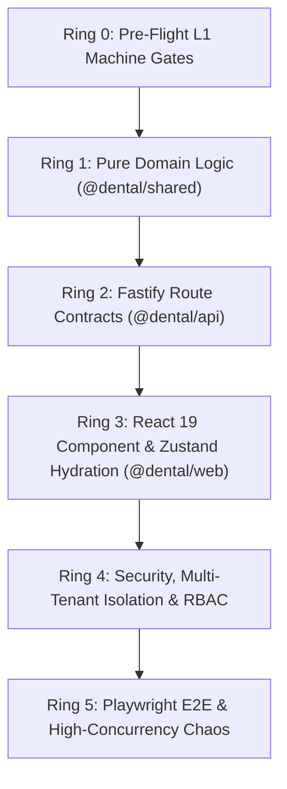

# 💻 CLI Commands, Smoke Tests & Test Suite Architecture

> ⚠️ **ВЫСШАЯ КОНСТИТУЦИЯ (THE SUPREME LAW):** [`.agents/THE_HAMMER_MASTER_PROMPT.md`](file:///C:/Clinic_MVP/dental-crm/.agents/THE_HAMMER_MASTER_PROMPT.md) и [`.agents/AGENTS.md`](file:///C:/Clinic_MVP/dental-crm/.agents/AGENTS.md).
>
> 🎯 **СТРАТЕГИЧЕСКИЙ ПРИОРИТЕТ №1 И ГЛАВНЫЙ АКЦЕНТ СИСТЕМЫ:**
> **Соло-врач (1–2 кресла, субаренда, ИП/самозанятый) и небольшая клиника (1–3 кресла)**.
> До сетевых холдингов нам ещё расти и расти! Все команды сборки, линтеры и смоук-тесты проверяют стабильность монолита и отсутствие трения.
>
> 🛑 **СТОП-ЛИНИЯ DEFINITION OF DONE (МАНДАТ 8j) & ZERO DEAD-ENDS (МАНДАТ 8n):**
> Код завершен только при: Exit 0 компиляторов, 0 ошибок кодировки (`check:encoding`), 0 нетипизированных моков, пофайловый `git add <file>`, Dual-Push (`origin` + `gitlab`).
>
> 🧭 **Навигация:** [🗺️ Главный Индекс (.agents/INDEX.md)](file:///C:/Clinic_MVP/dental-crm/.agents/INDEX.md) | [📚 Мастер-Архитектура Тестирования (docs/testing/MASTER_TESTING_ARCHITECTURE.md)](file:///C:/Clinic_MVP/dental-crm/docs/testing/MASTER_TESTING_ARCHITECTURE.md) | **[Системный Закон (AGENTS.md)](file:///C:/Clinic_MVP/dental-crm/.agents/AGENTS.md)**

---

## 🚨 КРИТИЧЕСКИЕ ИНВАРИАНТЫ ДЛЯ СУБАГЕНТОВ (SWARM RED TEAM GATES)

1. **Запрет на глобальный `typecheck` для воркеров (Мандат 8t / 8wx):**
   - Субагентам роя **КАТЕГОРИЧЕСКИ ЗАПРЕЩЕНО** параллельно запускать глобальный `npm run typecheck`, `tsc -b --noEmit` или полную сборку `npm run build`.
   - Глобальный компилятор поднимает тяжелые процессы `node.exe` на всех ядрах процессора, сжигает RAM хоста и подвешивает систему пользователя (Compiler Thrashing).
   - Субагенты обязаны проверять код строго точечными тестами (`node --test ...` или локальными юнит-тестами). Полный `npm run typecheck` запускает единолично L1 Оркестратор.
2. **Лимит памяти и таймауты (Anti-Pagefile Ballooning Ceiling):**
   - Все тестовые команды запускаются со строгим флагом памяти: `--max-old-space-size=2048` (для веб — до 3072 МБ).
   - Таймаут на выполнение любого юнит-теста строго $\le 10$ секунд (`--test-timeout=10000`).
3. **Изоляция боевых ключей и окружения (Мандат 8af):**
   - Тесты никогда не используют реальные API-ключи из `.env`. Все внешние интеграции перехвачены мок-хэндлерами.
   - При запуске тестов API обязателен импорт модуля зачистки: `--import ./apps/api/src/tests/support/poolTeardown.ts`.
4. **Гарантированное закрытие Fastify и пула PostgreSQL (Anti-Hang Law):**
   - Каждый тестовый сьют обязан содержать блок `after(async () => { await app.close(); })`.
   - На уровне раннера `poolTeardown.ts` автоматически вызывает `closeAllTenantTestApps()` и закрывает соединение `endPool()`.

---

## 🛠️ Сборка и управление монорепозиторием

Команды запускаются из корневого каталога монорепозитория:

*   `npm run dev` — Запуск Fastify API (`127.0.0.1:4100`) и Vite Web (`127.0.0.1:5173`) серверов параллельно.
*   `npm run build` — Последовательная компиляция рабочих пространств: `shared` ➔ `api` ➔ `web`.
*   `npm run typecheck` — **(Только L1 Оркестратор!)** Проверка TypeScript компилятора по 5 этапам: `shared` ➔ `shared:tests` ➔ `api` ➔ `api:tests` ➔ `web`.
*   `npx @biomejs/biome check --write .` — Форматирование и базовый линтинг кодовой базы.
*   `npm run check:encoding` — Проверка строгого UTF-8 без BOM по 23 960+ файлам (включая `.md`).
*   `npm run check:react-hooks` — Проверка правил хуков React 19 (ноль условных хуков).
*   `npm run check:stub-overrides` — Проверка целостности контрактов хука `useAppLogic`.
*   `npm run check:dynamic-imports` — Проверка валидности всех путей динамических импортов.
*   `npm run check:sandboxes` — Проверка отсутствия изолированных `*_preview.html` файлов.
*   `npm run check:limits` — Контроль размера модулей по Мандату 8b (200–300 строк, макс 500).

---

## 🗄️ Команды базы данных PostgreSQL 18 (`127.0.0.1:5432`)

*   `npm run db:generate` — Генерация миграций Drizzle.
*   `npm run db:migrate` — Накатывание миграций на **нативный PostgreSQL 18 по TCP `127.0.0.1:5432`** через раннер `apps/api/src/scripts/migrate.ts`.
*   `npm run db:migrate:check` — Холостой прогон миграций (Dry Run). Показывает, что применится, не изменяя базу данных.
*   `npm run db:reset-seed` — Безопасный сброс и перезаполнение сидами одного тенанта (защищен флагом `DENTAL_ALLOW_DESTRUCTIVE_DB_RESET="YES"`).

---

## 🧪 Пирамида тестирования из 6 колец (Ring 0..Ring 5)

> 🔬 **КАНОНИЧЕСКИЙ РЕЕСТР ТЕСТИРОВАНИЯ (SSOT):**  
> Полная документация архитектуры тестирования зафиксирована в [`docs/testing/MASTER_TESTING_ARCHITECTURE.md`](file:///C:/Clinic_MVP/dental-crm/docs/testing/MASTER_TESTING_ARCHITECTURE.md).



---

## 🎯 БОЕВЫЕ ТОЧЕЧНЫЕ КОМАНДЫ ТЕСТИРОВАНИЯ ДЛЯ СУБАГЕНТОВ

### Ring 0: Машинные статические гейты (время прогона $\le 3$ с)
```bash
# 1. Проверка кодировки UTF-8 (ноль BOM):
npm run check:encoding

# 2. Проверка хуков React 19:
npm run check:react-hooks

# 3. Проверка стабов useAppLogic:
npm run check:stub-overrides

# 4. Проверка динамических импортов:
npm run check:dynamic-imports

# 5. Проверка дизайн-токенов:
npm run check:css-tokens

# 6. Проверка базовой инфраструктуры тестов:
npm run test:infra
```

### Ring 1: Чистая доменная математика и фаззинг (`packages/shared`)
```bash
# 1. Фаззинг формулы FDI, геометрии Wheeler 2.5D и копеек (300 мс):
node --max-old-space-size=2048 --test-timeout=10000 --import tsx --test packages/shared/src/__tests__/fuzzingToothAndBillingMath.test.ts

# 2. Фильтрация тестов по паттерну имени (например, Гамильтон-Хэр):
node --max-old-space-size=2048 --test-timeout=10000 --import tsx --test packages/shared/src/__tests__/fuzzingToothAndBillingMath.test.ts --test-name-pattern="splitKopecks"

# 3. Анестезия, утилизация карпул СанПиН 3.3686-21 и Soft Negative Stock:
node --max-old-space-size=2048 --test-timeout=10000 --import tsx --test packages/shared/src/tests/anesthesiaPkuDisposal.test.ts

# 4. Стоматологический пост-процессор распознавания речи:
node --max-old-space-size=2048 --test-timeout=10000 --import tsx --test packages/shared/src/ai/dentalSpeechPostProcessor.test.ts
```

### Ring 2: Fastify API роуты, схемы Zod и обработка ошибок (`apps/api`)
```bash
# 1. Префлайт-валидация UUID (защита от CWE-209 и SQL 22P02, 37 тестов):
node --max-old-space-size=2048 --test-timeout=10000 --import tsx --import ./apps/api/src/tests/support/poolTeardown.ts --test apps/api/src/tests/routes/apiContractsAndErrorHardening.test.ts

# 2. Шторм идемпотентности (UUIDv7 Idempotency-Key) и сетевой хаос:
node --max-old-space-size=2048 --test-timeout=10000 --import tsx --import ./apps/api/src/tests/support/poolTeardown.ts --test apps/api/src/tests/chaos/idempotencyAndOfflineStorm.test.ts

# 3. Жизненный цикл ЭМК, дневников приёма SOAP и ПЭП подписи:
node --max-old-space-size=2048 --test-timeout=10000 --import tsx --import ./apps/api/src/tests/support/poolTeardown.ts --test apps/api/src/tests/clinical/clinicalEmrLifecycle.test.ts

# 4. Касса 54-ФЗ без ИНН физлиц, сплит и Soft Negative Stock склада:
node --max-old-space-size=2048 --test-timeout=10000 --import tsx --import ./apps/api/src/tests/support/poolTeardown.ts --test apps/api/src/tests/routes/cashboxFiscalAndWarehouseDeduction.test.ts

# 5. Омниканальная телефония, мессенджеры и транзакционный Outbox:
node --max-old-space-size=2048 --test-timeout=10000 --import tsx --import ./apps/api/src/tests/support/poolTeardown.ts --test apps/api/src/tests/routes/omnichannelTelephonyAndOutbox.test.ts

# 6. Радиология (DICOM PACS <50мс) и наряды ЗТЛ по шкале VITA:
node --max-old-space-size=2048 --test-timeout=10000 --import tsx --import ./apps/api/src/tests/support/poolTeardown.ts --test apps/api/src/tests/routes/radiologyAndLabOrdersLifecycle.test.ts

# 7. Планы лечения, 3 тарифа (Эконом/Оптимум/Премиум) и вычет 13% НДФЛ:
node --max-old-space-size=2048 --test-timeout=10000 --import tsx --import ./apps/api/src/tests/support/poolTeardown.ts --test apps/api/src/tests/routes/treatmentPlanStudioAndPep.test.ts
```

### Ring 3: React 19 компоненты, Zustand сторы и гидратация (`apps/web`)
```bash
# 1. Поведенческие тесты стора, изоляция сессий 152-ФЗ и анти-амнезия:
node --max-old-space-size=2048 --test-timeout=10000 --import tsx --import ./apps/web/testCssStub.mjs --test apps/web/src/store/__tests__/appStoreBehavioral.test.ts

# 2. Реактивная гидратация состояния 0-F5 (Мандат 8zq):
node --max-old-space-size=2048 --test-timeout=10000 --import tsx --import ./apps/web/testCssStub.mjs --test apps/web/src/components/__tests__/clinicalWorkflowStateHydration.test.tsx

# 3. Одонтограмма Wheeler 2.5D, мультиселект и контекстные меню:
node --max-old-space-size=2048 --test-timeout=10000 --import tsx --import ./apps/web/testCssStub.mjs --test apps/web/src/components/odontogram/__tests__/odontogramRealBehavioralSuite.test.tsx

# 4. Визит врача, автосохранение черновиков SOAP и разблокированный Primary CTA:
node --max-old-space-size=2048 --test-timeout=10000 --import tsx --import ./apps/web/testCssStub.mjs --test apps/web/src/components/visit/__tests__/visitRealBehavioralSuite.test.tsx

# 5. Сплит-касса 54-ФЗ и комбинированные платежи:
node --max-old-space-size=2048 --test-timeout=10000 --import tsx --import ./apps/web/testCssStub.mjs --test apps/web/src/components/cashbox/__tests__/cashboxSsotScreens.test.tsx
```

### Ring 4: Безопасность, 152-ФЗ, межклиническая изоляция и RBAC
```bash
# 1. Межклиническая изоляция организаций (организация ➔ 404, неклинические роли ➔ 403):
node --max-old-space-size=2048 --test-timeout=10000 --import tsx --import ./apps/api/src/tests/support/poolTeardown.ts --test apps/api/src/tests/security/deepRoutesPrivacyAudit.test.ts

# 2. Защита персональных данных 152-ФЗ (маскирование телефонов, паспортов РФ, СНИЛС):
node --max-old-space-size=2048 --test-timeout=10000 --import tsx --import ./apps/api/src/tests/support/poolTeardown.ts --test apps/api/src/tests/security/payloadStripping152Fz.test.ts

# 3. Человечные отказы в доступе по Мандату 8zg (ноль латиницы и дев-жаргона):
node --max-old-space-size=2048 --test-timeout=10000 --import tsx --import ./apps/api/src/tests/support/poolTeardown.ts --test apps/api/src/tests/security/roleRefusalText.test.ts
```

### Ring 5: Playwright E2E и ACID-стресс PostgreSQL 18
```bash
# 1. Сквозной 6-фазный мастер-цикл приёма врача у кресла (Playwright E2E):
npx playwright test apps/web/tests/e2e/master-clinical-lifecycle.spec.ts

# 2. Кросс-модульные сценарии кассы 54-ФЗ и склада:
npx playwright test apps/web/tests/e2e/cashbox-billing-flow.spec.ts
npx playwright test apps/web/tests/e2e/warehouse-consumption-flow.spec.ts
npx playwright test apps/web/tests/e2e/odontogram-multiselect-flow.spec.ts

# 3. Стресс-тест параллельных транзакций ACID и дедлоков PostgreSQL 18:
node --max-old-space-size=2048 --test-timeout=10000 --import tsx --import ./apps/api/src/tests/support/poolTeardown.ts --test apps/api/src/tests/concurrency/acidTransactionStress.test.ts
```

---

## 🛑 ДОРОЖНАЯ КАРТА ДОМЕННЫХ РЕЕСТРОВ ТЕСТИРОВАНИЯ (`docs/testing/`)

| Доменный стандарт | Путь к реестру | Ключевой охват |
| :--- | :--- | :--- |
| **Мастер-Архитектура (SSOT)** | [`docs/testing/MASTER_TESTING_ARCHITECTURE.md`](file:///C:/Clinic_MVP/dental-crm/docs/testing/MASTER_TESTING_ARCHITECTURE.md) | Полный свод пирамиды тестирования, команд и контрактов |
| **Сквозной E2E Master Flow** | [`docs/testing/E2E_CLINICAL_TESTING_STANDARD.md`](file:///C:/Clinic_MVP/dental-crm/docs/testing/E2E_CLINICAL_TESTING_STANDARD.md) | 6-фазный путь пациента от брони до чека и склада |
| **Сетевой хаос и идемпотентность** | [`docs/testing/CHAOS_AND_IDEMPOTENCY_TEST_REGISTRY.md`](file:///C:/Clinic_MVP/dental-crm/docs/testing/CHAOS_AND_IDEMPOTENCY_TEST_REGISTRY.md) | UUIDv7 `Idempotency-Key`, Double-Spend защита |
| **Контракты роутов Fastify** | [`docs/testing/API_ROUTES_INQUISITION_REGISTRY.md`](file:///C:/Clinic_MVP/dental-crm/docs/testing/API_ROUTES_INQUISITION_REGISTRY.md) | Защита от CWE-209 и SQL 22P02 во всех 11 доменах |
| **ACID-транзакции и дедлоки** | [`docs/testing/ACID_CONCURRENCY_TEST_REGISTRY.md`](file:///C:/Clinic_MVP/dental-crm/docs/testing/ACID_CONCURRENCY_TEST_REGISTRY.md) | 20 потоков на слот, `SELECT ... FOR UPDATE` |
| **Фаззинг формулы FDI и копеек** | [`docs/testing/CLINICAL_MATH_FUZZING_REGISTRY.md`](file:///C:/Clinic_MVP/dental-crm/docs/testing/CLINICAL_MATH_FUZZING_REGISTRY.md) | 10k мутаций FDI, Гамильтон-Хэр, Wheeler 2.5D |
| **Жизненный цикл ЭМК и дневников** | [`docs/testing/CLINICAL_EMR_TEST_REGISTRY.md`](file:///C:/Clinic_MVP/dental-crm/docs/testing/CLINICAL_EMR_TEST_REGISTRY.md) | SOAP протоколы, автосейв черновиков, ПЭП SHA-256 |
| **React 19 & Zustand сторы** | [`docs/testing/WEB_COMPONENTS_TEST_REGISTRY.md`](file:///C:/Clinic_MVP/dental-crm/docs/testing/WEB_COMPONENTS_TEST_REGISTRY.md) | Реактивная гидратация 0-F5, изоляция сессий 152-ФЗ |
| **Касса 54-ФЗ и склад** | [`docs/testing/CASHBOX_AND_WAREHOUSE_TEST_REGISTRY.md`](file:///C:/Clinic_MVP/dental-crm/docs/testing/CASHBOX_AND_WAREHOUSE_TEST_REGISTRY.md) | Сплит-оплата в копейках, Soft Negative Stock |
| **Радиология, DICOM и ЗТЛ наряды** | [`docs/testing/RADIOLOGY_LAB_ORDERS_TEST_REGISTRY.md`](file:///C:/Clinic_MVP/dental-crm/docs/testing/RADIOLOGY_LAB_ORDERS_TEST_REGISTRY.md) | Визиограф <50мс, шкала Миша HU, шкала VITA |
| **Телефония, мессенджеры и Outbox** | [`docs/testing/OMNICHANNEL_AND_TELEPHONY_TEST_REGISTRY.md`](file:///C:/Clinic_MVP/dental-crm/docs/testing/OMNICHANNEL_AND_TELEPHONY_TEST_REGISTRY.md) | Транзакционный Outbox, тихий режим врача, DLQ |
| **Безопасность, 152-ФЗ и RBAC** | [`docs/testing/SECURITY_AND_RBAC_TEST_REGISTRY.md`](file:///C:/Clinic_MVP/dental-crm/docs/testing/SECURITY_AND_RBAC_TEST_REGISTRY.md) | Изоляция организаций, маскирование ПДн |
| **ИИ-Копайлот и харнесс** | [`docs/testing/AI_COPILOT_TEST_REGISTRY.md`](file:///C:/Clinic_MVP/dental-crm/docs/testing/AI_COPILOT_TEST_REGISTRY.md) | 3 уровня доверия, ротация ключей, откат мутаций |
| **Реестр очищения тестов** | [`docs/testing/TEST_SUITES_INQUISITION_REGISTRY.md`](file:///C:/Clinic_MVP/dental-crm/docs/testing/TEST_SUITES_INQUISITION_REGISTRY.md) | Искоренение моков и рантайм-валидация |
