# ПЛАН И РУКОВОДСТВО ПО ВНЕДРЕНИЮ 3D-СКАНЕРОВ RUNYES И ВИЗИОГРАФОВ XVSENSOR В DENTE CRM

> **ДОКУМЕНТ:** Пошаговая инженерная дорожная карта и руководство по интеграции аппаратных данных интраорального сканирования и радиовизиографии в кодовую базу монорепозитория DENTE CRM (`packages/shared`, `apps/api`, `apps/web`).  
> **ОСНОВАНО НА РЕАЛЬНЫХ ДАННЫХ:** Извлеченные базы данных `workspace2.0.db` и `xvsensor_XPECT.Mammo.db`, CLI-утилиты `AssbinTool.exe` и `MeshSimplify.exe`, доменные модели `dental_domain_models.cs`.

---

## 1. АРХИТЕКТУРА СКВОЗНОГО КОНВЕЙЕРА (DATA FLOW)

```mermaid
flowchart LR
    A["Рабочее место врача<br>(ПК со сканером Runyes)"] -->|1. Завершение сканирования| B["Фоновый демон клиники<br>(dental-sync-daemon)"]
    B -->|2. HTTP POST multipart/zip| C["Fastify API CRM<br>(/api/clinical/scans/ingest)"]
    C -->|3. Распаковка JSON метаданных| D["PostgreSQL / Drizzle<br>(intraoral_scan_sessions)"]
    C -->|4. AssbinTool.exe: .ro -> .ply| E["Конвертер формата"]
    E -->|5. MeshSimplify.exe: 500k -> 50k| F["Генератор WebGL превью"]
    F -->|6. Сохранение в MinIO / S3| G["Облачное хранилище клиники"]
    G -->|7. Асинхронный стриминг| H["React 19 / Three.js<br>(DentalJawViewer.tsx)"]
    D -->|8. FDI зубная карта| I["Интерактивная Одонтограмма<br>и Ортопедия (ЗТЛ наряд)"]
```



---

## 2. ЭТАПЫ РЕАЛИЗАЦИИ

### ЭТАП 1: ОБЩИЕ СХЕМЫ И ТИПЫ (`packages/shared`)

1. **Создание доменных контрактов сканирования:**
   - Путь: `packages/shared/src/hardware/intraoralScannerTypes.ts`
   - Описание интерфейсов: `IntraoralScanSession`, `IntraoralToothPlan`, `ToothPreparationType`, `ProstheticMaterialType`, `ImplantRetentionCode`.
   - Zod-схемы валидации входящих пакетов: `scanIngestPayloadSchema`.

2. **Маппинг номенклатуры протезирования (FDI 11–48):**
   - Перенос энумов из `dental_enums.json`:
     - Подготовка: `CROWN_ANATOMIC`, `VENEER`, `INLAY`, `ONLAY`, `IMPLANT`, `PONTIC`.
     - Материалы: `ZIRCONIA`, `E_MAX`, `TITANIUM`, `PMMA`, `COMPOSITE`.
     - Оттенки: Vita Classical (`A1`..`D4`, `BL1`..`BL4`).
     - Фиксация имплантов: `SCREW_RETAINED` (винтовая), `CEMENT_RETAINED` (цементная).

---

### ЭТАП 2: БЭКЕНД И ФОНОВАЯ ОБРАБОТКА МЕШЕЙ (`apps/api`)

1. **Размещение скомпилированных CLI-утилит:**
   - Создать папку сервиса: `apps/api/bin/mesh-tools/`
   - Поместить туда извлеченные:
     - `AssbinTool.exe` (конвертер закрытого формата `.ro`)
     - `MeshSimplify.exe` (децимация сеток)
   - Создать кроссплатформенный TypeScript-модуль `apps/api/src/services/meshProcessingService.ts`:
     - Метод `convertRoToPly(inputPath: string): Promise<string>`
     - Метод `decimateMesh(inputPly: string, targetFaces: number = 50000): Promise<string>`

2. **Fastify Роут приёма сканирований:**
   - Путь: `apps/api/src/routes/clinicalScans.ts`
   - Эндпоинт: `POST /api/clinical/scans/ingest`
   - Логика обработчика:
     1. Принимает multipart ZIP-файл или папку кейса.
     2. Извлекает `profile.json` и `3ds_output.json`.
     3. Находит файлы верхней и нижней челюсти (`implant_upper.ply`, `implant_lower.ply`) и прикуса (`implant_buccal_1.stl`).
     4. Если файлы в формате `.ro` $\to$ запускает `AssbinTool.exe`.
     5. Запускает `MeshSimplify.exe`: создает легковесные копии `preview_upper.ply` (2–3 МБ) и `preview_lower.ply`.
     6. Сохраняет оригиналы и превью в локальное хранилище/S3 (`apps/api/src/services/storageService.ts`).
     7. Делает транзакционную запись в БД:
        - Создаёт сессию сканирования `intraoral_scan_sessions`.
        - Проставляет в зубную карту пациента активные зубы с кодами подготовки и материалами `intraoral_tooth_plans`.
        - Привязывает готовый наряд лаборатории `Сесссс_order.pdf`.

3. **База данных (Drizzle миграция):**
   - Добавить миграцию Drizzle: `apps/api/drizzle/XXXX_intraoral_scans_and_rvg.sql` с таблицами:
     - `intraoral_scan_sessions`
     - `intraoral_tooth_plans`
     - `radiology_dicom_studies`

---

### ЭТАП 3: ФРОНТЕНД — 3D ВЬЮЕР И ИНТЕГРАЦИЯ В ОРТОПЕДИЮ (`apps/web`)

1. **Компонент 3D-просмотрщика челюстей на Three.js:**
   - Путь: `apps/web/src/components/imaging/DentalJaw3DViewer.tsx`
   - Технологии: `@react-three/fiber` или чистый Three.js + `OrbitControls` + `PLYLoader`.
   - Ключевые требования:
     - **Вершинные цвета (Vertex Colors):** `vertexColors: true` в материале `MeshStandardMaterial` для фотореалистичного цвета десны и эмали.
     - **Режим окклюзии (Bite Alignment):** Одновременный показ верхней и нижней челюсти в положении смыкания с выравниванием по матрице прикуса `implant_buccal_1.stl`.
     - **Послойные тумблеры:** Скрыть/Показать верхнюю челюсть, нижнюю челюсть, скан-боди маркеры имплантов.
     - **0px задержки:** Сначала мгновенный рендер 2D-превью `screen_shot_front.png`, пока в фоне асинхронно гидратируется 3D-сцена.

2. **Интеграция в модуль ортопедии (`apps/web/src/components/orthopedics`):**
   - Встроить кнопку «3D Скан челюсти» в `OrthopedicsChairsidePanel.tsx`.
   - Автоматическая синхронизация с `OrthopedicsVitaShadePicker.tsx`: при выборе цвета в сканере оттенок Vita подставляется в наряд зубного техника.
   - Вывод PDF-наряда зуботехнической лаборатории в `OrthopedicPassportA4Modal.tsx`.

3. **Интеграция калибровок визиографа в `rvgViewerEngine.ts`:**
   - Применить аппаратные параметры из `xvsensor_XPECT.Mammo.db`:
     - Динамический диапазон серого: `Window Width = 10`
     - Яркость/уровень: `Window Level = 5`
     - Фильтр резкости костной ткани корней (Unsharp Masking для выявления скрытых апикальных очагов).

---

### ЭТАП 4: КЛИНИЧЕСКИЙ ЭДЖ-ДЕМОН (ZERO-CLICK WORKFLOW)

1. **Создание фонового агента для ПК врача:**
   - Исходник: `C:\Users\Admin\Desktop\_runyes_extract\Dental_Clinic_Extract\crm_ready_modules\crm_ingest_watcher.py`
   - Упаковка в автономный исполняемый файл:
     ```powershell
     pyinstaller --onefile --noconsole --name "dental-sync-daemon" crm_ingest_watcher.py
     ```
2. **Установка на кресельный моноблок сканера:**
   - Мониторит папку: `C:\Users\Dentalia\Desktop\Сканы пациентов\`
   - Автоматический запуск при старте Windows через автозагрузку или службу `sc.exe`.
   - При завершении сканирования файл отправляется в CRM без единого клика со стороны врача.

---

## 3. ЧТО ДЕЛАТЬ ПРЯМО СЕЙЧАС (NEXT IMMEDIATE ACTIONS)

1. **Шаг 1:** Добавить схемы типов `packages/shared/src/hardware/intraoralScannerTypes.ts`.
2. **Шаг 2:** Создать сервис обработки 3D-файлов `apps/api/src/services/meshProcessingService.ts` с вызовом `MeshSimplify.exe`.
3. **Шаг 3:** Реализовать Fastify роут `apps/api/src/routes/clinicalScans.ts`.
4. **Шаг 4:** Создать компонент `DentalJaw3DViewer.tsx` в `apps/web/src/components/imaging/`.
5. **Шаг 5:** Прогнать сквозной тест на реальном клиническом сэмпле `sample_3d_patient\11111111`.
