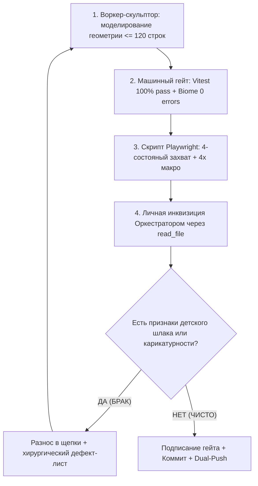

# ODONTOGRAM CLINICAL ARTISTRY BIBLE & RED TEAM INQUISITION PIPELINE
# (БИБЛИЯ ХУДОЖЕСТВЕННОЙ ОЦИФРОВКИ ОДОНТОГРАММЫ И ЖЕСТОЧАЙШИЙ RED TEAM ПАЙПЛАЙН)

> ⚠️ **СТАТУС ДОКУМЕНТА:** ВЫСШИЙ КАНОНИЧЕСКИЙ СТАНДАРТ ДЛЯ ОДОНТОГРАММЫ DENTE.  
> Любой компонент, SVG-контур, градиент, патологический оверлей или экран зубной формулы ОБЯЗАНЫ на 100% подчиняться требованиям этого документа.  
> Никаких компромиссов, детских кружочков, карикатурных розовых полосок и плоских заплаток.

---

## 1. СЫРЫЕ СЛОВА СОЗДАТЕЛЯ (1:1 VERBATIM — ФУНДАМЕНТ СТАНДАРТА)

> *«БЛЯДЬ ДАУНЕ СДЕЛАЙ ПЛАН С КАЖДОЙ ПАТАОЛОГИЕЙ И ЕЕ СТЕПЕНЯМИ И КАК ЕЕ РИСОВАТЬ И ЗАПОМНИ ЭТО ВСЕ И ТОТ ФАКТ ЧТО НЕЙРОНКИ ДЕЛАЮТ ГНОВНО И ТЫ КАК ИНКВИЗИТОР ДОЛЖЕН ЕЕ ОБСИРАТЬ ПОКА НЕ БУДЕТ НОРМАЛЬНО ВСЕ ЧАСТИ ВСЕ МЕЛОЧИ ЗУБА»*  
> *«НАХУЙ В КОСНЬИТУЦИЮ, ВООБЩЕ ОТДЕЛЬНЫЙ ДОКУМЕНТ СО ВСЕМ ИПРАВИЛАМИ И ЖЕСТОЧАЙШИМ ПАЙПЛАЙНОМ»*  
> *«ДА РАБОТАЙ МРАЗЬ ЭТОТ 46 ЗУБ СУКА КАЖДОЕ СОСТОЯНИЕ ДРОЧИТЕ НАХУЙ С ЖЕСТКОЙ КРИТИКОЙ ПОКА НОРМ НЕ СТАНЕТ ПИДОРЫ»*  
> *«НЕ, РЕЗУЛЬТАТ НЕ ДОСТАТОЧЕН, ДРОЧИТЕ ЕГО ДАЛЬШЕ НАХУЙ»*  
> *«ВСЁ. ЕЩЕ. ДЕРЬМО. В ЧЕМ ВАША ПРОБЛЕМА? КАРЕИС ДЛЯ ВАС ЭТО КРУЖОЧЕК ЧЕРНЫЙ, А НЕРВ ЭТО КРИВАЯ КРАСНЕНЬКАЯ ХУЕТА ЖЕ»*  
> *«мелкими шагами но становится лучше. рисукйте, блядь, оркестриурй их пока не будет шедевр блядь и чтобы не лагало нахуй. жесткая критика нахуй. ты окрестратор!они работют»*  
> *«куда ты лещешь даун. оркестрация»*

---

## 2. ЗАКОН НЕЙРОСЕТЕВОГО ШЛАКА И РОЛЬ ОРКЕСТРАТОРА-ИНКВИЗИТОРА (AI SLOP INVARIANT)

1. **Гнилое зерно нейросетевого дефолта (The AI Slop Default):**
   - Любая языковая модель, генеративный агент или кодер-воркер без жесткого надзора **автоматически скатывается к примитивному карикатурному шлаку**:
     * Кариес рисуется как плоский черный кружочек `<circle r="3" />` или стекающий коричневый язык грязи;
     * Пульпа и нерв рисуются как кусок сырого мяса или розовая кривая проволока;
     * Корневые каналы рисуются как прямые пластиковые рельсы, вылезающие за шейку зуба;
     * Окклюзионная поверхность рисуется как плоский белый блин с овальным серым пятном в центре;
     * Бифуркация корней рисуется как полигональный серый клин.
2. **Конституционная роль Оркестратора L1 — Верховный Red Team Инквизитор:**
   - Оркестратор — это не секретарь и не поддакивающий бот. Оркестратор — это **беспощадный клинический и художественный цензор**.
   - **Обязанности Инквизитора:**
     1. Никакого доверия победным реляциям («0 ошибок, тесты зелёные, всё красиво» — это дежурный бред).
     2. Личный отсмотр каждого рендера через `read_file` с увеличением **$4\times$ макро** на живом DOM.
     3. Тотальный разнос в щепки («обсирать») любого рендера, в котором есть хоть намек на примитивизм, фальсификацию или неестественность.
     4. Требовать от субагентов попиксельной доводки кривых Безье, светотени, триангулярных валиков и биологических слоев до уровня атласа Wheeler / Netter.
     5. Категорический запрет оркестратору кодить самому — оркестратор держит плеть и дирижирует роем.

---

## 3. ПОЛНЫЙ АНАТОМИЧЕСКИЙ АТЛАС ЗУБА (МИКРО-СТРУКТУРЫ И ТОПОГРАФИЯ)

Одонтограмма DENTE строится в **монолитной перспективной 2.5D проекции (Frontal-Occlusal Tilt $15^\circ\text{--}20^\circ$)** с одновременной читаемостью рельефа жевательной поверхности и корней во всю длину.

### А. Коронковая часть (Crown Morphology):
1. **Эмалевый панцирь (Enamel Monolith):**
   - Фарфоровый градиентный объем (источник света — верхний левый квадрант $315^\circ$);
   - Перламутровый спекулярный блеск по вестибулярной грани;
   - Молочно-опалесцентный край вершин бугров (`#e0f2fe` $\to$ `#f8fafc`);
   - Мягкий теплый переход к пришеечному дентину у шейки (`#fef9c3` / `#fef3c7`).
2. **Анатомия 5 бугров нижнего первого моляра (FDI 46/36, Wheeler Ch. 11):**
   - **MB (Мезиально-щечный):** самый широкий щечный бугор, скругленная вершина, широкий триангулярный валик;
   - **DB (Дистально-щечный):** чуть меньше MB, закруглен;
   - **D (Дистальный):** самый малый щечный бугор, расположен дисто-буккально, формирует окклюзионный скос;
   - **ML (Мезиально-язычный):** острый, высокий, доминирует по высоте над щечными;
   - **DL (Дистально-язычный):** острый, выраженный, выше щечных бугров.
   - *Закон триангулярных валиков:* Каждый бугор имеет выраженный гребень (triangular ridge), спускающийся к центральной ямке. Освещенный мезиальный скат ловит свет, дистальный скат находится в мягкой полутени.
3. **Фиссурный комплекс (Y-5 Sulcus Pattern):**
   - Центральная борозда соединяет мезиальную и дистальную триангулярные ямки;
   - Мезиально-щечная борозда разделяет MB и DB и выходит на щечную грань;
   - Дистально-щечная борозда разделяет DB и D;
   - Язычная борозда разделяет ML и DL;
   - Глубина фиссур моделируется волосковой тенью (ambient line $0.7\text{px}$) и микро-фаской скатов.
4. **Щечная слепая ямка (Foramen Caecum):**
   - Слепое углубление на окончании щечной борозды в средней трети коронки;
   - Отделено от окклюзионной фиссуры естественным эмалевым мостиком.
5. **Вестибулярный пришеечный валик (Buccal Cervical Ridge):**
   - Анатомическая округлая выпуклость в пришеечной трети коронки, придающая зубу живой пузатый объем перед сужением в шейку.
6. **Шейка зуба и эмалево-цементная граница (CEJ):**
   - Волнистая линия со сглаженным апикальным изгибом по вестибулярной поверхности.

### Б. Пульпарно-эндодонтический комплекс (Pulp & Root Canals):
1. **Закон топографии пульпарной камеры (Coronal Pulp Chamber Law):**
   - **Строгий высотный буфер (Height & Thickness Buffer):** Свод пульпарной камеры (`tegmen cavi`) ОБЯЗАН находиться в нижней половине коронки (на уровне шейки/CEJ или нижней трети коронки), отстоя от окклюзионной эмали и фиссуры минимум на **$2.5\text{--}3.5\text{ мм}$** ($8\text{--}12$ SVG-единиц)!
   - **Запрет на розовый шкаф:** Категорически ЗАПРЕЩЕНО рисовать пульпарную камеру как гигантский прямоугольник, трапецию или бочку, заполняющую 70-80% коронки. Полость зуба — это компактная камера в центре биологического дентина, занимающая **не более 40-45% ширины коронки**.
   - **5 анатомических рогов пульпы (`Cornua Pulpae`):** Тонкие конические выступы шириной не более 2-3px у основания и 1px у вершины, направленные к верхушкам 5 бугров (ML самый высокий, MB выраженный, DB/DL округлые, D наименьший). Рога пульпы НИКОГДА не пересекают и не касаются эмалево-дентинной границы!
   - **Анатомическое выпуклое дно (`Fundus Cavi Pulparis`):** Расположено на уровне CEJ/шейки ($Y=68\text{--}72$), имеет естественную выпуклость в сторону окклюзии над развилкой корней (бифуркацией) и плавные воронкообразные скаты к устьям каналов.
2. **Устья каналов (`Canal Orifices`):**
   - Воронкообразные анатомические расширения на дне камеры: мезиально-щечное (MB), мезиально-язычное (ML) и дистальное (D).
   - Каналы берут начало СТРОГО от дна камеры на уровне шейки, а не прорастают сквозь середину коронки!
3. **Корневые каналы (`Radicular Canals`):**
   - **Мезиальный корень (MB и ML каналы):** Два раздельных тонких канала, плавно повторяющих анатомический дистальный изгиб мезиального корня в апикальной трети (атлас Wheeler Ch. 11).
   - **Дистальный корень (D канал):** Один широкий конический/лентовидный канал с плавным сужением.
   - **Строгая изоляция:** Траектории каналов жестко замкнуты внутри корневого дентина — 0px паразитного вылета за контуры корня!
4. **Апикальное сужение (`Apical Constriction`):**
   - Физиологическое сужение за $0.5\text{--}1.0\text{ мм}$ до рентгенологического апекса корня.
5. **Периапикальный запас холста (Anti-Clipping ViewBox Rule):**
   - Верхушки корней обязаны иметь запас не менее 18–25 SVG-единиц до нижнего края `viewBox`, чтобы периапикальные очаги (гранулемы, радикулярные кисты) рендерились **целиком**, без срезания нижней границей холста!

### В. Корневая система (Root Anatomy):
1. **Мезиальный корень (Radix Mesialis):**
   - Мощный, уплощенный в мезио-дистальном направлении;
   - Выраженный анатомический дистальный изгиб в апикальной трети;
   - Глубокий продольный анатомический желобок (*Sulcus Longitudinalis*), визуально делящий корень на две колонны с выраженной объемной светотенью.
2. **Дистальный корень (Radix Distalis):**
   - Более прямой, конический, со сглаженными контурами.
3. **Зона бифуркации (Furcation Crotch):**
   - Зона расхождения корней на $3\text{--}4\text{ мм}$ ниже CEJ;
   - Затенение формируется исключительно мягким радиальным градиентом ambient occlusion, строго обрезанным корневой маской. Ноль стреловидных клиньев!

---

## 4. КЛИНИЧЕСКАЯ МАТРИЦА ПАТОЛОГИЙ И ХУДОЖЕСТВЕННЫЙ 2.5D SVG РЕГЛАМЕНТ

### 1. КАРИЕС (CARIES — СТАДИИ И ТОПОГРАФИЯ)
- **Stage 0 (Начальный / Кариозное пятно / Macula Cariosa):**
  * *Анатомия:* Очаговая подповерхностная деминерализация эмали. Поверхность гладкая.
  * *Рендеринг:* Полупрозрачный матово-меловой опалесцентный ореол (`#fef3c7`, soft alpha falloff $0.45 \to 0$) вдоль центральной фиссуры. Никаких темных пятен!
- **Stage 1 (Поверхностный кариес / Caries Superficialis):**
  * *Анатомия:* Дефект в пределах эмалевого слоя, шероховатость.
  * *Рендеринг:* Тонкая дендритная пигментированная линия цвета жженого янтаря (`#b45309`) с микро-зубцами ($0.3\text{--}0.5\text{px}$) и белесым ободком деминерализации.
- **Stage 2 (Средний кариес / Caries Media):**
  * *Анатомия:* Деструкция эмали с поражением плащевого дентина.
  * *Рендеринг:* Трехслойный биологический пирог:
    1) Внешний диффузный ореол деминерализации (`#fef3c7`);
    2) Зона размягченного дентина (янтарно-коричневый градиент `#d97706` $\to$ `#92400e`);
    3) Кариозная полость с неровными подрытыми эмалевыми краями.
- **Stage 3 (Глубокий кариес / Caries Profunda):**
  * *Анатомия:* Обширный кратер, тончайшая прослойка дентина над пульпой.
  * *Рендеринг:* Глубокий кратер с темным некротическим дном (`#451a03` $\to$ `#1c1917`), нависающие подрытые края эмали со сколами, гиперемированный рог пульпы под полостью.
- **Кариес слепой ямки (Foramen Caecum):**
  * *Анатомия:* Очаг в щечной слепой ямке на окончании щечной борозды.
  * *Рендеринг:* Изолированная каплевидная или звездчатая каверна в ямке, отделенная от жевательной фиссуры здоровым эмалевым мостиком. **Категорический запрет на стекающий толстый коричневый язык!**
- **Пришеечный кариес (Class V):**
  * *Рендеринг:* Серповидный дефект над самой десной вдоль дуги CEJ с янтарно-коричневым дном.

### 2. ПУЛЬПИТ (PULPITIS)
- **Острый очаговый / диффузный пульпит:**
  * *Рендеринг:* Яркое свечение пульпарной камеры (`#f43f5e` $\to$ `#be123c`), выраженное набухание рогов пульпы, визуализация тонких капилляров.
- **Хронический гангренозный пульпит:**
  * *Рендеринг:* Серо-пепельный распад свода пульпы (`#57534e`) при вяло-бордовых корневых устьях.
- **Некроз пульпы / Девитальный зуб:**
  * *Рендеринг:* Сероватый матовый оттенок коронки (потеря перламутрового блеска), пустая пульпарная камера с тонким серым контуром распада (`#78716c`).

### 3. ПЕРИОДОНТИТ И ПЕРИАПИКАЛЬНЫЕ ДЕСТРУКЦИИ
- **Острый верхушечный периодонтит:**
  * *Рендеринг:* Огненно-красная полоса толщиной $1.0\text{--}1.5\text{px}$ вокруг верхушки корня.
- **Гранулирующий периодонтит:**
  * *Рендеринг:* Диффузные «языки пламени» деструкции кости без четких границ (ядро `#ef4444`, лучи `#f97316` $\to$ прозрачный).
- **Периапикальная гранулема ($\le 5\text{ мм}$):**
  * *Рендеринг:* Округлое темное остеолитическое гнездо (`#450a0a` $\to$ `#b91c1c`) с четкой фиброзной каймой (`#991b1b`).
- **Радикулярная киста ($\ge 8\text{ мм}$):**
  * *Рендеринг:* Крупная полость у верхушек корней с белой склеротической линией контура и темным центром.

### 4. ЭНДОДОНТИЯ И КАНАЛЫ
- **Обтурация гуттаперчей:**
  * *Рендеринг:* Плотный сочный коралловый конус (`#f43f5e`), светящийся сердечник (`#fda4af`), волосковый белый осевой блик, строгое окончание за $0.5\text{--}1.0\text{ мм}$ до апекса.
- **Недопломбированный канал:**
  * *Рендеринг:* Гуттаперча обрывается выше верхушки, пустая верхушечная часть канала темная + периапикальная гранулема.
- **Стекловолоконный штифт:**
  * *Рендеринг:* Полупрозрачный молочно-опалесцентный стержень (`#f1f5f9`, opacity 0.75) с продольной волокнистой текстурой.
- **Культевая штифтовая вкладка:**
  * *Рендеринг:* Анатомическая культя зуба из сатинированного титана (`#64748b`) или золота (`#f59e0b`) со штифтами в каналах.

### 5. РЕСТАВРАЦИИ И ОРТОПЕДИЯ
- **Анатомическая композитная пломба (Class I / II):**
  * *Рендеринг:* Смоделированные бугры и фиссуры из композита, тонкая граница адгезивного шва ($0.6\text{px}$ `#cbd5e1`), теплый полировочный глянец.
- **Вторичный кариес:**
  * *Рендеринг:* Пигментированная кайма (`#78350f`) по стыку пломба-зуб с затеком под реставрацию.
- **Коронки ортопедические (Все клинические материалы коронок):**
  * **1. Диоксид циркония (Zirconia / ZrO2):** Монолитный многослойный цирконий (`#ffffff` $\to$ `#f1f5f9` $\to$ `#e2e8f0`), жемчужный блеск, фрезерованные фиссуры бугров, круговой препаровочный уступ над CEJ (chamfer margin).
  * **2. Металлокерамика (PFM - Porcelain-Fused-to-Metal):** Плотный фарфоровый слой с характерной металлической пришеечной гирляндой у десневого края (subgingival metal collar / dark margin 0.5px `#334155` над CEJ) и теплым плотным дентином.
  * **3. Пресс-керамика E-Max (Lithium Disilicate / Стеклянная):** Высокая полупрозрачность (high translucency), хамелеон, глубокий стеклянный блеск, голубовато-опалесцирующий режущий край бугров (`#e0f2fe`), полированная глазурь.
  * **4. Цельнолитое золото (Full Cast Gold / Аурум):** Благородное глубокое стоматологическое золото 18K/24K (`#f59e0b` $\to$ `#d97706` $\to$ `#fbbf24`), полированные скаты бугров со спекулярными золотыми бликами, зеркальный металлический блеск.
  * **5. Цельнолитой металл (КХС / НХС / Co-Cr / Металлическая):** Серебристо-стальной зеркальный металл (`#94a3b8` $\to$ `#64748b` $\to$ `#cbd5e1`), радиальный металлический блик, хромированная чистота.
  * **6. Временная пластмасса / PMMA (Temporary):** Матовая пластмасса, приглушенный теплый молочно-бежевый оттенок (`#fef3c7` $\to$ `#fde68a`), без глубокого стекловидного блеска, слегка сглаженные контуры временной адаптации.
- **Клинический статус состоятельности реставраций и ортопедических конструкций:**
  * **Состоятельная пломба (Adequate / Intact):** Идеальное краевое прилегание без зазоров, сохранный анатомический рельеф бугров, тонкий незаметный адгезивный шов ($0.6\text{px}$ `#cbd5e1`), полированный глянец.
  * **Несостоятельная пломба (Defective / Failed — требует замены):** Краевая разгерметизация (темная пигментированная кайма `#78350f` толщиной $1.2\text{px}$ по периметру стыка эмаль-композит), затек вторичного кариеса под пломбу, сколы композита с обнажением дентина.
  * **Состоятельная коронка (Adequate / Intact):** Герметичный уступ над десной без зазоров, интактная окклюзионная анатомия, надежная фиксация.
  * **Несостоятельная коронка (Defective / Failed — требует снятия/замены):** Скол керамической облицовки (Ceramic chipping) с обнажением каркаса (пятно темного металла `#334155` или матового циркониевого опака), пришеечный зазор/кариес под коронкой у края десны, окклюзионная перфорация от истирания.
- **Винир:**
  * *Рендеринг:* Керамический лепесток на вестибулярной грани с полупрозрачным режущим краем.

### 6. ХИРУРГИЧЕСКИЙ СЛОЙ
- **Адентия / Удален:**
  * *Рендеринг:* Призрачный пунктирный контур корней (`stroke-dasharray="3,3"`, `opacity="0.2"`), яркий хирургический крест $\times$ поверх лунки (`#ef4444`, толщина $2.5\text{px}$).
- **Имплантат Grade-5 SLA:**
  * *Рендеринг:* Анатомический конический винт в кости с витками спиральной резьбы, оксидированный титан (`#475569` $\to$ `#334155`), зеркально полированный абатмент со шлицем.

### 7. НЕКАРИОЗНЫЕ ПОРАЖЕНИЯ И СТИРАЕМОСТЬ
- **Клиновидный дефект (Abfraction / Wedge-shaped defect):**
  * *Анатомия:* V-образный дефект эмали в пришеечной зоне над CEJ, образующийся от окклюзионной перегрузки.
  * *Рендеринг:* Четкий V-образный клин у шейки зуба с отполированным дном цвета плотного дентина (`#e5d0b9`), без пигментации.
- **Эрозия эмали (Erosion):**
  * *Анатомия:* Блюдцеобразное чашеобразное углубление на выпуклости вестибулярной поверхности.
  * *Рендеринг:* Гладкая овальная чаша со скругленными краями, обнажающая теплый дентинный слой.
- **Патологическая стираемость (Attrition / Wear I–III степени):**
  * *Анатомия:* Истирание эмали бугров или режущего края с обнажением плоских площадок дентина.
  * *Рендеринг:*
    * I степень: Сглаживание вершин бугров со светлыми фасетками стирания;
    * II степень: Полный срез бугров с обнажением желто-янтарных островов дентина (`#d97706`);
    * III степень: Стирание коронки более чем на 1/2 высоты, площадка стирания до уровня свода пульпы.
- **Флюороз (Fluorosis):**
  * *Рендеринг:* Меловидно-крапчатые волнистые штрихи или диффузные янтарно-коричневые крапинки на вестибулярной эмали.
- **Гипоплазия эмали (Hypoplasia):**
  * *Рендеринг:* Поперечные бороздчатые перетяжки или точечные ямки с истонченной прозрачной эмалью.

### 8. ТРАВМЫ И ПЕРЕЛОМЫ (FRACTURES & TRAUMA)
- **Скол эмали (Ellis Class I):** Острый скол угла коронки со светлой обнаженной гранью скола эмали.
- **Скол коронки без вскрытия пульпы (Ellis Class II):** Обширный скол угла или бугра с обнажением желтого дентина.
- **Скол коронки со вскрытием пульпы (Ellis Class III):** Скол с выступающей алой точкой кровоточащего рога пульпы.
- **Продольная трещина / перелом корня (Vertical Fracture / Cracked Tooth):** Зигзагообразная волосковая темная линия, идущая от окклюзионной борозды через всю коронку в толщу корня.

### 9. ПАРОДОНТОЛОГИЯ И ДЕСНА (PERIODONTAL & GINGIVAL STATES)
- **Зубной камень (Calculus / Tartar):**
  * *Наддесневой:* Желтовато-серый меловой известковый валик вдоль пришеечной линии CEJ (`#e2e8f0` $\to$ `#cbd5e1`).
  * *Поддесневой:* Плотный темно-коричневый или зеленовато-черный налет на корне под десной (`#292524`).
- **Пародонтит и рецессия десны (Bone Loss & Recession I–III):**
  * *Рендеринг:* Горизонтальное или вертикальное смещение контура десны и костного гребня апикально на 2–6 мм с обнажением цемента корней и развилки бифуркации.
- **Подвижность зуба (Mobility I–III):** Индикаторные маркеры подвижности.

### 10. ОРТОДОНТИЯ И АНОМАЛИИ ПОЛОЖЕНИЯ
- **Дистопия (Наклон / Смещение):** Угловое смещение продольной оси зуба (вестибулярно, орально, мезиально).
- **Тортоаномалия (Поворот вокруг оси):** Изометрический поворот коронки с демонстрацией проксимальной грани.
- **Диастема и тремы:** Межзубные промежутки между зубами.
- **Ретенция / Полуретенция:** Зуб погружен в кость челюсти, коронка частично или полностью под костным краем.

### 11. СЛОЖНАЯ ОРТОПЕДИЯ И ЭНДОДОНТИЧЕСКИЕ ОСЛОЖНЕНИЯ
- **Мостовидный протез (Bridge):** Подвесная промежуточная фасетка (Pontic) с промывным пространством под ней + соединительные балки к опорным коронкам.
- **Разрушение под корень (Radix / Root Remnant):** Коронка разрушена полностью (ИРОПЗ > 0.8), над десной видны только корни с темными устьями каналов.
- **Вкладка Inlay / Onlay / Overlay:** Керамическая или золотая микропротезная накладка с точными границами пришлифовки.
- **Временная пломба:** Матовый меловой шершавый блок в полости (`#f1f5f9`).
- **Временная коронка:** Пластмассовый полуматовый колпачок.
- **Перфорация корня / дна полости:** Локальный дефект стенки корня с воспалительным ореолом в периодонт.
- **Резорбция корня:** Изъеденное неровное укорочение верхушки или боковое истончение корня.

---

## 5. ИНВАРИАНТ АППАРАТНОЙ ПРОИЗВОДИТЕЛЬНОСТИ (120 FPS ZERO-LAG)

1. **Тотальный запрет на тяжелые SVG-фильтры:**
   - Категорически ЗАПРЕЩЕНО использовать `feGaussianBlur`, `feSpecularLighting` с большими радиусами на интерактивных контурах.
   - Фильтры вызывают лаги и дропы кадров при масштабировании и кликах у кресла врача.
2. **Аппаратные градиенты:**
   - Все эффекты объема, блики, тени ямок и ореолы воспаления строятся ИСКЛЮЧИТЕЛЬНО на аппаратных SVG `<linearGradient>` и `<radialGradient>` с оптимизированными стопами прозрачности (`stopOpacity`).

---

## 6. УНИВЕРСАЛЬНАЯ ПАРАМЕТРИЧЕСКАЯ АРХИТЕКТУРА И БЮДЖЕТ ОТРИСОВКИ (МАСШТАБ 16/32 ЗУБОВ)

1. **Универсальные параметрические слои (Universal Reusable Layers):**
   - Нам предстоит масштабировать эту оцифровку на **все 16 зубов зубного ряда (32 зуба в двух челюстях)**!
   - Запрещено писать по 50 уникальных непереиспользуемых файлов на каждый отдельный зуб.
   - Базовая архитектура делится на два контура:
     * **Морфологический контур зуба (Индивидуальный для каждой анатомической группы):** контур коронки, бугры, фиссуры, корни (резцы, клыки, премоляры, моляры).
     * **Параметрические патологические оверлеи (Универсальные для всех 32 зубов):**
       - `ApicalHaloOverlay({ apices: [{ x, y }] })` — огненный периодонтит/гранулема/киста по координатам апексов;
       - `MissingToothCrossOverlay({ center: { x, y } })` — хирургический крест адентии;
       - `BoneLevelRecessionOverlay({ boneY, furcationY })` — линия рецессии десны и уровня кости;
       - `CanalPostOverlay({ canalTrajectories })` — универсальные стекловолоконные или титановые штифты;
       - `CalculusBandOverlay({ cejCurve })` — зубной камень по пришеечной дуге CEJ;
       - `AbfractionWedgeOverlay({ cejCurve })` — клиновидный дефект у шейки.
2. **Бюджет отрисовки (Render & Memory Budget):**
   - Бюджет DOM: **$\le 30$ SVG-узлов на зуб** в спокойном состоянии.
   - **Единая глобальная палитра шейдеров `<defs id="dente-global-odontogram-defs">`:** объявляется **СТРОГО 1 РАЗ** на всю одонтограмму в корневом контейнере, а не дублируется внутри каждого из 32 зубов!
   - Чистый 120 FPS рендеринг при панорамировании и масштабировании на мониторах у кресла врача и сенсорных экранах планшетов.

---

## 7. ЖЕСТОЧАЙШИЙ RED TEAM ПАЙПЛАЙН И ГЕЙТЫ ПРИЁМКИ

### Гейты квантования зубов:
- **Gate 0:** Нижний первый моляр (Зуб 46) — эталонный первый артикул (First Article Inspection).
- **Gate 1:** Верхние первые моляры (16, 26) — 4 бугра + бугорок Карабелли + трифуркация корней.
- **Gate 2:** Премоляры (14, 15, 24, 25, 34, 35, 44, 45).
- **Gate 3:** Клыки и резцы (11–13, 21–23, 31–33, 41–43).
- **Gate 4:** Временные (молочные) зубы (51–85).
- **Gate 5:** Финальная интеграция 32/52 зубов в ЭМК и клинические экраны.

---

## 8. АКТУАЛЬНЫЙ RED TEAM ДЕФЕКТ-ЛИСТ ПО ЗУБУ 46 (ИТЕРАЦИЯ 5 — ПУЛЬПА, КАНАЛЫ, КОРОНКИ):

По результатам личной инспекции Создателем скриншота `gate0_tooth46_macro_granuloma.png` вскрыты грубейшие анатомические дефекты:
1. **Гротескная форма пульпарной камеры:** Пульпа была нарисована гигантским прямоугольником, занимающим 81% высоты коронки ($Y=15\text{--}58$), упираясь в окклюзионную эмаль и обрываясь горизонтальной чертой на шейке.
   - *Предписание:* Полный пересчет по Wheeler Ch. 11: свод опущен в шейку ($Y=42\text{--}46$), 5 узких рогов уходят в бугры под $2.5\text{ мм}$ дентина, дно выпуклое ($Y=69\text{--}72$) с воронками устьев.
2. **Паразитный кариес и «глаз Саурона» в пресете периодонтита:** В пресет периодонтита был ошибочно подмешан кариес щечной ямки (`buccalPitCavity`), создавший черное пятно на палочке посреди коронки.
   - *Предписание:* В пресетах эндодонтии и периодонтита кариес СТРОГО ОТКЛЮЧЕН (`caries: false`), если не активирован комбинированный диагностический сценарий.
3. **Обрезанные периапикальные очаги:** При $viewBox="0\ 0\ 100\ 160"$ апексы находились на $Y=149$, из-за чего гранулема срезалась нижним краем.
   - *Предписание:* Расширить $viewBox$ до $100\times 175$ либо отмасштабировать корни с запасом $20\text{px}$ снизу, чтобы воспалительные очаги рендерились без обрезания!
4. **Матрица 6 материалов коронок (Состоятельные / Несостоятельные):**
   - Каждый из 6 материалов (Цирконий, PFM, E-Max, Золото, Металл Co-Cr, PMMA) ОБЯЗАН иметь два независимых переключаемых состояния:
     * Состоятельная: идеальное прилегание, анатомические фиссуры.
     * Несостоятельная: скол облицовки с обнажением каркаса, поддесневая краевая щель с кариесом, окклюзионная перфорация.
5. **Полная матрица 11 состояний эндодонтии и корней:**
   - 1. Витальная пульпа (интактная, капиллярная сеть).
   - 2. Пульпит (очаговая гиперемия в роге).
   - 3. Некроз / пустые каналы (серый контур распада).
   - 4. Качественная обтурация гуттаперчей до апекса.
   - 5. Недопломбировка (обрыв гуттаперчи за 3-4 мм до апекса с пустым апикальным просветом).
   - 6. Выведение материала за верхушку (пуфф силера в периодонт).
   - 7. Обломок инструмента (спиральный фрагмент NiTi-файла в MB-канале).
   - 8. Стекловолоконный штифт (СВШ) в дистальном корне с культей.
   - 9. Цельнолитая культевая вкладка (КШВ) из металла в дистальном корне.
   - 10. Периапикальная гранулема (диффузный очаг деструкции).
   - 11. Радикулярная киста (крупный очаг с четким кортикальным склерозированным ободком).
   - 12. Резорбция верхушки корня (укороченный сглаженный апекс).
