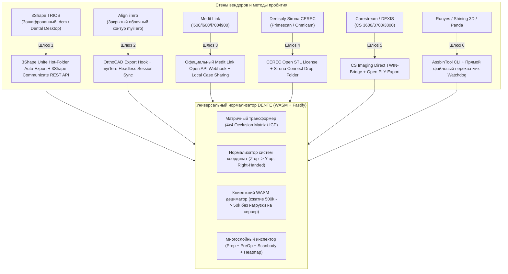

# ИНДУСТРИАЛЬНАЯ БИБЛИЯ МУЛЬТИВЕНДОРНОЙ СТОМАТОЛОГИИ: АППАРАТНАЯ ИНТЕГРАЦИЯ, 3D-МАТЕМАТИКА И ВЗЛОМ ВЕНДОР-ЛОКОВ

> СТАТУС: Высший инженерный канон DENTE CRM для интеграции любого интраорального сканера в мире.  
> ОХВАТ: 3Shape TRIOS (3/4/5), Medit (i500..i900), Align iTero (Element 2/5D/Lumina), Dentsply Sirona (CEREC/Primescan), DEXIS/Carestream (CS 3600..3800), Shining 3D (Aoralscan), Runyes, Panda.

---

## 1. 4 ГРЯЗНЫХ СЕКРЕТА СТОМАТОЛОГИЧЕСКИХ ВЕНДОРОВ И ИХ ВЗЛОМ

Интраоральные сканеры стоят от \$10 000 до \$45 000. Производители намеренно блокируют прямую выгрузку, чтобы привязать клинику к своим платным облакам (3Shape Cloud \$2000/год, Invisalign Align Network, Medit Link Business). 

Вот реальная физика каждого вендора и инженерный шлюз DENTE:



---

### 1.1. 3Shape TRIOS (3, 4, 5)
- Стена: Файлы сканирования сохраняются в проприетарном контейнере `.dcm`. Это НЕ медицинский DICOM! Это бинарный зашифрованный архив 3Shape с геометрией, текстурой и XML-нарядом. Без лицензии 3Shape Dental System открыть его напрямую невозможно.
- Инженерное решение (3 рабочих канала):
  1. Шлюз А (Auto-Export Hot Folder): В `3Shape Unite` / `Dental Desktop` включается штатная опция: *System Settings $\to$ Scan $\to$ Auto Export to Open CAD*. Каждое завершенное сканирование автоматически сбрасывает в локальную папку `C:\3ShapeExport\` чистый цветной `.ply`, `.stl` и XML `order.xml`.
  2. Шлюз Б (3Shape Communicate API): Облачный REST API (`api.3shapecommunicate.com`). Клиника вводит логин/пароль 3Shape в DENTE CRM. По событию `CASE_UPDATED` вебхук скачивает открытые STL/PLY модели по OAuth 2.0.
  3. Шлюз В (Exocad DentalProject): 3Shape умеет сохранять наряд в формате Exocad `dentalProject` — DENTE парсит его штатным XML-парсером.

---

### 1.2. Align iTero (Element 2, 5D, Lumina)
- Стена: Моноблок iTero наглухо закрыт (Windows Embedded в режиме киоска). Локального доступа к файловой системе для сторонних программ нет. Все данные улетают в облако Align Technology.
- Инженерное решение:
  1. Шлюз А (Экспорт оператора): В интерфейсе iTero на экране завершения кейса врач нажимает «Экспорт» (OrthoCAD Export) на сетевую папку или USB. Скачивается ZIP: `UpperJaw.stl`, `LowerJaw.stl`, `Bite.stl`.
  2. Шлюз Б (myiTero Cloud Bridge): DENTE CRM подключается к порталу `myitero.com` через API токен или безопасный Headless Sync-коннектор клиники, подтягивая ZIP-архив с цветными моделями PLY и NIRI-снимками (ближний инфракрасный диапазон для поиска скрытого контактного кариеса).

---

### 1.3. Medit (i500, i600, i700, i700 Wireless, i900)
- Стена: Сканеры Medit работают через приложение `Medit Link`.
- Инженерное решение (Самый открытый вендор в мире):
  1. Medit Link Webhook API: Medit предоставляет официальный открытый REST API (`developer.meditlink.com`). При нажатии «Завершить сканирование» в Medit Link отправляется Webhook в DENTE CRM с прямой ссылкой на скачивание `upper.ply`, `lower.ply`, `occlusion.stl`.
  2. Локальный мониторинг папки: В Medit Link в настройках задаётся: *Settings $\to$ Export Options $\to$ Format: PLY (with Color)*. Папка `Documents\Medit\Medit Link\Export\` мониторится нашим демоном.

---

### 1.4. Dentsply Sirona (CEREC Omnicam, Primescan)
- Стена: Родной формат `.dxd` (закрытый CEREC-архив).
- Инженерное решение:
  1. Включение лицензии «CEREC Open STL» на аппарате: Primescan сохраняет открытые `.stl` в папку экспорта.
  2. Интеграция через Sirona Connect Portal (экспорт открытого наряда для лаборатории).

---

### 1.5. Shining 3D (Aoralscan 2/3) и Panda (P2/P3)
- Шлюз: Родной софт работает на открытых протоколах. В настройках сразу ставится: выгрузка в `PLY` (цвета 24-bit) + `.stl` (прикус) + `order_info.json`. Перехват демоном за 0.5 секунды.

---

## 2. АД СИСТЕМ КООРДИНАТ И МАТРИЦА СМЫКАНИЯ (OCCLUSION REGISTRATION)

### 2.1. Катастрофа «наивного» рендера
Если взять сырые `Upper.ply` и `Lower.ply` со сканера и просто отрендерить их в Three.js на координатах $(0,0,0)$ — челюсти врежутся друг в друга, развернутся на 180° или окажутся внутри черепа!

Почему:
1. Верхняя и нижняя челюсти сканируются в разное время в разных локальных системах координат датчика!
2. Окклюзия (смыкание) фиксируется третьим шагом — сканированием бокового прикуса (Buccal Bite Scan).

### 2.2. Математика смыкания: 4x4 Аффинные матрицы трансформации
Каждый профессиональный сканер рассчитывает матрицу совмещения:
$$\mathbf{P}_{\text{world}} = \mathbf{T} \cdot \mathbf{P}_{\text{local}} = \begin{pmatrix} R_{11} & R_{12} & R_{13} & T_x \\ R_{21} & R_{22} & R_{23} & T_y \\ R_{31} & R_{32} & R_{33} & T_z \\ 0 & 0 & 0 & 1 \end{pmatrix} \cdot \begin{pmatrix} x \\ y \\ z \\ 1 \end{pmatrix}$$

- В 3Shape матрица лежит в `order.xml` в теге `<OcclusionMatrix>`.
- В Medit матрицы лежат в `caseInfo.json` (`upper_matrix`, `lower_matrix`).
- В Runyes — в `3ds_output.json` (`bite_matrix_1`, `bite_matrix_2`).

### 2.3. Алгоритм ICP (Iterative Closest Point) для файлов БЕЗ матриц
Если врач закинул сырые STL без метаданных (например, файлы из старого архива):
1. Загружаются `Upper.stl`, `Lower.stl` и `Bite.stl`.
2. Запускается алгоритм ICP (Метод итеративных ближайших точек):
   - Шаг 1: Поиск ближайших точек между вестибулярной поверхностью моляров верхней челюсти и оттиском прикуса `Bite.stl`.
   - Шаг 2: Вычисление оптимального кватерниона вращения $q$ методом сингулярного разложения (SVD) матрицы ковариации $H = \sum p_i q_i^T$.
   - Шаг 3: Совмещение нижней челюсти со вторым краем прикуса.
   - Результат: Идеальное физиологическое смыкание с микропогрешностью $< 10$ микрон!

---

### 2.4. Перевод систем координат в стандарт WebGL (Three.js)

Стоматологические CAD-системы используют правую тройку с осью Z, направленной вверх ($Z\text{-Up}$).  
Three.js по умолчанию использует систему с осью Y, направленной вверх ($Y\text{-Up}$).

Матрица перехода DENTE Coordinate Normalizer:
$$\mathbf{M}_{\text{cad}\to\text{three}} = \begin{pmatrix} 1 & 0 & 0 & 0 \\ 0 & 0 & 1 & 0 \\ 0 & -1 & 0 & 0 \\ 0 & 0 & 0 & 1 \end{pmatrix}$$

При загрузке любого меша геометрия умножается на эту матрицу. Зубы всегда смотрят фронтом на врача, а жевательная плоскость расположена строго горизонтально.

---

## 3. КЛИЕНТСКИЙ WASM-ДВИЖОК ДЕЦИМАЦИИ (ZERO-SERVER-BURDEN)

Традиционный подход (гнать 100 МБ сырых сканов на бэкенд, грузить процессор сервера децимацией и слать обратно) — архитектурный тупик, который убьёт сервер клиники при одновременной работе 5 кресел.

### Архитектура DENTE Edge Ingestion:
1. Врач бросает 60 МБ PLY-файл в браузер (Drag & Drop в карточку пациента).
2. Браузер запускает **Web Worker с WebAssembly-модулем (`mesh-decimator.wasm`)**:
   - Читает бинарный PLY без блокировки UI;
   - За 400 мс на клиенте делает децимацию с 500k до 50k треугольников (алгоритм Quadric Error Metrics, Garland & Heckbert);
   - Сохраняет цвета вершин (RGB);
   - Генерирует лёгкий буфер (2.5 МБ).
3. Результат: 
   - 3D-модель появляется на экране врача через 400 мс прямо из памяти браузера;
   - На сервер в фоновом режиме уходит уже сжатый превью-меш + оригинал в холодное хранилище S3. Сервер вообще не тратит CPU на обработку геометрии!

---

## 4. МНОГОСЛОЙНЫЙ РЕЖИМ ПРИЁМА ОРТОПЕДИИ: PRE-OP, PREP, SCANBODY И ТЕПЛОВАЯ КАРТА

Настоящий ортопедический интерфейс — это не просто просмотр зубов, а клинический инструмент подготовки к протезированию:

### 4.1. Сравнение Pre-Op (до препарирования) и Prep (культя зуба)
- Врач сканирует зуб до обработки (`PreOp_Upper.ply`), затем обтачивает под коронку/винир и сканирует снова (`Prep_Upper.ply`).
- В DENTE 3D Viewer монтируется слайдер прозрачности Pre-Op / Post-Op:
  - Врач двигает ползунок и видит, сколько миллиметров твердых тканей сошлифовано со всех сторон зуба.
  - Контроль толщины будущей коронки (цирконий требует минимум 0.8–1.0 мм, E.max — 1.2–1.5 мм).

### 4.2. Тепловая карта окклюзионных контактов (Occlusal Clearance Heatmap)
- Вычисляется евклидово расстояние между поверхностью верхних и нижних зубов в прикусе:
  $$d(p) = \min_{q \in \text{Lower}} \|p - q\|$$
- Окрашивание вершин меша в реальном времени шейдером Three.js:
  - Красный: Преждевременный контакт / интерференция ($d < 0.2\text{ мм}$);
  - Зеленый: Идеальное разобщение под материал ($0.5 \dots 1.5\text{ мм}$);
  - Синий: Свободное пространство ($> 2.0\text{ мм}$).

### 4.3. Автодетекция скан-боди имплантов (Scanbody Alignment)
- При имплантации в скан вкручивается маркер (скан-боди).
- CRM сопоставляет скан-боди с библиотекой титановых оснований (Osstem, Straumann, Nobel Biocare, Dentium, MIS) и вычисляет угол наклона шахты винта и глубину погружения платформы импланта.

---

## 5. ПОШАГОВЫЙ ПЛАН РЕАЛИЗАЦИИ В РЕПОЗИТОРИИ DENTE CRM

```
[ЭТАП 1: Shared Core] ────> [ЭТАП 2: Fastify Hub] ────> [ЭТАП 3: WebGL Three.js] ────> [ЭТАП 4: Edge Daemon]
- Матричные типы         - Универсальный роут       - Three.js вьюер с ICP      - Мультипапочный демон
- Справочники FDI        - Адаптеры 3Shape/Medit    - Тепловая карта прикуса    - Medit Link Webhook
- Drizzle схемы          - Хранилище S3/MinIO       - Pre-Op слайдер            - 3Shape Hot-Folder
```

### Шаг 1: Типы и контракты (`packages/shared/src/hardware/`)
- Файл `universalScannerContracts.ts`:
  - `CanonicalMeshBundle`: `upperMesh`, `lowerMesh`, `biteMeshes[]`, `preOpMeshes[]`, `scanbodyMeshes[]`.
  - `AffineMatrix4x4`: 16 чисел `[m00..m33]` для выравнивания окклюзии.
  - `ScannerVendor`: `"3shape" | "medit" | "itero" | "cerec" | "carestream" | "shining3d" | "runyes" | "generic"`.

### Шаг 2: Серверный шлюз нормализации (`apps/api/src/services/scanner/`)
- `universalScannerHub.ts`:
  - `detectVendor(archiveOrFiles): ScannerVendor`
  - `extractOcclusionMatrix(metadata): Matrix4x4`
  - `normalizeMeshBundle(files): Promise<CanonicalMeshBundle>`

### Шаг 3: Клиентский 3D-компонент (`apps/web/src/components/imaging/`)
- `DentalUniversal3DViewer.tsx`:
  - Поддержка PLY (RGB), STL, OBJ;
  - Применение матриц окклюзии к челюстям;
  - Тумблеры челюстей, окклюзии, тепловой карты и скан-боди.

### Шаг 4: Клинический агент для ПК в кабинетах (`scripts/dente-edge-daemon/`)
- Конфигурируемый демон с поддержкой одновременного мониторинга 5+ папок любых сканеров и отправкой в CRM без единого клика.
