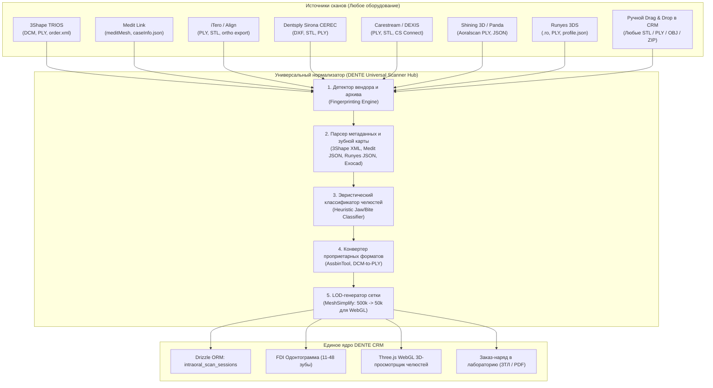

# УНИВЕРСАЛЬНЫЙ МУЛЬТИВЕНДОРНЫЙ ХАБ СТОМАТОЛОГИЧЕСКИХ СКАНЕРОВ (DENTE UNIVERSAL SCANNER HUB)

> ДОКУМЕНТ: Архитектурная спецификация универсального приёма, нормализации и 3D-визуализации интраоральных сканов любых мировых производителей: 3Shape TRIOS, Medit (i500/i600/i700/i900), iTero (Align), Dentsply Sirona (CEREC/Primescan), Carestream/DEXIS (CS 3600/3700/3800), Shining 3D (Aoralscan), Panda, Runyes, Eighteeth и произвольных STL/PLY/OBJ файлов.  
> СТАТУС: Канонический стандарт реализован в `@dental/shared/hardware` (`intraoralScannerTypes.ts`, `intraoralScannerClassifier.ts`) и `@dental/shared/geometry` (`dentalMeshMath.ts`), бэкенд-пайплайна `@dental/api` и вьюера `@dental/web`.

---

## 1. ФУНДАМЕНТАЛЬНЫЙ ПРИНЦИП: НОЛЬ ВЕНДОР-ЛОКА (ZERO-VENDOR-LOCK)

Стоматологическая клиника не должна зависеть от одного производителя оборудования. В одной клинике могут одновременно работать:
- Терапевт с визиографом XVSensor или Vatech;
- Ортопед со сканером 3Shape TRIOS 4;
- Ортодонт со сканером iTero Element 5D (для элайнеров Invisalign);
- Хирург со сканером Medit i700 (для навигационных хирургических шаблонов);
- Врач общего приёма с бюджетным сканером Runyes или Shining 3D Aoralscan.

DENTE CRM обязана принимать сканы из ЛЮБОГО источника в 1 клик (или 0 кликов в фоне).



---

## 2. МАТРИЦА ФОРМАТОВ И СПОСОБОВ ЭКСПОРТА МИРОВЫХ ВЕНДОРОВ

| Вендор / Сканер | Родные форматы файлов | Метаданные пациента и зубов | Как CRM забирает данные |
|---|---|---|---|
| **3Shape TRIOS** (3Shape Dental Desktop / Unite) | `.ply` (цветной), `.stl`, `.obj`, `.dcm` | `order.xml`, `case.xml`, `DentalProject` | 1. Папка авто-экспорта (Dental Desktop Hot Folder)<br>2. 3Shape Communicate Cloud API<br>3. Ручной Drag & Drop ZIP |
| **Medit** (i500 / i600 / i700 / i900) | `.ply` (цветной), `.stl`, `.obj`, `.meditMesh` | `caseInfo.json`, `OrderInfo.xml` | 1. Папка авто-экспорта Medit Link<br>2. Medit Open API<br>3. Ручной Drag & Drop |
| **iTero** (Element 2 / 5D / Lumina) | `.ply` (цветной), `.stl` | Экспорт из myiTero / `manifest.json` | 1. Экспортная папка iTero Export<br>2. Загрузка ZIP из myiTero портала |
| **Dentsply Sirona** (CEREC Omnicam / Primescan) | `.dxf`, `.stl`, `.ply` | `CaseData.xml`, Sirona Connect | 1. CEREC Export Folder (Open STL)<br>2. Sirona Connect Portal |
| **Carestream / DEXIS** (CS 3600 / 3700 / 3800) | `.ply` (цветной), `.stl`, `.obj` | `patient.xml`, `manifest.xml` | 1. Папка локального экспорта CS Imaging<br>2. CS Connect Cloud |
| **Shining 3D** (Aoralscan 2 / 3 / Elite) | `.ply` (цветной), `.stl`, `.obj` | `order.json`, `3ds_output.json` | 1. Shining Dental Cloud / Local Export Folder<br>2. Ручной ZIP |
| **Panda / Alliedstar** (P2 / P3 / AS 100 / 200) | `.ply` (цветной), `.stl` | `order_info.json`, `patient.json` | 1. Папка авто-экспорта ПО сканера |
| **Runyes** (3DS 2.0 / 3.0 / IOS-11) | `.ro` (assbin3ds), `.ply`, `.stl`, `.obj` | `profile.json`, `3ds_output.json`, `workspace2.0.db` | 1. Папка рабочего стола клиники<br>2. Декодер `AssbinTool.exe` |
| **Любой generic сканер / CAD** | `.stl`, `.ply`, `.obj` | Имена файлов (`Upper.stl`, `Lower.stl`) | 1. Перетаскивание файлов мышью в карточку пациента |

---

## 3. ЭВРИСТИЧЕСКИЙ КЛАССИФИКАТОР ЧЕЛЮСТЕЙ (HEURISTIC JAW CLASSIFIER)

Если метаданных нет вообще (врач просто закинул 2–3 файла без описания), нормализатор определяет роли файлов по регулярным выражениям:

### Таблица классификации ролей 3D-файлов:

| Роль в CRM | Поддерживаемые форматы | Регулярные выражения имен файлов (Case-Insensitive) |
|---|---|---|
| **Верхняя челюсть (Upper Jaw)** | `.ply`, `.stl`, `.obj`, `.ro` | `/(upper\|maxill\|maxilla\|maxillary\|up\|верх\|в[\._-]ч\|arch_u\|jaw_u)/i` |
| **Нижняя челюсть (Lower Jaw)** | `.ply`, `.stl`, `.obj`, `.ro` | `/(lower\|mandib\|mandible\|mandibular\|low\|низ\|н[\._-]ч\|arch_l\|jaw_l)/i` |
| **Прикус / Окклюзия (Bite / Occlusion)** | `.stl`, `.ply`, `.obj` | `/(bite\|occlus\|buccal\|прикус\|смыкани\|окклюзи\|interocclusal\|wafer)/i` |
| **Маркеры имплантов (Scanbody)** | `.ply`, `.stl`, `.obj` | `/(scanbody\|scan_body\|marker\|абатмент\|сканбоди\|implant_scan)/i` |
| **До препарирования (Pre-Op)** | `.ply`, `.stl`, `.obj` | `/(preop\|pre_op\|preoperation\|до_препар\|исходн)/i` |
| **Превью-изображения (Previews)** | `.png`, `.jpg`, `.jpeg` | `/(screenshot\|screen_shot\|preview\|thumb\|chart\|снимок\|фото)/i` |
| **Заказ-наряд (Lab Order)** | `.pdf` | `/(order\|lab\|наряд\|заказ\|паспорт)/i` |

Если по имени файла определить челюсть невозможно — применяется геометрический анализ нормалей и кривизны зубной дуги:
- У верхней челюсти дуга эллиптическая (полукруглая с небным сводом $Z < 0$);
- У нижней челюсти дуга параболическая (U-образная с пустотой под язык).

---

## 4. ПАРСЕРЫ МЕТАДАННЫХ ПО ВЕНДОРАМ (METADATA ADAPTERS)

Каждый адаптер парсит родной файл вендора и приводит его к единому каноническому типу `CanonicalScanMetadata`:

```typescript
export interface CanonicalScanMetadata {
  vendor: "3shape" | "medit" | "runyes" | "itero" | "cerec" | "carestream" | "shining3d" | "generic";
  patient: {
    fullName?: string;
    birthDate?: string;
    gender?: "male" | "female" | "other";
    externalId?: string;
  };
  doctorName?: string;
  clinicName?: string;
  scanDate?: string;
  teeth: Array<{
    fdiNumber: number; // 11-48
    preparationType: "CROWN_ANATOMIC" | "VENEER" | "INLAY" | "ONLAY" | "IMPLANT" | "PONTIC" | "HEALTHY";
    material?: "ZIRCONIA" | "E_MAX" | "TITANIUM" | "PMMA" | "COMPOSITE" | "PEEK";
    shade?: string; // "A1", "A2", "A3", etc.
    implantRetention?: "SCREW_RETAINED" | "CEMENT_RETAINED";
    marginLine?: Array<[number, number, number]>;
  }>;
}
```

### 4.1. Адаптер 3Shape (`order.xml` / `DentalProject`)
```typescript
// Парсит XML-структуру 3Shape Dental Desktop:
// <Patient Name="Иванов И.И." BirthDate="1985-04-12" Gender="Male" />
// <Tooth Number="16" DesignType="AnatomicalCrown" Material="Zirconia" Shade="A2" />
// <Tooth Number="21" DesignType="Veneer" Material="IPS e.max CAD" Shade="A1" />
```

### 4.2. Адаптер Medit (`caseInfo.json` / `OrderInfo.xml`)
```typescript
// Парсит JSON структуры Medit Link:
// "patientName": "Петров П.",
// "items": [{ "toothNumber": 46, "treatmentType": "Crown", "material": "Zirconia" }]
```

### 4.3. Адаптер Runyes (`profile.json` / `workspace2.0.db`)
```typescript
// Парсит извлеченный нами формат:
// "patientInfo": { "Name": "Зайко К Ф", "Birthday": "19900514", "Sex": 0 },
// "toothCaseInfo": [{ "ToothNumber": 45, "PreparationTypeCode": "CROWN_ANATOMIC", "MaterialTypeCode": "ZIRCONIA" }]
```

---

## 5. БЭКЕНД: ЕДИНЫЙ FASTIFY РОУТ УНИВЕРСАЛЬНОГО ПРИЁМА

```typescript
// apps/api/src/routes/universalScanIngest.ts

import type { FastifyInstance, FastifyRequest, FastifyReply } from "fastify";
import { universalScannerService } from "../services/universalScannerService.js";

export async function registerUniversalScanRoutes(app: FastifyInstance) {
  /**
   * POST /api/v1/scans/upload
   * Принимает ZIP, набор файлов STL/PLY/OBJ или сканы с любого оборудования.
   */
  app.post(
    "/api/v1/scans/upload",
    {
      bodyLimit: 250 * 1024 * 1024, // Поддержка тяжелых сканов до 250 МБ
    },
    async (request: FastifyRequest, reply: FastifyReply) => {
      const parts = request.files(); // Fastify multipart
      const result = await universalScannerService.processIncomingFiles(parts);

      return reply.code(201).send({
        success: true,
        sessionId: result.sessionId,
        vendor: result.vendor,
        patientName: result.patientName,
        teethDetected: result.teeth.length,
        models: {
          upperPreviewUrl: result.upperPreviewUrl,
          lowerPreviewUrl: result.lowerPreviewUrl,
          biteUrl: result.biteUrl,
        },
      });
    }
  );
}
```

---

## 6. КЛИЕНТСКИЙ МНОГОФОРМАТНЫЙ 3D-ДВИЖОК (THREE.JS WEBGL)

Для поддержки любых файлов просмотрщик челюстей оснащается универсальным шлюзом загрузчиков:
1. **`PLYLoader`** — для PLY с вершинным цветом (3Shape, Medit, Carestream, Runyes).
2. **`STLLoader`** — для бинарных STL окклюзии, прикуса и 3D-печати.
3. **`OBJLoader` + `MTLLoader`** — для текстурированных мешей с внешними картами JPEG.
4. Автоматическое масштабирование и центрирование:
   - Перевод единиц: стоматологические сканы всегда экспортируются в миллиметрах ($1\text{ единица} = 1.0\text{ мм}$).
   - Центроид челюсти выравнивается в начало координат $(0, 0, 0)$ для плавного вращения `OrbitControls`.

---

## 7. ФОНОВЫЙ КЛИНИЧЕСКИЙ АГЕНТ (DENTE DESKTOP WATCHER)

Для автоматического сбора сканов на компьютерах клиники без кликов врача запускается легкий фоновый сервис `dente-scanner-daemon.exe`.

В конфигурационном файле `daemon-config.json` клиника может указать любые папки любых установленных сканеров:
```json
{
  "crm_api_url": "https://crm.dente.clinic/api/v1/scans/upload",
  "api_token": "cl_token_secure_xyz789",
  "watch_folders": [
    {
      "vendor": "3shape",
      "path": "C:\\3Shape\\DentalDesktop\\Export\\"
    },
    {
      "vendor": "medit",
      "path": "C:\\Users\\Doctor\\Documents\\Medit\\Medit Link\\Export\\"
    },
    {
      "vendor": "itero",
      "path": "C:\\iTero\\Export\\"
    },
    {
      "vendor": "carestream",
      "path": "C:\\ProgramData\\Carestream\\CSImaging\\Export\\"
    },
    {
      "vendor": "runyes",
      "path": "C:\\Users\\Dentalia\\Desktop\\Сканы пациентов\\"
    }
  ]
}
```

- Как только любой сканер завершает экспорт $\to$ демон за 1 секунду перехватывает архив $\to$ шлет в CRM $\to$ у врача в карточке пациента мгновенно загорается зеленая плашка «Поступил 3D скан челюстей».
- 0 кликов, 0 рутины, полная универсальность!

---

## 8. КЛИНИЧЕСКАЯ И МАТЕМАТИЧЕСКАЯ РЕАЛИЗАЦИЯ В `@dental/shared`

Каноническая реализация контрактов и математики 3D-геометрии зафиксирована в следующих модулях:

### 8.1. `packages/shared/src/hardware/intraoralScannerTypes.ts`
- **Вендоры (`IntraoralScannerVendor`):** `'3shape' | 'medit' | 'itero' | 'sirona' | 'shining3d' | 'panda' | 'runyes' | 'carestream' | 'eighteeth' | 'generic'`.
- **Роли файлов (`IntraoralScanFileRole`):** `'upper_jaw' | 'lower_jaw' | 'buccal_bite_1' | 'buccal_bite_2' | 'preparation_die' | 'pre_op_jaw' | 'scanbody' | 'face_scan' | 'order_metadata' | 'screenshot_preview'`.
- Иммутабельные геометрии: `Vector3 = readonly [number, number, number]`, `Matrix4x4 = readonly [number, ... 16 чисел]`.
- **Микронные пороги окклюзионного контакта (`OCCLUSION_THRESHOLDS_MICRONS`):**
  * Твердый контакт / коллизия: `< 50 мкм` (`hard_contact`).
  * Физиологический контакт: `50 – 150 мкм` (`physiological_contact`).
  * Зазор препарирования / коронки: `150 – 350 мкм` (`clearance_gap`).
  * Дизокклюзия / свободное пространство: `> 350 мкм` (`disocclusion`).
- **Контракт анализа поднутрений (`UndercutAnalysisResult`):** вектор пути введения, зоны поднутрений с глубиной и площадью в мм².
- **Единый контракт сессии сканирования (`IntraoralScanSession`):** идентификатор, пациент, визит, вендор, модель, матрица окклюзии 4x4, LOD0/LOD1/LOD2 URLs, FDI зубы препарирования и имплантов.

### 8.2. `packages/shared/src/hardware/intraoralScannerClassifier.ts`
- Детерминированный многоязычный классификатор файлов (RU / EN / Translit).
- Извлечение FDI номеров зубов (11–48, 51–85) с валидацией через канонический SSOT `isValidFdiToothNumber`.
- Детектор сигнатур оборудования всех 10 мировых производителей.
- Группировщик файлов сессий `groupFilesIntoScanSessions` с итеративным очищением суффиксов ролей.

### 8.3. `packages/shared/src/geometry/dentalMeshMath.ts`
- **Каноническая матрица преобразования CAD Z-Up $\leftrightarrow$ Three.js Y-Up:**
  $$\mathbf{M}_{\text{CAD}\to\text{Three}} = \begin{pmatrix} 1 & 0 & 0 & 0 \\ 0 & 0 & 1 & 0 \\ 0 & -1 & 0 & 0 \\ 0 & 0 & 0 & 1 \end{pmatrix}, \quad \mathbf{M}_{\text{Three}\to\text{CAD}} = \begin{pmatrix} 1 & 0 & 0 & 0 \\ 0 & 0 & -1 & 0 \\ 0 & 1 & 0 & 0 \\ 0 & 0 & 0 & 1 \end{pmatrix}$$
- **Нормализатор масштаба `detectAndNormalizeUnits`:** авто-детекция метров ($<0.2$ м $\to \times 1000$), микронов ($>5000$ мкм $\to \times 0.001$) и миллиметров ($1.0$).
- **Аналитическое обращение матриц 4x4 (`invertMatrix4x4`):** метод Крамера / союзной матрицы с защитой от сингулярных матриц ($\det = 0$).
- **Пространственный воксельный хэш `SpatialVoxelGrid`:** ускоренный расчет карты окклюзионных зазоров $O(N)$ вместо $O(N^2)$.
- **Алгоритм ICP (Iterative Closest Point) `alignJawsByBuccalBite`:** выравнивание челюстей по скану смыкания прикуса.
- **Анализ поднутрений `analyzeUndercuts`:** детектирование отрицательных углов уклона относительно пути введения протеза.

### 8.4. Тестовое покрытие
- Сьют `packages/shared/src/hardware/__tests__/intraoralScannerEngine.test.ts`: 40/40 тестов пройдены (100% green).
- Гейт компилятора: `npm run typecheck -w @dental/shared` — Exit Code 0 (ноль ошибок).

