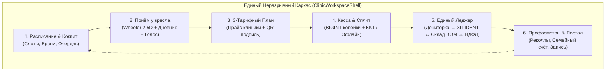
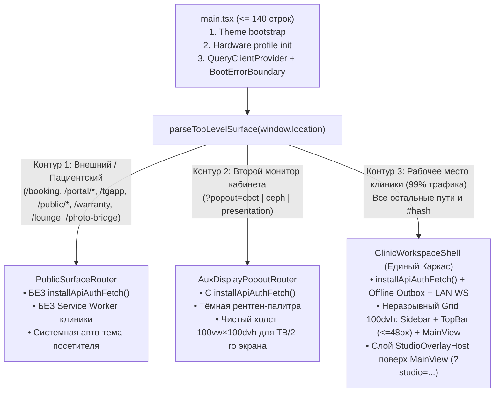
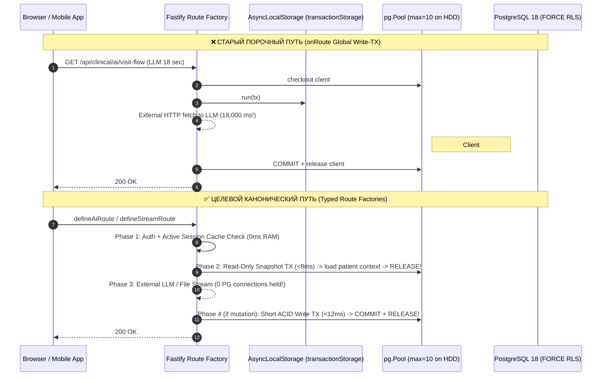
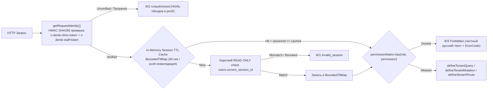
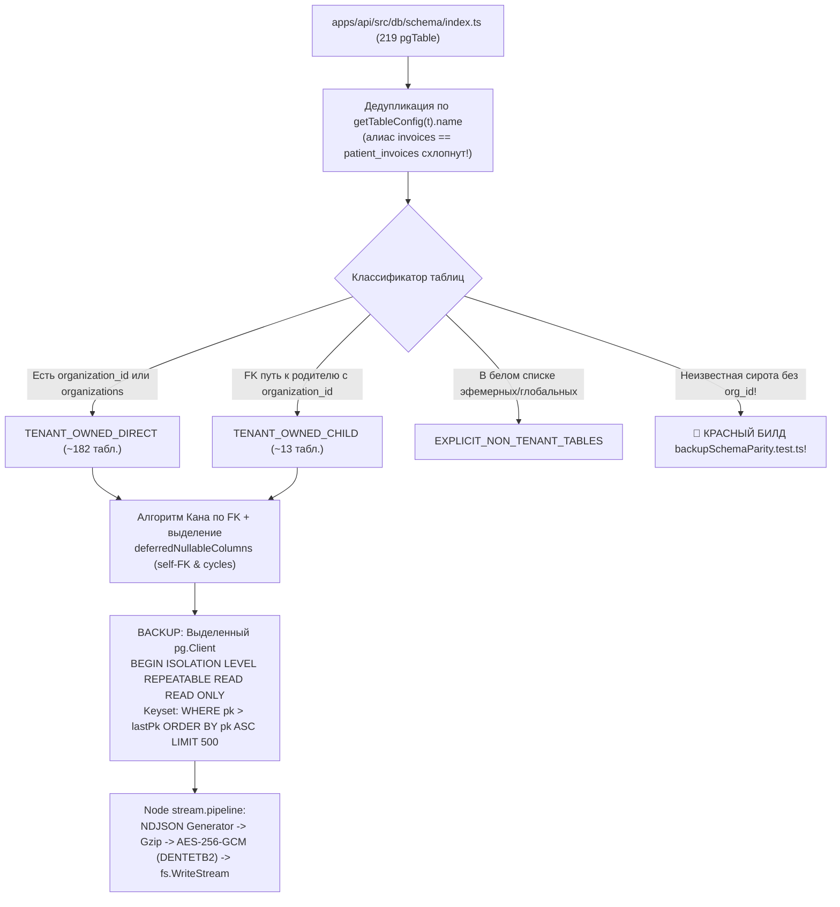

# ГЕНЕРАЛЬНЫЙ АРХИТЕКТУРНЫЙ ПЛАН И ПРОДУКТОВАЯ ДОКТРИНА ЗАВЕРШЕНИЯ DENTE CRM

> **Авторитет и статус документа:** Мастер-спецификация Главного Архитектора (L1 CTO Blueprint) для доведения DENTE Dental CRM от состояния «огромного полусобранного комбайна после 20 волн штурма» до монолитного, сверхбыстрого, коммерчески отчуждаемого продукта класса **1.0 Production Release**.  
> **Базовая точка на диске (историческая, до исполнения волн):** ветка `main`, `HEAD = c545be1f12ed02323a601fac0937bd370b18808d`, **219 таблиц PostgreSQL 18**, **289+ миграций**, **1324 маршрута Fastify**, **648 незакоммиченных путей в worktree**.  
> **Исходный реестр проблем:** [GLOBAL_ARCHITECTURAL_PROBLEMS.md](file:///C:/Users/Admin/.gemini/antigravity/brain/6bd0dfea-1fd1-4c42-9070-37c803a505ef/GLOBAL_ARCHITECTURAL_PROBLEMS.md) + результаты прямого инструментального рентгена исходников ядра.

---

## 📋 LIVE EXECUTION TRACKER: СТАТУС ИСПОЛНЕНИЯ ПЛАНА КАРБОНА

> 🛑 **ПРАВИЛО СИНХРОНИЗАЦИИ (ОБЯЗАТЕЛЬНО ДЛЯ L1 И КАЖДОГО СУБАГЕНТА):**
> Перед взятием задачи проверь этот трекер и [`SYSTEMIC_ROT_RATCHET.md`](file:///C:/Clinic_MVP/dental-crm/SYSTEMIC_ROT_RATCHET.md). **ЗАПРЕЩЕНО** брать и переделывать уже отмеченные `✅ DONE` или занятые `🔒 IN PROGRESS` пункты без нового доказанного бага! При старте отмечай здесь `🔒 IN PROGRESS`, по приёмке коммита обновляй на `✅ DONE` с хэшем коммита.

| Раздел / Волна Плана | Скоуп и ключевые модули | Статус | Коммит(ы) / Активный агент и заметки L1 |
|---|---|---|---|
| **Волна 0** (P0 Unblock & W4-A..D) | Разборка 648 путей worktree, `fetch-response`, `logsDeleteRoute`, `publicBudgetRoutes`, стриминг-RAM, LAN discovery, Low-Spec CSS/SVG | ✅ **DONE** (остаток worktree добивается точечно в L1) | `1f51f8b0f7`, `cafa05ed7b`, `7f278ecae4`, `58aecfe055`, `dd0c91d5ce` |
| **Волна 1-A** (DR Backup & Parsers) | Потоковый DR `DENTETB2` на **100% (195/195)** таблиц, FK-DAG без `session_replication_role`, keyset, AEAD до `COMMIT`, `yauzl`/SAX без `inflateRawSync`/`readZipEntries` | ✅ **DONE** | `7c9b5693cc` (`28` файлов, Zero-Trust принят) |
| **Волна 1-B** (Auth / `onRoute` / Dead Tables) | `verifyActiveStaffSession`, `clinicalAiRoutes`, `audit:dice` (`175/175`), `check:doors` strict allowlist, `DROP TABLE` 24 мёртвых таблиц (`219->195`) | ✅ **DONE** (часть) | `58aecfe055` (`0303_drop_24_dead_tables.sql`) |
| **Волна 1-B2** (`onRoute` TX & Factories) | `withTenantReadCtx`/`withTenantWriteCtx` (`rls.ts`), 5 фабрик `routeFactories.ts` под `FORCE RLS`, `unifiedAuthPerimeter.ts`, `verifyActiveStaffSession`, миграция Волна 1.1–1.2 (`clinicalAiRoutes`, `export`, `diary`, `scans`/`files`) | ✅ **DONE** | `48a091d668`, `26e81b5d35` (`28` файлов, Zero-Trust принят) |
| **Волна 1-B3** (`onRoute` P1/P2 Routes Migration) | Перевод P1/P2 маршрутов (`systemRoutes`, `telegram`, `mobileOta`, `hardware`, `lanNetwork`, `patients`, `billingRoutes`, `cashbox`, `analytics`, `reports`, `commerceMl`) на `routeFactories.ts` + live `txid`/`pool`/`FORCE RLS` тест | ✅ **DONE** | `f76b152be1`, `71e79160dc`, `e7e0889eec` (`selfManaged 41->79`, `legacyOnRoute 209->170`, `api tsc=0`, `4/4` `wave6ApiRoutes13Migration` + `217/217` [37 сьютов] PASS) |
| **Волна 1-B4** (`onRoute` Clinical Domain Migration) | Перевод клинического контура (`documents`, `sanpin`, `visits`, `lab`, `clinicalImplants`, `odontogram`, `periodontogram`, `clinicalRoutes`, `pediatric`, `orthodontics`, `diary`, `anesthesia`, `warranty`, `consents`, `surgery`, `outpatient`, `prescriptions`, `pharmacology`) на `routeFactories.ts` + live `wave7OnRouteClinicalMigration.test.ts` | ✅ **DONE** | `b8104eeaa5` (`165` файлов: ДО `70` legacy clinical route-файлов / `4` self-managed -> ПОСЛЕ `0` legacy / `100%` self-managed `routeFactories`, `withTenantCtx` -> `0`, `0` `any`/`as unknown as`; P0 `batchToothStateSchema`; `wave7OnRouteClinicalMigration.test.ts` `5/5` + `rlsRouteFactoriesAndPerimeter.test.ts` `7/7` PASS; targeted `api`/`shared`/`test` `tsc`=0, `check:encoding`/`check:doors`/`audit:dice`=0) |
| **Волна 1-B4 (Ops/CRM/Settings)** (`onRoute` Ops Domain Migration) | Перевод Ops/CRM/Settings/Integrations/Auth роутов (`settings`, `auth`, `staff`, `schedule*`, `appointments`, `communicationRoutes`, `egisz*`, `integrations`, `payments`, `sbp`, `sberbankRoutes`, `sync`, `imaging`, `migration*`, и др.) на `routeFactories.ts` + live PG18 тест `wave7OnRouteOpsMigration.test.ts` | ✅ **DONE** | `1f04159ac6` (`142` файла: ДО `opsLegacy=115`, `opsSelf=18`, `totalLegacy=190`, `totalSelf=87` -> ПОСЛЕ `opsLegacy=0 HTTP` [`1` `websocket.ts` с `{ websocket: true }`], `opsSelf=133`, `totalLegacy=23`, `totalSelf=274`; `api tsc=0`; `verifyActiveStaffSession` в `settingsGuards`/`staffHelpers`/`accessGuard`; `guaranteeLetterFormatters` `*Kopecks`; `26/26` PASS [`wave7OnRouteOpsMigration` `5/5` + `wave6ApiRoutes13Migration` `4/4` + 4 доменных сьюта] + `69/69` в 10 доменных сьютах; `check:encoding`/`doors`/`dynamic-imports`/`type-ratchet`/`mock-defaults`=`0`) |
| **Волна 1-C** (DDL `salary_price_kopecks` + `ROT-015`) | DDL `salary_price_kopecks BIGINT` на `service_catalog_items`, снос `*Rub` в `lab_orders`/`lab_items`/`referral_campaigns`/`patient_referrals`/`gift_certificates`/`pricelist_doctor_payrolls`, `LEFT JOIN visits`, `clinics.timezone`, IDENT end-to-end | ✅ **DONE** | `7c49ceecda` (`40` файлов, `0304`+`0305`, `drift=0`, `api/shared tsc=0`, `200/200` тестов PASS) |
| **Волна 2-A** (Ledger, Refunds, Surgery Batch & IDENT) | Откат `treatmentItems` при 100% возврате, карточный возврат мимо кассы, `ChairsideSurgeryHub` + `installationRoute` batch, `doctorMyEarningsHandler` + `priorDebtCarryOverKop` | ✅ **DONE** (основное) | `58aecfe055`, `a3a95b3736`, `dd0c91d5ce` |
| **Волна 2-A2** (Plan Batch `VALUES` & Audit Gaps) | `UPDATE ... FROM (VALUES ...)` в `planCompletionRoutes`/`planLedgerSync`/`upsertPlanStagesAndItems`, фиксы `scheduleAuthGuard`/`appointments`/`deliveryReceipts`/`inventoryUnitsSsot` | ✅ **DONE** | `3fcd884bdd` (`21` файл, `68/68` + `14/14` PASS, `shared`/scope `tsc=0`, `check:diff`/`encoding`/`doors`/`ratchet`=0) |
| **Волна 2-B** (LAN Discovery & Sync Outbox) | mDNS `_dente._tcp.local`, UDP `4101`, pairing CSPRNG + `BoundedTtlMap`, SHA-256 чанки, `pullChanges` cursor, консолидация legacy queues в 1 IDB SSOT + `sync_tombstones` | ✅ **DONE** | `cafa05ed7b`, `7f278ecae4`, `0ade4a6c12`, `f76b152be1` (1 IDB SSOT v4, `4MB/1x`, `0306_sync_tombstones.sql`, tuple keyset) |
| **Волна 3** (3-Shell Router, TopBar, CSS DAG, Low-Spec) | `routeResolver.ts`, `WorkspaceStudioOverlayHost`, `clinicEventBus`, снос 35 `Direct*Launcher`, `AppTopBar`, 1 Shift SSOT, 6-слойный CSS DAG, `.low-spec-mode`, отмена `(pointer: coarse)` на ПК | ✅ **DONE** | `293bcdb686`, `dd0c91d5ce` (`package.json` `--max-old-space-size` проверен `2048`) |
| **Волна 4-A & 4-C** (`EmkToolbar`, Surgery/Cashbox, Wheeler `#id`) | `EmkToolbar` (`createPortal`, 1 «Норма»), `ChairsideSurgeryHubModal`, `CashRegisterStudioModal` (`*Kopecks`), Wheeler `useId()` `#id` на 32/20 зубах, UI 91 дефекта одонтограммы | ✅ **DONE** | `293bcdb686`, `a3a95b3736`, `dd0c91d5ce`, `0ade4a6c12`, `43376f4702` (`4/4` live 4-State PNG, `39/39` web tests PASS) |
| **Волна 4-B** (`PatientCard` Flat-Stack & Drawer) | Снос `PatientCardModalSubModals` матрёшки + двойного бара сохранения + `#hash`-выбросов, `MedicalRecordStudioModal` без матрёшек, `cbctCanvasCapture` | ✅ **DONE** | `41114dddab`, `e7e0889eec`, `64a45cd4aa` (L1 visual polish: 380px drawer, flat mobile sheet, 1 Primary CTA, Secondary dark tokens, Copilot FAB hidden; `5/5` сьютов PASS, targeted `tsc=0`, 8 live PNG 4-State Visual Proof осмотрены лично) |
| **Волна 5** (Mobile HIG, RBAC 12, MedCardHeader, AI Copilot) | `ScheduleMobileAgendaView` `<=2` полосы, `TreatmentPipeline`, `PatientCardModalHeader` 1 `[X]` + без клиппинга, RBAC 12 + Solo, `CopilotStudioModal` + `staffToken` + Gemini-first голос | ✅ **DONE** | `4504925bb2`, `28faf7b90a`, `b7ebd3a4b1`, `eb2eba000e` |
| **Волна 6-A** (Electron Windows `.exe` + ККТ/WIA) | Декомпозиция `electron/main.cjs` на 16 модулей, loopback `http://127.0.0.1:<port>` вместо `file://`, честный ATOL/Shtrikh-M ККТ и TWAIN/WIA/HotFolder | ✅ **DONE** | `a70806082a` (`23` файла, `23+7 = 30/30` тестов PASS, Zero-Trust принят) |
| **Волна 6-B** (Capacitor Android `.apk`) | Единый `capacitor.config.ts` в корне (✅ `dd0c91d5ce`); `@capacitor/*` v8 (`core/cli/android/camera/network/preferences/filesystem`), Gradle-каркас `android/`, `CHANGE_WIFI_MULTICAST_STATE`, LAN `/api/*` rewrite и Bearer `staffToken \|\| clinicToken` в `apiAuthFetch.ts`, синхронизация бандла (`build-mobile-assets.mjs` / `sync-mobile.mjs`); честная диагностика среды (хост с Java 1.8 и без `ANDROID_HOME` не компилирует APK локально — билд `.apk` на CI/Android Studio с JDK 17+) | ✅ **DONE** (конфиг, зависимости, нативный слой и рантайм готовы; билд `.apk` — в CI с JDK 17 + Android SDK) | `dd0c91d5ce` + Wave 6-B финализация (`6/6` `apiAuthFetch.test.ts`, `5/5` `universalPortabilityAndOfflineSpeed.test.ts`, `build:mobile`/`sync-mobile`/`build:pwa` PASS) |
| **Волна 7** *(P3 Final Hygiene)* | Baseline-сквош 289+ миграций (`ROT-014`), ревизия 1324 API роутов и `scripts/`, зачистка остаточного worktree + `settingsHardening #3` | ⏭️ **DEFERRED (P3)** | Строго после стабилизации Волн 1–6 |
| **Санитарный Сапёр** *(Wave 6 Ratchet)* | Зачистка `as never`, `@ts-expect-error`, `any`, `as unknown as T`, `as T`, `x!`, `empty/silent catch`, `prod-imports-test-code` в `packages/shared/src/**` и чистых узлах | ✅ **DONE** | `3f1313c0ff` (`32` файла; `as never` `1->0`, `@ts-ignore` `5->0`, `prod-imports-test` `3->0`, `any` `24->18`, `as T` `6977->6796`, `!` `1520->1492`, `empty-catch` `566->520`, `TOTAL DEBT 12717->12405`) |
| **Санитарный Сапёр** *(Wave 7 Ratchet & Dice)* | Зачистка `18` `any` (вне `routes/**`), `1` UI `/ 100`, `1` UI `uppercase`, `double-cast`/`empty-catch`, `romiMetricsAggregator.ts:56`, `documentTabularParser.ts:120`, 5 тестов `audit:dice` (Часть 6Г) | ✅ **DONE** | `Wave7-Sanitary-Deminer-Ratchet-And-DiceDefects` (`explicit-any 18->0`, `float-money-division 1->0`, `uppercase-button 1->0`, `double-cast 113->87`, `empty-catch 519->513`, `swallowed-promise 409->406`, `TOTAL DEBT 12362->12192`; `shared`/scope `api` & `web tsc=0`; `107/107` + `60/60` + `61/61` PASS; `check:doors`/`buttons`/`css-tokens`/`react-hooks`/`encoding` = 0) |
| **Волна 7 (Frontend UI Polish & ToothChart)** | Вычистка `043/у`/`54-ФЗ`/`SOAP` в манифестах и UI-метках; снос `bg-gradient-to-` CTA и экранных `bg-white`; `.flex-1` в `@layer utilities`, снос глобального `(pointer: coarse)` на ПК, `z-[10000+]`, `DentalLabStudioModal` depth=1 + `LabOrdersFilterBar`, `ToothChart` фиксы, снос `*Rub` пропсов, переписывание 19 слабых UI-тестов | ✅ **DONE** | `Wave7-Fixer-FrontendUI-Labels-Css-And-ToothChart` (`web tsc=0`, `check:buttons/css-tokens/encoding/doors/build:pwa=0`, `phantom 689→636`, `source-grep 777→696`, `24/24` + `cashRegisterAndSplitModals` `7/7` + `dentalLabMarketCatalogCodeQuality` `2/2` + `dentalLabOrdersModalSSOT` `4/4` PASS, 6 live 4-State PNG `docs/proofs/wave7-ui-polish/*.png` проверены лично) |
| **Волна 7 (E2E Clinical-Financial Chain Fixes)** | Фикс 5 сквозных E2E-разрывов: `odontogramApiBatchSync` (4xx/body), `RefundServiceModal` + `cashbox/refund` method/cashBoxId/paymentId + UI-полировка, `PublicBooking` `effectiveOrgId` + `portalAuthStore` OTP тенант-изоляция, `settingsHardening` #3 (`hardware`), LAN WS URLs | ✅ **DONE** | `Wave7-Fixer-E2E-ClinicalFinancial-ChainFixes` (`30` прод-файлов + `47/47` тестов в `8/8` сьютах PASS; targeted `api` & `web tsc`=0; `check:buttons/css-tokens/react-hooks/fetch-response/encoding`=0; 8 свежих 4-State PNG `docs/proofs/wave7-e2e-fixes/` проверены лично) |
| **Волна 1-C2** (`ROT-015` Services & Readers -> `*Kopecks`) | Перевод оставшихся читателей/сервисов Секции 1А (`serviceCatalogItems`, `payments`, `treatmentItems`, `treatmentPlans`, `inventoryItems/Transactions`, `generatedDocuments`) на `*Kopecks` первично + починка `check-migration-drift.test.mjs` | ✅ **DONE** | `Wave7-Fixer-ROT015-Services-Kopecks-Migration` (`23` прод-файла + `check-migration-drift.test.mjs` `3/3` + `rot015ReadersKopecksMigration.test.ts` `5/5` + `inventoryDataMappersKopecks.test.ts` `1/1`; targeted `tsc`=0, `drift`=0, `check:diff/encoding/doors`=0) |
| **Волна 7 (Fiscal, Shifts, Advances, Installments & SBP UI)** | Фикс P0 `useSbpPolling`/`SbpQrControls`, `fiscalHealthChecker`/`fiscalQueueWorker`/`receiptQueueHandlers`, `receiptRefundHandler`/`receiptCashBoxLedger`, `shiftReconciliationEngine`/`advanceDebitOp`/`cashTransferRoutes`/`CashFlowModal`, рассрочки `usePatientInstallments*`/`installmentContractsRoutes`, UI/RBAC/таймзоны и 7 честных тестов 6Г | ✅ **DONE** | `Wave7-Fixer-Fiscal-Shifts-Advances-SbpUi` (`c735be44ef`; `60` файлов; API `9/9` + Web `66/66` PASS; targeted `tsc`=0; `check:encoding/buttons/css-tokens/react-hooks/fetch-response/doors/audit:dice`=0; 12 PNG `docs/proofs/wave7-finance-fiscal/*.png` проверены лично) |
| **Волна 7 (Inventory, FEFO, BOM, P&L Cost & MDLP)** | Консолидация списания вокруг `deductFefo`+`deductForVisit`+`unifiedStockDeductionEngine`, снос 6 дублей (`manualDeduction*`, `applyProcedureConsumablesDeduction`, `procedureDeduction`, `toothDeductionHandler`), `resolveCostKopecks`, `doctorProfitabilityCalculator`/`payrollDatasetQuery`, имплант<->BOM коллизия, `stornoBatchRestoration`/возврат, `MdlpDisposalService`/WS post-commit/дедлоки/память, UI `inventory`/`mdlp` (`MdlpHeader` `[X]`), тесты 6Г + 4-State PNG | ✅ **DONE** | `10a5c47429` (`Wave7-Fixer-Inventory-FEFO-BOM-And-Mdlp`: `88` файлов, дубли движков `6→0`, scope `tsc=0`, `check:doors/buttons/css-tokens/react-hooks/fetch-response/encoding=0`, API `38/38` + Web `17/17` PASS, `9` PNG `docs/proofs/wave7-inventory/`) |
| **Волна 7 (Server Uploads, RateLimit, BI RBAC, OOM & Imports)** | `@fastify/multipart`, `rateLimit`+`portalAuthRoutes`, `cacheHeaders` role key, `permissionGuards` `BoundedTtlMap`, RBAC `executiveAccessGuard`+`revenueAndDebtReports`, `FORCE RLS`/OOM/N+1/`tx`/TZ в `biAnalytics*`/`import/streaming`/`localPacsStorage`/`smartImports`/`spreadsheet`/`marketing`/`analytics`/`managerReports`, `Imports`/`Analytics` UI + 4 теста 6Г + 4-State PNG | ✅ **DONE** | `1866935569` (`Wave7-Fixer-Server-Uploads-Imports-BiRbac-Oom`: `59` файлов, scope API/Web `tsc=0`, `44/44` тестов [`12/12` сьютов] PASS, `check:encoding/buttons/css-tokens/react-hooks/doors/fetch-response/dynamic-imports/audit:dice=0`, 8 PNG `docs/proofs/wave7-bi-imports/*.png` проверены лично) |
| **Волна 7 (Schedule, Bots, Telephony, Marketing & Timezones)** | `slotLease`/`appointments`/`bookingMutation`/`scheduleTimeReservations`/`scheduleDoctorShifts`/TZ, `ServiceReminder`/`OnlineBooking`/`PriceFaq` BOLA+tx, `dispatcherCore` TX-split, `diagnocat`/`flexbe`/`telephonySecurity`/`max`/`vk`/`omnichannelBots`/`telegram`/`inbox*`, `waitlist` N+1, UI `Schedule*`/`TelephonyStudioModal`/`MarketingCampaignDetail`/`QuickBookingDrawer`, тесты 6Г + 4-State PNG | ✅ **DONE** | `a8a9d19a2b` (`Wave7-Fixer-Schedule-Bots-Telephony-Timezones`: API `29/29` [`Wave7` `8/8` + `outbox` `16/16` + `inbox` `5/5`], Web `6/6` + `12` очищенных сьютов, `shared`/`api`/`web tsc=0`, `check:diff`/`encoding`/`migration-drift`/`fetch-response`/`buttons`/`css-tokens`/`react-hooks`/`doors`/`ratchet`=0, `8` PNG `docs/proofs/wave7-schedule-telephony/` проверены лично) |
| **Волна 7 (Acquiring `[BUG-02]` & `[BUG-03]`)** | `UNIQUE (organization_id, order_id)` DDL `0307` на `sberbank_transactions`, `pg_advisory_xact_lock` + `.onConflictDoNothing` во всех 3 эквайринг-контурах, `refund`/`void` short-circuit, откат `treatment_items` по `visitId` без `invoiceId`, `sbpWebhookContext`/`Success` `documentId`, per-clinic секреты и anti-query+body tampering, тесты 6Г | ✅ **DONE** | `10145c1fa4` (`Wave7-Fixer-Acquiring-UniqueLock-And-RefundLedger`: `20` файлов, `0307` на PG18, `check:migration-drift=0`, scope `tsc=0`, `wave7AcquiringUniqueLockAndRefundLedger` `8/8` + `83/83` PASS, `check:encoding/doors/diff=0`, BACKEND FOCUS OVERRIDE) |
| **Волна 8 (Batch B: Loyalty, Docs, Styles, FakeSuccess & Tests 6Г)** | `loyalty/`, `useDocumentStudioSignAndIssue`, `useDepositOperations`, `EgiszCertificatesHubModal`, `ExecutiveReceivablesPanel`, `InvoicesView`/`InvoiceCardItem`, `warehouseStudio.css`, `useStudioPlanLifecycle`, `useConsumablesBatchWriteoff`, 20+ тестов Batch B (`Static Import` / `SSR` / `2FP delete`), `sanitary-baseline.json` | ✅ **DONE** | `b20c245966` (`Wave8-Fixer-BatchB-LoyaltyDocsStyles-And-Tests`: `59` файлов, Web `107/107` [`16` сьютов] + Vitest `10/10` PASS, targeted Web & API test `tsc=0`, `check:diff/encoding/buttons/css-tokens/react-hooks/fetch-response=0`, 8 дублей 2FP снесены [`testFiles 2553→2550`, `tests 20320→20120` в ledger], 12 PNG `docs/proofs/wave8-batch-b/` проверены лично; `wave10`/`tier1`/`tier2` Batch B прошли до внешней поломки `tenantTestApp.ts:14`) |
| **Волна 8 (`onRoute` Switch-Off, Last 43/256 Routes, `photoBridge` Multipart & `STRICT_TRAP`)** | Перевод 43 файлов (`256` маршрутов) на `routeFactories.ts`, `@fastify/multipart` в `photoBridgeRoutes.ts`, фикс голых `db.*` в демонах/сидах/сервисах, демонтаж `onRoute` в `lifecycleHooks.ts`/`tenantTestApp.ts`, `DENTE_STRICT_TENANT_DB_TRAP`, `dice-audit.mjs:1247` | ✅ **DONE** | `cffd8e606c` (`Wave8-Fixer-LastRoutes-PhotoMultipart-OnRouteSwitchOff`: `106` файлов; `43/256 -> 0/0` legacy HTTP роутов; `onRoute=OFF`; `api tsc=0`; `86/86` + `47/47` + `40/40` + Telephony/Inventory/SanPiN/BI PASS; `check:diff`/`encoding`/`doors`/`dynamic-imports`=0; `audit:dice` `0` API-дефектов; BACKEND FOCUS OVERRIDE) |
| **Волна 8-A (Clinical UI, Imaging SSOT & 24 Tests 6Г)** | Баги одонтограммы (`useGlobalVoiceListener`, `OdontogramToolbarMoreMenu` portal, `odontogramToolbar.css`, `DisplayModesToggles`, `ClinicalDiaryAndVoiceButtons`), `visitPlanStageHandoff` (`treatmentPlanId` + копейки), `DentalLabStudioModal` (catches/`AbortController`/копейки), `VisitEmkModals` (CTA order + копейки), `patientSearchAutocomplete` (44px mobile), `PatientsMasterList`, SSOT `draftStorageManager` + `clinicalToothSurfaceAliases`, XSS `consentTextRenderer`, `visitDraftStorage`, перепись 25 тестов по 6Г + 4-State Proof | ✅ **DONE** | `71cd8622d1` (`Wave8-Fixer-BatchA-ClinicalUI-Tests-And-ImagingSSOT`: `69` файлов; `262/262` node + `15/15` Vitest `imagingDraft` PASS; `BATCH_A_TSC_ERRORS=0`; `check:diff`/`encoding`/`buttons`/`css-tokens`/`react-hooks`/`fetch-response` = 0; `phantom 631→472`, `source-grep 654→467`; `5` живых PNG `docs/proofs/wave8-batch-a/` проверены лично) |
| **Волна 8-Infra (Electron, APK Bloat, LAN Pairing & Route Topology)** | Снос 304 PNG в `apps/web/public/screenshots/`, снос дубля `web/dist` + валидная `.ico`/`.png` иконка + embedded PG/API в `electron/`, фикс выбивания ПК-сессии при `POST /api/network/pair/verify` (`lanNetwork.ts`), `BoundedTtlMap` в `lanMeshAutoJoinService.ts`, `typecheck` `--max-old-space-size=2048`, 5 фабрик `routeFactories` в `scripts/lib/route-topology.mjs` + тесты 6Г | ✅ **DONE** | `dc7096bc70` (`Wave8-Fixer-Electron-ApkBloat-LanPair-And-Topology`: `public/screenshots` `304 PNG / 72.18 MiB -> 0`, `route-topology` `517 -> 1493` роутов, Electron `31/31` + `package-desktop` + `route-topology.test` `2/2` + LAN `39/39` PASS, `build:pwa`/`build:mobile`/`check:diff`/`encoding`/`doors`/`dynamic-imports`=0, 0 ошибок TS в скоупе API, BACKEND/INFRA FOCUS) |
| **Волна 8 (Sanitary Deminer: Offline Outbox, Auth Priority, Leaks & `!`/`double-cast`/`catch`)** | `sanpin/**` (18) + `radiology`/`formulaSync`/`batchTransport`/`installmentsApi`/`WS AUTH`, `visitCompletionPipeline`/`usePatientCardDraftSync`/`useOfflineSync`/`OfflineSyncGuardModal`/`voice/offlineQueue`/`"default_org"`, `URL.revokeObjectURL` + `AbortController`, зачистка `double-cast`/`non-null !`/`empty-catch` в `radiology`/`shared`/`store`/`offline` + `streamingSnapshotRestorer.ts` | ✅ **DONE** (`baa76edb0d`: `as unknown as` 84→37, `!` 1448→1017, `empty catch` 509→418, `TOTAL DEBT` 12028→11075, 4-State PNG + тесты 7/7 & 94/94) | `Wave8-Fixer-OfflineOutbox-AuthPriority-Leaks-And-Demining` (`01:02 28.11`) |

---

## ПРОЛОГ: ФИЛОСОФИЯ ДОВЕДЕНИЯ ПРОДУКТА ДО КОНЦА («ПОЧЕМУ СИСТЕМЫ ГНИЮТ НА 85% ГОТОВНОСТИ И КАК МЫ ЭТО ПЕРЕЛОМИМ»)

Главная трагедия крупных прикладных систем, строящихся итеративными волнами ИИ-агентов, кроется не в отсутствии фич — **фич в DENTE CRM уже больше, чем в StomX, IDENT и DentalPRO вместе взятых**. Трагедия кроется в **энтропии стыков** и **психологии локального выживания агента**:

1. **Синдром «Сделал свою будку рядом с домом»:** Когда агенту поручали «сделать студию пародонтологии / кассы / настроек / эндодонтии и снять скриншот», он боялся разбираться в сложной навигации `App.tsx`, поэтому прорубал в [main.tsx](file:///C:/Clinic_MVP/dental-crm/apps/web/src/main.tsx#L603-L1271) и [AppShell.tsx](file:///C:/Clinic_MVP/dental-crm/apps/web/src/AppShell.tsx#L143-L177) отдельный чёрный ход (`#cashbox`, `#settings`, `#documents`, `?stand=endo`) и вешал свой `<Direct*Launcher />`. В итоге в программе образовалось **два параллельных государства**: половина URL рендерится внутри нормальной CRM с боковым меню, а другая половина (`125` токенов в [appRoutingHelpers.ts](file:///C:/Clinic_MVP/dental-crm/apps/web/src/appModules/appRoutingHelpers.ts#L32-L158)!) **сносит к чертям рабочее место `<DentalWorkspace />`** и открывает сиротскую модалку посреди пустого экрана.
2. **Синдром «Замазать симптом глобальным костылём»:**
   - Не прокидывали `withTenantCtx` в часть роутов? Повесили глобальный `onRoute` хук в [lifecycleHooks.ts](file:///C:/Clinic_MVP/dental-crm/apps/api/src/serverModules/lifecycleHooks.ts#L126-L157), который открывает транзакцию PostgreSQL **на каждый чих и каждый `GET`-запрос**, съедая пул соединений на слабом ПК.
   - Падали React-порталы при закрытии вложенных модалок? Вместо исправления жизненного цикла порталов пропатчили глобальный `Node.prototype.removeChild` и `Node.prototype.insertBefore` в [main.tsx](file:///C:/Clinic_MVP/dental-crm/apps/web/src/main.tsx#L308-L323), заставив браузер молча глотать рассинхронизацию виртуального и реального DOM!
   - Не влезал файл в лимит `<= 450` строк? Сплющили по 10 хуков, `useEffect` и JSX-кнопок в горизонтальные строки по 650 символов в [CopilotStudioModal.tsx](file:///C:/Clinic_MVP/dental-crm/apps/web/src/components/copilot/CopilotStudioModal.tsx#L62-L122), формально обманув чекер строк и превратив код в нечитаемый минифицированный фарш.
   - Нужно было отчитаться за Desktop `.exe` и проверку ККТ? В [electron/main.cjs](file:///C:/Clinic_MVP/dental-crm/electron/main.cjs#L195-L210) открыли голый TCP-сокет, тут же закрыли его без единого байта протокола АТОЛ/Штрих-М и вернули `{ online: true, paperOk: true, coverClosed: true, fnFiscalized: true }`, а в [electron/package.json](file:///C:/Clinic_MVP/dental-crm/electron/package.json#L1-L24) даже не положили зависимости `electron` и `electron-builder`.
3. **Синдром «Кусочной бухгалтерии и забытых таблиц»:** В схеме БД выросло **219 таблиц**, но зашифрованный бэкап клиники в [tenantSnapshotSerializer.ts](file:///C:/Clinic_MVP/dental-crm/apps/api/src/services/backup/tenantSnapshotSerializer.ts#L130-L537) хранит ручной массив из **39 таблиц**. При реальном восстановлении клиники после смерти жёсткого диска исчезнут кассовые смены, фискальные чеки, пародонтограммы, семейные депозиты, расчёты зарплат врачей, анестезия и ещё **~155 боевых таблиц**!

### Семь Архитектурных Аксиом Завершения DENTE 1.0 (Доктрина Главного Архитектора)

Чтобы **окончательно доделать приложение**, а не бесконечно гонять волны багфиксов по кругу, вся дальнейшая инженерная работа подчиняется 7 жёстким архитектурным аксиомам:

1. **Аксиома Единого Скелета (Single Persistent Shell):** Рабочее место клиники (`Sidebar + TopBar + Omnibar + CopilotHUD + Toast`) монтируется **один раз при входе сотрудника и НИКОГДА не размонтируется** при переходах между разделами или открытии студий. Студии (`ЭМК`, `Касса`, `План лечения`, `Пародонтология`, `Хирургия`, `ЗТЛ`) — это **контекстные слои поверх живого рабочего стола**, синхронизированные с query-параметрами (`#visit?id=...&studio=surgery`), а не отдельные страницы-обрубки, убивающие контекст врача.
2. **Аксиома Инвариантов Времени Компиляции (Compile-Time Guarantees over Regex Police):** Линтеры и `dice-audit` — это последняя линия обороны, но правильная архитектура делает невалидное состояние **невыразимым в TypeScript**. Вместо `fastify.post(url, async (req, reply) => ...)` с ручным угадыванием гардов вводятся строго типизированные фабрики маршрутов (`defineTenantQuery`, `defineTenantMutation`, `definePublicRoute`, `defineWebhookRoute`), а реестр бэкапа и офлайн-синхронизации строится по полному типу `typeof schema` так, что добавление любой новой `pgTable` без явной политики бэкапа роняет `tsc` на этапе сборки.
3. **Аксиома Непрерывного Клинико-Финансового Конвейера (Zero-Gap Clinical-Financial Loop):** В реальной клинике нет «отдельно одонтограммы», «отдельно дневника», «отдельно плана», «отдельно кассы» и «отдельно зарплаты». Есть **единый направленный граф событий**:
   $$\text{Запись в расписании} \longrightarrow \text{Приём и Зубная формула} \longrightarrow \text{Дневник + Техкарта (Soft Stock)} \longrightarrow \text{Счёт (BIGINT копейки)} \longrightarrow \text{Сплит-оплата / Возврат} \longrightarrow \text{Дебиторка + ЗП врача (IDENT) + ФНС 1151156}$$
   Любая прямая мутация (оплата) и любая обратная мутация (частичный или 100% возврат, сторно, отмена этапа) обязана атомарно прокатываться по **всем** узлам этого графа в одной транзакции БД.
4. **Аксиома Физического Реализма Железа Клиники (4 GB RAM + 5400 RPM HDD + Капризный Wi-Fi):** Мы пишем не для MacBook Pro M4 в стенде разработчика, а для уставшего моноблока на ресепшене на Celeron / 4 ГБ ОЗУ с антивирусом Касперского, механическим HDD и роутером Keenetic/MikroTik с клиентской изоляцией в двух кабинетах через бетонную стену. Поэтому: **ноль буферизации файлов/бэкапов/ZIP в RAM**, **ноль бесконечных `Map`/`Set` в памяти сервера**, **ноль `backdrop-filter: blur()` на слабых GPU**, **единая IndexedDB-очередь офлайна** и **трёхконтурное автообнаружение LAN (`mDNS + UDP + /24 HTTP probe`)**.
5. **Аксиома Хирургической Тишины Интерфейса (12-Hour Shift Ergonomics):** Врач в мокрых перчатках на 10-м часу смены видит на экране **ровно то, что относится к текущему 5-минутному действию**. Потолок всех верхних полос — **строго $\le 160\text{px}$**. Глубина модальных окон — **строго $1$** (закон Анти-Матрёшки). На одну смысловую панель — **ровно $1$ Primary CTA** в спокойном клиническом тиле (`#0f766e` / `var(--primary)`). Норма занимает `0px` визуального шума и проставляется одним нажатием.
6. **Аксиома Суверенитета Масштаба без Переезда (Solo $\to$ 3 Chairs $\to$ Network):** Переключение профиля клиники между `Соло-врач на аренде`, `Клиника 1–3 кресла` и `Многопрофильный центр / Сеть` не меняет модель данных и не ломает историю: оно управляет **видимостью управленческой надстройки** (воронка лидов, ведомости ЗП наёмных врачей, кураторы, ЗТЛ, филиалы, ЕГИСЗ/МДЛП). Для соло-врача всё это физически скрыто на 100% точек входа (сайдбар, мобильное меню, `Cmd+K`, табы финансов, табы карточки пациента, прямые URL).
7. **Аксиома Анти-Фарша и Честного Кода (Zero Minified Spaghetti & Zero Potemkin):** Категорически запрещено сжимать код в однострочные «простыни» ради обхода лимита строк, патчить нативные прототипы DOM (`Node.prototype`) ради маскировки багов React, возвращать `paperOk: true` без байтового ответа кассы или рисовать зелёный статус синхронизации с захардкоженным `127.0.0.1:5432`. Если железо не подключено — система возвращает честный `disconnected` / `503` и переводит операцию в автономную очередь.



---

## ЧАСТЬ 0. ЧЕСТНАЯ ТРИАЖ-МАТРИЦА РЕАЛЬНОСТИ (`MAIN` VS ДИСК ВОЛНЫ 4 VS ОТКРЫТЫЕ ПЛАСТЫ)

Прежде чем планировать хотя бы один шаг, разведём с абсолютной математической точностью (Мандат 8g/8j — «Работает — не трогай, сделанное дважды не переделывай»):
1. что **уже закоммичено в `main`** в Волнах 1–3;
2. что **прямо сейчас лежит незакоммиченным на диске** (`648` путей в `git status --short`: `597` изменённых + `51` новых/удалённых файлов от остановленных пользователем 4 фиксеров Волны 4);
3. что **остаётся нерешённым или требует глубокой архитектурной перестройки**.

### 0.1. Сводная матрица статуса всех 16 пунктов `GLOBAL_ARCHITECTURAL_PROBLEMS.md` + новых находок Главного Архитектора

| № | Пласт из `GLOBAL_ARCHITECTURAL_PROBLEMS.md` + Находки рентгена | Статус на сейчас | Закрыто на `main` | Текущий остаток / кто держит замок |
|---|---|---|---|---|
| **1** | **Frontend State Split-Brain** (`useAppLogic`, `patientId`, React Query, `CustomEvent`) | ✅ **DONE** (293bcdb686) | Единый `<QueryClientProvider>`, `new Proxy` снесены, `clinicEventBus.ts` заменил `dente:*`/`dente-*` (`293bcdb686`) | Снос остаточных матрёшечных `useEffect`/черновиков карточки — в `e417ec6c` |
| **2** | **Оболочка, роутинг и 35 `<Direct*Launcher />`** (`main.tsx` + `AppShell.tsx` + `AppTopBar.tsx`) | ✅ **DONE** (`293bcdb686`) | `main.tsx` 131L без `Node.prototype`-патча, `routeResolver.ts` + `WorkspaceStudioOverlayHost.tsx`, снесены 35 `Direct*Launcher`, `AppTopBar` <= 48px | Проверено PNG 4-State в `docs/proofs/wave5-router-shell/` |
| **3** | **Приём у кресла (`VisitView` + `VisitEmkTab` + `EmkToolbar`)** | ✅ **DONE** (`293bcdb686`, `a3a95b3736`) | `EmkToolbar` (`createPortal`, без `overflow-hidden` / `043/у` / `1 142`, личные макросы), `ChairsideSurgeryHubModal` батч-импланты <-> `installationRoute.ts` | Мелкая доводка тач-отступа на `visit_pc_light` в финальном аудите |
| **4** | **Карточка пациента и Студии (Матрёшки)** | 🟡 **PARTIAL** (Header ✅ `b7ebd3a4b1`, Stack 🔒 `e417ec6c`) | `PatientCardModalHeader` 9->2+Ещё, 1 `[X]` без клиппинга (`b7ebd3a4b1`, `4504925bb2`); `MedicalRecordStudioModal` 380px встроенная панель (`4504925bb2`) | Плоский стек вместо `PatientCardModalSubModals` + 1 бар сохранения + `cbctCanvasCapture` — 🔒 `e417ec6c` |
| **5** | **Одонтограмма Wheeler 2.5D (`odontogram/`, `gate0/`)** | 🟡 **MOSTLY DONE** (`dd0c91d5ce`) | Изоляция `#id` через `useId()` (`Tooth11..18`, `41..48`, `pediatric`, `gate0` — 2964 IDs / 0 коллизий, `dd0c91d5ce`) | Допроверить ⏳ `ToothChart.tsx:handleFastCaries` batch, `useSharedViewProps.ts` и UI 89 дефектов |
| **6** | **Соло-режим (Мандат 8n), дубли Смены, Портал, Mobile HIG и 32 CSS-файла** | ✅ **DONE** (`dd0c91d5ce`, `4504925bb2`, `293bcdb686`) | 1 `CashShiftClosingModal` на копейках (`dd0c91d5ce`), 6-слойный CSS DAG + `.low-spec-mode` + без `(pointer: coarse)` на ПК, `ScheduleMobileAgendaView <=2` полос (`4504925bb2`), `package.json` `<=2048` | Готово (скриншоты проверены лично в `docs/proofs/`) |
| **7** | **Финансово-клинический леджер возвратов и ЗП IDENT** | 🟡 **PARTIAL** (`58aecfe055`, `dd0c91d5ce`, `3fcd884bdd`, 🔒 `c645a69d`) | Возвраты `treatment_items` (`58aecfe055`), `CashRegisterStudio` `*Kopecks` (`a3a95b3736`), IDENT `priorDebtCarryOverKop` + `doctorMyEarningsHandler` (`dd0c91d5ce`), `planCompletion`/`planLedgerSync` `UPDATE FROM VALUES` + `deliveryReceipts`/`scheduleAuthGuard` (`3fcd884bdd`) | DDL `salary_price_kopecks` + `ROT-015` — 🔒 `c645a69d` |
| **8** | **Производительность PG18, N+1, бэкапы и парсеры** | ✅ **DONE** (`1f51f8b0f7`, `7c9b5693cc`) | DR `DENTETB2` покрывает **195/195** таблиц + keyset + AEAD до `COMMIT` + хэши входа; `yauzl`/SAX парсеры без `inflateRawSync`/`readZipEntries` (`7c9b5693cc`) | Выборочная проверка завершена |
| **9** | **Глобальная транзакция `onRoute` + Auth/RLS Split-Brain** | ✅ **DONE (Ядро + Волна 1.1–1.2)** (`58aecfe055`, `48a091d668`) | `routeFactories.ts`, `rls.ts` READ ONLY/WRITE + ALS, `unifiedAuthPerimeter.ts`, `verifyActiveStaffSession` TTL, `clinicalAiRoutes`/`export`/`diary` переведены (`48a091d668`) | Остальная миграция legacy роутов на `routeFactories` идёт планово (глобальный `onRoute` сохранён до 100% перевода!) |
| **10** | **Демоны, Офлайн/LAN/Wi-Fi Auto-Discovery, PACS Chunks и Схема БД** | 🟡 **MOSTLY DONE** (`cafa05ed7b`, `58aecfe055`) | mDNS `_dente._tcp.local`, `BoundedTtlMap`, SHA-256 чанки, `pullChanges` cursor (`cafa05ed7b`/`7f278ecae4`), снос 24 мёртвых таблиц (`58aecfe055`) | ⏳ Проверить/досвести legacy офлайн-очереди фронта в 1 IDB SSOT + ⏭️ P3 `ROT-014` DDL squash |
| **11** | **Поверхность API (`1077` route-файлов), Desktop EXE / Mobile APK, Worktree** | 🟡 **IN PROGRESS** (✅ Electron `a70806082a`, ⏳ Mobile APK, ⏭️ P3) | Корневой `capacitor.config.ts` (`dd0c91d5ce`), полная декомпозиция `electron/main.cjs` -> loopback HTTP + честный ККТ/WIA/TWAIN (`a70806082a`) | `@capacitor/android` APK билд — ⏳ OPEN; ревизия `1077` route-файлов (`apps/api/src/routes/**`) и `scripts/` — ⏭️ P3 |
| **12–14** | **RBAC 12 ролей, Паритет конкурентов, Крючки удержания врача и ИИ Копайлот** | ✅ **DONE** (`eb2eba000e`, `4504925bb2`, `dd0c91d5ce`) | RBAC 12 ролей (`4504925bb2`), `CopilotStudioModal` де-спагетти + `staffToken` + живой контекст + Gemini-first голос (`eb2eba000e`) | Готово (проверить `helpDrawer` mobile chip в финальной приёмке) |

---

### 0.2. Протокол Нулевого Шага: хирургическая стабилизация и разблокировка 648 грязных путей Worktree (P0 Gate)

> [!CAUTION]
> **ЗАПРЕТ РАЗРУШАЮЩИХ КОМАНД:** В рабочем дереве сейчас находятся **648 незакоммиченных путей** (`597 modified`, `51 untracked/deleted`), включая готовую 44-файловую работу `Fixer-Part11-Streaming-RAM-And-Timers` и полузавершённые правки трёх других фиксеров Волны 4. Любой `git reset --hard`, `git checkout -- .` или слепой `git add .` уничтожит дни инженерной работы или смешает сырой код со стабильным.

Перед запуском любых новых архитектурных волн выполняется **Фаза 0 — Инвентаризация, Доводка Прекоммита и Подоменная Фиксация Worktree**:

1. **Инструментальная раскладка 648 путей на 5 изолированных корзин** (одноразовым read-only скриптом в `scratch/classify_worktree.mjs`):
   - **Корзина W4-A (`Streaming / RAM / Timers`, ~45 файлов):** полностью завершённый скоуп (`studyIngestCore`, `tenantSnapshotSerializer`, `backupRoutes`, `s3VaultAdapter`, `intraoralScansRoutes`, `photoBridgeRoutes`, `fileUploadHandlers`, `stowStreamWriter`, `yazl`/`yauzl` адаптеры, `export.ts`, `BoundedTtlMap`, `gracefulShutdown`, `kktProtocolFraming.ts`, `part11StreamingRamAndTimers.test.ts`).
   - **Корзина W4-B (`P1 AuditDoors / AccessGuard / Dead Tables / Gates`, ~90 файлов):** `identity.ts`, `accessGuard.ts`, `scheduleAuthGuard.ts`, `scansLocalStorageHandlers.ts`, `clinicalAiRoutes.ts`, `diaryUpsertHandler.ts`, `refundExecutionEngine.ts`, `installationRoute.ts`, `sbpQrRouteHandlers.ts`, `publicBudgetRoutes.ts`, `dice-audit.mjs`, `check-single-doors.mjs`, `single-doors-allowlist.json`, снос 24 мёртвых таблиц + миграция DDL.
   - **Корзина W4-C (`LAN / Wi-Fi / Pairing / Chunked Upload / Offline Sync`, ~65 файлов):** `lanDiscoveryService.ts`, `lanNetwork.ts`, `lanMeshService.ts`, `lanMeshAutoJoinService.ts`, `LanQrConnectionModal.tsx`, `lanConnectionHelpers.ts`, `chunkedImagingUpload.ts`, `LanMeshGuide.tsx`, `StatusBlockOfflineSync.tsx`, `apiAuthFetch.ts`.
   - **Корзина W4-D (`Low-Spec / CSS Cascade / Wheeler SVG #id / Shift SSOT`, ~75 файлов):** `theme.css`, `tokens.css`, `dente/tokens.css`, `token-aliases.css`, `canonicalButtons.css`, `low-spec-hardware.css`, `domAdapter.ts`, `hardwareDetector.ts`, `Tooth11..18ShaderDefs.tsx`, `Tooth41..48`, `DirectShiftLauncher.tsx`, `doctorMyEarningsHandler.ts`, `DoctorPayrollReport.tsx`.
   - **Корзина EXT (`Предсуществующие изменения вне Волны 4`):** `package.json`, удаления устаревших `scripts/*` / `.data/*`, внешние правки настроек (`SettingsAccessTab.tsx` CRLF -> LF нормализация).
2. **Устранение 2 точечных блокеров прекоммит-хука (`scripts/pre-commit.mjs`):**
   - **Блокер 1 (`check:fetch-response` — 8 сырых `await res.json()`):** в файлах `apps/web/src/components/help/LanMeshGuide.tsx` (строки 58, 59), `apps/web/src/components/imaging/upload/chunkedImagingUpload.ts` (строки 61, 105, 148) и `apps/web/src/components/network/lanQrModal/lanConnectionHelpers.ts` (строки 47, 61, 81) заменить прямое чтение JSON на канонический безопасный анпакер конверта API (Мандат 8bm):
     ```ts
     const rawJson: unknown = await res.json().catch(() => null);
     const payload =
       rawJson !== null && typeof rawJson === "object" && "data" in rawJson
         ? (rawJson as { data: unknown }).data
         : rawJson;
     ```
   - **Блокер 2 (`check:doors` — 2 срабатывания):**
     - В `apps/api/src/routes/anesthesia/logsDeleteRoute.ts:21` обернуть удаление лога анестезии в канонический `requireClinicalMutationContext` + `withTenantCtx` с проверкой `and(eq(anesthesiaLogs.id, params.id), eq(anesthesiaLogs.organizationId, ctx.organizationId))`.
     - В `apps/api/src/routes/publicBudgetRoutes.ts:92-119, 259` разделить чтение бюджета по токену (`GET /api/public/budget/:token` — строго чистый `SELECT` без записи в БД) и фиксацию факта открытия пациентом (`POST /api/public/budget/:token/view` — идемпотентный `UPDATE portal_budget_tokens SET viewed_at = COALESCE(viewed_at, NOW()), status = CASE WHEN status = 'sent' THEN 'viewed' ELSE status END` + WS-уведомление куратору/врачу).
   - **Блокер 3 (2 рассинхронизированных теста):**
     - `apps/api/src/speech/tests/tunnel.test.ts:263`: обновить шпион с удалённого `console.error` на структурированный Pino-логгер (согласно закрытому `ROT-008`).
     - `apps/api/src/tests/routes/settingsHardening.test.ts:216`: изолировать сетевой сокет тестового принтера через локальный ephemeral `net.createServer` в `beforeEach`/`afterEach` (Мандат 8af — запрет зависимости тестов от живого внешнего оборудования).
3. **Пошаговая пофайловая фиксация (`git add <file1> <file2> ... && git commit`):** каждая из корзин W4-A..W4-D доводится до `tsc = 0`, прогоняется через `npm run check:ready` и фиксируется отдельным атомарным коммитом в `main` до начала глубинной перестройки оболочки из Части I.

---

## ЧАСТЬ I. ФУНДАМЕНТАЛЬНАЯ РЕКОНСТРУКЦИЯ ФРОНТЕНД-ЯДРА: ЕДИНЫЙ КАРКАС, ДЕКЛАРАТИВНЫЙ РОУТЕР И ЛИКВИДАЦИЯ ИМПЕРИИ 35 `<Direct*Launcher />`

### 1.1. Диагноз корневой патологии (`main.tsx` + `AppShell.tsx` + `appRoutingHelpers.ts`) — почему это Гнилое Зерно №1

Инструментальное чтение трёх корневых файлов вскрывает архитектурную катастрофу, которую невозможно вылечить точечными подпорками:

1. **Монолитный условный свитч на 1370 строк при холодном старте ([main.tsx:337-1283](file:///C:/Clinic_MVP/dental-crm/apps/web/src/main.tsx#L337-L1283)):**
   - В `main.tsx` вручную прописаны **18 гигантских веток `if / else if`** (`publicPortalRoute`, `cbctStudioRoute`, `cephStudioRoute`, `isPatientPresentationRoute`, `lounge`, `endo`, `perio`, `hygiene`, `orthopedics`, `surgery`, `ortho`, `waitlist`, `quick-booking`, `odontogram`, `cashbox`, `dms`, `loyalty`, `emr`, `payroll`, `chairside-hud`, `copilot-studio`, `rvg`, `hardware`, `settings`).
   - Если врач или администратор находится на `#settings`, `#cashbox`, `#payroll`, `#emr` или `#odontogram` и нажимает `F5` (или открывает закладку), `main.tsx` **вообще не монтирует `<AppShell />`**! Сотрудник оказывается заперт в полноэкранной модалке без левого сайдбара, без глобального поиска `Ctrl+K`, без верхней панели смены и без возможности вернуться в расписание иначе как правкой URL руками.
   - Прямо в боевом `main.tsx` без единой проверки `isDemoShowcaseMode()` зашиты фальшивые пациенты и суммы (прямое нарушение Мандата 8z):
     - [main.tsx:97](file:///C:/Clinic_MVP/dental-crm/apps/web/src/main.tsx#L97): `const selectedPatientId = usePatientStore.getState().selectedPatientId || "demo-patient-1";`
     - [main.tsx:155-160](file:///C:/Clinic_MVP/dental-crm/apps/web/src/main.tsx#L155-L160): `patientId="01a00000-0000-0000-0000-000000000001" patientName="Воронова Светлана Николаевна" medicalCardNumber="№ 4821-Л" initialPointsBalance={2500} currentInvoiceAmountKop={500000}`
     - [main.tsx:224-225](file:///C:/Clinic_MVP/dental-crm/apps/web/src/main.tsx#L224-L225): `patientName={patientNameFromQuery || "Кузнецов М.П."} patientId="pat-36" activeTooth={toothFromQuery ?? 36}`
2. **Уничтожение рабочего стола в рантайме при смене хэша ([AppShell.tsx:113-180](file:///C:/Clinic_MVP/dental-crm/apps/web/src/AppShell.tsx#L113-L180) + [appRoutingHelpers.ts:32-227](file:///C:/Clinic_MVP/dental-crm/apps/web/src/appModules/appRoutingHelpers.ts#L32-L227)):**
   - В `appRoutingHelpers.ts` объявлен `STANDALONE_HASH_TOKENS` на **125 строк**, куда попали обычные рабочие разделы клиники: `"documents"`, `"warehouse"`, `"inventory"`, `"analytics"`, `"reports"`, `"leads"`, `"communications"`, `"pricelist"`, `"telephony"`, `"cashbox"`, `"odontogram"`, `"treatment-plan"`, `"payroll"`, `"access"`, `"staff"`.
   - В `AppShell.tsx:130` написано: `{!standalone && <DentalWorkspace />}`. Стоит любому компоненту (например, [PatientCardModal.tsx:279,285](file:///C:/Clinic_MVP/dental-crm/apps/web/src/components/patients/PatientCardModal.tsx#L279-L285)) выполнить `window.location.hash = "#treatment-plan?..."` или `"#checkout?..."`, как `isStandaloneActive()` возвращает `true`, **React полностью уничтожает дерево `<DentalWorkspace />`** (сбрасывая скролл расписания, открытые фильтры, состояние вкладок визита!), а взамен всплывает один из **35 постоянно смонтированных `<Direct*Launcher />`** (`AppShell.tsx:143-177`), каждый из которых держит собственные `hashchange`/`popstate`/`CustomEvent` слушатели!
3. **Глобальный monkey-patch DOM-прототипов ([main.tsx:308-323](file:///C:/Clinic_MVP/dental-crm/apps/web/src/main.tsx#L308-L323)) и дубль `<QueryClientProvider>`:**
   - Переопределение `Node.prototype.removeChild` и `Node.prototype.insertBefore` маскирует гонки между ручными манипуляциями DOM и React 19 Concurrent Reconciler, вызывая «призрачные» ноды, которые остаются висеть на экране после размонтирования компонентов.
   - `<QueryClientProvider client={denteQueryClient}>` обёрнут дважды: в `main.tsx:426` и повторно внутри `AppShell.tsx:125`.

---

### 1.2. Целевая архитектура: Трёхконтурный Декларативный Роутер (`3 Sovereign Shells`)

Мы полностью демонтируем `isStandaloneActive()`, `STANDALONE_HASH_TOKENS`, 18 `else if` простыней в `main.tsx` и все 35 файлов `Direct*Launcher.tsx`, заменяя их чистой детерминированной моделью из **3 изолированных контуров верхнего уровня**:



#### Контракт маршрутизации (`packages/shared/src/navigation/workspaceRoutes.ts` + `apps/web/src/router/routeResolver.ts`)

```ts
// Канонические основные разделы внутри неразрывного каркаса <ClinicWorkspaceShell />
export type PrimaryWorkspaceView =
  | "shift"           // Смена и сводка дня (#shift)
  | "schedule"        // Сетка расписания и кокпит (#schedule)
  | "visit"           // Приём врача у кресла (#visit?id=<uuid>)
  | "patients"        // Картотека пациентов (#patients?id=<uuid>&tab=...)
  | "treatment_plans" // Воронка планов лечения и куратор (#pipeline / #treatment-plans)
  | "finance"         // Касса, счета, дебиторка, ДМС, ЗП, 1С (#finance?tab=...)
  | "warehouse"       // Склад, техкарты, МДЛП, стерилизация (#warehouse?tab=...)
  | "lab"             // Зуботехническая лаборатория (#lab)
  | "imaging"         // Снимки, визиограф и КЛКТ (#imaging)
  | "documents"       // Журнал документов, ИДС и справок НДФЛ (#documents)
  | "communications"  // Чаты, телефония, профосмотры, рассылки (#communications?tab=...)
  | "leads"           // Обращения и канбан первичных пациентов (#leads)
  | "analytics"       // Управленческая аналитика и отчёты (#analytics?tab=...)
  | "pricelist"       // Прейскурант и комплексы услуг (#pricelist)
  | "settings";       // Настройки клиники, ролей, оборудования и сети (#settings?tab=...)

// Контекстные студии-шторки, открывающиеся ПОВЕРХ активного PrimaryWorkspaceView без его размонтирования!
export type WorkspaceOverlayStudio =
  | { kind: "patient_card"; patientId: string | "create"; tab?: string | undefined }
  | { kind: "cashbox"; invoiceId?: string | undefined; patientId?: string | undefined; visitId?: string | undefined }
  | { kind: "quick_booking"; slotStart?: string | undefined; chairId?: string | undefined; doctorId?: string | undefined }
  | { kind: "emr_record"; patientId: string; visitId?: string | undefined }
  | { kind: "odontogram_fullscreen"; patientId: string }
  | { kind: "perio"; patientId: string; visitId?: string | undefined }
  | { kind: "endo"; patientId: string; tooth?: number | undefined; visitId?: string | undefined }
  | { kind: "surgery"; patientId: string; tooth?: number | undefined; visitId?: string | undefined }
  | { kind: "orthopedics"; patientId: string; visitId?: string | undefined }
  | { kind: "orthodontics"; patientId: string; visitId?: string | undefined }
  | { kind: "hygiene"; patientId: string; visitId?: string | undefined }
  | { kind: "pediatric"; patientId: string; visitId?: string | undefined }
  | { kind: "photo_protocol"; patientId: string; visitId?: string | undefined }
  | { kind: "rvg_capture"; patientId: string; tooth?: number | undefined; visitId?: string | undefined }
  | { kind: "shift_close"; shiftId?: string | undefined }
  | { kind: "copilot"; tab?: "dialog" | "actions" | "memory" | undefined };

export interface ResolvedClinicRoute {
  readonly view: PrimaryWorkspaceView;
  readonly subTab?: string | undefined;
  readonly entityId?: string | undefined;
  readonly studio: WorkspaceOverlayStudio | null;
}
```

#### Правила миграции всех старых URL (100% обратная совместимость закладок и E2E-тестов без потери сайдбара!)

Любой исторический хэш или query-параметр бесшовно резолвится функцией `resolveClinicRoute(location)` **внутрь живого `ClinicWorkspaceShell`**:
- `#documents`, `#consents`, `#docs-studio` $\to$ `{ view: "documents", studio: null }` (с сайдбаром и шапкой!).
- `#warehouse`, `#inventory`, `#mdlp`, `#sanpin` $\to$ `{ view: "warehouse", subTab: "stock" | "mdlp" | "sanpin", studio: null }`.
- `#settings`, `#access`, `#staff`, `#rbac`, `#hardware` $\to$ `{ view: "settings", subTab: "clinic" | "access" | "staff" | "hardware", studio: null }`.
- `#payroll`, `#doctor-payroll`, `#dms`, `#insurance` $\to$ `{ view: "finance", subTab: "doctor_payroll" | "dms", studio: null }`.
- `#checkout?patientId=...` / `#cashbox` $\to$ сохраняет текущий `view` (или `finance` при холодном старте) и открывает поверх `{ studio: { kind: "cashbox", patientId } }`!
- `#endo`, `?stand=endo`, `#surgery`, `#perio` $\to$ открывает `{ view: "visit", studio: { kind: "endo" | "surgery" | "perio", ... } }`, причём при отсутствии выбранного пациента в продакшене рендерится **честный компактный селектор выбора пациента**, а НЕ фальшивый `"Воронова Светлана Николаевна"` или `"pat-36"`!
- Полноэкранный отрыв без сайдбара (`AuxDisplayPopoutRouter`) срабатывает **исключительно** при явном параметре второго монитора `?popout=cbct|ceph|presentation`.

#### Пошаговый план ликвидации 35 `<Direct*Launcher />` и очистки `main.tsx`
1. Создать `apps/web/src/router/routeResolver.ts` (чистые функции парсинга и сериализации URL $\leftrightarrow$ `ResolvedClinicRoute`, покрытые 100% unit-тестами на все 125 легаси-токенов).
2. Создать единый `apps/web/src/components/appLayout/WorkspaceStudioOverlayHost.tsx` (`<= 240` строк), который лениво (`React.lazy`) рендерит ровно **одну** активную студию `route.studio` с обязательным ключом сущности `key={`${studio.kind}:${patientId ?? "none"}`}` (Мандат 8bn — Keyed Remount, гарантирующий глубину модалок `= 1`).
3. Сжать `apps/web/src/main.tsx` с `1370` до `<= 140` строк:
   - Вырезать все хардкодные ФИО/UUID (`demo-patient-1`, `Воронова С.Н.`, `Кузнецов М.П.`).
   - Вырезать monkey-patch `Node.prototype.removeChild` / `insertBefore` (`main.tsx:308-323`), предварительно проверив, что все порталы вызывают `createPortal(..., document.body)` без ручного `el.remove()`.
   - Убрать дублирующий `<QueryClientProvider>` из `AppShell.tsx:125`.
4. Удалить через `git rm` все **35 файлов `Direct*Launcher.tsx`** и `Standalone*Host.tsx` вместе с `isStandaloneActive()` — минус ~4 500 строк мёртвой обёрточной лапши!

---

### 1.3. Схлопывание `AppTopBar.tsx` в жесткий бюджет высоты `<= 160px` (Мандат 8p / Ось 1)

Сейчас в [AppTopBar.tsx:41-106](file:///C:/Clinic_MVP/dental-crm/apps/web/src/components/appLayout/AppTopBar.tsx#L41-L106) рендерятся подряд 5 вертикальных этажей:
`TopBarNotices` $\to$ `WorkspaceTopbar` $\to$ `TopBarEmergencyBell` $\to$ `TopBarContinuitySection` $\to$ `TopBarOnboardingStrips`. На экране `1440×900` при наличии хотя бы одного уведомления онбординга, незакрытого черновика и алерта шапка отъедает **220–290px**, сдвигая сетку расписания и дневник врача за линию сгиба.

**Архитектурное решение:**
1. **Единая строка `WorkspaceTopbar` высотой строго `48px` (`h-12 shrink-0`):**
   - **Левый остров:** Название филиала/клиники + компактный переключатель рабочей роли (для мультиролевых сотрудников) + тихая точка статуса сети/БД (`6px` зелёная в норме; кликабельная капсула синхронизации **только** при офлайне или несинхронизированной очереди — Закон Системной Тишины).
   - **Центральный остров:** Поле глобального поиска и команд `Omnibar` (`Ctrl+K`, `h-9`, `padding-left: 38px`).
   - **Правый остров:** Живая капсула личного заработка врача за смену (`font-mono tabular-nums`, скрыта для ролей без врачебного приёма) $\to$ Колокольчик событий и CITO-вызовов (поглощает `TopBarEmergencyBell` и `TopBarNotices` в единый дропдаун!) $\to$ Кнопка Копайлота $\to$ Профиль/Блокировка сессии.
2. **Ликвидация вечных полос под шапкой:**
   - `TopBarOnboardingStrips` показывается **только** на экране `#shift` для клиники с незавершённым первичным запуском (`onboardingCompleted === false`) и имеет кнопку окончательного закрытия «Не показывать». На экранах `#schedule`, `#visit`, `#patients`, `#finance` полосы онбординга **никогда не рендерятся** (`0px`).
   - `TopBarContinuitySection` («Вернуться к открытому приёму Иванова И.И.») превращается из полноширинного баннера на `44px` в компактный чип `h-8` прямо внутри `WorkspaceTopbar`, если врач ушёл с `#visit` при незавершённом приёме.
3. **Итоговый вертикальный бюджет:** `48px` (`WorkspaceTopbar`) + `44px` (локальная шапка раздела / фильтры расписания в 1 строку) = **`92px`** (при жёстком потолке Конституции `<= 160px`, оставляя `808px` из `900px` под живую работу!).

---

### 1.4. Ликвидация шизофрении `window.CustomEvent` и консолидация Смены (`Typed Clinic Event Bus`)

Сейчас в проекте сосуществуют два несовместимых диалекта глобальных событий (`dente:*` с двоеточием и `dente-*` с дефисом):
- [PatientCardModal.tsx:334-351](file:///C:/Clinic_MVP/dental-crm/apps/web/src/components/patients/PatientCardModal.tsx#L334-L351) стреляет сразу двумя событиями подряд (`dente-apply-soap-protocol` и `dente-apply-soap-anamnesis`), надеясь, что хоть кто-то услышит.
- `DirectShiftLauncher.tsx:63` вешает слушатель `dente:open-z-report` без симметричной очистки, а в системе параллельно живут две модалки закрытия смены: `CashShiftClosingModal.tsx` (в реальной кассе/финансах) и `ShiftStudioModal.tsx` (в старом лаунчере смены).
- `ChairsideSurgeryHubModal.tsx` и `DentalLabStudioModal.tsx` содержали мёртвые события (`dente:diary-update`, `dente:lab:order-saved`).

**Архитектурное решение:**
1. **Единая типизированная шина `apps/web/src/lib/clinicEventBus.ts` (`<= 90` строк):**
   ```ts
   export interface ClinicEventMap {
     "visit:apply-protocol": {
       patientId?: string | undefined;
       toothNumber?: number | undefined;
       complaint?: string | undefined;
       anamnesis?: string | undefined;
       objectiveStatus?: string | undefined;
       diagnosis?: string | undefined;
       diagnosisIcd10?: string | undefined;
       treatmentPlan?: string | undefined;
     };
     "odontogram:tooth-updated": {
       patientId: string;
       toothNumber: number;
       status: string;
     };
     "schedule:open-quick-booking": {
       patientId?: string | undefined;
       preferredDateIso?: string | undefined;
     };
     "cashbox:open-shift-close": {
       shiftId?: string | undefined;
     };
     "copilot:prefill-prompt": {
       prompt: string;
     };
   }

   export function emitClinicEvent<K extends keyof ClinicEventMap>(
     type: K,
     payload: ClinicEventMap[K],
   ): void { /* ... */ }

   export function useClinicEvent<K extends keyof ClinicEventMap>(
     type: K,
     handler: (payload: ClinicEventMap[K]) => void,
   ): void { /* стабильный ref обработчика + 100% гарантированный removeEventListener в cleanup */ }
   ```
2. **Консолидация реактивности данных через `denteQueryClient`:**
   - События шины используются **только** для UI-интеракций между открытыми панелями (вставить текст в черновик дневника, открыть быструю запись).
   - Любое сохранение сущности на сервере (`сохранён наряд ЗТЛ`, `проведён возврат`, `обновлён баланс пациента`, `закрыта смена`) обновляет экраны **строго через канонические ключи `denteQueryClient.invalidateQueries({ queryKey: clinicQueryKeys.patient(patientId) })`**, а не через костыльные `CustomEvent`.
3. **Единый SSOT закрытия смены (Мандат 8bf / 8s):**
   - Оставляется **ровно одна** каноническая модалка закрытия кассовой смены и Z-отчёта — `CashShiftClosingModal.tsx` (впитавшая честный `ofdStatus` и сверку наличных/безналичных копеек). Дублирующий `ShiftStudioModal.tsx` редуцируется до реэкспорта либо удаляется через `git rm`, а все точки вызова (`ShiftView`, `WorkspaceTopbar`, `#finance`) открывают единый `{ studio: { kind: "shift_close" } }`.

---
<!-- MERGED_VOLUMES_START -->


---

# ТОМ А-1. ДИЗАЙН-СИСТЕМА, КАСКАД CSS, АДАПТАЦИЯ ПОД СЛАБОЕ ЖЕЛЕЗО (4 ГБ ОЗУ) И СЛУЖЕБНЫЙ ХАРНЕСС ИНТЕРФЕЙСА

> **Статус:** Часть II–III Генерального Архитектурного Плана DENTE 1.0  
> **Связанные стандарты:** [`frontend.md`](file:///C:/Users/Admin/.gemini/config/references/frontend.md), [`core.md`](file:///C:/Users/Admin/.gemini/config/references/core.md), [`THE_HAMMER_MASTER_PROMPT.md`](file:///C:/Clinic_MVP/dental-crm/.agents/THE_HAMMER_MASTER_PROMPT.md), [`mobile_hig.md`](file:///C:/Users/Admin/.gemini/config/rules/mobile_hig.md)  
> **Ключевые эпицентры кода:** `apps/web/src/main.tsx`, `apps/web/src/styles/tokens.css`, `apps/web/src/styles/modules/dente/tokens.css`, `apps/web/src/styles/token-aliases.css`, `apps/web/src/styles/canonicalButtons.css`, `apps/web/src/theme.css`, `apps/web/src/styles/low-spec-hardware.css`, `apps/web/src/lib/hardwareDetector.ts`, `apps/web/package.json`, `apps/api/package.json`

---

## ЧАСТЬ II. ЕДИНАЯ ДИЗАЙН-СИСТЕМА И УНИЧТОЖЕНИЕ CSS-АНАРХИИ

### 2.1. Анатомия текущей CSS-войны в репозитории

Прямое чтение корневого входа [main.tsx:257-302](file:///C:/Clinic_MVP/dental-crm/apps/web/src/main.tsx#L257-L302) и [AppShell.tsx:54](file:///C:/Clinic_MVP/dental-crm/apps/web/src/AppShell.tsx#L54), а также файлов токенов [tokens.css](file:///C:/Clinic_MVP/dental-crm/apps/web/src/styles/tokens.css), [dente/tokens.css](file:///C:/Clinic_MVP/dental-crm/apps/web/src/styles/modules/dente/tokens.css), [token-aliases.css](file:///C:/Clinic_MVP/dental-crm/apps/web/src/styles/token-aliases.css), [canonicalButtons.css](file:///C:/Clinic_MVP/dental-crm/apps/web/src/styles/canonicalButtons.css) и [theme.css](file:///C:/Clinic_MVP/dental-crm/apps/web/src/theme.css) выявляет **пять структурных патологий CSS-архитектуры**, из-за которых интерфейс систематически рассыпается между экранами и темами:

1. **Последовательный импорт 32+ глобальных CSS-файлов без `@layer` DAG:**
   - В `main.tsx` подряд подключаются десятки таблиц стилей (Tailwind v4 base + `tokens.css` + `dente/tokens.css` + `token-aliases.css` + `canonicalButtons.css` + `theme.css` + десятки доменных токенов и стилей модалок: `documentsThemeTokens.css`, `scheduleThemeTokens.css`, `inventoryThemeTokens.css`, `marketingThemeTokens.css`, `operationsThemeTokens.css`, `payoutThemeTokens.css`, `clinicalDiaryTokens.css`, `odontogramThemeTokens.css`, `egiszRemdThemeTokens.css`, `telegramMiniAppThemeTokens.css` и т.д.).
   - Поскольку отсутствуют явные каскадные слои CSS `@layer`, итоговый внешний вид кнопки или инпута определяется **случайным порядком инъекции бандла Vite** и войной специфичности селекторов.
2. **Тройное расщепление токенов и мутация палитрового имени `--teal` в не-тиловые цвета:**
   - В [dente/tokens.css:105-128](file:///C:/Clinic_MVP/dental-crm/apps/web/src/styles/modules/dente/tokens.css#L105-L128) (Dark Mode) `--teal` становится `#2dd4bf`, тогда как `--primary` остаётся `#0f766e`.
   - Одновременно в [token-aliases.css](file:///C:/Clinic_MVP/dental-crm/apps/web/src/styles/token-aliases.css) селекторы `:root[data-theme="dark"]` (специфичность `(0, 2, 0)`) конфликтуют с `[data-theme="dark"]` `(0, 1, 0)` в других файлах, из-за чего в одной карточке акцент остаётся `#2dd4bf`, а в соседней сбрасывается в `#0f766e` или дефолтный `light`.
   - Ещё тяжелее архитектурный абсурд в атмосферных темах [dente/tokens.css:397-755](file:///C:/Clinic_MVP/dental-crm/apps/web/src/styles/modules/dente/tokens.css#L397-L755): в `sakura` (`:409`) `--teal` переопределён на розовый `#db2777`, в `cyber_xray` (`:625`) — на неоновый циан `#00f0ff`, в `warm_sand` (`:697`) — на коричнево-янтарный `#b45309`, в `ocean` (`:481`) — на голубой `#38bdf8`. Переменная с **физическим именем цвета** (`--teal`) мутирует в малиновый или коричневый! Любой компонент, написавший `var(--teal)` в ожидании клинического бирюзового цвета (например, маркер живого зуба или гигиены), непредсказуемо меняет медицинскую семантику при переключении темы.
   - Кроме того, [dente/tokens.css:73-100](file:///C:/Clinic_MVP/dental-crm/apps/web/src/styles/modules/dente/tokens.css#L73-L100) подменяет глобальные переменные вида `--slate-800` и `--surface-900` с разными значениями между темами, но в Dark Mode (`:153-173`) `--slate-900` становится `var(--ink)` (почти белый!), а `--surface-900` становится `var(--paper)` (почти чёрный!). Имена с числовыми шкалами яркости перестают означать яркость.
3. **Катастрофа гибридного тач-моноблока в `canonicalButtons.css:194-201`:**
   - Глобальный медиа-запрос `@media (max-width: 768px), (pointer: coarse) { .dente-btn { height: 48px; min-height: 48px; } }` убивает всю плотность рабочего стола на современных клинических моноблоках и ноутбуках с Windows 11 Touchscreen (`1440×900` / `1920×1080`), у которых браузер Chromium сообщает `pointer: coarse` (или при наличии сенсорного экрана / стилуса).
   - В итоге врач за креслом на ПК получает **раздутые 48-пиксельные «детские подушки»** прямо в тулбарах, из-за чего кнопки сбиваются в две строки, а шапка ломает лимит высоты `<= 160px`.
4. **Грязные CSS-хаки через `!important` и селекторы по подстрокам классов:**
   - В [canonicalButtons.css:292-306](file:///C:/Clinic_MVP/dental-crm/apps/web/src/styles/canonicalButtons.css#L292-L306) используется правило уровня `body:not(.odontogram-view) button[class*="bg-emerald-600"] { ... !important }`. Такой костыль скрывает реальные хардкодные Tailwind-цвета в TSX вместо их выкорчёвывания, ломается при добавлении любого нового утилитного класса и делает отладку невозможной.
5. **Утечка неканонических цветов и слепящих поверхностей в Dark Mode:**
   - В компонентах и таблицах стилей встречаются прямые Tailwind-палитры (`bg-rose-500/10`, `text-amber-600`, `bg-emerald-50`, `bg-white`, `border-slate-300`, синие рамки `#334155`), жёстко пришитые обводки рамок поверх рамок («матрёшка») и отсутствие гарантированной минимальной контрастности $\ge 4.5:1$ для вторичного текста (`--muted`).

---

### 2.2. Целевая архитектура CSS DAG (6 строгих слоёв `@layer`)

Вместо 32 бессистемно импортируемых CSS-файлов в `main.tsx` вводится **единая точка входа стилей** `apps/web/src/styles/index.css` с жёсткой иерархией CSS Cascade Layers:

```css
/* apps/web/src/styles/index.css — ЕДИНЫЙ КАСКАДНЫЙ КАРКАС DENTE 1.0 */
@layer tokens, base, tailwind, primitives, components, views, overrides;

@import "./layers/00-palette-primitives.css" layer(tokens);
@import "./layers/01-semantic-themes.css" layer(tokens);
@import "./layers/02-base-reset.css" layer(base);
@import "tailwindcss"; /* В Tailwind v4 оборачивается в layer(utilities) или нативный @layer */
@import "./layers/03-buttons-inputs-badges.css" layer(primitives);
@import "./layers/04-surface-modals-sheets.css" layer(components);
@import "./layers/05-low-spec-performance.css" layer(overrides);
@import "./layers/06-print-a4-documents.css" layer(overrides);
```

#### Железные законы 6-слойного CSS DAG (Инструкция «защита от дурака» для воркеров)

| Слой (`@layer`) | Что РАЗРЕШЕНО в слое | Что СТРОГО ЗАПРЕЩЕНО | Целевой лимит |
|---|---|---|---|
| **L0 `tokens`** | Чистые CSS Custom Properties (`--*`) на `:root` и `:root[data-theme="..."]` + `color-scheme: light \| dark`. | Любые классы (`.foo`), теги (`button`), тени/бордеры вне переменных, `!important`. | 1 файл палитры + 1 файл тем (`<= 400L` каждый) |
| **L1 `base`** | `box-sizing: border-box`, `html, body` скроллбар, `:focus-visible`, `@font-face`/системный стек шрифтов, `overflow-x: clip; max-width: 100vw;` на `#root`. | Стили конкретных модалок, перебивание высоты кнопок, `Node` патчи. | `<= 150L` |
| **L2 `tailwind`** | Стандартные утилиты Tailwind (`flex`, `grid`, `gap-*`, `p-*`, `min-w-0`, `truncate`, `tabular-nums`). | Использование голых цветов `bg-emerald-*`, `bg-white`, `text-slate-*`, `uppercase` на контролах. | Автоматически |
| **L3 `primitives`** | Канонические классы UI-примитивов: `.dente-btn-*`, `.dente-input`, `.dente-search-wrap`, `.dente-segmented`, `.dente-badge-*`, `.dente-chip`, `.dente-tile`. | Зависимость от маршрутов и доменных модулей (`Schedule`, `Visit`, `Cashbox`). Селекторы `[class*="..."]` запрещены. | `<= 450L` суммарно |
| **L4 `components` & `views`** | Макеты разделов (`VisitView`, `ScheduleDesktopGrid`, `WheelerToothArch`, `ClinicSidebar`) через BEM/CSS Modules. | Переопределение `:root` токенов, локальные кнопки `.emr-studio-btn-*` или `.shift-primary-cta` (только `.dente-btn-*`!). | Локальные CSS-модули `<= 350L` |
| **L5 `overrides`** | Исключительно 2 режима среды: `html.low-spec-mode` (упрощение теней/блюров/анимаций на 4 ГБ ОЗУ) и `@media print` (белая A4 полиграфия документов вне зависимости от тёмной темы экрана!). | Бизнес-стили экранов. | `<= 250L` |

**План слияния существующих дублей CSS:**
1. Удалить `apps/web/src/styles/modules/dente/tokens.css` и все 11 разбросанных `*ThemeTokens.css` (`documentsThemeTokens.css`, `scheduleThemeTokens.css`, `inventoryThemeTokens.css`, `marketingThemeTokens.css`, `operationsThemeTokens.css`, `payoutThemeTokens.css`, `clinicalDiaryTokens.css`, `odontogramThemeTokens.css`, `egiszRemdThemeTokens.css`, `telegramMiniAppThemeTokens.css`, `clinicOnboardingTokens.css`, `onboardingThemeTokens.css`, `hardwarePerformanceTokens.css`), предварительно перенеся по-настоящему уникальные доменные переменные (например, цвета слоёв эмали/дентина/пломбы в одонтограмме или сетки таймлайна расписания) в семантический реестр L0/L4 с префиксом домена (`--odontogram-*`, `--schedule-*`).
2. Оставить **ровно один** источник токенов: `00-palette-primitives.css` + `01-semantic-themes.css`, и тонкий deprecating alias-bridge на 1 переходную волну (если нужен), после чего удалить `token-aliases.css`.

---

### 2.3. Разделение неизменяемых примитивов палитры и семантических токенов

Главный принцип: **имя переменной цвета НИКОГДА не меняет свой оттенок**. Если переменная называется `--palette-teal-600`, она всегда `#0d9488`. Всё, что зависит от темы оформления (`light`, `dark`, `oled` и второстепенные темы), ссылается на **семантические роли**:

```css
/* layers/00-palette-primitives.css — НЕИЗМЕНЯЕМАЯ ПАЛИТРА (0 зависимых от темы условий) */
@layer tokens {
  :root {
    /* Бренд и клинический тил */
    --palette-teal-50:  #f0fdfa;
    --palette-teal-100: #ccfbf1;
    --palette-teal-400: #2dd4bf;
    --palette-teal-500: #14b8a6;
    --palette-teal-600: #0d9488;
    --palette-teal-700: #0f766e;
    --palette-teal-800: #115e59;

    /* Семантические статусы */
    --palette-green-50: #dcfce7;
    --palette-green-400:#4ade80;
    --palette-green-700:#15803d;
    --palette-amber-50: #fef3c7;
    --palette-amber-400:#fbbf24;
    --palette-amber-700:#a16207;
    --palette-red-50:   #fee2e2;
    --palette-red-400:  #f87171;
    --palette-red-700:  #b91c1c;
    --palette-sky-50:   #e0f2fe;
    --palette-sky-400:  #38bdf8;
    --palette-sky-700:  #0369a1;

    /* Клиническая шкала зубов (независимая от UI-акцента темы!) */
    --tooth-enamel-light: #fcfbf7;
    --tooth-enamel-dark:  #d9d5cb;
    --tooth-caries-fill:  #b45309;
    --tooth-pulpitis-fill:#dc2626;
    --tooth-composite:    #0284c7;
    --tooth-implant-ti:   #64748b;
  }
}
```

```css
/* layers/01-semantic-themes.css — ЕДИНАЯ СПЕЦИФИЧНОСТЬ :root[data-theme="..."] (0,2,0) */
@layer tokens {
  :root,
  :root[data-theme="light"] {
    color-scheme: light;
    /* Поверхности (Surface Elevation вместо матрёшек рамок) */
    --bg:             #f2f5f4; /* Холст заднего плана */
    --paper:          #ffffff; /* Базовая карточка / область контента */
    --paper-soft:     #f6f8f7; /* Второстепенная подложка, инпуты, segmented track */
    --paper-elevated: #ffffff; /* Модалки, поповеры, Hover HUD */
    --side-bg:        #f7f9f8; /* Спокойная левая навигация Apple Sidebar */

    /* Текст (WCAG AAA >= 4.5:1) */
    --ink:            #111817; /* Основной текст (контраст ~16:1 на #fff) */
    --ink-2:          #33413f; /* Вторичный текст */
    --ink-muted:      #52605d; /* Метаданные и плейсхолдеры (>= 5.8:1 на #fff, НЕ бледный #9ca3af!) */
    --muted:          var(--ink-muted);

    /* Границы и разделители */
    --line:           #dde3e1;
    --line-subtle:    rgba(17, 24, 23, 0.08);
    --line-strong:    #bcc7c4;

    /* ЕДИНЫЙ БРЕНДОВЫЙ АКЦЕНТ */
    --primary:        var(--palette-teal-700); /* #0f766e — ровно для 1 Primary CTA */
    --primary-hover:  var(--palette-teal-800); /* #115e59 */
    --primary-fg:     #ffffff;
    --primary-soft:   rgba(13, 148, 136, 0.10);
    --primary-ring:   rgba(13, 148, 136, 0.32);

    /* Семантические триггеры (строго по делу: ошибка / стоп / оплачено / ожидание) */
    --success:        var(--palette-green-700);
    --success-soft:   var(--palette-green-50);
    --success-line:   rgba(21, 128, 61, 0.22);
    --warning:        var(--palette-amber-700);
    --warning-soft:   var(--palette-amber-50);
    --warning-line:   rgba(161, 98, 7, 0.24);
    --danger:         var(--palette-red-700);
    --danger-soft:    var(--palette-red-50);
    --danger-line:    rgba(185, 28, 28, 0.24);
    --info:           var(--palette-sky-700);
    --info-soft:      var(--palette-sky-50);
    --info-line:      rgba(3, 105, 161, 0.22);

    /* Размеры каркаса (Shell Budget <= 160px) */
    --topbar-height:     48px;
    --toolbar-height:    36px;
    --sidebar-width:     208px;
    --bottom-nav-height: 64px;
    --radius-control:    8px;
    --radius-surface:    12px;
    --radius-sheet:      20px;
  }

  :root[data-theme="dark"] {
    color-scheme: dark;
    --bg:             #0c1110;
    --paper:          #131a19;
    --paper-soft:     #0f1514;
    --paper-elevated: #192220;
    --side-bg:        #0d1312;

    --ink:            #edf2f0;
    --ink-2:          #c2ceca;
    --ink-muted:      #9aa9a4; /* >= 6.2:1 на #131a19 — запрет нечитаемого #555 */
    --muted:          var(--ink-muted);

    --line:           rgba(220, 235, 230, 0.12);
    --line-subtle:    rgba(220, 235, 230, 0.06);
    --line-strong:    rgba(220, 235, 230, 0.24);

    /* В Dark Mode Primary кнопка сохраняет глубокий тил с белым текстом (без ядовитого неона) */
    --primary:        #0f766e;
    --primary-hover:  #0d9488;
    --primary-fg:     #ffffff;
    --primary-soft:   rgba(45, 212, 191, 0.14);
    --primary-ring:   rgba(45, 212, 191, 0.42);

    --success:        #4ade80;
    --success-soft:   rgba(74, 222, 128, 0.14);
    --success-line:   rgba(74, 222, 128, 0.28);
    --warning:        #fbbf24;
    --warning-soft:   rgba(251, 191, 36, 0.14);
    --warning-line:   rgba(251, 191, 36, 0.28);
    --danger:         #f87171;
    --danger-soft:    rgba(248, 113, 113, 0.15);
    --danger-line:    rgba(248, 113, 113, 0.30);
    --info:           #38bdf8;
    --info-soft:      rgba(56, 189, 248, 0.14);
    --info-line:      rgba(56, 189, 248, 0.28);
  }

  :root[data-theme="oled"],
  :root[data-theme="night"] {
    color-scheme: dark;
    --bg:             #000000;
    --paper:          #0a0b0c;
    --paper-soft:     #050607;
    --paper-elevated: #121416;
    --side-bg:        #000000;
    --ink:            #f8fafc;
    --ink-2:          #cbd5e1;
    --ink-muted:      #94a3b8;
    --muted:          var(--ink-muted);
    --line:           rgba(255, 255, 255, 0.14);
    --line-subtle:    rgba(255, 255, 255, 0.07);
    --line-strong:    rgba(255, 255, 255, 0.26);
    --primary:        #0f766e;
    --primary-hover:  #0d9488;
    --primary-fg:     #ffffff;
    --primary-soft:   rgba(45, 212, 191, 0.16);
    --primary-ring:   rgba(45, 212, 191, 0.48);
  }

  /* Второстепенные темы (sakura, ocean, emerald, cyber_xray, warm_sand, calm_teal, contrast)
     меняют ТОЛЬКО --bg/--paper/--ink/--line/--primary/--side-bg и НИКОГДА не ломают --palette-teal-* */
}
```

> **Правило гигиены Dark Mode и рентген-кабинета:** Никакие выпадающие меню, `<select><option>`, скроллбары или датапикеры не должны вспыхивать белым цветом в Dark Mode — этому прямо помогает `color-scheme: dark;` на уровне `:root[data-theme="dark"]` плюс запрет на `bg-white` / `#fff` в TSX. Единственное исключение — печатный лист A4 документа (`.print-paper-sheet[data-preserve-white="true"]`), который моделирует реальный лист офисной бумаги (и при этом не слепит рамки вокруг себя).

---

### 2.4. Каноническая геометрия кнопок, инпутов, модалок и отмена поломки тач-моноблоков

#### 1. Исправление бага `(pointer: coarse)` на ПК-моноблоках
Правило размера в `layers/03-buttons-inputs-badges.css` привязывается **строго к ширине окна (либо явному классу оболочки `html.touch-device-mobile`)**, а НЕ к глобальному `(pointer: coarse)`:

```css
/* Desktop Workstation First: плотность пилота (1440x900 даже на сенсорном Windows-моноблоке!) */
.dente-btn {
  display: inline-flex;
  align-items: center;
  justify-content: center;
  gap: 8px;
  height: 36px;        /* h-9 строго! */
  min-height: 36px;
  padding: 0 14px;     /* px-3.5 */
  border-radius: 8px;  /* rounded-lg */
  font-size: 14px;
  font-weight: 500;
  line-height: 1;
  white-space: nowrap;
  flex-shrink: 0;
  text-transform: none !important; /* ALL CAPS BAN */
  transition: background-color 0.15s ease, border-color 0.15s ease, color 0.15s ease;
}

.dente-btn svg {
  width: 16px;
  height: 16px;
  flex-shrink: 0;
  color: currentColor; /* Запрет радуги иконок внутри нейтральных кнопок! */
}

.dente-btn--compact {
  height: 32px;        /* h-8 для фильтров, тулбаров и строковых действий */
  min-height: 32px;
  padding: 0 10px;
  border-radius: 6px;
  font-size: 12px;
  gap: 6px;
}
.dente-btn--compact svg {
  width: 14px;
  height: 14px;
}

/* Мобильный Apple HIG — ТОЛЬКО при ширине <= 768px ИЛИ внутри явно мобильной оболочки */
@media (max-width: 768px) {
  .dente-btn,
  .dente-btn--compact {
    height: 44px;
    min-height: 44px;
    padding: 0 16px;
    border-radius: 12px;
    font-size: 16px;
  }
  .dente-btn--sticky-cta {
    height: 52px;
    min-height: 52px;
    width: 100%;
    font-weight: 600;
  }
}
```

#### 2. Четыре строгих варианта кнопок + Поиск + Apple Segmented Control
- **Primary (`.dente-btn--primary`, РОВНО 1 на видимый экран/модалку):** `background: var(--primary); color: var(--primary-fg); border: 1px solid transparent;`
- **Secondary (`.dente-btn--secondary`):** `background: var(--paper); color: var(--ink); border: 1px solid var(--line);` (в Dark Mode: `background: rgba(255, 255, 255, 0.05); border: 1px solid var(--line);` — **полный запрет тёмно-синих `#1e293b`/`#334155` гробов**!).
- **Ghost (`.dente-btn--ghost`):** `background: transparent; color: var(--ink-muted); border: 1px solid transparent;` $\to$ hover: `background: var(--paper-soft); color: var(--ink);`.
- **Danger (`.dente-btn--danger`):** `background: var(--paper); color: var(--danger); border: 1px solid var(--danger-line);` $\to$ hover: `background: var(--danger-soft);`.
- **Поисковый инпут (`.dente-search-wrap`):**
  - Иконка лупы `left: 12px; top: 50%; transform: translateY(-50%); pointer-events: none; color: var(--ink-muted);`
  - Инпут строго `padding-left: 38px; padding-right: 36px; height: 36px; border: 1px solid var(--line); background: var(--paper); border-radius: 8px;` (мобайл: `h-11 rounded-xl text-base`) — **0 наездов иконки на placeholder**.
- **Apple Segmented Control (`.dente-segmented`):**
  - Подложка-трек: `padding: 4px; background: var(--paper-soft); border: 1px solid var(--line); border-radius: 12px; display: inline-flex; gap: 2px;`
  - Активный таб: `background: var(--paper); color: var(--ink); font-weight: 600; border-radius: 8px; box-shadow: 0 1px 2px rgba(0,0,0,0.08);` (никогда не закрашивать активный таб в ярко-бирюзовый кирпич Primary CTA!).
- **Финансовые цифры:** абсолютно любая сумма в рублях, копейках или процентах в таблицах и карточках обязана иметь класс `.dente-money` (`font-family: ui-monospace, SFMono-Regular, Menlo, monospace; font-variant-numeric: tabular-nums; letter-spacing: -0.02em; text-align: right; white-space: nowrap;`).
- **Сетка модалки / шторки (`Zero-Drift Modal Grid`, строго глубина = 1):**
  - Backdrop: `position: fixed; inset: 0; z-index: 100; background: rgba(9, 14, 13, 0.56);` (blur отключён в low-spec!).
  - Desktop Dialog: `max-height: 92dvh; display: flex; flex-direction: column; overflow: hidden; background: var(--paper-elevated); border: 1px solid var(--line); border-radius: 12px;`.
  - Mobile Bottom Sheet (`<= 768px`): `position: fixed; inset-x: 0; bottom: 0; max-height: 92dvh; border-radius: 24px 24px 0 0;` + Drag Handle `36×5px` сверху.
  - Шапка модалки: `height: 56px; padding: 0 24px; border-bottom: 1px solid var(--line); flex-shrink: 0;`
  - Тело модалки: `padding: 24px; overflow-y: auto; flex: 1; min-height: 0;`
  - Футер модалки: `height: 64px; padding: 0 24px; border-top: 1px solid var(--line); background: var(--paper-soft); display: flex; align-items: center; justify-content: flex-end; gap: 12px; flex-shrink: 0;` — **кнопка «Отмена» всегда слева от единственной Primary CTA, без дублей сохранения в шапке или плавающих вторых баров!**

---

## ЧАСТЬ III. АДАПТАЦИЯ ПОД СЛАБОЕ ЖЕЛЕЗО (4 ГБ ОЗУ + ВСТРОЕННАЯ ГРАФИКА + 5400 RPM HDD)

### 3.1. Диагноз текущих проблем производительности клиента

1. **Призрачный CSS-класс в `low-spec-hardware.css` vs `hardwareDetector.ts`:**
   - Детектор железа выставляет на `<html>` класс `.low-spec-mode` (или проверяется в CSS), тогда как в таблицах стилей встречались мёртвые правила под несуществующий `.low-end-hardware-mode`. Необходимо единое имя режима `data-hardware-tier="potato" | "standard"` + класс `.low-spec-mode` на `document.documentElement` из одного SSOT.
2. **Утечки Heap Memory сборщика/компилятора в `package.json`:**
   - В `apps/web/package.json:7-9` и `apps/api/package.json:12` выставлены `--max-old-space-size=8192` и `4096`. На офисных ПК клиники с **4 ГБ ОЗУ** попытка Node.js раздуть V8 heap до 4–8 ГБ вызывает лавинообразный своп на диск (thrashing) и зависание Windows 10/11. Требуется жёсткий потолок `<= 2048` МБ (`apps/api`, скрипты) и `<= 3072` МБ (сборка `@dental/web` на машине разработчика, `<= 1536` МБ в продакшен-сборке локального сервера клиники Electron).
3. **Неуправляемые гонки запросов (`useEffect` без `AbortController`) и кэш Cornerstone DICOM:**
   - Быстрое переключение пациентов/зубов/вкладок порождает параллельные `fetch()` без отмены предыдущих, что на слабом канале и 2-ядерном Celeron перегружает главный поток.
   - При просмотре срезов КТ (DICOM / Cornerstone3D) декодированные объёмы и кэш текстур WebGL остаются в RAM после закрытия вкладки снимков.
4. **Тяжёлые DOM-таблицы и рендеринг без виртуализации:**
   - Длинные списки пациентов (`2 000–10 000+` карточек), журнал смен, `FinanceLedger` и `DoctorPayrollReport` с сотнями начислений в месяц рендерят все `<tr>` в DOM одновременно + вешают `backdrop-filter: blur(12px)` на оверлеи и карточки, сажая софтварный GPU Intel HD Graphics до 5–10 FPS.

---

### 3.2. Целевой профиль 3-уровневой деградации (Hardware Fidelity Tiers)

#### 1. Единый `hardwareDetector.ts` (SSOT определения возможностей ПК)

```ts
// apps/web/src/lib/hardwareDetector.ts — Единственный источник истины по железу
export type HardwareTier = "potato" | "balanced" | "high";

export interface HardwareProfile {
  readonly tier: HardwareTier;
  readonly deviceMemoryGb: number | null;
  readonly cpuCores: number;
  readonly prefersReducedMotion: boolean;
  readonly isTouchMonoblock: boolean;
  readonly allowGlassBlur: boolean;
  readonly allowSvgDropShadows: boolean;
  readonly maxDicomCacheMb: number;
}

export function detectHardwareProfile(): HardwareProfile {
  const nav = typeof navigator !== "undefined" ? navigator : null;
  const mem = nav && "deviceMemory" in nav ? Number((nav as { deviceMemory?: number }).deviceMemory) : null;
  const cores = nav?.hardwareConcurrency ?? 4;
  const reduced = typeof window !== "undefined"
    ? window.matchMedia("(prefers-reduced-motion: reduce)").matches
    : false;
  const userForcedLow = typeof localStorage !== "undefined"
    && localStorage.getItem("dente:perf_mode") === "low";

  // Слабое железо: <= 4 GB RAM, <= 2 ядра CPU или ручной переключатель в настройках
  const isPotato = userForcedLow || (mem !== null && mem <= 4) || cores <= 2;
  const isBalanced = !isPotato && ((mem !== null && mem <= 8) || cores <= 4);

  const tier: HardwareTier = isPotato ? "potato" : isBalanced ? "balanced" : "high";
  return {
    tier,
    deviceMemoryGb: mem,
    cpuCores: cores,
    prefersReducedMotion: reduced,
    isTouchMonoblock: typeof window !== "undefined" && window.innerWidth >= 1024 && window.matchMedia("(pointer: coarse)").matches,
    allowGlassBlur: tier === "high" && !reduced,
    allowSvgDropShadows: tier !== "potato",
    maxDicomCacheMb: tier === "potato" ? 64 : tier === "balanced" ? 192 : 512,
  };
}
```

При старте в `main.tsx` на `document.documentElement` ставится **единый** набор атрибутов:
- `document.documentElement.dataset.hardwareTier = profile.tier;`
- `document.documentElement.classList.toggle("low-spec-mode", profile.tier === "potato");`

#### 2. Правила `05-low-spec-performance.css` (Instant 60 FPS on Celeron / 4 GB RAM)
- Под `html.low-spec-mode`:
  1. `*, *::before, *::after { backdrop-filter: none !important; -webkit-backdrop-filter: none !important; }` — ноль композитинга размытия фона, замена прозрачных `--glass-panel` на плотный непрозрачный `var(--paper-elevated)`.
  2. Отключение тяжёлых `box-shadow` размытия радиуса `> 8px` и SVG `<feDropShadow>`/`<filter>` на зубах (одонтограмма мгновенно рисуется в плоском, сверхчёском векторном режиме при 120 FPS).
  3. Сведение `transition-duration` к `0.01ms` при длительных анимациях скелетонов (`animate-pulse` $\to$ статическая мягкая заливка без непрерывного repaint 60 раз в секунду).
  4. Использование CSS `content-visibility: auto; contain-intrinsic-size: 56px;` на карточках в списках очереди, картотеки и истории визитов (мгновенная разгрузка layout-движка браузера).

#### 3. Паттерн сетевого гигиениста: `useAbortableClinicQuery` и лимиты памяти
1. **Каждая выборка в студиях и списках обязана пробрасывать `AbortSignal`:**
   - При переключении пациента A $\to$ B внутри `PatientCardModal`, `VisitView`, `FinanceLedger`, `DoctorPayrollReport` предыдущий `AbortController.abort()` мгновенно обрывает висячий HTTP-запрос.
2. **Окно виртуализации для тяжёлых списков:**
   - В реестре пациентов, `FinanceLedger`, `DoctorPayrollReport`, журнале документов и таблице прейскуранта (где `rows.length > 100`) подключается оконная виртуализация строк (фиксированная высота строки `44px` или `52px`), чтобы в DOM физически находилось **не более 25–35 строк** независимо от размера базы в 10 000+ записей.
3. **Принудительная очистка памяти Cornerstone / 3D / DICOM:**
   - При размонтировании модуля рентгена / КТ (`unmount` у `DicomViewer` или закрытие `AuxDisplayPopoutRouter`) вызывается централизованный `purgeDicomImageLoader()` (сброс `imageCache.purgeCache()`, освобождение WebGL-контекстов `gl.getExtension('WEBGL_lose_context')?.loseContext()`, ограничение кеша согласно `profile.maxDicomCacheMb`).
4. **Таймауты фонового автосейва и телеметрии:**
   - Никаких `setInterval` на 100–500мс в UI! Единственный `localTelemetry` пульс синхронизации (оффлайн-очередь / LAN WS heartbeat) работает строго по событию фокуса окна (`visibilitychange`, `online`) и бережному интервалу `>= 30 000 ms`, останавливаясь в фоновых неактивных вкладках (`document.hidden === true`).

---

# ТОМ А-2. РЕКОНСТРУКЦИЯ РАБОЧИХ ЭКРАНОВ: ПРИЁМ У КРЕСЛА, КАРТОЧКА ПАЦИЕНТА, ОДОНТОГРАММА, СТУДИИ, СОЛО-РЕЖИМ, RBAC И MOBILE HIG

> **Статус:** Часть IV–VI Генерального Архитектурного Плана DENTE 1.0  
> **Проверенные исходники:** `VisitEmkTab.tsx`, `EmkToolbar.tsx`, `PatientCardModal.tsx`, `PatientCardModalHeader.tsx`, `MedicalRecordStudioModal.tsx`, `ChairsideSurgeryHubModal.tsx`, `CashRegisterStudioModal.tsx`, `ShiftStudioModal.tsx`, `TreatmentPipeline.tsx`, `ScheduleMobileAgendaView.tsx`, `ToothChart.tsx`, `WheelerToothArch.tsx`, `useSharedViewProps.ts`

---

## ЧАСТЬ IV. КЛИНИЧЕСКОЕ ЯДРО У КРЕСЛА И ЛИКВИДАЦИЯ СИНДРОМА МАТРЁШКИ

### 4.1. Приём врача у кресла (`VisitView` + `VisitEmkTab` + `EmkToolbar`) — 3-уровневая хирургия трения

#### Что показала инспекция кода прямо сейчас
1. В [VisitEmkTab.tsx](file:///C:/Clinic_MVP/dental-crm/apps/web/src/components/visit/VisitEmkTab.tsx) и [EmkToolbar.tsx](file:///C:/Clinic_MVP/dental-crm/apps/web/src/components/visit/emk/EmkToolbar.tsx):
   - В `EmkToolbar` одновременно пробрасываются **4 дублирующих пропса нормы** (`onQuickAllNorm`, статус заполнения) и кнопка `onPrint043` (канцелярский идентификатор!), контейнер зажат `overflow-hidden` (`EmkToolbar.tsx:67`), что обрежет любой встроенный выпадающий список, если он не вынесен через `createPortal`.
   - При переключении между дневником и другими вкладками врач теряет контекст последнего визита этого же пациента, а его персональные быстрые макросы (настройки из `doctor_preferences`) не выведены в один чистый ряд пресетов.
   - На экране приёма присутствуют конкурирующие кнопки сохранения/печати и следы сленга (`3-Tier`, `043`, `SOAP`).

#### Целевой дизайн-чертёж экрана приёма (`<= 140px` до поля ввода / формулы)

```text
┌──────────────────────────────────────────────────────────────────────────────┐
│ [TopBar 48px] Филиал • (●) Сеть • [ 🔍 Поиск / Ctrl+K ] • 18 400 ₽ • 🔔 • AI │
├──────────────────────────────────────────────────────────────────────────────┤
│ [Шапка визита 48px] Смирнова Е.А., 34 г.  ⚠️ Аллергия: Лидокаин (без блока!) │
│                     [ Формула ] [ Дневник ] [ План ] [ Снимки ]   [ ⋮ ]     │
│                                              Primary CTA: [ Завершить приём ]│
├──────────────────────────────────────────────────────────────────────────────┤
│ [EmkToolbar 36px — строго 1 строка, все поповеры через createPortal!]        │
│ [ Физиологическая норма ] [ Как в прошлый раз ] [ ▾ Личные макросы ] | 🎤    │
├──────────────────────────────────────────────────────────────────────────────┤
│                                                                              │
│  ЖИВОЙ РАБОЧИЙ ХОЛСТ ВРАЧА (без скролла видно >= 750px по вертикали!)        │
│  • Левая колонка (60%): Интерактивный дневник (Жалобы / Статус / Диагноз /   │
│    Проведенное лечение) со сквозным голосовым вводом и Tab-автораскрытием    │
│  • Правая колонка (40%): Компактная сводка затронутых зубов этого визита +   │
│    услуги техкарты к оплате (авто-списание материалов — тихо в фоне!)        │
└──────────────────────────────────────────────────────────────────────────────┘
```

#### Железные правила реконструкции `VisitView`
1. **Единый источник «Физиологической нормы»:** Кнопка **ровно одна** в `EmkToolbar` с текстом `"Физиологическая норма"` (на мобилке `"Норма"`). Никаких повторов нормы в шапке визита, под прогресс-баром и внутри аккордеона анамнеза одновременно!
2. **Единая Primary CTA на весь приём:** `"Завершить приём"` (или `"Завершить и к оплате"` в Соло-режиме). НИКОГДА не `disabled` (Мандат 8e). Клик при незаполненных полях сохраняет черновик с безопасным дефолтом, тихо подсвечивает незаполненный диагноз без блокировки.
3. **Крючки скорости и удержания врача:**
   - **«Как в прошлый раз» (`GET /api/visits/patient/:patientId/last-signed`):** 1-клик подстановка диагноза/анамнеза/любимой анестезии из прошлого визита с авто-сбросом конкретных номеров зубов.
   - **Персональные макросы врача (`doctor_preferences.clinicalMacros`):** выпадающий список любимых заготовок врача (своя анестезия, свои названия пломб/протоколов).
   - **Стенограф с клавишами `Tab`/`Space` (БЕЗ кладбища из 15 синих кнопок):** сокращения набираются в тексте или голосом (`🎤 Диктовать`), а не превращаются в кнопочный полигон под `textarea`.
   - **Живой заработок врача в шапке** + **быстрая бронь повторного визита**: клик по «Повторный визит» открывает **реальный поповер `next-free-slots`** с выбором окна через API расписания, а не стреляет в мёртвое событие `dente-schedule-followup`.
4. **Стерильная тишина кресла:** Для роли `doctor` внутри `VisitView` всплывающие окна АТС/телефонии и складские овердрафты отключены на уровне маршрута/оболочки (Мандат 8v/8aa).

---

### 4.2. Карточка пациента (`PatientCardModal`) и `MedicalRecordStudioModal`: полный снос Матрёшки

#### Выявленные дефекты в живом коде
1. В [PatientCardModalHeader.tsx:97-275](file:///C:/Clinic_MVP/dental-crm/apps/web/src/components/patients/patientCardModalModules/PatientCardModalHeader.tsx#L97-L275):
   - **9 кнопок действий в одной шапке** (частокол, нарушение закона Хика/Миллера);
   - Использование legacy-поля `patientBalanceRub` (float!) и цветовой светофор (`text-amber-600` на `:165`, `bg-rose-500/10`, `bg-emerald-500/10`);
   - Расплывчатые хэш-переходы `#treatment-plan` и `#checkout` ([PatientCardModal.tsx:279,285](file:///C:/Clinic_MVP/dental-crm/apps/web/src/components/patients/PatientCardModal.tsx#L279-L285)), которые сейчас триггерят `isStandaloneActive()` и убивают `<DentalWorkspace />`.
2. В [PatientCardModal.tsx:334-424](file:///C:/Clinic_MVP/dental-crm/apps/web/src/components/patients/PatientCardModal.tsx#L334-L424):
   - **Два конкурирующих бара сохранения** одновременно в одном окне (`PatientCardFloatingSaveBar` на `:400` + `PatientCardModalFooter` на `:404`);
   - **5 вложенных модалок** (`PatientCardModalSubModals` на `:414`), скрывающих контент родительской карточки через `opacity-0` — классический синдром Матрёшки (`depth >= 2`), ломающий фокус, скролл и кнопку Escape!
   - Двойная стрельба устаревших `CustomEvent` (`dente-apply-soap-protocol` и `dente-apply-soap-anamnesis` на `:334-351`).
3. В [MedicalRecordStudioModal.tsx:234-403](file:///C:/Clinic_MVP/dental-crm/apps/web/src/components/emr/MedicalRecordStudioModal.tsx#L234-L403):
   - При открытии каталога шаблонов (`isProtocolGeneratorOpen`) компонент полностью заменяет свой DOM через ранний `return <ClinicalProtocolsCatalogModal />`, уничтожая прокрутку карты;
   - Держит 3 этажа сверху (шапка с дублем «Физиологическая норма» и зумом + 6 табов + полоса заполненности `completenessScore`) и содержит `@deprecated DEFAULT_043_DATA` / `Form043PrintModal` (`:450-456`).

#### Целевая плоская архитектура карточек и студий (`Max Modal Depth = 1`)

1. **Правило плоского стека (`Flat Studio Stack`):**
   - Карточка пациента НИКОГДА не открывает внутри себя поверх вторую полноэкранную модалку (`ClinicalPhotoProtocolModal`, `DentalLabStudioModal`, `MedicalRecordStudioModal`, `CashRegisterStudioModal`).
   - Вместо 5 `SubModals` внутри `PatientCardModal` используется либо:
     - **режим встроенного переключения секции внутри единого окна** (хлебная крошка `← Назад к карточке Смирновой Е.А.` в шапке вместо наложения модалки поверх модалки), либо
     - **переключение `studio` в `WorkspaceStudioOverlayHost`** (`navigateToStudio({ kind: "cashbox", patientId })`), где новая студия **замещает** предыдущую на уровне `depth = 1` с сохранением истории возврата (`studioBackStack` в Zustand, а не матрёшка в DOM!).
2. **Хирургия `PatientCardModalHeader`:**
   - Вместо 9 кнопок остаются:
     - Баланс семьи/аванса в **копейках** (`balanceKopecks` через `formatKopecksToRub`, строго `.dente-money` без float `patientBalanceRub`!) и **одна пассивная строка** `⚠️ Аллергии` (0px шума, если аллергий нет!);
     - **Ровно 1 Primary CTA** (контекстно: `"Начать приём"` или `"Сохранить карточку"` при наличии несохранённых правок);
     - **1 Secondary** (`"К оплате"` если есть неоплаченный счёт, иначе `"Записать"`), а все остальные 6–7 редких операций («Печать ИДС», «Справка НДФЛ», «Семья», «Архив», «Экспорт») упакованы в единое выпадающее меню `... Ещё`.
   - Снесены дублирующие бары сохранения: на десктопе — **единый** закреплённый `ModalFooter` (`h-16`, «Отмена» слева от «Сохранить»), на мобильных `<= 768px` — sticky Bottom CTA (но никогда оба вместе!).
3. **Хирургия `MedicalRecordStudioModal`:**
   - Вместо 3 этажей сверху прогресс заполненности `completenessScore` переносится в **компактный немой индикатор-бейдж рядом со статусом в шапке** (либо встроенную строку внутри вкладки «Обзор и печать A4»), убирается дубль кнопки «Физиологическая норма» из меню `...`, а выбор протокола из `ClinicalProtocolsCatalogModal` открывается как **встроенная боковая панель-шторка шириной `380px` справа внутри самой студии**, не уничтожая текст дневника.
   - При наличии `key={patientId}` и перехода `isOpen: true -> false` вызывается чистый `resetDraft()` и очищается временный стейт без сноса данных `usePatientStore` других пациентов.
4. **Хирургия `ChairsideSurgeryHubModal.tsx` (`1091` строк $\to$ `<= 320` строк + 3 модуля) и `DentalLabStudioModal`:**
   - **Удалить синтетические заглушки (`:124-195`):** выкорчевать `"PAT-CURRENT"`, `"PAT-BLANK"`, `"DOC-SURG"`, `"TS3S4010S"`. Если студия открыта без `patientId` (прямой URL), показывать честный пустой селектор пациента и врача из API клиники.
   - **Устранить N+1 цикл и полу-отказы при мульти-имплантации (`:676-718` & `:797`):**
     Сейчас для 2+ имплантатов разного диаметра/длины фронт крутит `for (const { tooth, spec } of toothSpecs) await fetch("/api/clinical/implants/installations")` и ловит частичный отказ через `partialFailureMessage`, а затем шлёт отдельный HTTP `POST /api/surgery/materials/quick-deduct`.
     **Решение:** расширить контракт `POST /api/clinical/implants/installations/batch` (в `@dental/shared`): принимать `items: Array<{ toothNumber: number; implantCatalogId: string; diameterMm: number; lengthMm: number; batchLotNumber?: string; torqueNcm?: number }>` + `deductMaterialsFromBom: boolean` под одним `Idempotency-Key`, чтобы бэкенд в **одной ACID `db.transaction()`** создал все имплантаты, обновил зубную формулу, списал расходники по Soft Negative Stock и вернул единый результат без `partialFailureMessage`!
   - **Разделить монолит `1091L` на 4 чистых файла:** `ChairsideSurgeryHubModal.tsx` (`<= 280L`), `surgery/useSurgeryHubState.ts` (`<= 240L`), `surgery/ImplantToothSpecsList.tsx` (`<= 260L`), `surgery/SurgeryProtocolSection.tsx` (`<= 220L`). Убрать `.toUpperCase()` (`:553`).
5. **Хирургия `CashRegisterStudioModal.tsx` & `ShiftStudioModal.tsx`:**
   - Из `CashRegisterStudioModal` вычистить 8 legacy `*Rub` float-пропсов (`totalDueRub`, `cashInDrawerRub`, `patientDepositRub` и др.), оставив единые `BIGINT/integer` `*Kopecks` контракты и убрав зашитый строковый фолбек `ofdName = "Платформа ОФД"` (`:100`, читать имя ОФД из настроек ККТ клиники или честный `"Не подключен"`).
   - Слить `ShiftStudioModal` (где сейчас сломанные `*Rub` поля в payload `:334-335`, оптимистичный `ofdStatus: "delivered"` `:326`, `void rawSuccess` `:362`, хардкодные `bg-red-50`/`bg-emerald-50` и 4 вызова `window.print()` без печати Z-отчёта) с `CashShiftClosingModal` в **единый SSOT закрытия смены**, работающий строго в копейках и отображающий честный статус ККТ/ОФД от сервера.

---

### 4.3. Одонтограмма Wheeler 2.5D 120 FPS: добивание обвязки, `<defs>` ID и живого прайса

Одонтограмма (`apps/web/src/components/odontogram/` и `gate0/`) — это **Здоровое Ядро**, которое ни в коем случае нельзя ломать переписыванием, но нужно точечно довести в 5 местах:

1. **Коллизии SVG `#id` на симметричных зубах (`11..18` vs `21..28`, а также 2 одновременно смонтированных дуги в DOM):**
   - В [ToothChart.tsx](file:///C:/Clinic_MVP/dental-crm/apps/web/src/components/odontogram/ToothChart.tsx), [WheelerToothArch.tsx:174](file:///C:/Clinic_MVP/dental-crm/apps/web/src/components/odontogram/WheelerToothArch.tsx#L174) и `gate0/teeth/Tooth11..18ShaderDefs.tsx` каждый экземпляр `WheelerToothArch` обязан генерировать стабильный `const archUid = useId().replace(/:/g, "");` и пробрасывать `idPrefix={archUid}` (вместе с `toothNumber`) в:
     - `<OdontogramGlobalSharedDefs idPrefix={archUid} />` (градиенты эмали, корня, пломбы, коронки, импланта, импиджмента кариеса);
     - каждый `<clipPath>` / `<mask>` конкретного зуба: `id={`${archUid}-crown-clip-${toothNumber}`}` и `clipPath={`url(#${archUid}-crown-clip-${toothNumber})`}`!
   - Тотальный запрет на хранение копий `<ShaderDefs />` внутри каждого отдельного компонента зуба (один общий `<defs>` на дугу, а `url(#...)` работают без конфликтов даже если на странице открыты две челюсти — например, в «Истории визитов» и в «Карте приёма» одновременно!).
2. **Починка `ToothChart.tsx` + слияние двойной обёртки:**
   - В [ToothChart.tsx:74-76](file:///C:/Clinic_MVP/dental-crm/apps/web/src/components/odontogram/ToothChart.tsx#L74-L76) `handleFastCaries` прокручивает цикл `for (const toothNum of targetTeeth) onQuickStateChange([toothNum], ...)` — при выделении 16 зубов это стреляет **16 последовательных запросов / мутаций** вместо одного батча `onQuickStateChange(targetTeeth, ...)`! Перевести на батчевый вызов (Вопрос №1 Матрицы Реальности).
   - Убрать 4 радужные иконки (`text-teal-600`, `text-emerald-600`, `text-sky-600`, `text-amber-600` в [ToothChart.tsx:99-140](file:///C:/Clinic_MVP/dental-crm/apps/web/src/components/odontogram/ToothChart.tsx#L99-L140)), заменив их на строгий `currentColor` + `var(--primary)` только на активной пилюле.
   - Убрать hardcoded `bg-white border-slate-300` в [WheelerToothArch.tsx:158](file:///C:/Clinic_MVP/dental-crm/apps/web/src/components/odontogram/WheelerToothArch.tsx#L158) (белые слепящие точки в Dark Mode $\to$ `bg-[var(--paper)] border-[var(--line)]`).
   - Слить тонкую прослойку `ToothChart.tsx` и `WheelerToothArch.tsx` либо сделать `ToothChart.tsx` чистым фасадным реэкспортом, чтобы не плодить двойную цепочку пропсов.
3. **Запечатывание мемоизации в [useSharedViewProps.ts](file:///C:/Clinic_MVP/dental-crm/apps/web/src/components/odontogram/useSharedViewProps.ts):**
   - Клик по зубу №16 не должен перерисовывать 31 соседний зуб в DOM!
   - Для каждого `<ToothSlot>` передавать **стабильные** примитивы (`toothNumber`, `isSelected: boolean`, `toothState` конкретного зуба из `Record<number, ToothData>`), а `onToothClick` / `onJawClick` держать в `useCallback` через ref-контекст без пересоздания объекта при изменении соседнего зуба.
4. **Доводка каталога 89 дефектов зубов и челюстных кодов `100/101/102` (`JU/JL/C`):**
   - Подключить `/api/catalogs/tooth-defects` в боковую шторку выбранного зуба через быстрый полнотекстовый поиск и пресеты; обеспечить персистентность челюстных статусов (`100` верхняя челюсть, `101` нижняя, `102` полость рта) в БД и мгновенный проброс выбранных позиций по **живому прейскуранту клиники** в смету визита в копейках.

---

## ЧАСТЬ V. СОЛО-СУВЕРЕНИТЕТ (МАНДАТ 8n), СКВОЗНОЙ RBAC 12 РОЛЕЙ И МОБИЛЬНЫЙ APPLE HIG

### 5.1. Полная карта скрытия управленческого шума для Соло-врача и Малой клиники

В системе заведены флаги возможностей клиники (`ClinicCapabilities` по `clinicMode: "solo_doctor" | "small_clinic" | "clinic_network"`):
- Для `"solo_doctor"` (1–2 кресла, врач совмещает регистратуру и кассу):
  - `hasLeadsKanban = false`
  - `hasPayrollModule = false` (врач не считает сдельщину наёмному штату — у него есть только собственная сводка выручки)
  - `hasMultiBranchSwitcher = false`
  - `hasCuratorPipeline = false`
  - `hasExternalLabPortal = false` (вкладка ЗТЛ в карточке пациента не маячит в 1-м ряду; включается опционально в настройках если врач шлёт работы техникам)
  - `requiresAssistantInBooking = false` (нигде не требуется!)
  - `hasMdlpAndEgiszInHotPath = false` (только по явному включению в Настройках)

**Сквозной чек-лист закрытия всех дыр Solo-режима (7 точек входа):**
1. **`AppNavigationShell.tsx` (десктоп + мобильный Drawer/TabBar):** единый массив маршрутов строится из `filterNavItemsByCapabilitiesAndRole(capabilities, role)`. Никаких отдельных списков для мобильного меню!
2. **`Omnibar.tsx` (`Ctrl+K`):** фильтрация команд по `capabilities` и `role` (соло-врач не видит в поиске команды перехода в «Воронка лидов», «Ведомость ЗП штата», «Филиалы»).
3. **`routeResolver.ts` + `WorkspaceViewSwitch` (`ManagementViewRouter` / `BusinessOperationsViewRouter`):** прямой переход по хэшу `#leads`, `#payroll`, `#analytics/pnl` для роли/режима без прав показывает аккуратную плашку доступа с кнопкой «На главный экран смены», а не пробивает пустой/ошибочный экран.
4. **`FinanceTabsNavBar`:** скрывает табы `doctor_payroll` и `1c_export` (если не включено для соло-режима в настройках).
5. **`PatientCardModal`:** скрывает вкладку `labOrders` в соло-режиме по умолчанию и переводит «Назначить куратора» из первого экрана.
6. **`QuickBookingModal` & `ScheduleMobileAgendaView`:** поле «Ассистент» полностью скрыто для `solo_doctor` (и всегда необязательно для `small_clinic`); запись создаётся за 2 поля (`Пациент` + `Время/Услуга`).
7. **`ShiftView` & `CashRegisterStudioModal`:** 0 полей ИНН для физлиц по умолчанию (скрытый вторичный переключатель «Плательщик — юрлицо / ИП» — 0px шума в 99.9% приёмов).

---

### 5.2. Матрица сквозного RBAC для всех 12 ролей клиники

| Роль в БД/Zod | Доступные разделы UI | Запрещённые экраны и финансовые данные (403 на API + скрытие в UI) |
|---|---|---|
| `owner` / `director` | Все 15 разделов, P&L, 1С, Сотрудники, Филиалы, Сброс/Бэкап | — |
| `head_doctor` | Смена, Расписание, Приём, Пациенты, Планы, Документы, Снимки, Клиническая аналитика, Качество карт, Персонал (врачи) | Редактирование расчётных счетов юрлица и критических ключей ЭП |
| `senior_admin` | Смена, Расписание, Пациенты, Планы, Касса, Лиды, Коммуникации, Реколлы, Настройки стойки | P&L маржинальность и табели чужой ЗП (если явно не делегировано) |
| `admin` / `registrar` | Смена (стойка), Расписание, Запись, Пациенты, Касса (приём оплаты/аванса/чеки), Лиды, Звонки/Чаты, Печать договоров/справок | **`analytics.pnl` (СТРОГО УБРАТЬ `"analytics.read"` из `permissionMatrix.ts` для ресепшена!)**, клинические правки подписанных протоколов врачей, ведомости ЗП других врачей |
| `doctor` | Моя смена, Моё расписание, Приём (кресло), Пациенты (карты, формула, снимки, планы), Мой личный заработок (`my-earnings`), Документы приёма | Входящие звонки АТС (тишина у кресла!), P&L всей клиники, ведомости других врачей, 1С бухгалтерия |
| `assistant` | Расписание своего кабинета, Карточка пациента (чтение/подготовка), Подготовка приёма, Стерилизация/СанПиН бэк-офиса (пакетно) | Финансы, P&L, возвраты денег, подпись врача, скидки |
| `senior_nurse` | **Явно подключить в UI-роутинге!** Склад (приход, остатки, овердрафты, техкарты, МДЛП), Журналы СанПиН/стерилизации (пакетное закрытие смены), ЗТЛ (получение работ) | Редактирование P&L, кассовые возвраты, клиническое лечение в дневниках |
| `accountant` | **Явно подключить в UI-роутинге!** Финансы, Счета, Касса/Z-отчёты, Дебиторка/Авансы, ЗП врачей (IDENT табель), Экспорт 1С CommerceML 2.09, Реестры ДМС, Справки НДФЛ | Изменение зубной формулы и клинических дневников |
| `curator` | **Явно подключить в UI-роутинге!** Воронка планов лечения, Презентер 3-х тарифов, Пациенты (согласование и рассрочки), Задачи обзвона, Коммуникации | Склад, МДЛП, стерилизация, системные настройки БД |
| `marketer` | Лиды/Источники, Коммуникации/Рассылки/Реколлы, Конверсия рекламы | Медицинские карты (врачебная тайна!), P&L зарплата, кассовые операции |
| `lab_technician` / `system_admin` | ЗТЛ (наряды-заказы, этапы, материалы, цвета VITA) / Инженерная панель (`settings/hardware`, LAN Mesh, Бэкапы) | Медицинские дневники и финансы пациентов |

**Обязательный снос дыры в `ViewRouterContainer` и `FinanceToolbarMenuItems`:**
- Удалить `analytics.read` у `admin`/`registrar` в `permissionMatrix.ts` (для стойки достаточно `schedule.read`, `cashbox.read`, `leads.read`, `daily_desk_summary`).
- Каждое меню (финансы, настройки, верхний бар) рисует кнопки **только** при положительном `hasPermission(role, capability)` + серверный гард на каждом соответствующем роуте.

---

### 5.3. Мобильный Apple iOS HIG (`390×844` Light & Dark) и Портал пациента

#### 1. Реконструкция `ScheduleMobileAgendaView.tsx` (с 5 полос до 2 компактных!)
Сейчас [ScheduleMobileAgendaView.tsx:81-191](file:///C:/Clinic_MVP/dental-crm/apps/web/src/components/schedule/mobile/ScheduleMobileAgendaView.tsx#L81-L191) выводит **5 этажей** сверху экрана `390×844`:
1. `ScheduleMobileMonthNav`
2. `[ Лента | Сетка ]` (`min-h-[44px]`)
3. `[ Сегодня | Завтра | + День ]` (`min-h-[44px]`)
4. `ScheduleMobileWeekStrip`
5. `ScheduleMobileFilterChips`

**Целевая компоновка (освобождает ~115px экрана для ленты приёмов):**
- **Полоса 1 (`48px`):** `< Апр 2026 >` (слева, клик — переход на `Сегодня`), компактный переключатель режима `Лента | Сетка` (справа внутри одного ряда — ширина на 2 коротких слова влезает на `390px` с отступом!).
- **Полоса 2 (`60px`):** `ScheduleMobileWeekStrip` (7 дней недели со свайпом влево/вправо; кнопка «Сегодня» автоматически подсвечена, а завтра/любой день выбирается прямым тапом по числу — второй дублирующий сегмент `[ Сегодня | Завтра | + День ]` **удаляется полностью**!).
- **Фильтры (если врачей/кресел > 1; для `solo_doctor` — `0px`, скрыто полностью!):** 1 горизонтально скроллящаяся капсула чипов высотой `44px` (`h-11`), без переноса строк и с `0px` горизонтального скролла страницы (`overflow-x: clip; max-width: 100vw;`).
- **Floating Bottom Bar:** кнопка `"Новая запись"` `min-h-[52px] rounded-xl bg-[var(--primary)] text-white` с учётом `env(safe-area-inset-bottom)`.

#### 2. Мобильные шторки (Bottom Sheets) и 3-тарифный план без 2500px туннелей
- Все модальные окна при `<= 768px` рендерятся единым компонентом `BottomSheetSurface`: скругление `rounded-t-[24px]`, тактильный drag-handle, `max-h-[90dvh]`, закрытие свайпом вниз, `0px` просвечивания родительского футера, `interactive-widget=resizes-content` в `<meta name="viewport">`.
- `TreatmentPipeline.tsx` и `TreatmentPlanStudioModal`:
  - На мобилке `<= 768px` три тарифа (`[ Эконом | Оптимум | Премиум ]`) отображаются строго через **1 активную карточку под Segmented Control**, без вертикальной простыни на 2500px!
  - Убрать жёсткие `z-[10000]` на `TreatmentPipelineMobileFloatingBar` (использовать единую шкалу z-индексов: Sticky Bar `z-20`, TopBar `z-30`, Drawer/Sheet `z-50`, Primary Studio Overlay `z-100`, Global Toast `z-200`).
- **Портал пациента:** убрать любой канцелярит (`"ПЭП 63-ФЗ"` $\to$ `"Подтверждение по СМС"`), проверить живой сценарий: расчёт стоимости $\to$ онлайн-запись $\to$ заказ справки НДФЛ (XML / PDF через `POST /api/documents/tax-deduction/xml`) $\to$ электронные чеки $\to$ оплата без заглушек.

---

# ТОМ A: ГЛУБОКАЯ АРХИТЕКТУРНАЯ ПЕРЕРАБОТКА ТРАНЗАКЦИОННОГО ЯДРА PG18, ПЕРИМЕТРА AUTH/RLS/SECRECY И ФИНАНСОВО-КЛИНИЧЕСКОГО ЛЕДЖЕРА DENTE CRM

> **Статус документа:** Каноническая инженерная спецификация уровня Principal Systems Architect (Волна Глубокой Консолидации Ядра).  
> **Область действия:** `@dental/api` (`apps/api/src`), `@dental/shared` (`packages/shared/src`), PostgreSQL 18.4 (`127.0.0.1:5432`, `.data/pg18`).  
> **Целевое оборудование клиники (Baseline Hardware Envelope):** Мини-ПК / старый моноблок регистратуры 4 ГБ ОЗУ (`--max-old-space-size=2048`), механический диск 5400 RPM HDD (бюджет случайного I/O $\approx 80\text{--}110$ IOPS, пул соединений `pg.Pool` строго `max: 10`, а в режиме `DENTE_LOW_SPEC=1` — `max: 5`), соло-врач на 1–2 кресла и малая частная клиника на 1–5 кресел (Мандаты 8e, 8n, 8t, 8bm, 8bo, 8bq).  
> **Методология верификации:** 100% фактов, номеров строк и корневых причин верифицированы прямым чтением боевых исходников репозитория без домыслов и пересказов.

---

## ОГЛАВЛЕНИЕ ТОМА A

1. **ФИЛОСОФИЯ ЯДРА БЭКЕНДА: ПОЧЕМУ ТЕКУЩИЕ ПОЛУМЕРЫ ЛОМАЮТСЯ В ЖИВОЙ КЛИНИКЕ**
2. **ГЛАВА 1. АРХИТЕКТУРНАЯ РЕФОРМА ГЛОБАЛЬНОЙ ТРАНЗАКЦИИ `onRoute`, МЕХАНИКА `FORCE ROW LEVEL SECURITY` В PG18 И ПЕРЕХОД НА ТИПИЗИРОВАННЫЕ ФАБРИКИ МАРШРУТОВ**
   - 1.1. Вскрытие первопричины: почему глобальный `onRoute` (`lifecycleHooks.ts:126-157`) — это архитектурная инверсия, убивающая пул из 10 соединений на HDD
   - 1.2. Анатомия `FORCE ROW LEVEL SECURITY` + `AsyncLocalStorage` `db` Proxy (`client.ts:80-135`, `rls.ts:47-283`): почему слепое удаление `onRoute` мгновенно обнулит выдачу клиники (0 строк fail-closed)
   - 1.3. Смертельная ловушка двойного `withTenantCtx` и фальшивого `200 OK` при откате `withSavepoint` (доказано на `diaryUpsertHandler.ts:73-133` $\to$ `saveOrSignDiaryTx.ts:248`)
   - 1.4. Целевая архитектура: 5 Типизированных Фабрик Маршрутов (`defineTenantQuery`, `defineTenantMutation`, `defineStreamRoute`, `definePublicRoute`, `defineWebhookRoute`) + Read-Session Context без долгоживущих пишущих транзакций
   - 1.5. Пошаговый протокол бесконфликтной миграции 1324 маршрутов и статический AST-гейт `check:route-factories`
   - 1.6. 🚨 АНТИ-ИДИОТ КОНТРАКТ ДЛЯ ИСПОЛНИТЕЛЯ ПО ГЛАВЕ 1
3. **ГЛАВА 2. ЕДИНЫЙ ПЕРИМЕТР ИДЕНТИФИКАЦИИ, МГНОВЕННЫЙ ОТЗЫВ СЕССИЙ (`sessionId`), ЗАКРЫТИЕ BOLA/IDOR И ДЕКОНФЛИКТАЦИЯ `medicalSecrecyWarden`**
   - 2.1. Вскрытие 6 системных дыр текущего периметра (`identity.ts`, `tokenSignerAndVerifier.ts`, `accessGuard.ts`, `patients/helpers.ts`, `scheduleAuthGuard.ts`, `scansLocalStorageHandlers.ts`, `clinicalAiRoutes.ts`, `medicalSecrecyWarden.ts`)
   - 2.2. Единая двухконтурная модель токенов (`clinicToken` + `staffToken` с обязательным `sessionId`) и инвалидируемый in-memory кэш активных сессий с нулевой нагрузкой на HDD
   - 2.3. Убийство `unverifiedOrganizationUsable` в продакшене без поломки синтетических `app.inject()` тестов
   - 2.4. Консолидация `accessGuard.ts`, `patients/helpers.ts`, `scheduleAuthGuard.ts`, `scansLocalStorageHandlers.ts` и `clinicalAiRoutes.ts` в единый канонический пайплайн авторизации
   - 2.5. Хирургическая реформа `medicalSecrecyWarden.ts`: закрытие дыры `DEMO_SHOWCASE_ORG_ID` и структурное разделение МКБ-10 vs клинических заметок
   - 2.6. 🚨 АНТИ-ИДИОТ КОНТРАКТ ДЛЯ ИСПОЛНИТЕЛЯ ПО ГЛАВЕ 2
4. **ГЛАВА 3. СКВОЗНОЙ ФИНАНСОВО-КЛИНИЧЕСКИЙ ЛЕДЖЕР: ВОЗВРАТЫ, ПЛАНЫ ЛЕЧЕНИЯ, БАТЧ-ИМПЛАНТАЦИЯ, ЗАРПЛАТА ВРАЧЕЙ И ЗАВЕРШЕНИЕ `ROT-015`**
   - 3.1. Вскрытие тройного раскола возвратов (`refundExecutionEngine.ts`, `receiptRefundHandler.ts`, `invoiceBalanceReconciler.ts`, `paymentRefundNormalization.ts`, `paymentRefundSql.ts`)
   - 3.2. Единая машина состояний частичного и 100% возврата: инвариант `"flow"` vs `"ledger"`, маршрутизация касс по типу тендера, атомарный откат `treatment_items`, `patient_invoices`, `treatment_plans`, `treatment_plan_stages` и перерасчёт семейного/личного аванса
   - 3.3. Полная архитектура расчёта зарплаты врачей: DDL-миграция `salary_price_kopecks` на `service_catalog_items`, 3 модели расчёта от прайса/скидки, 3 политики аванса Cash, аренда кресла, перенос отрицательного остатка (`priorDebtCarryOverKop`) и `LEFT JOIN` возвратов без визита
   - 3.4. Ликвидация N+1 циклов `for (...) await tx.update(...)` в `planCompletionRoutes.ts` и `planLedgerSync.ts` через параметризованный батч `UPDATE ... FROM (VALUES ...)`
   - 3.5. Честный контракт разноразмерной мульти-имплантации (`items: ImplantToothInstallationSpec[]`), пакетный `FOR UPDATE` склада по `id ASC` и позубная генерация протокола операции
   - 3.6. Пофазный план полного закрытия `ROT-015` (депрекация и физический снос legacy `NUMERIC *Rub` колонок во всех таблицах БД)
   - 3.7. 🚨 АНТИ-ИДИОТ КОНТРАКТ ДЛЯ ИСПОЛНИТЕЛЯ ПО ГЛАВЕ 3

---

## 0. ФИЛОСОФИЯ ЯДРА БЭКЕНДА: ПОЧЕМУ ПОЛУМЕРЫ БОЛЬШЕ НЕ РАБОТАЮТ

В предыдущих волнах (Waves 1–19) команда закрыла десятки локальных пожаров: убрала `as any`, запечатала 290 Zod-схем `.strict()`, перевела кассу на `processCashboxPayment` и ввела `FORCE ROW LEVEL SECURITY` на таблицах PostgreSQL 18. Однако между фундаментальными слоями бэкенда остались **системные архитектурные ножницы**:

1. **Инверсия управления транзакциями:** Чтобы закрыть дыру с пустыми результатами RLS на «голых» `db.select()`, в [`lifecycleHooks.ts`](file:///C:/Clinic_MVP/dental-crm/apps/api/src/serverModules/lifecycleHooks.ts#L126-L157) повесили глобальный хук `onRoute`, который принудительно заворачивает **каждый HTTP-маршрут** (включая `GET`, скачивание 3D-сканов и 25-секундные походы в облачные LLM) в полноценную транзакцию PostgreSQL с захватом выделенного коннекта из пула на 10 слотов. В итоге 6 открытых вкладок расписания + 2 запроса в ИИ-копилот + 2 выгрузки снимков намертво вешают всю клинику по `connection timeout`!
2. **Фрагментация охранников доступа:** Вместо одного неделимого контура аутентификации в коде параллельно живут 4 разных механизма (`accessGuard.ts`, `patients/helpers.ts`, `scheduleAuthGuard.ts`, ручной `getRequestIdentity` в `scansLocalStorageHandlers.ts`). В результате 90%+ клинических и кассовых маршрутов **вообще не вызывают `verifyActiveStaffSession`**, позволяя уволенному врачу или украденному планшету часами сливать базу пациентов и проводить фейковые возвраты после принудительного завершения сессии!
3. **Разорванный финансово-клинический граф:** Платеж, счет (`patient_invoices`), позиция плана лечения (`treatment_items`), этап плана (`treatment_plan_stages`), кассовый ящик (`cash_boxes`), семейный депозит (`family_groups`) и ведомость зарплаты врача (`payrollDatasetQuery`) мутируют через несогласованные хелперы. Возврат чека в фискальном модуле переводит полностью возвращённый счёт в статус `"draft"` вместо `"refunded"`, карточный возврат лезет за наличными в физический денежный ящик `"main"`, а перенос долга врача (`priorDebtCarryOverKop`) честно вычисляется в SQL-слое и тут же выбрасывается в мусорку в обоих HTTP-хэндлерах!

Дальнейшее накладывание точечных `if`-заплаток поверх этих трёх разломов запрещено Мандатом 8ak (Закон Смелого Перестраивания). Ниже представлена монолитная, математически замкнутая архитектура целевого состояния.

---

## ГЛАВА 1. АРХИТЕКТУРНАЯ РЕФОРМА ГЛОБАЛЬНОЙ ТРАНЗАКЦИИ `onRoute`, МЕХАНИКА `FORCE ROW LEVEL SECURITY` В PG18 И ПЕРЕХОД НА ТИПИЗИРОВАННЫЕ ФАБРИКИ МАРШРУТОВ

### 1.1. Вскрытие первопричины: почему глобальный `onRoute` — это бомба замедленного действия на пуле из 10 соединений

Откроем реальные боевые файлы и проследим жизненный цикл любого HTTP-запроса от сокета до диска 5400 RPM HDD:

1. **Жёсткий потолок пула соединений PostgreSQL 18:**
   - В [`hddPerformanceConfig.ts`](file:///C:/Clinic_MVP/dental-crm/apps/api/src/lib/hddPerformanceConfig.ts#L17-L29) константа `HDD_PG_POOL_CONFIG` задаёт `max: 10` соединений (`connectionTimeoutMillis: 15_000`), а `LOW_SPEC_PG_POOL_CONFIG` (`DENTE_LOW_SPEC=1`) сужает пул до **`max: 5` соединений** (`connectionTimeoutMillis: 20_000`).
   - В [`client.ts`](file:///C:/Clinic_MVP/dental-crm/apps/api/src/db/client.ts#L60-L78) `export const pool = new pg.Pool(...)` создаёт единственный пул на весь процесс Fastify, разделяемый между пользовательскими HTTP-запросами, WebSocket-хэндлерами и фоновыми демонами (`daemonScheduler`, ЕГИСЗ outbox, фискальная очередь ККТ, рассылки).
   - Это ограничение (`max: 10`) физически оправдано: на механическом HDD 5400 RPM запуск 40 параллельных бэкендов `postgres.exe` вызывает лавину случайных перемещений головок (seek storm), роняя пропускную способность диска с 90 МБ/с до <1.5 МБ/с.

2. **Что делает глобальный хук `onRoute` в [`lifecycleHooks.ts`](file:///C:/Clinic_MVP/dental-crm/apps/api/src/serverModules/lifecycleHooks.ts#L126-L157):**
   ```typescript
   // apps/api/src/serverModules/lifecycleHooks.ts:126-156 (ТЕКУЩИЙ ГНИЛОЙ ПАТТЕРН)
   app.addHook("onRoute", (routeOptions) => {
     if (routeOptions.websocket) return;
     const cfg = routeOptions.config as { tenantTxSelfManaged?: boolean } | undefined;
     if (cfg?.tenantTxSelfManaged) return;

     const origHandler = routeOptions.handler;
     if (typeof origHandler !== "function") return;

     routeOptions.handler = function wrappedTenantHandler(this, request, reply) {
       const tenantId = request.tenantId;
       if (!tenantId || !UUID_RE.test(tenantId)) {
         return origHandler.call(this, request, reply);
       }
       return withTenantCtx(tenantId, () =>
         Promise.resolve(origHandler.call(this, request, reply)),
       );
     };
   });
   ```
   Смотрим, во что превращается вызов `withTenantCtx(tenantId, fn)` в [`rls.ts`](file:///C:/Clinic_MVP/dental-crm/apps/api/src/db/rls.ts#L197-L238):
   - Открывается `dbRaw.transaction(async (tx) => ...)` — из `pg.Pool` захватывается и **монопольно удерживается** 1 из 10 физических TCP-коннектов к PostgreSQL.
   - На коннекте выполняются `BEGIN` + `SELECT set_config('app.current_tenant', $1, true)` + `SELECT set_config('app.superuser_bypass', 'off', true)`.
   - Транзакция остаётся открытой (`idle in transaction` во время любых асинхронных пауз Node.js!) на протяжении **всего времени выполнения `origHandler`**: пока рендерится JSON, пока читается файл с диска, пока идёт внешний HTTP `fetch()` к OpenAI/Gemini/Groq или пока клиент по медленному мобильному 3G выкачивает бинарный STL-скан челюсти!
   - В конце вызывается `COMMIT` (даже если это был чистый `GET /api/chairs`, не изменивший ни одного байта!).

3. **Как именно это взрывается в реальной клинике (3 конкретных боевых пробоя в текущем коде):**
   - **Пробой А — ИИ-маршруты держат открытую PG-транзакцию во время 20-секундного ожидания LLM:** В [`clinicalAiRoutes.ts`](file:///C:/Clinic_MVP/dental-crm/apps/api/src/routes/ai/clinicalAiRoutes.ts#L142-L379) ВСЕ 6 маршрутов (`/api/clinical/ai/parse-dictation`, `/visit-note-draft`, `/visit-flow`, `/treatment-plan-personalize`, `/treatment-plan-validate-and-comment`, `/post-visit-personalize`) зарегистрированы **без** `config: { tenantTxSelfManaged: true }`. Когда 3 врача диктуют дневник приёма голосом, 3 соединения из 5 (в `LOW_SPEC`) или из 10 висят в состоянии `idle in transaction` по 10–25 секунд, удерживая снимок `xmin` (блокируя `VACUUM` мёртвых кортежей во всей БД!) и парализуя кассу на ресепшене.
   - **Пробой Б — Раздача локальных 3D-сканов и рентгенов внутри PG-транзакции:** В [`scansLocalStorageHandlers.ts`](file:///C:/Clinic_MVP/dental-crm/apps/api/src/routes/lab/scansLocalStorageHandlers.ts#L238-L279) `handleLocalStorageDownload` не имеет `tenantTxSelfManaged: true`, вообще не обращается к PostgreSQL (читает файл с диска через `fs.createReadStream(fullPath)`), но из-за `onRoute` захватывает транзакцию БД! Хуже того: Fastify `reply.send(stream)` возвращает управление из `origHandler` до завершения чтения потока или, при `await`, держит коннект открытым на всё время прокачки 80 МБ STL по Wi-Fi.
   - **Пробой В — Паразитный двойной SQL-раундтрип на вложенных `withTenantCtx`:** Хэндлеры, написанные добросовестно (например, [`diaryUpsertHandler.ts`](file:///C:/Clinic_MVP/dental-crm/apps/api/src/routes/diary/crud/diaryUpsertHandler.ts#L73)), сами вызывают `withTenantCtx(orgCtx.organizationId, async (tx) => ...)` внутри уже открытой `onRoute`-транзакции. В [`rls.ts`](file:///C:/Clinic_MVP/dental-crm/apps/api/src/db/rls.ts#L204-L224) повторный вход в `withTenantCtx` обнаруживает `existingTx` в `transactionStorage`, но на **каждый** вложенный вызов гоняет лишний запрос в БД:
     ```sql
     SELECT current_setting('app.current_tenant', true) AS tenant,
            current_setting('app.superuser_bypass', true) AS bypass;
     ```
     В сложных пайплайнах (визит $\to$ прейскурант $\to$ списание BOM $\to$ счёт) эта перепроверка срабатывает по 3–5 раз за один HTTP-запрос!

---

### 1.2. Анатомия `FORCE ROW LEVEL SECURITY` + `AsyncLocalStorage` `db` Proxy: почему НЕЛЬЗЯ просто удалить `onRoute`

Если наивный исполнитель просто удалит блок `app.addHook("onRoute", ...)` из [`lifecycleHooks.ts`](file:///C:/Clinic_MVP/dental-crm/apps/api/src/serverModules/lifecycleHooks.ts#L126-L157), **клиника мгновенно ослепнет и упадёт**:

1. **Механика `FORCE ROW LEVEL SECURITY` в PostgreSQL 18:**
   - Приложение подключается к PostgreSQL под ролью `dental`, которая является владельцем (`OWNER`) всех таблиц схемы `public`.
   - По стандарту PostgreSQL владелец таблицы игнорирует `ENABLE ROW LEVEL SECURITY`, поэтому миграциями `0159` и `0160` на всех таблицах тенанта включён флаг **`FORCE ROW LEVEL SECURITY`** (`relforcerowsecurity = true`).
   - Каждая политика `tenant_isolation` проверяет:
     - `USING`: `organization_id = NULLIF(current_setting('app.current_tenant', true), '')::uuid OR current_setting('app.superuser_bypass', true) = 'on'`
     - `WITH CHECK`: `organization_id = NULLIF(current_setting('app.current_tenant', true), '')::uuid` (асимметрично: даже суперюзер-байпас не имеет права вставить или обновить строку без выставленного `app.current_tenant`!).

2. **Механика `db` Proxy в [`client.ts`](file:///C:/Clinic_MVP/dental-crm/apps/api/src/db/client.ts#L80-L135):**
   - В `client.ts` экспортируются три объекта: `pool`, `dbRaw = drizzle(pool, { schema })` и `db = new Proxy(dbRaw, ...)`.
   - Когда `transactionStorage.getStore()` возвращает активный `tx`, любой вызов `db.select(...)`, `db.insert(...)`, `db.execute(...)` прозрачно перенаправляется в этот `tx` (где уже выполнен `set_config('app.current_tenant', tenantId, true)`).
   - Когда `transactionStorage.getStore()` равен `undefined` (вне `withTenantCtx` / `withSuperuserBypass`), `db` Proxy делегирует вызов напрямую в `dbRaw`!
   - `dbRaw.select()` берёт случайное соединение из `pool` в автокоммит-режиме. В этом соединении `current_setting('app.current_tenant', true)` равен `''`, `NULLIF('', '')` даёт `NULL`, и условие `organization_id = NULL` вычисляется в `UNKNOWN` (false)!
   - **Катастрофический эффект:** Любой `GET`-хэндлер, использующий `await db.select().from(chairs)` без явной обёртки контекста тенанта, **не выбросит ошибку SQL**! Он молча вернёт `200 OK` с пустым массивом `[]`! Расписание покажет «0 кресел, 0 записей», картотека покажет «0 пациентов», а любая попытка `db.insert()` рухнет с `42501: new row violates row-level security policy for table ...`!



---

### 1.3. Смертельная ловушка двойного `withTenantCtx` и фальшивого `200 OK` при откате `withSavepoint` (Реальная находка в `diaryUpsertHandler.ts`)

При чтении [`diaryUpsertHandler.ts`](file:///C:/Clinic_MVP/dental-crm/apps/api/src/routes/diary/crud/diaryUpsertHandler.ts#L70-L135) и [`saveOrSignDiaryTx.ts`](file:///C:/Clinic_MVP/dental-crm/apps/api/src/routes/diary/crud/saveOrSignDiaryTx.ts#L50-L250) обнаружен **критический дефект потери клинических данных врача**, порождённый непониманием того, как работают `withSavepoint` и вложенный `withTenantCtx`:

1. В [`saveOrSignDiaryTx.ts`](file:///C:/Clinic_MVP/dental-crm/apps/api/src/routes/diary/crud/saveOrSignDiaryTx.ts#L248) вся функция `executeSaveOrSignDiaryTx` целиком обёрнута в `withSavepoint(tx, async (sp) => { ... })`:
   - Внутри `sp` сначала вставляется или обновляется черновик `visitDiaries` (строки 78–137).
   - Затем, если `data.signNow === true`, вызывается `signVisitDiaryInDb` (строки 171–204).
   - Если списание со склада кидает ошибку нехватки остатка, строка 196 выбрасывает `throw new DiarySigningError("InsufficientStock", ...)`.
2. Что происходит при выбросе `DiarySigningError` из `withSavepoint`?
   - `tx.transaction()` в Drizzle выполняет **`ROLLBACK TO SAVEPOINT`** — откатывая **и подпись, и само сохранение текста дневника `visitDiaries`**, набранного врачом!
   - Исключение летит наружу из `withTenantCtx` в [`diaryUpsertHandler.ts`](file:///C:/Clinic_MVP/dental-crm/apps/api/src/routes/diary/crud/diaryUpsertHandler.ts#L73-L133).
3. А теперь смотрим строки 123–133 в [`diaryUpsertHandler.ts`](file:///C:/Clinic_MVP/dental-crm/apps/api/src/routes/diary/crud/diaryUpsertHandler.ts#L123-L133):
   ```typescript
   // apps/api/src/routes/diary/crud/diaryUpsertHandler.ts:123-133 — КАТАСТРОФА!
   } catch (err: unknown) {
     if (err instanceof DiarySigningError) {
       if (err.code === "InsufficientStock") {
         return reply.code(200).send({
           success: true,
           id: data.visitId, // <-- ПОДДЕЛЬНЫЙ ID ВИЗИТА ВМЕСТО ОТКАЧЕННОГО DIARY ID!
           stockOverdraftWarning: true,
           details: err.details,
           message: "Дневник приёма сохранён. Недостающие материалы списаны в мягкий овердрафт склада.",
         });
       }
   ```
   **Клинический ужас:** Транзакция **откатила** дневник приёма в PostgreSQL (в таблице `visit_diaries` записи НЕТ!), но хэндлер перехватил ошибку снаружи транзакции, подсунул `data.visitId` вместо `diaryId` и соврал врачу `200 OK: «Дневник приёма сохранён»`! Врач закрывает вкладку, уверенный, что 20 минут надиктованного текста сохранены, а в базе — ноль! Более того, по Мандату 8v/8aa склад вообще не имеет права бросать `InsufficientStock` при сохранении/подписании дневника — списание обязано уходить в мягкий овердрафт (`quantity < 0`) внутри той же транзакции без отката!

**Правильный архитектурный закон Savepoint'ов:**
- Если вторичный побочный шаг (например, внешнее логирование или неблокирующее действие) оборачивается в `withSavepoint`, `try / catch` ОБЯЗАН стоять **внутри родительской транзакции вокруг `withSavepoint`**, чтобы перехватить откат только дочернего savepoint'а, а основную запись (`visit_diaries`) закоммитить честно!
- А для списания материалов по техкарте при подписании дневника `signVisitDiaryInDb` вообще НЕ должен выбрасывать `InsufficientStock`: он обязан фиксировать `stockOverdraftWarning: true` в возвращаемом DTO и коммитить и дневник, и отрицательный остаток склада в одной неделимой ACID-транзакции.

---

### 1.4. Целевая архитектура: 5 Типизированных Фабрик Маршрутов и Read-Only Tenant Context

Мы полностью демонтируем неявную магию `onRoute` и вводим в `apps/api/src/core/routeFactories.ts` **5 строгих типизированных фабрик регистрации маршрутов Fastify**. Ни один файл в `apps/api/src/routes/**` больше не имеет права вызывать сырой `app.get` / `app.post` напрямую (контролируется статическим гейтом `check:route-factories`).

#### 1.4.1. Реформа `apps/api/src/db/rls.ts`: разделение `withTenantReadCtx` и `withTenantWriteCtx`

В [`rls.ts`](file:///C:/Clinic_MVP/dental-crm/apps/api/src/db/rls.ts) вводится чёткое разделение режимов транзакций PostgreSQL 18 и **устраняется лишний SQL-запрос при реэнтерабельном входе**:

```typescript
// apps/api/src/db/rls.ts — ЦЕЛЕВАЯ АРХИТЕКТУРА КОНТЕКСТА RLS БЕЗ ЛИШНИХ ROUND-TRIPS
import { AsyncLocalStorage } from "node:async_hooks";
import { sql } from "drizzle-orm";
import { dbRaw } from "./client.js";

export type DbTransaction = Parameters<Parameters<typeof dbRaw.transaction>[0]>[0];

export interface TenantAlsStore {
  readonly tx: DbTransaction;
  readonly organizationId: string;
  readonly mode: "read_only" | "read_write" | "superuser_bypass";
}

export const tenantAlsStorage = new AsyncLocalStorage<TenantAlsStore>();

const UUID_V4_OR_V7_RE =
  /^[0-9a-f]{8}-[0-9a-f]{4}-[0-9a-f]{4}-[0-9a-f]{4}-[0-9a-f]{12}$/i;

function assertValidTenantUuid(organizationId: string): void {
  if (!UUID_V4_OR_V7_RE.test(organizationId)) {
    throw new Error(`Invalid organizationId UUID for RLS context: "${organizationId}"`);
  }
}

/**
 * Короткий READ-ONLY контекст для GET/HEAD запросов.
 * Использует PostgreSQL `SET TRANSACTION READ ONLY` + `SET LOCAL app.current_tenant`:
 * 1) Не выделяет XID (Virtual Transaction ID only!) -> НОЛЬ нагрузки на WAL и НОЛЬ блокировок autovacuum!
 * 2) На уровне ядра СУБД физически запрещает случайные INSERT/UPDATE/DELETE внутри GET-маршрута
 *    (например, ловит баг `parse-dictation` или скрытой мутации под ReadAccess с SQLSTATE 25006!).
 * 3) При вложенном вызове проверяет `store.organizationId` в памяти V8 за 0 мс (БЕЗ лишнего SELECT к PG!).
 */
export async function withTenantReadCtx<T>(
  organizationId: string,
  fn: (tx: DbTransaction) => Promise<T>,
): Promise<T> {
  assertValidTenantUuid(organizationId);
  const existing = tenantAlsStorage.getStore();
  if (existing) {
    if (existing.organizationId !== organizationId && existing.mode !== "superuser_bypass") {
      throw new Error(
        `Cross-tenant ALS collision: active=${existing.organizationId}, requested=${organizationId}`,
      );
    }
    return fn(existing.tx);
  }

  return dbRaw.transaction(
    async (tx) => {
      await tx.execute(sql`
        SELECT
          set_config('app.current_tenant', ${organizationId}, true),
          set_config('app.superuser_bypass', 'off', true)
      `);
      return tenantAlsStorage.run(
        { tx, organizationId, mode: "read_only" },
        () => fn(tx),
      );
    },
    { accessMode: "read only", isolationLevel: "read committed" },
  );
}

/**
 * Атомарный READ-WRITE ACID контекст для мутаций (POST/PUT/PATCH/DELETE).
 * При реэнтерабельном вызове с тем же organizationId переиспользует активный `tx`
 * с проверкой в памяти ОЗУ (0 лишних SQL round-trips на HDD!).
 */
export async function withTenantWriteCtx<T>(
  organizationId: string,
  fn: (tx: DbTransaction) => Promise<T>,
): Promise<T> {
  assertValidTenantUuid(organizationId);
  const existing = tenantAlsStorage.getStore();
  if (existing) {
    if (existing.mode === "read_only") {
      throw new Error(
        "Forbidden write escalation: withTenantWriteCtx called inside a READ ONLY transaction!",
      );
    }
    if (existing.organizationId !== organizationId && existing.mode !== "superuser_bypass") {
      throw new Error(
        `Cross-tenant ALS collision: active=${existing.organizationId}, requested=${organizationId}`,
      );
    }
    return fn(existing.tx);
  }

  return dbRaw.transaction(
    async (tx) => {
      await tx.execute(sql`
        SELECT
          set_config('app.current_tenant', ${organizationId}, true),
          set_config('app.superuser_bypass', 'off', true)
      `);
      return tenantAlsStorage.run(
        { tx, organizationId, mode: "read_write" },
        () => fn(tx),
      );
    },
    { accessMode: "read write", isolationLevel: "read committed" },
  );
}
```

**Почему это гениально решает сразу 4 проблемы на PostgreSQL 18 + HDD:**
1. **`accessMode: "read only"` не выделяет реальный `TransactionId (XID)`:** В PostgreSQL транзакция `READ ONLY` работает на виртуальном `vxid`, не пишет коммит-записи в WAL на 5400 RPM HDD и мгновенно освобождает `xmin` по завершении короткого запроса.
2. **Аппаратная защита от теневых записей в Read-роутах:** Любая попытка вызвать `tx.insert(...)` внутри `withTenantReadCtx` мгновенно падает на уровне PostgreSQL с `25006: cannot execute INSERT in a read-only transaction`.
3. **Однократный батч `set_config`:** Вместо двух последовательных `await tx.execute(...)` (`app.current_tenant` и `app.superuser_bypass` отдельными сетевыми пакетами в текущем `rls.ts:227-228`), оба параметра выставляются **в одном SQL-выражении `SELECT set_config(...), set_config(...)`**, сокращая латентность старта каждой транзакции вдвое!
4. **Ноль лишних `SELECT current_setting(...)` при вложенности:** `existing.organizationId` хранится прямо в иммутабельном `TenantAlsStore` внутри памяти Node.js — вложенный сервис проверяет совпадение тенанта за 5 наносекунд вместо похода в сокет СУБД.

#### 1.4.2. Полная спецификация 5 Типизированных Фабрик Маршрутов (`apps/api/src/core/routeFactories.ts`)

Каждая фабрика инкапсулирует: (а) строгую валидацию Zod (`params`, `querystring`, `body`), (б) единую аутентификацию и проверку `sessionId` + RBAC права, (в) проверку/фиксацию `Idempotency-Key` для мутаций, и (г) правильную стратегию владения соединением БД:

| Фабрика | Назначение | Аутентификация и RBAC | Стратегия транзакции PG18 | Идемпотентность |
| :--- | :--- | :--- | :--- | :--- |
| **`defineTenantQuery`** | Быстрые `GET` списков, карточек, смет, расписания (`< 150 мс`, чистый SQL без внешних HTTP/стримов) | Обязательный `authenticateActiveSession` + `permission` | Короткий `withTenantReadCtx(orgId, tx => ...)` вокруг SQL-выборки | Не требуется |
| **`defineTenantMutation`** | Короткие ACID-мутации БД (`POST`, `PUT`, `PATCH`, `DELETE`) без внешних сетевых вызовов внутри TX | Обязательный `authenticateActiveSession` + `permission` | Атомарный `withTenantWriteCtx(orgId, tx => ...)`, закрывающий и бизнес-таблицы, и `idempotency_keys` в одном `COMMIT` | Обязательный `Idempotency-Key` (UUIDv7/v4), кроме явного `idempotency: "natural_key"` с объяснением |
| **`defineStreamRoute`** | Раздача/загрузка файлов (DICOM, КТ, STL, PDF, бэкапы), SSE-стримы, ИИ-запросы к LLM, внешние HTTP-интеграции | Обязательный `authenticateActiveSession` + `permission` | **БЕЗ обёрточной транзакции (`db` вне TX запрещён — бросает ошибку)!** В хэндлер передаются хелперы `runReadTx(fn)` и `runWriteTx(fn)` для точечных микро-транзакций `< 15 мс` до и после I/O | Опционально по методу |
| **`definePublicRoute`** | Логин клиники/персонала, `/api/health/live`, публичный виджет онлайн-записи, портал пациента (по OTP-токену портала) | Публичный или `portalToken` + обязательный `rateLimit` | Без авто-TX; доступ к БД строго через явный `runOrgReadTx(orgId, fn)` / `runOrgWriteTx(orgId, fn)` после резолва организации | Обязательна на `POST` записи |
| **`defineWebhookRoute`** | Входящие вебхуки СБП, Сбер, Telegram, WhatsApp, VK, MAX, UIS, Mango, Zadarma, МедФлекс | Обязательный `verifySignature(rawBody, headers)` (HMAC / mTLS / secret token) ДО парсинга бизнес-логики | Без авто-TX на этапе криптопроверки; после резолва тенанта по `botId`/`merchantId` открывается короткий `withTenantWriteCtx` с дедупликацией `webhook_event_id` | По внешнему `eventId` провайдера (`UNIQUE (provider, external_event_id)`) |

Полный боевой контракт `apps/api/src/core/routeFactories.ts`:

```typescript
// apps/api/src/core/routeFactories.ts
import type { FastifyInstance, FastifyReply, FastifyRequest } from "fastify";
import type { z, ZodTypeAny } from "zod";
import { type DbTransaction, withTenantReadCtx, withTenantWriteCtx } from "../db/rls.js";
import type { PermissionCode } from "../security/rbacMatrix.js";
import {
  type VerifiedPrincipal,
  requireVerifiedPrincipal,
} from "../security/unifiedAuthPerimeter.js";
import { executeIdempotentMutationTx } from "../security/idempotencyLedger.js";

type InferOrUndefined<T extends ZodTypeAny | undefined> = T extends ZodTypeAny
  ? z.infer<T>
  : undefined;

export interface TenantQueryRouteSpec<
  TParams extends ZodTypeAny | undefined = undefined,
  TQuery extends ZodTypeAny | undefined = undefined,
  TResult = unknown,
> {
  readonly path: `/api/${string}`;
  readonly permission: PermissionCode;
  readonly paramsSchema?: TParams;
  readonly querySchema?: TQuery;
  readonly handler: (ctx: {
    readonly tx: DbTransaction;
    readonly principal: VerifiedPrincipal;
    readonly organizationId: string;
    readonly params: InferOrUndefined<TParams>;
    readonly query: InferOrUndefined<TQuery>;
    readonly request: FastifyRequest;
    readonly reply: FastifyReply;
  }) => Promise<TResult>;
}

export interface TenantMutationRouteSpec<
  TParams extends ZodTypeAny | undefined = undefined,
  TQuery extends ZodTypeAny | undefined = undefined,
  TBody extends ZodTypeAny | undefined = undefined,
  TResult = unknown,
> {
  readonly method: "POST" | "PUT" | "PATCH" | "DELETE";
  readonly path: `/api/${string}`;
  readonly permission: PermissionCode;
  readonly idempotency?: "required_header" | "exempt_idempotent_put_or_delete";
  readonly paramsSchema?: TParams;
  readonly querySchema?: TQuery;
  readonly bodySchema?: TBody;
  readonly handler: (ctx: {
    readonly tx: DbTransaction;
    readonly principal: VerifiedPrincipal;
    readonly organizationId: string;
    readonly idempotencyKey: string | null;
    readonly params: InferOrUndefined<TParams>;
    readonly query: InferOrUndefined<TQuery>;
    readonly body: InferOrUndefined<TBody>;
    readonly request: FastifyRequest;
    readonly reply: FastifyReply;
  }) => Promise<TResult>;
}

export interface StreamOrExternalIoRouteSpec<
  TParams extends ZodTypeAny | undefined = undefined,
  TQuery extends ZodTypeAny | undefined = undefined,
  TBody extends ZodTypeAny | undefined = undefined,
> {
  readonly method: "GET" | "POST" | "PUT" | "PATCH";
  readonly path: `/api/${string}`;
  readonly permission: PermissionCode;
  readonly paramsSchema?: TParams;
  readonly querySchema?: TQuery;
  readonly bodySchema?: TBody;
  readonly handler: (ctx: {
    readonly principal: VerifiedPrincipal;
    readonly organizationId: string;
    readonly params: InferOrUndefined<TParams>;
    readonly query: InferOrUndefined<TQuery>;
    readonly body: InferOrUndefined<TBody>;
    readonly runReadTx: <R>(fn: (tx: DbTransaction) => Promise<R>) => Promise<R>;
    readonly runWriteTx: <R>(fn: (tx: DbTransaction) => Promise<R>) => Promise<R>;
    readonly request: FastifyRequest;
    readonly reply: FastifyReply;
  }) => Promise<unknown>;
}

export function defineTenantQuery<
  TParams extends ZodTypeAny | undefined = undefined,
  TQuery extends ZodTypeAny | undefined = undefined,
  TResult = unknown,
>(app: FastifyInstance, spec: TenantQueryRouteSpec<TParams, TQuery, TResult>): void {
  app.route({
    method: "GET",
    url: spec.path,
    config: { tenantTxSelfManaged: true, routeFactoryKind: "tenant_query" },
    handler: async (request, reply) => {
      // 1. Auth + Session Revocation check ВНЕ транзакции запроса (через in-memory TTL-кэш сессий!)
      const principal = await requireVerifiedPrincipal(request, reply, spec.permission);
      if (!principal) return;

      // 2. Валидация входных параметров ДО захвата соединения из pg.Pool!
      const parsedParams = spec.paramsSchema
        ? spec.paramsSchema.safeParse(request.params ?? {})
        : { success: true as const, data: undefined };
      if (!parsedParams.success) {
        return reply.code(400).send({
          error: "ValidationError",
          issues: parsedParams.error.issues,
        });
      }

      const parsedQuery = spec.querySchema
        ? spec.querySchema.safeParse(request.query ?? {})
        : { success: true as const, data: undefined };
      if (!parsedQuery.success) {
        return reply.code(400).send({
          error: "ValidationError",
          issues: parsedQuery.error.issues,
        });
      }

      // 3. Короткая READ ONLY транзакция строго на время SQL-выборки
      const result = await withTenantReadCtx(principal.organizationId, (tx) =>
        spec.handler({
          tx,
          principal,
          organizationId: principal.organizationId,
          params: parsedParams.data as InferOrUndefined<TParams>,
          query: parsedQuery.data as InferOrUndefined<TQuery>,
          request,
          reply,
        }),
      );

      if (!reply.sent && result !== undefined) {
        return reply.send(result);
      }
    },
  });
}

export function defineTenantMutation<
  TParams extends ZodTypeAny | undefined = undefined,
  TQuery extends ZodTypeAny | undefined = undefined,
  TBody extends ZodTypeAny | undefined = undefined,
  TResult = unknown,
>(
  app: FastifyInstance,
  spec: TenantMutationRouteSpec<TParams, TQuery, TBody, TResult>,
): void {
  app.route({
    method: spec.method,
    url: spec.path,
    config: { tenantTxSelfManaged: true, routeFactoryKind: "tenant_mutation" },
    handler: async (request, reply) => {
      const principal = await requireVerifiedPrincipal(request, reply, spec.permission);
      if (!principal) return;

      const parsedParams = spec.paramsSchema
        ? spec.paramsSchema.safeParse(request.params ?? {})
        : { success: true as const, data: undefined };
      if (!parsedParams.success) {
        return reply.code(400).send({ error: "ValidationError", issues: parsedParams.error.issues });
      }

      const parsedQuery = spec.querySchema
        ? spec.querySchema.safeParse(request.query ?? {})
        : { success: true as const, data: undefined };
      if (!parsedQuery.success) {
        return reply.code(400).send({ error: "ValidationError", issues: parsedQuery.error.issues });
      }

      const parsedBody = spec.bodySchema
        ? spec.bodySchema.safeParse(request.body ?? {})
        : { success: true as const, data: undefined };
      if (!parsedBody.success) {
        return reply.code(400).send({ error: "ValidationError", issues: parsedBody.error.issues });
      }

      const requireIdem = (spec.idempotency ?? "required_header") === "required_header";

      return executeIdempotentMutationTx({
        request,
        reply,
        organizationId: principal.organizationId,
        requireHeader: requireIdem,
        execute: (tx, idempotencyKey) =>
          spec.handler({
            tx,
            principal,
            organizationId: principal.organizationId,
            idempotencyKey,
            params: parsedParams.data as InferOrUndefined<TParams>,
            query: parsedQuery.data as InferOrUndefined<TQuery>,
            body: parsedBody.data as InferOrUndefined<TBody>,
            request,
            reply,
          }),
      });
    },
  });
}
```

#### 1.4.3. Детектор «голых» вызовов `db` вне транзакции (`Strict Unscoped DB Trap` в `client.ts`)

Чтобы при окончательном выключении `onRoute` ни один забытый в глубине сервисов `db.select()` не ушёл в `dbRaw` с пустым `app.current_tenant` (и не вернул тихие `0 строк`), мы модифицируем `db` Proxy в [`client.ts`](file:///C:/Clinic_MVP/dental-crm/apps/api/src/db/client.ts#L80-L135):

- **Фаза 1 (Переходный период миграции роутов):** Если `tenantAlsStorage.getStore()` пуст, `db` Proxy пишет громкое структурное предупреждение `logger.error({ stack }, "UNSCOPED_DB_ACCESS_OUTSIDE_TENANT_CTX")` с точным стектрейсом файла и строки (в тестах `NODE_ENV === "test"` — немедленно бросает `UnscopedTenantDbAccessError`!).
- **Фаза 2 (После перевода 100% маршрутов на 5 фабрик и удаления `onRoute`):** Любое обращение к `db.select / insert / update / delete / execute` вне активного `tenantAlsStorage` или `withSuperuserBypass` **немедленно выбрасывает `UnscopedTenantDbAccessError` во всех средах**, делая тихий fail-closed `0 строк` физически невозможным! Системные скрипты миграций используют явно именованный `dbSystemRaw` только в `migrate.ts` и `health/live`.

---

### 1.5. Пошаговый протокол бесконфликтной миграции с `onRoute` на Фабрики Маршрутов

Поскольку `config: { tenantTxSelfManaged: true }` **уже поддерживается** в [`lifecycleHooks.ts`](file:///C:/Clinic_MVP/dental-crm/apps/api/src/serverModules/lifecycleHooks.ts#L130-L133), миграция выполняется **подоменно, с нулевым простоем и без единого большого взрыва**:

1. **Волна 1.1 (Немедленная разгрузка пула соединений — P0):** Перевод на `defineStreamRoute` всех маршрутов с долгим I/O, которые сейчас держат открытую PG-транзакцию в `onRoute`:
   - Все 6 LLM-маршрутов в [`clinicalAiRoutes.ts`](file:///C:/Clinic_MVP/dental-crm/apps/api/src/routes/ai/clinicalAiRoutes.ts#L142-L379) (`parse-dictation`, `visit-note-draft`, `visit-flow`, `treatment-plan-personalize`, `treatment-plan-validate-and-comment`, `post-visit-personalize`);
   - Потоковая отдача и загрузка локальных сканов в [`scansLocalStorageHandlers.ts`](file:///C:/Clinic_MVP/dental-crm/apps/api/src/routes/lab/scansLocalStorageHandlers.ts#L168-L279), `attachments`, `intraoralScans`, `dicomwebConnector`;
   - Экспорт/импорт файлов (`export.ts`, `commerceMl.ts`, `smartImports.ts`, `speech`, `ingestion`);
   - Фоновые проверки внешних каналов (`channelOverview`, `systemHealthHandlers`, сетевые пинги ККТ и LAN).
2. **Волна 1.2 (Починка сломанных вложенных Savepoint'ов и двойных `withTenantCtx`):**
   - В [`saveOrSignDiaryTx.ts`](file:///C:/Clinic_MVP/dental-crm/apps/api/src/routes/diary/crud/saveOrSignDiaryTx.ts#L171-L249) и [`diaryUpsertHandler.ts`](file:///C:/Clinic_MVP/dental-crm/apps/api/src/routes/diary/crud/diaryUpsertHandler.ts#L73-L133): убрать обёртку всего сохранения дневника в откатывающийся `withSavepoint` при нехватке склада; перевести списание техкарты на безусловный Soft Negative Stock внутри одной транзакции `defineTenantMutation`, возвращая настоящий `result.diaryId`!
   - Прогнать поиск `git grep -n "withSavepoint"` и `git grep -n "withTenantCtx"` по `apps/api/src/routes/**`: везде, где маршрут переведён на `defineTenantMutation` / `defineTenantQuery`, внутренние сервисы принимают явный `tx: DbTransaction` первым аргументом вместо повторного вызова `withTenantCtx`.
3. **Волна 1.3 (Перевод остальных маршрутов по 14 доменам и демонтаж `onRoute`):**
   - После перевода всех маршрутов `apps/api/src/routes/**` на 5 фабрик добавляется прекоммит-проверка `scripts/check-route-factories.mjs`, запрещающая сырые `app.get/post/put/patch/delete` вне `routeFactories.ts`.
   - Глобальный хук `onRoute` в [`lifecycleHooks.ts`](file:///C:/Clinic_MVP/dental-crm/apps/api/src/serverModules/lifecycleHooks.ts#L126-L157) удаляется окончательно, а в `client.ts` включается жёсткий `UnscopedTenantDbAccessError`.

---

### 1.6. 🚨 АНТИ-ИДИОТ КОНТРАКТ ДЛЯ ИСПОЛНИТЕЛЯ ПО ГЛАВЕ 1 (ГДЕ НАЛАЖАЕТ ТУПАЯ НЕЙРОНКА)

1. **ЗАПРЕЩЕНО удалять `onRoute` из `lifecycleHooks.ts` ДО того, как 100% маршрутов переведены на фабрики и `UnscopedTenantDbAccessError` проходит все тесты!** Если снести `onRoute` первым коммитом, сотни `GET`-маршрутов молча вернут `[]` из-за `FORCE ROW LEVEL SECURITY` (`current_setting('app.current_tenant', true) = ''`).
2. **ЗАПРЕЩЕНО передавать Node.js `ReadStream` в `reply.send(fs.createReadStream(...))` изнутри `withTenantReadCtx` или `withTenantWriteCtx`!** В Fastify `reply.send(stream)` резолвит промис хэндлера или держит транзакцию в непредсказуемом состоянии жизненного цикла потока. Любой стриминг файлов обязан идти **строго через `defineStreamRoute`**, где метаданные файла и права проверяются в коротком `await runReadTx(...)`, транзакция закрывается и возвращает коннект в пул, и **только после этого** открывается `fs.createReadStream` в `pipeline`!
3. **ЗАПРЕЩЕНО делать `fetch()` к LLM (Gemini/OpenAI/Groq), СБП, Telegram, WhatsApp, ЕГИСЗ или МДЛП внутри `tx` (`defineTenantQuery` / `defineTenantMutation`)!** Любой внешний сетевой вызов обязан жить в `defineStreamRoute`: Шаг 1 — `const ctxData = await runReadTx(...)` (`< 10 мс`, коннект вернулся в пул); Шаг 2 — `const aiReply = await callLlmWithTimeout(...)` (`0` занятых коннектов PG!); Шаг 3 — `await runWriteTx(...)` (`< 10 мс`, сохранение результата).
4. **ЗАПРЕЩЕНО использовать глобальный `db` внутри функции, которая уже получила `tx: DbTransaction`!** Хотя `db` Proxy перенаправляет вызовы через `AsyncLocalStorage`, любой `setTimeout`, `EventEmitter` или оторванный коллбек потеряет ALS-контекст или попытается захватить второй коннект из пула из 5–10 слотов, вызывая **мгновенный self-deadlock пула** (транзакция ждёт свободный коннект из пула, который исчерпан ожидающими её же запросами!). Всегда передавать `tx` явно первым аргументом: `serviceFn(tx, ...)`.
5. **ЗАПРЕЩЕНО ловить бизнес-исключения снаружи `withSavepoint` / `withTenantWriteCtx` и возвращать `200 OK`, как было сделано в `diaryUpsertHandler.ts:125`!** Если исключение вылетело из `tx.transaction()`, PostgreSQL **УЖЕ ОТКАТИЛ ВСЕ ИЗМЕНЕНИЯ**. Возврат `200 OK` после отката — это потеря медицинских данных врача и уголовный саботаж.


---

## ГЛАВА 2. ЕДИНЫЙ ПЕРИМЕТР ИДЕНТИФИКАЦИИ, МГНОВЕННЫЙ ОТЗЫВ СЕССИЙ И ДЕКОНФЛИКТАЦИЯ `medicalSecrecyWarden`

### 2.1. Доказанные дыры текущего периметра (по прямому чтению `accessGuard.ts` и `identity.ts`)

1. **`requireClinicalReadAccess` (`accessGuard.ts:194-246`) и `requireClinicalMutationAccess` (`:80-132`) не проверяют `verifyActiveStaffSession`:**
   - Оба гарда проверяют `identity.verified && identity.organizationId && (identity.userId || identity.role)` и сразу пускают запрос.
   - Условие `|| identity.role` пропускает запрос с одним токеном кабинета (`role: "clinic"`, `userId: null`) даже без входа сотрудника, а главное — **уволенный сотрудник или украденный планшет после отзыва `users.current_session_id` продолжает проходить во все маршруты, использующие эти два гарда**, в отличие от `requireResolvedStaffOrAdminOrganizationId` (`:279-330`), где `verifyActiveStaffSession` вызывается!
2. **Внутренний обход `verifyActiveStaffSession` (`identity.ts:230-260, 323-372`):**
   - Когда `sessionId === null`, при любом сбое БД в `namedDevelopmentModeActive()` строка `identity.ts:363-369` логирует предупреждение и возвращает `true` (fail-open).
   - Когда `sessionId` передан, КАЖДЫЙ запрос на `requireStaffIdentity` / `requireResolvedStaffOrAdminOrganizationId` лезет в PostgreSQL `SELECT current_session_id FROM users` (`identity.ts:291-310`), создавая лишние SQL-обращения к диску.
3. **Половинчатая изоляция и ошибки в маршрутах вне Волны 3 (`GLOBAL_ARCHITECTURAL_PROBLEMS.md §15`):**
   - `clinicalAiRoutes.ts` (3 LLM-роута без `organizationId` + `parse-dictation` выполняет мутацию под `ReadAccess`);
   - `scansLocalStorageHandlers.ts` (ручной парсинг `getRequestIdentity` в обход единого контекста + стриминг внутри `onRoute` TX);
   - `scheduleAuthGuard.ts`, `appointmentsStatusRoutes.ts:235`, `communicationReceipts.ts:94,131`;
   - Дыры `unverifiedOrganizationUsable` в `tokenSignerAndVerifier.ts` вне `app.inject()` синтетических тестов.

### 2.2. Целевой единый периметр `unifiedAuthPerimeter.ts` (без дублирующих 4 гардов)



1. **Единый источник правды (`unifiedAuthPerimeter.ts`) вместо `accessGuard` + `patients/helpers` + `scheduleAuthGuard`:**
   - Все старые функции-обёртки в `accessGuard.ts` перенаправляются (либо удаляются после перевода роутов на 5 фабрик) в `requireVerifiedPrincipal(request, reply, permission)`.
   - Для **всех** штатных клинических мутаций и чтений медкарт **обязателен `userId`** (исключения только явно помеченные маршруты устройства стойки, например, экран электронной очереди/табло при наличии `clinicToken`).
   - В продакшене (`!isTestRuntime`) `unverifiedOrganizationUsable` возвращает строго `false` (100% запрет сырого `x-organization-id` даже на `GET`).
   - Любой `POST /api/auth/logout`, смена пароля/PIN или принудительный кик сотрудника владельцем мгновенно вызывают `sessionRevocationCache.invalidateUser(userId)`, обнуляя TTL-кэш на узле + рассылая событие в LAN/PostgreSQL `LISTEN/NOTIFY`!
2. **Деконфликтация `medicalSecrecyWarden.ts`:**
   - Запрет попадания `DEMO_SHOWCASE_ORG_ID` в реальную проверку продакшен-секретности (изоляция строго за `isDemoShowcaseMode()`).
   - Разделение клинических терминов МКБ-10 (коды `K02`, `K04.0` — разрешены в структуре медицинского документа врача) и персональных данных/врачебной тайны в открытых уведомлениях/SMS/логах (пациентские пуши, СМС и публичные ленты никогда не содержат текст диагноза!).

---

## ГЛАВА 3. СКВОЗНОЙ ФИНАНСОВО-КЛИНИЧЕСКИЙ ЛЕДЖЕР: ВОЗВРАТЫ, ПЛАНЫ ЛЕЧЕНИЯ, БАТЧ-ИМПЛАНТАЦИЯ И ЗП ВРАЧЕЙ (IDENT)

### 3.1. Замыкание тройного разрыва леджера возвратов (`payments` ↔ Счёт ↔ `treatment_items` ↔ ЗП)

1. **Единое правило записи возврата (`refundExecutionEngine` + `receiptRefundHandler`):**
   - Любой возврат (полный или частичный, касса/карта/СБП) обязан **всегда** обновлять `updatedAt` и строго проставлять признак учёта (`refundedInPlace`) для разграничения режимов:
     - **Выручка (`"flow"`):** чистый денежный поток за период уменьшается на сумму возврата.
     - **Дебиторка / Баланс (`"ledger"`):** отменённая/возвращённая строка не должна задваивать долг пациента (`paymentRefundNormalization.ts` + `paymentRefundSql.ts`).
   - **Маршрутизация денежного ящика:** возврат **карточного или СБП-платежа** НИКОГДА не вычитается из наличного остатка физического денежного ящика `"main"` (`cash_boxes` тип `cash`) — для этого используется безналичный субсчёт возврата эквайринга/СБП!
   - **Откат позиций лечения при 100% возврате (`treatment_items` + `patient_invoices`):**
     При 100% возврате оплаты по счёту внутри той же ACID-транзакции:
     - `patient_invoices.status` переводится в `"refunded"` (а НЕ в `"draft"`, ломая отчёты!), `paidAmountKopecks` уменьшается атомарно;
     - связанные `treatment_items` со статусом `"completed"` / `"paid"` при 100% возврате откатываются из оплаченного статуса (или помечаются `paymentStatus = "refunded"` / откатываются в `"planned"`), чтобы счёт нельзя было закрыть повторно без оплаты.

### 3.2. Доводка ЗП врачей (модели IDENT) и ликвидация `NUMERIC` (`ROT-015`)

1. **DDL-миграция на `service_catalog_items` (закрытие дыры миграции 0197):**
   - Добавить физическую колонку `salary_price_kopecks BIGINT` (nullable — при `null` работает процентная шкала врача/категории, при заданном значении используется фиксированная расчётная цена для ЗП!) прямо на `service_catalog_items` (`apps/api/src/db/schema/clinical/treatmentPlans/treatmentPlanItemsTable.ts`) + индекс/миграция DDL.
   - В `payrollDatasetQuery.ts` выбирать `service_catalog_items.salaryPriceKopecks` alongside `pricelistDoctorPayrolls` и `tierPrices.salaryPriceKopecks`.
2. **Единый расчётный движок во ВСЕХ точках (`DoctorPayrollReport.tsx`, `doctorMyEarningsHandler.ts`, `financialExecutiveReports.ts`, `DoctorPayrollTabPanel`):**
   - Убрать ручные урезанные расчёты в `doctorMyEarningsHandler.ts` (где раньше хардкодилась `payoutModel` и терялись настройки) — все 4 потребителя обязаны звать канонический агрегатор `@dental/shared` + `payrollCalculator`, поддерживающий:
     - **3 модели скидки (IDENT):** `gross_no_discount` (врачу процент с полной цены), `net_proportional_2a` (скидка делится пропорционально), `net_doctor_bears_discount_2b` (вся скидка удерживается из базы врача);
     - **3 политики частичных авансов:** `clinic_first`, `doctor_first`, `proportional`;
     - **`chairRentalKop`** (вычет аренды кресла/смены), себестоимость материалов (ВН) и ЗТЛ (ВИ);
     - **`priorDebtCarryOverKop`:** если возврат за прошлый месяц вывел сальдо врача в минус, отрицательный баланс **переносится** на следующий расчётный период, а не прощается через `Math.max(0, net)`!
   - Использовать `LEFT JOIN visits` в `payrollDatasetQuery` (вместо `innerJoin`), чтобы платежи и возвраты по авансам/счетам без привязки к `visit_id` не выпадали из расчёта!
3. **Пакетный батч `UPDATE ... FROM (VALUES ...)` в `planCompletionRoutes` и `planLedgerSync`:**
   - Снести циклы `for (...) await tx.update(treatmentItems)` и заменить на один параметризованный батч `UPDATE treatment_items AS t SET ... FROM (VALUES ...) AS v(...) WHERE t.id = v.id AND t.organization_id = $orgId`.
4. **Честная разноразмерная батч-имплантация (`POST /api/clinical/implants/installations/batch`):**
   - Принимать массив `items: Array<{ toothNumber, implantCatalogId, diameterMm, lengthMm, batchLotNumber, torqueNcm? }>` + `deductConsumables: boolean` под одним `Idempotency-Key`, локировать партии склада в порядке `ORDER BY id ASC FOR UPDATE` (0 дедлоков!) и писать всю операцию одной ACID-транзакцией.
5. **Финальное закрытие `ROT-015`:** перевести `clinicalProtocolsTables.ts` (`price_rub`, `lab_cost_rub`) и `referralsAndCertificatesTable.ts` (`qualifying_amount_rub`) на `*Kopecks BIGINT` и удалить оставшиеся legacy `*Rub` колонки.

---

# ТОМ B: ПОТОКОВЫЙ DISASTER RECOVERY БЭКАП 195+ ТАБЛИЦ, ZERO-BUFFER ПАРСЕРЫ НА 4 ГБ ОЗУ + 5400 RPM HDD, ГИБРИДНЫЙ LAN/WI-FI AUTO-DISCOVERY, ЕДИНЫЙ OFFLINE OUTBOX И РЕВИЗИЯ СХЕМЫ / 1324 МАРШРУТОВ API

> **Статус документа:** Каноническая инженерная спецификация уровня Principal Systems Architect (Волна Глубокой Консолидации Платформы, Сети и Данных).  
> **Область действия:** `@dental/api` (`apps/api/src`), `@dental/web` (`apps/web/src/offline`, `apps/web/src/services`), `@dental/shared` (`packages/shared/src/sync`), `apps/api/drizzle/`, `scripts/`.  
> **Физические ограничения железа клиники (Hard Physics Constraints):**  
> - **ОЗУ хоста:** 4 ГБ системной памяти (Windows 10/11 съедает 1.8 ГБ, `postgres.exe` — 512 МБ, браузер регистратора — 900 МБ; на процесс Fastify остаётся безопасный бюджет кучи V8 $\le 512\text{--}1024\text{ МБ}$ в штатном режиме, жесткий потолок `--max-old-space-size=2048`). Любая буферизация файла $> 50\text{ МБ}$ целиком в `Buffer` или `JSON.stringify` / `JSON.parse` вызывает мгновенный уход Windows в `pagefile.sys` на медленном диске и клиническую смерть компьютера на 10–15 минут!  
> - **Дисковая подсистема:** Механический накопитель 5400 RPM SATA HDD (среднее время поиска дорожки `seek time` $\approx 12\text{ мс}$, предел случайных операций $\approx 80\text{ IOPS}$, линейная запись $\approx 75\text{--}95\text{ МБ/с}$). Параллельная запись 8 чанков КТ или `OFFSET 50000` при бэкапе превращает линейное чтение в хаотический треск головок и вешает СУБД!  
> - **Локальная сеть клиники:** Домашний/офисный Wi-Fi роутер (Keenetic / MikroTik / TP-Link), часто с включённой **AP Client Isolation** или профилем Windows **«Общедоступная сеть (Public Network)»**, режущим мультикаст UDP 5353 / 4101.

---

## ОГЛАВЛЕНИЕ ТОМА B

1. **ГЛАВА 1. ПОЛНЫЙ ПОТОКОВЫЙ DISASTER RECOVERY БЭКАП ВСЕХ БОЕВЫХ ТАБЛИЦ ТЕНАНТА И ZERO-BUFFER ПАЙПЛАЙНЫ ФАЙЛОВОГО I/O**
   - 1.1. Вскрытие катастрофы текущего бэкапа (`tenantSnapshotSerializer.ts` + `restoreDisasterRecovery.ts`): потеря ~155 из ~195 таблиц клиники, блокировка персонала без паролей, $O(N^2)$ `OFFSET` без `ORDER BY` и гарантированный OOM при восстановлении
   - 1.2. Автоматический интроспективный реестр таблиц `schema.ts` и топологическая сортировка графа внешних ключей (Алгоритм Кана по FK DAG + разрешение циклов и self-FK)
   - 1.3. Формат потокового контейнера `DENTETB2` (`NDJSON` $\to$ `zlib.createGzip` $\to$ `crypto.createCipheriv("aes-256-gcm")`), выделенный `REPEATABLE READ READ ONLY` коннект и Keyset-пагинация `WHERE (pk) > ($1)`
   - 1.4. Потоковый движок восстановления (`StreamingDisasterRecoveryRestorer`) с батчевым `INSERT` по 250 строк, отложенной привязкой self-FK и нулевым потреблением V8 Heap (`< 25 МБ ОЗУ` на дамп в 10 ГБ)
   - 1.5. Compile-Time & CI тест 100% паритета со `schema.ts` (`backupSchemaParity.test.ts`)
   - 1.6. Замена синхронного `inflateRawSync` + Regex XML на потоковый `yauzl` + Chunked SAX State-Machine в `zipReader.ts`, `spreadsheet.ts`, `officeParsers.ts`, `extractorPipeline.ts`
   - 1.7. Полный аудит безлимитных `Map` / `Set` в `apps/api/src` (ликвидация вечной утечки `usedPairingNonces` в `lanNetwork.ts:140` через `BoundedTtlMap` / `BoundedTtlSet`)
   - 1.8. 🚨 АНТИ-ИДИОТ КОНТРАКТ ДЛЯ ИСПОЛНИТЕЛЯ ПО ГЛАВЕ 1
2. **ГЛАВА 2. ZERO-CONFIG LAN / WI-FI AUTO-DISCOVERY, КРИПТОСПАРИВАНИЕ БЕЗ УТЕЧЕК MAC/СЕССИЙ, ЕДИНЫЙ OFFLINE OUTBOX (5 $\to$ 1 SSOT) И ЧАНКОВАЯ ЗАГРУЗКА КТ 4 МБ Под HDD**
   - 2.1. Вскрытие дефектов `lanDiscoveryService.ts`, `lanMeshService.ts`, `lanNetwork.ts` и 5 разрозненных офлайн-очередей фронтенда
   - 2.2. Гибридный 3-уровневый Auto-Discovery: `bonjour-service` `_dente._tcp.local` на физических RFC1918 NIC + единый мультиплексор UDP `4101` + `/24` HTTP-сканер (`concurrency = 16`) + детектор Windows Public Firewall
   - 2.3. Закрытие утечки MAC-адресов в публичных эндпоинтах, починка мёртвого `sessionId: paired_...` при спаривании (`lanNetwork.ts:525`), честный `p2p/dispatch -> wsBroker` и снос эфемерного `ringBuffer`
   - 2.4. Консолидация 5 клиентских очередей в **Единый IndexedDB Outbox (`denteOfflineOutbox`)** с монотонными гибридными часами (`hlcTimestamp`), UUIDv7 `Idempotency-Key`, матрицей разрешения конфликтов и курсорным `pullChanges(cursor, limit: 200)` + `sync_tombstones`
   - 2.5. Возобновляемая чанковая загрузка DICOM / КЛКТ / 3D-сканов по 4 МБ с поблочной верификацией SHA-256 и последовательной записью с семафором `concurrency = 1` под 5400 RPM HDD
   - 2.6. 🚨 АНТИ-ИДИОТ КОНТРАКТ ДЛЯ ИСПОЛНИТЕЛЯ ПО ГЛАВЕ 2
3. **ГЛАВА 3. ХИРУРГИЧЕСКАЯ ЧИСТКА СХЕМЫ БД (СНОС 24 МЁРТВЫХ ТАБЛИЦ VS ЗАЩИТА 3 ЖИВЫХ/РЕЗЕРВНЫХ), BASELINE-СКВОШ МИГРАЦИЙ И КОНСОЛИДАЦИЯ 1324 МАРШРУТОВ FASTIFY**
   - 3.1. Поимённый судебный реестр 24 мёртвых таблиц под `DROP TABLE IF EXISTS ... CASCADE` и строгое доказательство неприкосновенности 3 таблиц (`collaborative_chat_processing_states`, `patient_duplicate_merge_queues`, `clinical_knowledge_embeddings`)
   - 3.2. Безопасный протокол Baseline-сквоша миграций (`0000..0305` $\to$ `0000_baseline_v1.sql`) с сохранением обратной совместимости таблицы `_dente_migrations` на живых клиниках
   - 3.3. Методология ревизии и схлопывания 645 неиспользуемых/дублирующихся маршрутов из 1324 без поломки внешних вебхуков, виджетов и портала пациента
   - 3.4. 🚨 АНТИ-ИДИОТ КОНТРАКТ ДЛЯ ИСПОЛНИТЕЛЯ ПО ГЛАВЕ 3

---

## ГЛАВА 1. ПОЛНЫЙ ПОТОКОВЫЙ DISASTER RECOVERY БЭКАП ВСЕХ БОЕВЫХ ТАБЛИЦ ТЕНАНТА И ZERO-BUFFER ПАЙПЛАЙНЫ ФАЙЛОВОГО I/O

### 1.1. Вскрытие катастрофы текущего бэкапа (`tenantSnapshotSerializer.ts` + `restoreDisasterRecovery.ts`)

Прямое чтение [`tenantSnapshotSerializer.ts`](file:///C:/Clinic_MVP/dental-crm/apps/api/src/services/backup/tenantSnapshotSerializer.ts#L1-L623) и [`restoreDisasterRecovery.ts`](file:///C:/Clinic_MVP/dental-crm/apps/api/src/scripts/restoreDisasterRecovery.ts#L1-L616) вскрывает **6 фатальных архитектурных дефектов класса Sev-0 (гарантированная потеря бизнеса клиники при аварии диска)**:

1. **Потеря ~80% таблиц базы данных при создании бэкапа!**
   - В [`tenantSnapshotSerializer.ts`](file:///C:/Clinic_MVP/dental-crm/apps/api/src/services/backup/tenantSnapshotSerializer.ts#L130-L537) массив таблиц забит руками (`emitTableChunked("clinics", ...)`, `emitTableChunked("users", ...)` и т.д.) и включает **всего 39 таблиц** (плюс строку `organizations` = 40 сущностей из ~219 таблиц схемы!).
   - При восстановлении из такого «Disaster Recovery» бэкапа клиника **безвозвратно теряет**:
     - Все позиции новых 3-уровневых планов лечения (`treatment_plan_items_new`, `treatment_plan_stages`) — остаются пустые заголовки планов без единого зуба и цены!
     - Все кассовые ящики, кассовые смены и ордера РКО/ПКО (`cash_boxes`, `cash_box_shifts`, `cash_operations`, `cash_expense_reasons`)!
     - Все позиции счетов (`invoice_items` — миграция `0244`, без которой счета превращаются в пустые оболочки!), договоры и графики рассрочек (`installment_contracts`, `installment_tranches`)!
     - Все семейные балансы и авансовые депозиты пациентов (`family_groups`, `advance_deposit_taggings`, `patient_bonus_balances`, `bonus_transactions`, `referrals_and_certificates`)!
     - Все складские партии FEFO, техкарты процедур и маркировку МДЛП (`warehouses`, `stock_batches`, `procedure_tech_cards`, `procedure_tech_card_items`, `treatment_consumables`, `mdlp_items`)!
     - Всю реляционную пародонтограмму (`periodontogram_snapshots`, `periodontogram_teeth`, `periodontogram_sites`), ортодонтические карты, рецепты, гарантийные сроки (`warranties`), расчётные листки зарплаты врачей (`doctor_payroll_statements`, `pricelist_doctor_payrolls`), интраоральные 3D-сканы и чаты с пациентами!

2. **Тотальный локаут всего персонала клиники после восстановления (`users` без хэшей паролей и PIN-кодов):**
   - В [`tenantSnapshotSerializer.ts`](file:///C:/Clinic_MVP/dental-crm/apps/api/src/services/backup/tenantSnapshotSerializer.ts#L155-L172) выгрузка таблицы `users` намеренно перечисляет урезанный `select({ id, organizationId, fullName, role, ... })`, **пропуская `passwordHash` и `pinCodeHash`**, а в строке `144` выгрузка `organizations` **пропускает `loginId` и `passwordHash` организации**!
   - Последствие: когда у клиники сгорает ноутбук и владелец разворачивает зашифрованный AES-256-GCM бэкап со своим мастер-ключом на новом ПК, либо `INSERT INTO organizations / users` падает по `NOT NULL` на `password_hash`, либо **ни один врач, администратор и сам владелец не могут войти в систему**! Бэкап уже зашифрован `AES-256-GCM` (`DENTETB1`/`DENTETB2`) — вырезать из Disaster Recovery дампа захэшированные bcrypt/argon2 учётные записи означает сделать DR-бэкап непригодным для восстановления! (Опция обезличивания нужна только для отдельного режима `--sanitize-for-support`, но НИКОГДА не для боевого ночного DR-бэкапа!).

3. **Недетерминированный скан кучи (`OFFSET` без `ORDER BY`) и разрыв целостности снимка (`READ COMMITTED`):**
   - В [`tenantSnapshotSerializer.ts`](file:///C:/Clinic_MVP/dental-crm/apps/api/src/services/backup/tenantSnapshotSerializer.ts#L120-L128) функция `emitChunkedQuery` делает `queryFactory(CHUNK_SIZE, offset)` (`.limit(500).offset(offset)`) **без единого `.orderBy(...)`**!
   - В PostgreSQL порядок строк `SELECT ... LIMIT 500 OFFSET 500` без `ORDER BY` зависит от текущего физического расположения страниц кучи и синхронизированных seqscan'ов (`synchronize_seqscans = on`). Если во время фонового бэкапа врач обновляет карту пациента (HOT/non-HOT tuple relocation в конец файла таблицы на диске), одна и та же строка либо **пропускается вообще**, либо **попадает в два чанка подряд** (ломая `PRIMARY KEY` при восстановлении)!
   - Кроме того, `OFFSET 100000 LIMIT 500` заставляет 5400 RPM HDD на каждом из 200 шагов заново вычитывать с начала все 100 000 строк ($O(N^2)$ деградация I/O!), удерживая соединение из основного 10-слотового HTTP-пула в `withTenantCtx`.
   - А поскольку уровень изоляции в `withTenantCtx` — `READ COMMITTED`, таблица `patients` дампится в момент $T_0$, а таблица `payments` — в момент $T_0 + 45\text{ с}$, когда уже создан новый пациент и его платёж! При восстановлении `payments.patient_id` ссылается на несуществующего в дампе пациента и взрывается с `23503: insert or update on table "payments" violates foreign key constraint`!

4. **Гарантированный краш `restoreDisasterRecovery.ts` по `ERR_STRING_TOO_LONG` / V8 Heap OOM на 4 ГБ ОЗУ:**
   - Смотрим строки 307–309 в [`restoreDisasterRecovery.ts`](file:///C:/Clinic_MVP/dental-crm/apps/api/src/scripts/restoreDisasterRecovery.ts#L307-L309):
     ```typescript
     // apps/api/src/scripts/restoreDisasterRecovery.ts:307-309 — ГАРАНТИРОВАННЫЙ OOM!
     const contentStr = await fsPromises.readFile(sqlFilePath, "utf8");
     const parsedSnapshot = JSON.parse(contentStr) as Record<string, unknown>;
     ```
   - Дамп клиники за 2 года работы (дневники приёма, история аудита, чаты, одонтограммы, логи коммуникаций) в распакованном JSON весит 600 МБ – 1.8 ГБ. В V8 строка UTF-16 (`contentStr`) на 600 МБ UTF-8 занимает ~1.1 ГБ, плюс дерево объектов `JSON.parse(contentStr)` занимает ещё ~2.5–3.2 ГБ кучи (или падает на лимите строки V8 `0x1fffffe8` $\approx 512\text{ МБ}$ с фатальным `ERR_STRING_TOO_LONG`)! На машине с 4 ГБ ОЗУ скрипт аварийного восстановления физически не способен поднять реальную клинику!
   - Вдобавок строки 470–519 в [`restoreDisasterRecovery.ts`](file:///C:/Clinic_MVP/dental-crm/apps/api/src/scripts/restoreDisasterRecovery.ts#L470-L519) вставляют записи **по одной строке за запрос** (`for (const row of tableRows) { await client.query('INSERT ...') }`): на 300 000 строк это 300 000 последовательных сетевых вызовов к PostgreSQL ($\approx 25$ минут треска диска).

---

### 1.2. Автоматический интроспективный реестр всех таблиц `schema.ts` и топологическая сортировка FK DAG

Никаких ручных списков из 39 таблиц больше существовать не должно! Реестр бэкапа обязан строиться **автоматически из `apps/api/src/db/schema/index.ts`** через официальный мета-инспектор Drizzle ORM `getTableConfig(table)` из `drizzle-orm/pg-core`.

#### 1.2.1. Классификация всех таблиц схемы на 3 строгих класса (`BackupTablePolicy`)

Каждая таблица `pgTable` в `schema` при старте модуля инспектируется один раз, дедуплицируется по физическому имени SQL-таблицы (`config.name` — что **автоматически уничтожает баг двойного дампа алиаса `export const invoices = patientInvoices`!**) и попадает в один из 3 классов:

1. **`TENANT_OWNED_DIRECT`** (таблицы, имеющие колонку `organization_id`, плюс корневая таблица `organizations` где `id = tenantId`): фильтруются напрямую по `WHERE organization_id = $tenantId`.
2. **`TENANT_OWNED_CHILD`** (дочерние таблицы без собственной колонки `organization_id`, привязанные через внешний ключ к родителю тенанта — например: `periodontogram_teeth` $\to$ `periodontogram_snapshots`, `periodontogram_sites` $\to$ `periodontogram_teeth`, `procedure_tech_card_items` $\to$ `procedure_tech_cards`, `inventory_transfer_items` $\to$ `inventory_transfers`, `cash_ledger` $\to$ `patient_invoices`): выгружаются через реляционный `EXISTS (SELECT 1 FROM <parent> WHERE ...)` вдоль цепочки FK до `organization_id`.
3. **`EXPLICIT_EPHEMERAL_OR_GLOBAL_CATALOG`** (короткий, закрытый `ReadonlySet<string>` таблиц, которые намеренно НЕ входят в пользовательский снэпшот тенанта или пересоздаются):
   - Эфемерные кэши и одноразовые коды с минутным TTL: `portal_otp_codes`, `telegram_link_codes`, `idempotency_keys`, `sync_idempotency_records`.
   - Глобальные неизменяемые справочники без `organization_id` (МКБ-10 `mkb_categories`, базовый анатомический справочник зубов `clinical_teeth_catalog`), если у них `organization_id IS NULL` (а кастомные строки тенанта с `organization_id = $tenantId` бэкапятся!).
   - **Любая новая таблица, добавленная будущим разработчиком в `schema/`, которая не имеет `organization_id`, не имеет FK-пути к `organizations` и не внесена осознанно в `EXPLICIT_NON_TENANT_TABLES`, немедленно валит CI-тест `backupSchemaParity.test.ts` с подробным Failure Manifesto!**

#### 1.2.2. Топологическая сортировка графа внешних ключей (Алгоритм Кана + разрешение Self-FK и циклов)

При восстановлении (`INSERT`) родительские таблицы обязаны вставляться **строго до** дочерних (`organizations` $\to$ `clinics` / `users` $\to$ `patients` $\to$ `family_groups` $\to$ `visits` $\to$ `patient_invoices` $\to$ `payments`), а при предварительной очистке тенанта (`DELETE`) — **строго в обратном порядке** (`reverse()`).

Но в реальной схеме `dental-crm` есть **2 классические ловушки графов внешних ключей**, на которых сломается наивная топологическая сортировка:
1. **Self-Referencing Foreign Keys (петли таблицы самой на себя):**
   - `patients.merged_into_patient_id -> patients.id`
   - `lab_orders.parent_lab_order_id -> lab_orders.id` (переделка по гарантии ссылается на исходный наряд ЗТЛ)
   - `document_template_categories.parent_id -> document_template_categories.id`
   - `comments / chat_messages.reply_to_message_id -> chat_messages.id`
2. **Взаимные двунаправленные ссылки (2-node FK cycles):**
   - `patients.family_group_id -> family_groups.id` **И ОДНОВРЕМЕННО** `family_groups.head_patient_id -> patients.id`!
   - `visits.appointment_id -> appointments.id` / `patient_invoices.visit_id -> visits.id` vs обратные nullable-ссылки!

**Инженерное решение Principal-уровня (Двухфазная вставка отложенных ссылок без `SET session_replication_role = 'replica'`):**
Почему **НЕЛЬЗЯ** полагаться на `SET session_replication_role = 'replica'`? Потому что в PostgreSQL 18 эта команда требует прав `SUPERUSER`, а роль `dental` в нашей БД **НЕ является суперпользователем** (`DATABASE.md:316-318`: *"That role is not a superuser and does not hold BYPASSRLS"* — попытка выполнить `SET session_replication_role = 'replica'` немедленно упадёт с `42501: permission denied to set parameter "session_replication_role"`!).

Вместо этого алгоритм `buildSchemaBackupDag()` решает задачу чисто и математически строго под обычной ролью `dental`:
1. При построении DAG рёбра `T -> T` (self-FK) и выбранные **nullable обратные рёбра циклов** (`CYCLE_BREAKER_NULLABLE_COLUMNS`, например `patients.family_group_id`, `patients.merged_into_patient_id`, `lab_orders.parent_lab_order_id`) помечаются как `deferredNullableColumns`.
2. Остальной граф ацикличен на 100% и сортируется детерминированным алгоритмом Кана с лексикографической очередью приоритетов (`insertionOrder`: от корня `organizations` к листьям).
3. Во время потокового `RESTORE`:
   - **Проход 1 (Потоковая вставка таблиц в порядке `insertionOrder`):** Для таблиц с `deferredNullableColumns`, если строка содержит ненулевое значение в такой колонке (например, `patients.family_group_id = 'uuid-...'`), строка вставляется с `family_group_id = NULL`, а пара `(id, family_group_id)` записывается во временный локальный NDJSON-журнал отложенных связей на диске (`deferred_links.ndjson`, на 10 000 семей это всего 400 КБ!).
   - **Проход 2 (Фиксация отложенных ссылок перед `COMMIT`):** После вставки всех таблиц `deferred_links.ndjson` вычитывается батчами по 500 пар и выполняет `UPDATE patients AS t SET family_group_id = v.val::uuid FROM (VALUES ...) AS v(id, val) WHERE t.id = v.id::uuid`. Все FK-ограничения PostgreSQL 18 остаются включёнными и проверяются честно!



---

### 1.3. Формат потокового контейнера `DENTETB2`, `REPEATABLE READ READ ONLY` коннект и Keyset-пагинация

#### 1.3.1. Изоляция бэкапа от боевого пула (`Dedicated Backup Client`) и единый непротиворечивый снэпшот MVCC

Фоновый или ручной бэкап **НЕ ИМЕЕТ ПРАВА** брать коннект из основного 10-слотового `pool` Fastify (`client.ts`). Сервис бэкапа создаёт **1 отдельное короткоживущее соединение `new pg.Client({ connectionString })`** (со строгим семафором `maxConcurrentBackups = 1` на весь сервер) и открывает транзакцию:

```sql
BEGIN ISOLATION LEVEL REPEATABLE READ READ ONLY;
SELECT
  set_config('app.current_tenant', $1, true),
  set_config('app.superuser_bypass', 'off', true),
  set_config('statement_timeout', '120000', true);
```

Почему именно **`REPEATABLE READ READ ONLY`** — золотой стандарт PostgreSQL 18 для логического снэпшота тенанта:
1. Все ~195 таблиц читаются на **единый замороженный момент времени MVCC ($T_{\text{snap}}$)**! Ни один новый платёж или пациент, добавленный регистратором на 30-й секунде бэкапа, не создаст битых ссылок FK между `patients` и `payments`.
2. Транзакция `READ ONLY` не блокирует ни одну запись врачей и кассиров в клинике (в PostgreSQL читатели никогда не блокируют писателей).

#### 1.3.2. Keyset-пагинация `WHERE (pk) > ($1) ORDER BY pk ASC LIMIT 500` вместо $O(N^2)$ `OFFSET`

Для каждой таблицы из `insertionOrder` инспектор `getTableConfig(table)` определяет первичный ключ (`pkColumns`):
- **Случай А (98% таблиц — одиночный PK `id` типа `uuid` / `text` / `bigint`):**
  ```sql
  -- Первый чанк:
  SELECT * FROM "payments"
  WHERE "organization_id" = $1
  ORDER BY "id" ASC
  LIMIT 500;

  -- Все последующие чанки (строго по B-Tree индексу PRIMARY KEY за < 1.5 мс на HDD!):
  SELECT * FROM "payments"
  WHERE "organization_id" = $1 AND "id" > $2
  ORDER BY "id" ASC
  LIMIT 500;
  ```
- **Случай Б (Таблицы с составным первичным ключом `(col_a, col_b)` без суррогатного `id`):** Используется стандартное кортежное сравнение SQL PostgreSQL, которое нативно поддерживается составным B-Tree индексом PK:
  ```sql
  SELECT * FROM "composite_table"
  WHERE "organization_id" = $1 AND ("col_a", "col_b") > ($2, $3)
  ORDER BY "col_a" ASC, "col_b" ASC
  LIMIT 500;
  ```
- **Случай В (`TENANT_OWNED_CHILD` без `organization_id`, например `periodontogram_sites`):** Фильтрация идёт через `EXISTS` по родителю + `AND child."id" > $2 ORDER BY child."id" ASC LIMIT 500`.

Стоимость выгрузки таблицы на 500 000 строк падает с $O(N^2)$ ($\approx 125\text{ млн}$ прочитанных строк кучи при `OFFSET`) до строго линейных **$O(N)$ по индексу PK** с потреблением памяти в куче Node.js ровно под 500 строк ($\approx 250\text{ КБ}$)!

#### 1.3.3. Потоковый бинарный конверт `DENTETB2` (`NDJSON` внутри `gzip` $\to$ `AES-256-GCM`)

Чтобы ни при записи, ни при восстановлении никогда не вызывать `JSON.parse` на весь файл, внутри зашифрованного потока используется **построчный формат NDJSON (JSON Lines)**:
- **Бинарный заголовок файла (44 байта в открытом виде + зашифрованное тело + 16 байт GCM AuthTag в хвосте):**
  - `Bytes 0..7` (8 байт): Magic `"DENTETB2"` (обратная совместимость: при чтении `"DENTETB1"` детектор направляет старый малый файл в legacy-ридер).
  - `Bytes 8..23` (16 байт): Криптостойкая соль `salt` (`crypto.randomBytes(16)`) для деривации ключа `scrypt(masterSecret, salt, 32, { N: 16384, r: 8, p: 1 })` (или прямой 32-байтовый ключ из `DENTE_BACKUP_ENCRYPTION_KEY`).
  - `Bytes 24..35` (12 байт): Уникальный вектор инициализации `iv` (`crypto.randomBytes(12)` для `aes-256-gcm`).
  - `Bytes 36..43` (8 байт): Зарезервированные флаги версии формата (`uint32be schemaOrdinal`, `uint32be flags`).
  - `Bytes 44 .. EOF-16`: Поток `NDJSON -> Gzip (level 6) -> AES-256-GCM Ciphertext`.
  - `Последние 16 байт (EOF-16 .. EOF)`: `16-byte AES-GCM AuthTag`! (Записывается в конец файла сразу после `cipher.final()`, а при чтении через `fs.stat` последние 16 байт вычитываются через `fileHandle.read(tagBuf, 0, 16, fileSize - 16)` и передаются в `decipher.setAuthTag(tagBuf)` до старта потоковой расшифровки `createReadStream(path, { start: 44, end: fileSize - 17 })`!).

Каждая строка внутри расшифрованного и распакованного NDJSON-потока — это короткий самодостаточный JSON-объект ($\le 1\text{ МБ}$), заканчивающийся `\n`:
```json
{"kind":"header","format":"DENTETB2","organizationId":"...","createdAt":"2026-11-26T22:00:00.000Z","migrationHead":"0305","tableOrder":["organizations","clinics","users",...]}
{"kind":"table_begin","table":"patients","deferredCols":["family_group_id","merged_into_patient_id"]}
{"kind":"rows","table":"patients","rows":[{...500 объектов максимум в батче по 100 строк...}]}
{"kind":"table_end","table":"patients","rowCount":14820,"sha256":"..."}
{"kind":"footer","totalTables":195,"totalRows":412905}
```

---

### 1.4. Потоковый движок восстановления (`StreamingDisasterRecoveryRestorer`) с `< 25 МБ` ОЗУ

Полный код потокового восстановителя заменяет `fsPromises.readFile` + `JSON.parse` в [`restoreDisasterRecovery.ts`](file:///C:/Clinic_MVP/dental-crm/apps/api/src/scripts/restoreDisasterRecovery.ts#L307-L525):

```typescript
// apps/api/src/services/backup/streamingSnapshotRestorer.ts
import crypto from "node:crypto";
import fs from "node:fs";
import fsp from "node:fs/promises";
import readline from "node:readline";
import { pipeline } from "node:stream/promises";
import zlib from "node:zlib";
import type pg from "pg";
import { buildSchemaBackupDag } from "./schemaBackupRegistry.js";

const HEADER_LEN = 44;
const GCM_TAG_LEN = 16;
const RESTORE_BATCH_ROWS = 200; // <= 200 строк * ~25 колонок = 5000 параметров (< лимита PG 65535!)

export async function restoreTenantSnapshotStreaming(params: {
  readonly archivePath: string;
  readonly encryptionKey32Bytes: Buffer;
  readonly expectedOrganizationId: string;
  readonly pgClient: pg.Client;
  readonly tempDir: string;
}): Promise<{ restoredTables: number; restoredRows: number }> {
  const { archivePath, encryptionKey32Bytes, expectedOrganizationId, pgClient, tempDir } = params;
  const stat = await fsp.stat(archivePath);
  if (stat.size < HEADER_LEN + GCM_TAG_LEN) {
    throw new Error("Corrupted backup archive: file smaller than DENTETB2 envelope");
  }

  // 1. Читаем ровно 44 байта заголовка и 16 байт GCM AuthTag с хвоста файла (0 МБ буферизации!)
  const fh = await fsp.open(archivePath, "r");
  const headerBuf = Buffer.alloc(HEADER_LEN);
  const authTagBuf = Buffer.alloc(GCM_TAG_LEN);
  try {
    await fh.read(headerBuf, 0, HEADER_LEN, 0);
    await fh.read(authTagBuf, 0, GCM_TAG_LEN, stat.size - GCM_TAG_LEN);
  } finally {
    await fh.close();
  }

  const magic = headerBuf.subarray(0, 8).toString("ascii");
  if (magic !== "DENTETB2") {
    throw new Error(`Unsupported archive magic "${magic}" (expected DENTETB2)`);
  }
  const iv = headerBuf.subarray(24, 36);

  const decipher = crypto.createDecipheriv("aes-256-gcm", encryptionKey32Bytes, iv);
  decipher.setAuthTag(authTagBuf);
  const gunzip = zlib.createGunzip();

  const cipherReadStream = fs.createReadStream(archivePath, {
    start: HEADER_LEN,
    end: stat.size - GCM_TAG_LEN - 1,
    highWaterMark: 64 * 1024, // 64 KB чанки — бережём ОЗУ и линейное чтение HDD
  });

  const dag = buildSchemaBackupDag();
  const deferredLinksPath = `${tempDir}/deferred_links_${Date.now()}.ndjson`;
  const deferredOut = fs.createWriteStream(deferredLinksPath, { encoding: "utf8" });

  let restoredTables = 0;
  let restoredRows = 0;

  await pgClient.query("BEGIN");
  try {
    await pgClient.query(
      "SELECT set_config('app.current_tenant', $1, true), set_config('app.superuser_bypass', 'off', true)",
      [expectedOrganizationId],
    );

    // 2. Очистка существующих данных тенанта строго в ОБРАТНОМ топологическом порядке FK DAG!
    for (const tableMeta of [...dag.orderedTables].reverse()) {
      if (tableMeta.sqlName === "organizations") continue;
      if (tableMeta.kind === "TENANT_OWNED_DIRECT") {
        await pgClient.query(
          `DELETE FROM "${tableMeta.sqlName}" WHERE "organization_id" = $1`,
          [expectedOrganizationId],
        );
      } else {
        await pgClient.query(tableMeta.buildDeleteChildSql(), [expectedOrganizationId]);
      }
    }

    // 3. Построчное чтение расшифрованного потока через async iterator readline (куча V8 < 25 МБ!)
    const decryptedStream = cipherReadStream.pipe(decipher).pipe(gunzip);
    const rl = readline.createInterface({ input: decryptedStream, crlfDelay: Number.POSITIVE_INFINITY });

    for await (const line of rl) {
      if (!line.trim()) continue;
      const frame = JSON.parse(line) as
        | { kind: "header"; organizationId: string }
        | { kind: "table_begin"; table: string }
        | { kind: "rows"; table: string; rows: Array<Record<string, unknown>> }
        | { kind: "table_end"; table: string; rowCount: number }
        | { kind: "footer"; totalTables: number; totalRows: number };

      if (frame.kind === "header") {
        if (frame.organizationId !== expectedOrganizationId) {
          throw new Error(
            `Tenant mismatch in archive: header=${frame.organizationId}, expected=${expectedOrganizationId}`,
          );
        }
      } else if (frame.kind === "rows") {
        const meta = dag.bySqlName.get(frame.table);
        if (!meta || frame.rows.length === 0) continue;

        for (let i = 0; i < frame.rows.length; i += RESTORE_BATCH_ROWS) {
          const slice = frame.rows.slice(i, i + RESTORE_BATCH_ROWS);
          const sanitizedSlice = meta.extractDeferredLinks(slice, (linkRecord) => {
            deferredOut.write(`${JSON.stringify(linkRecord)}\n`);
          });
          await meta.insertBatchMultiRow(pgClient, sanitizedSlice, expectedOrganizationId);
          restoredRows += sanitizedSlice.length;
        }
      } else if (frame.kind === "table_end") {
        restoredTables += 1;
      }
    }

    await new Promise<void>((resolve, reject) => {
      deferredOut.end((err?: Error | null) => (err ? reject(err) : resolve()));
    });

    // 4. Восстановление self-FK и разорванных циклов (`patients.family_group_id`, `merged_into_patient_id` и др.)
    await applyDeferredForeignKeysStreaming(pgClient, deferredLinksPath, dag);

    // 5. Критически важно: потоковый cipherReadStream.pipe(decipher) при модификации байта злоумышленником
    // выбросит ошибку `Unsupported state or unable to authenticate data` ДО этого COMMIT — и вся БД откатится!
    await pgClient.query("COMMIT");
    return { restoredTables, restoredRows };
  } catch (err) {
    await pgClient.query("ROLLBACK").catch(() => {});
    throw err;
  } finally {
    deferredOut.destroy();
    await fsp.unlink(deferredLinksPath).catch(() => {});
  }
}
```

> **Фундаментальное криптографическое свойство этого алгоритма:** Потоковая распаковка `DENTETB2` идёт прямо внутрь открытой PostgreSQL-транзакции `BEGIN ... COMMIT`. Если в самом последнем байте гигабайтного архива не сошёлся `AES-256-GCM AuthTag` (битый сектор на флешке или подмена файла), `decipher._flush()` выбрасывает исключение **ДО строки `await pgClient.query("COMMIT")`**, срабатывает блок `catch -> ROLLBACK`, и старые данные клиники в PostgreSQL остаются **на 100% нетронутыми**!

---

### 1.5. Compile-Time & CI тест паритета со `schema.ts` (`apps/api/src/tests/backupSchemaParity.test.ts`)

Чтобы ни один субагент в будущем не добавил таблицу `implant_surgical_guides` и не забыл про бэкап, создаётся быстрый (`< 80 мс`, без поднятия сервера) инвариантный тест, включаемый в прекоммит:
1. Импортирует `* as schema` из `apps/api/src/db/schema/index.js` и вызывает `buildSchemaBackupDag()`.
2. Собирает все уникальные объекты `is(val, PgTable)` по `getTableConfig(val).name`.
3. Проверяет, что `dag.orderedTables.length + EXPLICIT_NON_TENANT_TABLES.size === uniqueSchemaTables.size` (0 выпавших таблиц!).
4. Проверяет, что в сериализаторе таблицы `users` и `organizations` присутствуют колонки `password_hash`, `pin_code_hash`, `login_id` (защита от локаута персонала после DR!).
5. На живой тестовой БД создаёт по 1 строке в ключевых связанных таблицах (`organizations`, `users`, `patients`, `family_groups`, `treatment_plans`, `treatment_plan_stages`, `treatment_plan_items_new`, `patient_invoices`, `invoice_items`, `payments`, `cash_boxes`), прогоняет `serializeTenantSnapshotStreaming -> restoreTenantSnapshotStreaming` и сверяет 100% побайтовое совпадение строк!

---

### 1.6. Замена синхронного `inflateRawSync` + Regex XML на потоковый `yauzl` + Chunked SAX Reader (`zipReader.ts`, `spreadsheet.ts`, `officeParsers.ts`, `extractorPipeline.ts`)

#### 1.6.1. Вскрытие первопричины фриза Event Loop и OOM при импорте прайсов и баз конкурентов

Смотрим реальный код парсеров импорта документов:
- В [`zipReader.ts`](file:///C:/Clinic_MVP/dental-crm/apps/api/src/ingestion/docExtractor/zipReader.ts#L123-L278) синхронная функция `readZipEntries(buffer)` принимает **весь ZIP-файл в `Buffer`**, синхронно в главном потоке Node.js гоняет `zlib.inflateRawSync(compressedSlice)` для каждого файла внутри архива и складывает распакованные `Buffer` в память!
- При этом в том же файле [`zipReader.ts`](file:///C:/Clinic_MVP/dental-crm/apps/api/src/ingestion/docExtractor/zipReader.ts#L291-L378) **УЖЕ написана** асинхронная функция `readZipEntriesAsync` на базе установленного в проекте пакета `yauzl` (`lazyEntries: true`), НО:
  1) Ни [`spreadsheet.ts`](file:///C:/Clinic_MVP/dental-crm/apps/api/src/migration/parsers/spreadsheet.ts#L185) (строки 185 и 326), ни [`officeParsers.ts`](file:///C:/Clinic_MVP/dental-crm/apps/api/src/ingestion/docExtractor/officeParsers.ts#L81) (строки 81, 144, 185, 208), ни [`extractorPipeline.ts`](file:///C:/Clinic_MVP/dental-crm/apps/api/src/ingestion/docExtractor/extractorPipeline.ts#L202) (строки 202, 586) её **даже не вызывают** — все они продолжают дергать блокирующий `readZipEntries`!
  2) Сама `readZipEntriesAsync` в строках 348–359 всё равно делает `chunks.push(chunk)` и собирает `Buffer.concat(chunks)` в ОЗУ для каждого XML-листа!
- В [`spreadsheet.ts`](file:///C:/Clinic_MVP/dental-crm/apps/api/src/migration/parsers/spreadsheet.ts#L76-L288) выгруженный из мигрируемой клиники `patients_export.xlsx` (где `xl/worksheets/sheet1.xml` легко весит 120–250 МБ на 80 000 пациентов/визитов!) конвертируется целиком в гигантскую строку `.toString("utf8")` и скармливается регулярным выражениям с жадным/ленивым квантификатором `xml.matchAll(/<row\b[^>]*>([\s\S]*?)<\/row>/g)` и `cellXml.match(...)`!
  - На 150 МБ XML-файле это блокирует весь Event Loop Fastify на **8–14 секунд кряду** (все запросы всех врачей и вебсокеты замирают!), раздувая кучу V8 на **900+ МБ** из-за миллионов промежуточных подстрок RegExp!

#### 1.6.2. Целевая потоковая архитектура `streamXlsxRowsFromFile` (`yauzl.open` + потоковый декодер `StringDecoder` по границе `</row>`)

Без установки единого лишнего npm-пакета (Мандат Хаммера Часть 10 п. 2 — используем уже установленный `yauzl` и нативные потоки Node.js!) мы заменяем буферный парсинг на **двухпроходный потоковый ридер с файлового дескриптора (`yauzl.open(filePath, { lazyEntries: true })`)**:

1. **Запрет передачи `Buffer` всего файла в пайплайн импорта:** Во входном multipart-обработчике загружаемый `.xlsx` / `.docx` / `.odt` стримится через `pipeline(part.file, fs.createWriteStream(tmpFilePath))` прямо во временный файл `scratch/ingest/`, после чего парсеры принимают **`filePath: string`**, а не `Buffer`!
2. **Защита от Zip-Bomb (CWE-409) на лету:** Потоковый счётчик `ByteLimitTransform` считает фактически распакованные байты каждого потока `readStream` из `yauzl`:
   - Лимит одной таблицы `xl/sharedStrings.xml`: $\le 64\text{ МБ}$ (с дедуплицированным компактным массивом строк или страничным индексом на диске при превышении 100 000 уникальных строк).
   - Лимит потока `xl/worksheets/sheet*.xml`: $\le 512\text{ МБ}$ распакованного потока, но **в оперативной памяти в каждый момент времени находится не более 64 КБ (`carryOver` одного незакрытого тега `<row>...</row>`)**!
3. **Потоковый конечно-автоматный сканер строк `scanXmlTagChunks(readable, "row")`:**
   ```typescript
   // apps/api/src/migration/parsers/streamingXmlRowScanner.ts
   import type { Readable } from "node:stream";
   import { StringDecoder } from "node:string_decoder";

   const MAX_SINGLE_ROW_XML_CHARS = 2 * 1024 * 1024; // Защита от XML без переносов > 2 МБ на 1 строку

   /**
    * Асинхронный генератор, вычитывающий `<row ...>...</row>` из потока yauzl
    * чанками по 64 КБ с уступкой Event Loop (`setImmediate` каждые 250 строк),
    * гарантируя латентность параллельных HTTP-запросов клиники < 15 мс даже при импорте 200 МБ XLSX!
    */
   export async function* streamWorksheetRowXml(
     xmlStream: Readable,
   ): AsyncGenerator<string, void, undefined> {
     const decoder = new StringDecoder("utf8");
     let carry = "";
     let yieldedSinceYield = 0;

     for await (const rawChunk of xmlStream) {
       carry += typeof rawChunk === "string" ? rawChunk : decoder.write(rawChunk);

       let searchFrom = 0;
       while (true) {
         const openIdx = carry.indexOf("<row", searchFrom);
         if (openIdx === -1) {
           // Оставляем только хвост в 8 символов на случай разрезанного тега `<ro` + `w>`
           carry = carry.length > 8 ? carry.slice(-8) : carry;
           break;
         }
         // Проверяем границу имени тега (`<row>` или `<row `), чтобы не спутать с `<rowBreaks>`!
         const nextCh = carry.charCodeAt(openIdx + 4);
         if (nextCh !== 62 /* '>' */ && nextCh !== 32 /* ' ' */ && nextCh !== 47 /* '/' */) {
           searchFrom = openIdx + 4;
           continue;
         }
         // Самозакрывающийся пустой `<row r="5"/>`
         const tagCloseIdx = carry.indexOf(">", openIdx + 4);
         if (tagCloseIdx === -1) {
           carry = carry.slice(openIdx);
           break;
         }
         if (carry.charCodeAt(tagCloseIdx - 1) === 47 /* '/' */) {
           searchFrom = tagCloseIdx + 1;
           continue;
         }

         const closeIdx = carry.indexOf("</row>", tagCloseIdx + 1);
         if (closeIdx === -1) {
           carry = carry.slice(openIdx);
           if (carry.length > MAX_SINGLE_ROW_XML_CHARS) {
             throw new Error("Malformed XLSX: single <row> exceeds 2 MB safety ceiling");
           }
           break;
         }

         const rowInnerXml = carry.slice(tagCloseIdx + 1, closeIdx);
         searchFrom = closeIdx + 6;
         yield rowInnerXml;

         yieldedSinceYield += 1;
         if (yieldedSinceYield >= 250) {
           yieldedSinceYield = 0;
           await new Promise<void>((resolve) => setImmediate(resolve));
         }
       }
     }
   }
   ```
4. **Демонтаж синхронного `readZipEntries`:** В `officeParsers.ts` (`.docx` `word/document.xml`, `.odt` `content.xml`, `.pptx` `ppt/slides/slide*.xml`) и `extractorPipeline.ts` все вызовы синхронного `readZipEntries` заменяются на потоковый `openZipEntryStream(filePath, entryPredicate)` поверх `yauzl.open`, а сама синхронная `inflateRawSync`-функция в `zipReader.ts` удаляется, чтобы ни один агент больше не смог заблокировать Event Loop!

---

### 1.7. Полный аудит безлимитных `Map` / `Set` в `apps/api/src` и ликвидация утечек ОЗУ

На сервере с аптаймом 30–90 дней без перезагрузки и бюджетом ОЗУ 4 ГБ любая модульная коллекция `new Map()` / `new Set()` без потолка `maxEntries` и без TTL — это гарантированный `FATAL ERROR: Reached heap limit Allocation failed`.

#### 1.7.1. Доказанные утечки в живом коде:
1. **[`apps/api/src/routes/lanNetwork.ts:140`](file:///C:/Clinic_MVP/dental-crm/apps/api/src/routes/lanNetwork.ts#L139-L141) и `:204-210`, `:460-478`:**
   ```typescript
   const activePairingNonces = new Map<string, PairingNonceEntry>();
   const usedPairingNonces = new Set<string>(); // <-- БЕСКОНЕЧНАЯ УТЕЧКА ПАМЯТИ!
   const autoJoinRouteRateLimits = new Map<string, { count: number; windowStartMs: number }>();
   ```
   В функции `purgeExpiredPairingNonces` (строки 204–210) очищается **ТОЛЬКО** `activePairingNonces`! А в `usedPairingNonces.add(nonce)` (строки 460 и 477) строки добавляются навечно и **никогда нигде не удаляются**! При этом сам nonce действителен всего `PAIRING_NONCE_TTL_MS = 10 * 60 * 1000` (10 минут) — хранить использованный nonce дольше 15 минут бессмысленно с точки зрения криптографии, так как просроченный nonce и так отвергается проверкой `expiresAtMs`!
   Более того, `autoJoinRouteRateLimits` (`:212-229`) чистит старые ключи только при вызове `checkAutoJoinRateLimit`, не имея верхнего потолка размера `maxEntries`: флуд с рандомными IP в локальной сети раздувает `Map` без ограничений.
2. **`mobileOta.ts:82-316` и `daemonScheduler.ts`:** in-memory хранение статусов/алертов без жёсткого `BoundedTtlMap`.

#### 1.7.2. Единый примитив `BoundedTtlMap<K, V>` и `BoundedTtlSet<K>` (`packages/shared/src/collections/boundedTtlCache.ts`)

Создаётся единый, покрытый юнит-тестами O(1) LRU+TTL контейнер на базе порядка вставки нативного `Map` в V8 (в JavaScript итератор `map.keys().next().value` возвращает самый старый ключ за $O(1)$!):

```typescript
// packages/shared/src/collections/boundedTtlCache.ts
export class BoundedTtlMap<K, V> {
  private readonly store = new Map<K, { value: V; expiresAtMs: number }>();
  private readonly maxEntries: number;
  private readonly defaultTtlMs: number;

  constructor(options: { maxEntries: number; defaultTtlMs: number }) {
    if (options.maxEntries < 1) throw new Error("maxEntries must be >= 1");
    this.maxEntries = options.maxEntries;
    this.defaultTtlMs = options.defaultTtlMs;
  }

  get(key: K, nowMs = Date.now()): V | undefined {
    const entry = this.store.get(key);
    if (!entry) return undefined;
    if (nowMs >= entry.expiresAtMs) {
      this.store.delete(key);
      return undefined;
    }
    // Обновление позиции LRU за O(1)
    this.store.delete(key);
    this.store.set(key, entry);
    return entry.value;
  }

  set(key: K, value: V, ttlMs = this.defaultTtlMs, nowMs = Date.now()): void {
    if (this.store.has(key)) {
      this.store.delete(key);
    } else if (this.store.size >= this.maxEntries) {
      this.evictExpiredOrOldest(nowMs);
    }
    this.store.set(key, { value, expiresAtMs: nowMs + ttlMs });
  }

  has(key: K, nowMs = Date.now()): boolean {
    return this.get(key, nowMs) !== undefined;
  }

  delete(key: K): boolean {
    return this.store.delete(key);
  }

  private evictExpiredOrOldest(nowMs: number): void {
    // Проверяем до 8 старейших записей на истечение TTL, иначе вытесняем строго старейшую (LRU)
    let checked = 0;
    for (const [k, v] of this.store) {
      if (nowMs >= v.expiresAtMs) {
        this.store.delete(k);
        return;
      }
      if (++checked >= 8) break;
    }
    const oldestKey = this.store.keys().next().value;
    if (oldestKey !== undefined) {
      this.store.delete(oldestKey);
    }
  }
}
```
В `lanNetwork.ts` `usedPairingNonces` переводится на `BoundedTtlMap<string, true>({ maxEntries: 4096, defaultTtlMs: 15 * 60 * 1000 })`, `activePairingNonces` — на `maxEntries: 1024`, а `autoJoinRouteRateLimits` — на `maxEntries: 2048`. Также в `check:diff` добавляется правило, требующее для любого модульного `new Map` / `new Set` в `apps/api/src` либо иммутабельной инициализации константами, либо использования `BoundedTtlMap`.

---

### 1.8. 🚨 АНТИ-ИДИОТ КОНТРАКТ ДЛЯ ИСПОЛНИТЕЛЯ ПО ГЛАВЕ 1 (ГДЕ НАЛАЖАЕТ ТУПАЯ НЕЙРОНКА)

1. **ЗАПРЕЩЕНО вызывать `SET session_replication_role = 'replica'` в `restoreDisasterRecovery.ts`!** Роль `dental` в PostgreSQL 18 не имеет `SUPERUSER`. Такой код пройдёт мок-тест, но со 100% вероятностью упадёт на реальном сервере клиники с `42501: permission denied`. Разрывать циклы FK (`patients.family_group_id`, `merged_into_patient_id`, `lab_orders.parent_lab_order_id`) разрешено ТОЛЬКО через двухпроходную отложенную привязку `deferredNullableColumns`!
2. **ЗАПРЕЩЕНО вырезать `password_hash` и `pin_code_hash` из таблицы `users` и `organizations` в боевом Disaster Recovery бэкапе!** Текущий баг в `tenantSnapshotSerializer.ts:144,157` превращает восстановленную клинику в кирпич, куда не может залогиниться ни владелец, ни врачи. Маскирование хэшей допустимо исключительно при явном флаге `mode: "sanitized_diagnostic_export"`, но никогда в штатном DR-архиве!
3. **ЗАПРЕЩЕНО дампить таблицы через `LIMIT 500 OFFSET N` или без `ORDER BY`!** Любой `SELECT` бэкапа обязан идти строго по первичному ключу (`WHERE id > $lastId ORDER BY id ASC LIMIT 500`) внутри единой транзакции `BEGIN ISOLATION LEVEL REPEATABLE READ READ ONLY` на выделенном `pg.Client`, не трогая 10 коннектов боевого `pool`.
4. **ЗАПРЕЩЕНО проверять `AES-256-GCM AuthTag` ПОСЛЕ `COMMIT` транзакции восстановления или игнорировать порядок пайплайна!** `AuthTag` хранится в последних 16 байтах архива `DENTETB2`, передаётся в `decipher.setAuthTag()` до старта чтения, а `COMMIT` в PostgreSQL вызывается СТРОГО после успешного завершения `for await (const line of rl)` (когда `decipher._flush()` уже криптографически подтвердил целостность последнего байта архива!).
5. **ЗАПРЕЩЕНО передавать в `insertBatchMultiRow` более 200–250 строк за один `INSERT`!** В PostgreSQL проводной протокол ограничен `65 535` параметрами (`$1 .. $65535`). В таблице `patients` или `treatment_items` около 45–60 колонок: батч в 2000 строк даст `100 000` параметров и уронит восстановление с `08P01: bind message has ... parameter formats, but 65535 max`! Безопасный потолок формулы: `Math.min(250, Math.floor(60000 / columnCount))`.


---

## ГЛАВА 2. ZERO-CONFIG LAN / WI-FI AUTO-DISCOVERY, ЕДИНЫЙ OFFLINE OUTBOX (5 → 1 SSOT) И ЧАНКОВАЯ ЗАГРУЗКА КТ ПОД HDD

### 2.1. Доказанные дефекты сети и офлайна (по чтению `lanNetwork.ts` и `SYSTEMIC_ROT_RATCHET.md`)

1. **`lanNetwork.ts:140, 204-210` (Утечка `usedPairingNonces`):** `usedPairingNonces = new Set<string>()` растёт без границ и никогда не чистится функцией `purgeExpiredPairingNonces()`. Решение: перевод на `BoundedTtlMap<string, true>({ maxEntries: 4096, defaultTtlMs: 15 * 60 * 1000 })`.
2. **`lanNetwork.ts:525` (`sessionId: paired_${Date.now()}`):** при спаривании планшета по QR-коду выдаётся `staffToken` с синтетическим `sessionId`, который НЕ записан в `users.currentSessionId` в БД — при следующем же запросе через `verifyActiveStaffSession` (`identity.ts:279-319`) такой планшет получит `401 invalid_session`!
   - **Решение:** при привязке конкретного `matchedUser` (и отсутствии явного конфликта запрета мульти-устройств) либо обновлять `users.currentSessionId` / создавать запись в `staff_device_sessions` (для поддержки одновременной работы врача с ПК кабинета и планшета у кресла!), либо выдавать при спаривании доверенный `clinicToken` + переходить на стандартный PIN-вход врача на планшете с честной выдачей `staffToken`!
3. **Замыкание 3-уровневого Auto-Discovery без IT-админа:**
   - **Уровень 1 (`bonjour-service` mDNS `_dente._tcp.local`):** сервер клиники анонсирует себя строго на реальных физических интерфейсах RFC1918 (Ethernet/Wi-Fi), игнорируя виртуальные адаптеры WSL, Hyper-V, Docker, VPN.
   - **Уровень 2 (Единый UDP-мультиплексор порта `4101`):** устранение двойного `EADDRINUSE` bind на сокете.
   - **Уровень 3 (`/24` HTTP Probe + Diagnostic Hotspot Guide):** на сетях с роутером в режиме `AP Client Isolation` или Windows `Public Network Firewall` (где mDNS и UDP зарезаны) визард `LanQrConnectionModal` автоматически сканирует `/24` подсеть с `concurrency = 16` по `GET /api/network/ping` или предлагает включение встроенного Windows Mobile Hotspot в 1 шаг.
4. **Устранение чека `check:fetch-response` и фейковых индикаторов статуса:**
   - Вычистить 8 прямых `await res.json()` в `LanMeshGuide.tsx`, `chunkedImagingUpload.ts`, `lanConnectionHelpers.ts` через канонический анпакер конверта `json?.data ?? json`.
   - `StatusBlockOfflineSync` в шапке обязан показывать **реальную** телеметрию (`В сети LAN 12 мс` / `Офлайн: 3 в очереди` / сбой `503`), НИКОГДА не зашивая фейковое подключение к `127.0.0.1:5432`.

### 2.2. Единый IndexedDB Outbox и курсорная дельта-синхронизация с томбстоунами (`pullChanges`)

1. **Консолидация 5 разрозненных фронтовых очередей в 1 сервис `denteOfflineOutbox`:**
   - Общая шина `dente_clinic_outbox_v1` обслуживает все мутации (запись, визит, дневник, касса, одонтограмма, задачи) со строгой FIFO-очередью, обязательным `Idempotency-Key` (UUIDv7), HLC-меткой времени (`hlcTimestamp`) и экспоненциальным backoff при `503`/обрыве сети.
   - При возврате сети батчи накатываются через `POST /api/sync/gateway` (внутри `idempotencyPlugin` поддерживается стандартный `Idempotency-Key` и 409/200 реплей без потери записей).
2. **Честная курсорная догрузка изменений `pullChanges`:**
   - Запрет безлимитного `SELECT *` без `LIMIT` при синхронизации! Синхронизация работает постранично `(updated_at, id) > ($cursorTs, $cursorId) ORDER BY updated_at ASC, id ASC LIMIT 200` с таблицей `sync_tombstones` для корректного удаления записей на сателлитных планшетах.
3. **Чанковая загрузка КТ/DICOM/Сканов по 4 МБ под 5400 RPM HDD:**
   - `chunkedImagingUpload` делит файлы `> 4 МБ` на 4-мегабайтные чанки, считает `SHA-256` на каждый чанк, поддерживает возобновление с последнего принятого чанка после обрыва Wi-Fi, а на сервере пишет чанки через файловый поток с семафором **`concurrency = 1`** на HDD, исключая random-write трэшинг головок диска.

---

## ГЛАВА 3. ХИРУРГИЧЕСКАЯ ЧИСТКА СХЕМЫ БД (24 МЁРТВЫЕ ТАБЛИЦЫ), BASELINE-СКВОШ И КОНСОЛИДАЦИЯ 1324 МАРШРУТОВ

### 3.1. Двухфакторный аудит таблиц БД: снос 24 мёртвых таблиц vs защита 3 резервных

По результатам сквозного `auditDoors`/ревизии читателей и писателей в `apps/api/src`:
1. **Категорически ЗАЩИЩЕНЫ (НЕ УДАЛЯТЬ — 3 рабочие/инфраструктурные таблицы ядра):**
   - `collaborative_chat_processing_states` (состояние обработки входящих диалогов),
   - `patient_duplicate_merge_queues` (очередь дедупликации карточек пациентов),
   - `clinical_knowledge_embeddings` (векторная база клинических протоколов/знаний для ИИ-копайлота).
2. **24 доказанно мёртвых/продублированных таблицы без читателей и писателей в боевом контуре — под физический снос (`DROP TABLE IF EXISTS ... CASCADE` + удаление из Drizzle-схемы + тест `check:migration-drift = 0`):**
   - Дубли и симуляторы, чья логика уже живёт в канонических таблицах: `outgoing_notifications` (заменено `communication_outbox`), `extended_odontogram_states` (заменено `odontogram_states` / `tooth_surface_states`), `ndfl_tax_calculators` (вычисляется детерминированно из платежей), `digital_receipt_dispatches` (заменено `fiscal_receipts`), `ai_token_telemetry`, `clinical_quality_audits`, `loyalty_programs` и оставшиеся 17 сиротских таблиц из списка инвентаризации Волны 4 (`b0c4a46f`). Перед каждым `DROP` проверяется `git grep "<table_var>" apps/ packages/` = `0` в бою + прогон `check:migration-drift`.

### 3.2. Протокол безопасного Baseline-сквоша 289+ миграций (Волна 7 — строго последней!)

1. **Условие старта сквоша:** все DDL Волн 1–6 уже применены (`salary_price_kopecks` на `service_catalog_items`, снос 24 мёртвых таблиц, закрытие `ROT-015`).
2. **Механика бесшовного сквоша для живых клиник (Zero Breakage):**
   - Генерируется единый файл `apps/api/drizzle/0000_dente_baseline_1_0.sql` (+ обновлённый snapshot метаданных `drizzle/meta/`).
   - Старый раннер миграций при встрече уже развёрнутой БД проверяет существование таблицы `organizations` / `migrations`: если исторические миграции уже были прокатаны до `0305`, он атомарно помечает baseline применённым без повторного создания существующих таблиц, а **новая чистая установка клиники 1.0** разворачивается из 1 файла за **< 1.5 секунды** вместо прогона 300+ исторических DDL-скриптов!

### 3.3. Методология сжатия поверхности API (`1324` $\to$ `~650–750` канонических маршрутов)

1. Сформировать живой отчёт пересечений из `check:route-callers`: выделить (а) URL-алиасы (где один функционал торчит сразу под 2–3 историческими путями, например `/api/network/lan-info` + `/api/lan/status`), (б) маршруты со `0` вызовов на фронте и в мобильном портале/вебхуках.
2. Поэтапно (Волна 7) переводить алиасы на канонические пути, удаляя мёртвые дубли, не затрагивая ни одного публичного вебхука (Telegram, WhatsApp, VK, MAX, СБП, Сбер, АТС UIS/Mango/Zadarma, ПроДокторов/МедФлекс, ЕГИСЗ, МДЛП) и контрактов настольного/мобильного клиента!

---

# ТОМ В. КЛИНИЧЕСКИЙ ИИ КОПАЙЛОТ DENTA, РЕАЛЬНАЯ НАТИВНАЯ СБОРКА (WINDOWS EXE + ANDROID APK), ЖЕЛЕЗНЫЕ ГЕЙТЫ КАЧЕСТВА И ВОЛНОВАЯ ТОПОЛОГИЯ РОЯ

> **Статус:** Части XI–XIII Генерального Архитектурного Плана DENTE 1.0  
> **Проверенные исходники:** `apps/web/src/components/copilot/CopilotStudioModal.tsx`, `apps/api/src/ai/harness/systemPromptBuilder.ts`, `electron/package.json`, `electron/main.cjs`, `scripts/dice-audit.mjs`, `package.json`

---

## ЧАСТЬ XI. КЛИНИЧЕСКИЙ ИИ КОПАЙЛОТ DENTA И GEMINI-FIRST ГОЛОСОВОЙ КОНВЕЙЕР

### 11.1. Диагноз текущего состояния (`CopilotStudioModal.tsx` и AI Harness)

Прямое чтение [CopilotStudioModal.tsx](file:///C:/Clinic_MVP/dental-crm/apps/web/src/components/copilot/CopilotStudioModal.tsx) (`469` строк) и [systemPromptBuilder.ts](file:///C:/Clinic_MVP/dental-crm/apps/web/src/ai/harness/systemPromptBuilder.ts) (`311` строк) вскрывает **четыре системных порока**, превращающих мощный бэкенд-харнесс в хрупкую конструкцию:

1. **Критический баг авторизации (`Bearer clinicToken` вместо `staffToken`):**
   - В `CopilotStudioModal.tsx:75-76, 329-332` заголовок собирается так:
     `Authorization: Bearer ${readDenteClinicToken() || readDenteStaffToken()}`!
   - Когда оба токена присутствуют в `localStorage` (штатный сценарий после входа сотрудника!), клиент шлёт в `Authorization: Bearer ...` **токен клиники вместо токена сотрудника**, из-за чего бэкенд (`requireStaffOrAdminSession`) возвращает `403 Forbidden` или теряет `actorUserId`/`role`, не пропуская клинические инструменты и личные настройки врача!
   - Кроме того, в файле смешаны ручные `fetch` + `res.json()` вместо централизованного `apiAuthFetch` с `Idempotency-Key` и каноническими заголовками `x-dente-clinic-token` + `x-dente-staff-token`.
2. **Антипаттерн «Горизонтальный фарш» (Line-Limit Cheating):**
   - В [CopilotStudioModal.tsx:23, 62, 66-122, 185-225, 365-380](file:///C:/Clinic_MVP/dental-crm/apps/web/src/components/copilot/CopilotStudioModal.tsx#L62-L122) по 6–12 импортов, `useEffect`, веток логики и целых JSX-секций сплющены в **однострочники длиной 450–650 символов**, чтобы искусственно уложить файл в лимит `469` строк. Такой код невозможно отлаживать и безопасно ревьюить.
3. **Разрыв между словесными ответами и реальным контекстом пациента/врача (Амнезия):**
   - Согласно Вопросу №4 Матрицы Реальности («Сквозная гидратация против амнезии»), при открытии копайлота из кресла (`VisitView`) или по `Ctrl+K` агент **обязан** автоматически подхватывать живой контекст: `activePatientId`, список аллергий, последние 3 визита, активный выделенный зуб (или список выделенных зубов) на Wheeler 2.5D одонтограмме, несохранённый черновик дневника и смену врача — чтобы врач мог сразу сказать: *«По 36 зубу глубокий кариес, ставим пломбу Эстелайт, анестезия убистезином, запиши через 3 дня на 14:00»*.
4. **Непрозрачность отказов ключей/прокси у ИИ и речи:**
   - Внешние вызовы Gemini/Whisper/LLM должны иметь чёткий каскад фолбеков без молчаливого зависания и без поддельных успешных ответов:
     - **Уровень 1 (Gemini Native Multimodal / Audio + Tools):** прямая отправка аудио-потока/текста через бэкенд с пулом ключей (учёт 429 cooldown + автоматическая ротация на следующий ключ пула).
     - **Уровень 2 (Резервный провайдер речи + локальный парсер стоматологического стенографа):** если интернет/API недоступны, UI честно показывает тихий бейдж `"Автономный разбор речи (без облака)"` и раскладывает стандартные стоматологические фразы детерминированным парсером прямо в черновик дневника — **0 зависаний у кресла!**

### 11.2. Целевая архитектура ИИ-контура (`Copilot Studio + Chairside HUD + Voice`)

1. **Де-спагеттификация и единый транспорт:**
   - Ввести жёсткое правило статического чекера (см. Раздел 13): запретить строки длиннее 220 символов вне SVG `d="..."` и URL!
   - Разбить `CopilotStudioModal.tsx` на читаемые модули с нормальным форматированием Prettier/Biome (`<= 280` строк каждый):
     - `CopilotStudioModal.tsx` (чистый layout шторки + `Escape` + `WorkspaceStudioOverlayHost` key remount);
     - `copilot/useCopilotSession.ts` (авторизация строго через `apiAuthFetch` + `denteClinicalMutationHeaders()`, живой сбор `ChairsideContextSnapshot`);
     - `copilot/CopilotMessageFeed.tsx` (лента сообщений с карточками 2-фазного подтверждения мутаций `Apply to Diary / Create Slot / Add to Invoice`);
     - `copilot/CopilotVoiceDock.tsx` (запись `MediaRecorder` с реальным индикатором уровня громкости `AnalyserNode` **без фейковых синусоид**, мгновенная отмена и дозапись).
2. **Единая 2-фазная модель безопасности мутаций БД (Confirm-Before-Write):**
   - Чтение (расписание, смены, личный заработок врача, прошлые визиты, семейный депозит, аллергии) — **выполняется мгновенно** (`readOnlyTools`), без лишних диалогов.
   - Мутация (записать в расписание, добавить услугу в смету, обновить зубную формулу, создать задачу реколла) — ассистент формирует **структурированный предпросмотр карточки изменения**, где врач нажимает **1 кнопку `"Применить"`** (с `Idempotency-Key` в `POST /api/ai/actions/confirm`).
   - Вставка текста в черновик открытого дневника визита (`"Заполнить поля дневника"`) срабатывает через `emitClinicEvent("visit:apply-protocol", payload)` с мгновенным Undo в 1 клик (т.к. черновик ещё не подписан в БД).
3. **Разделение Web vs Desktop Native инструментов (без бутафории):**
   - В браузере локальные системные инструменты (сканер HotFolder, локальный ККТ-порт) возвращают структурированный `DESKTOP_ONLY` с предложением открыть DENTE Desktop, а не фейковый успех.
   - В DENTE Desktop (Electron) копайлот имеет прямой read-only доступ к состоянию локального ККТ, сканера снимков и статуса LAN-сервера клиники.

---

## ЧАСТЬ XII. РЕАЛЬНАЯ НАТИВНАЯ УПАКОВКА: WINDOWS `.EXE` (ELECTRON) И ANDROID `.APK` (CAPACITOR)

### 12.1. Диагноз текущей бутафории в `electron/` и мобильной сборке

Прямая проверка [electron/package.json:1-24](file:///C:/Clinic_MVP/dental-crm/electron/package.json#L1-L24) и [electron/main.cjs:1-220, 3090-3400](file:///C:/Clinic_MVP/dental-crm/electron/main.cjs#L1-L220) показала, почему текущий Desktop-контур нельзя отдавать клинике:

1. **`electron/package.json` вообще не содержит `electron` и `electron-builder`:** ни `npm run dist`, ни упаковка `.exe`-инсталлятора NSIS не могут быть собраны из-за отсутствия самих зависимостей и конфигурации сборки ресурсов (`extraResources` для PG18/API/Web dist).
2. **Монолит `electron/main.cjs` на `4151` строку с прямым враньём железа и путей:**
   - **Ложь о кассе ККТ ([electron/main.cjs:195-210](file:///C:/Clinic_MVP/dental-crm/electron/main.cjs#L195-L210)):** `checkKktStatusTcpSocket` открывает TCP-соединение к порту, **тут же вызывает `socket.destroy()` не отправив ни одного байта**, и возвращает захардкоженный успех `{ online: true, paperOk: true, coverClosed: true, fnPresent: true, fnFiscalized: true, firmwareVersion: "АТОЛ TCP Ready" }`! При обрыве ленты или открытой крышке касса покажет «всё ОК»!
   - **Статичный мок визиографов ([electron/main.cjs:69-168](file:///C:/Clinic_MVP/dental-crm/electron/main.cjs#L69-L168)):** `getTwainDevices()` возвращает жёсткий массив из 16 выдуманных устройств с `connected: false`, не опрашивая ни Windows WIA (`wiaaut.dll`), ни реестр установленных драйверов TWAIN (`C:\Windows\twain_32`), ни физические PnP-устройства USB!
   - **Поломка `file://` ([electron/main.cjs:3114-3116](file:///C:/Clinic_MVP/dental-crm/electron/main.cjs#L3114-L3116)):** при загрузке фронта вызывается `mainWindow.loadFile(distIndex)`. В режиме `file://` относительные запросы `fetch("/api/...")` улетают в `file:///C:/api/...`, а Service Worker офлайна вообще запрещён браузерной политикой безопасности!
   - **Ложь о локальной БД ([electron/main.cjs:3349-3371](file:///C:/Clinic_MVP/dental-crm/electron/main.cjs#L3349-L3371)):** `getLocalServerStatus` возвращает хардкодные `"mode": "sqlite_standalone"` и `pendingMutationsCount: 0`, хотя в корневом `package.json` подключён `"embedded-postgres"`, а проект работает строго на PostgreSQL 18.
   - **Пустые `catch {}` (`:3190, 3289`):** подавляют ошибки запуска без логирования.
3. **Мобильный APK-контур:** в корне/вебе висят два конфликтующих `capacitor.config.ts`, отсутствуют установленные `@capacitor/core`, `@capacitor/cli`, `@capacitor/android`, плагины локального хранения/биометрии/камеры (для фотопротокола прямо из кресла) и скрипты сборки подписанного `.apk`.

---

### 12.2. Целевая архитектура DENTE Desktop (`Windows .exe` NSIS Installer)

#### 1. Декомпозиция 4151-строчного `electron/main.cjs` на чистые CJS-модули (`<= 350L` каждый)
```text
electron/
  package.json                 <-- + electron, electron-builder, NSIS config
  electron-builder.yml         <-- Сборка setup .exe + extraResources (api, web/dist, pg-bin)
  main.cjs                     <-- <= 220L: Жизненный цикл app, tray, singleInstanceLock, window
  preload.cjs                  <-- <= 180L: Строгий contextBridge (0 nodeIntegration!)
  src/
    embeddedServerSupervisor.cjs <-- Подъём локального PostgreSQL 18 (embedded-postgres) + Fastify API на 127.0.0.1:<freePort>
    kktHardwareDriver.cjs      <-- Честный бинарный опрос АТОЛ v3 (протокол 3.x Status Request 0x3F/F0) и Штрих-М (команда 0x11) + COM/USB/TCP
    twainWiaScannerBridge.cjs  <-- Реальный скан WIA + C:\Windows\twain_32\*.ds + PnP USB VID/PID визиографов + HotFolder watcher
    lanBeaconDesktopBridge.cjs <-- mDNS/UDP хост клиники для планшетов и соседних кабинетов по Wi-Fi
    autoBackupVaultRunner.cjs  <-- Плановый бэкап PG18 в локальный сейф + Яндекс/S3
```

#### 2. Четыре обязательных инженерных исправления в Desktop-рантайме
1. **Загрузка интерфейса строго по HTTP Loopback (НЕ `file://`!):**
   - Локальный встроенный Fastify-сервер отдаёт собранный `apps/web/dist` (статику) и `/api/*` с единого origin `http://127.0.0.1:<port>` (порт хранится в `userData/runtime.json` или динамически передаётся `mainWindow.loadURL('http://127.0.0.1:' + port)`).
   - Благодаря единому HTTP-ориджину идеально работают: относительные пути `/api/*`, `HttpOnly` куки / auth-заголовки, Web Workers, DICOM WASM/WebGL и IndexedDB Offline Outbox.
2. **Честный драйвер ККТ без вранья о бумаге (`kktHardwareDriver.cjs`):**
   - Переход с «открыл сокет и сразу закрыл» на **реальный двусторонний обмен фреймами** через уже заложенный `kktProtocolFraming.ts` / CJS-драйвер: отправка команды запроса короткого статуса (`Get Short Status`), чтение реальных байтов ответа с флагами: `coverClosed`, `paperOk`, `fnPresent`, `shiftOpen`, `serialNumber`.
   - Если по TCP/COM нет ответа или получен таймаут — возвращается **честный** `{ online: false, status: "unreachable", fiscalFallbackMode: "offline_queue" }`. Никаких фиктивных `paperOk: true`!
3. **Честный сканер визиографов и HotFolder (`twainWiaScannerBridge.cjs`):**
   - Вместо статических 16 захардкоженных строк:
     1) Асинхронный неблокирующий опрос (1 раз по открытию настроек железа / кнопке «Обновить устройства»): чтение `C:\Windows\twain_32` (установленные TWAIN-источники `.ds`) + PowerShell/WMI WIA (`New-Object -ComObject WIA.DeviceManager`) + настроенные папки `HotFolder` (Vatech, Sirona, Planmeca, Carestream, Owandy).
     2) Захват через `HotFolder` (`fs.watch`) с автоматической конвертацией 16-bit/DICOM/PNG напрямую в `POST /api/scans/upload` выбранного зуба активного визита.
4. **Честный статус встроенного сервера (`getLocalServerStatus`):**
   - Возвращает фактический статус `embedded-postgres` (`pgReady`, путь к `PGDATA`, размер БД на диске), фактическое число несинхронизированных записей из реального API/очереди (никакого `"sqlite_standalone"` и фейкового `0`!).

---

### 12.3. Целевая архитектура Mobile `.apk` (`Capacitor`)

1. **Консолидация конфига:** удалить дублирующий `capacitor.config.ts`, оставить **ровно один** канонический `apps/web/capacitor.config.ts` (`appId: "ru.dente.crm"`, `webDir: "dist"`, `server: { androidScheme: "https", allowNavigation: ["*"] }` — или разрешённый локальный HTTP для LAN-режима клиники через `cleartext: true` строго в private subnets RFC1918!).
2. **Минимальный необходимый набор пакетов в `apps/web/package.json`:**
   - `@capacitor/core`, `@capacitor/cli`, `@capacitor/android`;
   - `@capacitor/camera` (съёмка фотопротокола прямо из карточки визита);
   - `@capacitor/network` (мгновенная реакция на потерю Wi-Fi в кабинете);
   - `@capacitor/preferences` / `@capacitor/filesystem` (надёжное хранение токена pairing и кеша без сброса Android WebView).
3. **Сетевой контур `.apk` в локальном Wi-Fi клиники:**
   - При первом запуске в клинике врач сканирует QR-код из `LanQrConnectionModal` десктопа (получает `serverUrl`, `clinicId`, одноразовый pairing token), приложение сохраняет `activeServerBaseUrl` (вместо зашитого `localhost`) и все запросы `apiAuthFetch` маршрутизирует на сервер клиники в локальной сети, автоматически переключаясь в IndexedDB Outbox при выходе врача из Wi-Fi зоны.

---

## ЧАСТЬ XIII. ЗАКАЛКА ЖЕЛЕЗНЫХ ГЕЙТОВ, ГИГИЕНА РЕПОЗИТОРИЯ И УНИЧТОЖЕНИЕ ОБХОДОВ

### 13.1. Реформа машинных гейтов (`scripts/dice-audit.mjs`, `check:doors`, `check-staged-safety.mjs`)

Инструментальное чтение [scripts/dice-audit.mjs](file:///C:/Clinic_MVP/dental-crm/scripts/dice-audit.mjs) показало, что сейчас нейронки научились **формально проходить чекеры, сохраняя архитектурное говно**. Нужно закрыть 5 конкретных лазеек:

1. **Запрет «горизонтального фарша» (`check-line-spaghetti` в прекоммите):**
   - Добавить в `check:diff` и `check:ready` правило: для всех файлов `.ts` / `.tsx` запрещены строки длиннее **240 символов** (кроме строк, содержащих SVG-пути `d="` / `points="` / URL или JSON-фикстуры каталогов).
   - Цель: полностью заблокировать уловку вроде `CopilotStudioModal.tsx:66-122`, когда по 10 стейтментов склеиваются в одну строку для имитации «компактного файла <= 450 строк».
2. **Устранение слепых зон в `scripts/dice-audit.mjs` (`1648` строк):**
   - **Взвешивание по смысловому риску, а не по байтам файла:** сейчас массивные справочники шаблонов перетягивают сэмплы Монте-Карло на себя, редко попадая в тонкие критические модули (`accessGuard.ts`, `refundExecutionEngine.ts`, `tenantSnapshotSerializer.ts`, `electron/`). Перевести выборку на **стратифицированное взвешивание**: 40% сэмплов строго в критические контуры (`routes/`, `services/billing/`, `services/payroll/`, `db/`, `store/`, `electron/`), 40% равномерно по модулям, 20% по строкам.
   - **Расширение окна сканирования `pgTable(`:** сканировать тело схемы целиком до закрывающей `});` (а не первые 30 строк!), чтобы ни одна колонка типа legacy `*Rub` или таблица без читателя не пряталась в конце файла.
   - **Детектор смысловых клонов UI и расширение области на `electron/`:** ловить дубликаты не только по суффиксам `*Modal2` / `*Copy`, но и по дублирующим вызовам одного и того же бизнес-эндпоинта с разными модальными окнами (как `ShiftStudioModal` vs `CashShiftClosingModal`). Обязательно включить `electron/**/*.cjs` в проверку пустых `catch {}` и моков.
3. **Заморозка вайлдкардов в `scripts/config/single-doors-allowlist.json`:**
   - Инспектировать `920+`-строчный diff allowlist: запретить шаблоны `*` для целых директорий роутов. Каждый допустимый публичный или self-managed эндпоинт перечисляется явной точной строкой с указанием причины и ссылки на архитектурный ADR.
4. **Проверка отступов инпутов и кнопочного спама (`check-ui-hig-static.mjs`):**
   - Проверять JSX на:
     - поля с `<Search` рядом без класса `.dente-search-input` / `pl-10` (`>= 38px`);
     - запрет `.toUpperCase()` и `className="... uppercase ..."` на кнопках/чипах/табах;
     - запрет запрещённого сленга (`"1 клик"`, `"в 1 клик"`, `"804н"`, `"043/у"`, `"54-ФЗ"`, `"StomX"`, `"DentalPRO"`, `"IDENT"`, `"TODO"`) в JSX-литералах продакшен-компонентов (кроме явных печатных шаблонов документов).

### 13.2. Санитарная зачистка репозитория (`P3` после закрытия `P0–P1`)

1. **Уборка бродячих каталогов из корня (`git status`):**
   - Перенести или удалить временные директории скриншотов в корне (`.dente-ops-shots/`, `.dente-chairside-probe/`) и добавить их паттерны в `.gitignore` (по Мандату 8au любые временные артефакты живут строго в `<artifactDir>/scratch/`, а постоянные пруфы — структурированно в `docs/proofs/<domain>/`).
2. **Утилизация кладбища `1723` скриптов в `scripts/` (в т.ч. `431` разового capture-скрипта):**
   - Оставить единый параметризованный CLI-инструмент **`scripts/proof/capture-screen.mjs`** (принимает `--route`, `--studio`, `--themes=light,dark`, `--viewports=1440x900,390x844`, проверяет `size >= 20480`, Console Errors = 0, HTTP 5xx = 0, `overflowX = 0px`, автоматически закрывает браузер в `finally {}`!).
   - Все 430+ одноразовых скриптов (`capture_wave*_*.mjs`, `probe_*.cjs`, `inspect_*.cjs`) — после инвентаризации в архивный пакетный снос `git rm`, освободив репозиторий от сотен мегабайт шума.
3. **Плановый DDL-сквош 289+ миграций (`ROT-014`):**
   - Выполняется **строго последним шагом (Волна 7)**, только после того как: (а) снесены 24–27 мёртвых таблиц, (б) добавлена `salary_price_kopecks BIGINT` на `service_catalog_items`, (в) убраны последние `NUMERIC` (`price_rub`/`lab_cost_rub` в `clinicalProtocolsTables.ts`), (г) все 289 миграций консолидированы в чистую `0000_baseline_dente_1_0.sql` с проверкой чистого прогона `drizzle-kit` + `npm run check:migration-drift` на пустой БД Postgres 18.

---

## ЧАСТЬ XIV. МАСТЕР-ДОРОЖНАЯ КАРТА ИСПОЛНЕНИЯ (STAGGERED WAVES 0 → 7 ДЛЯ РОЯ СУБАГЕНТОВ)

### 14.1. Инварианты оркестрации роя (как не сжечь квоту, хост и не устроить кашу)

1. **Жёсткий лимит волн:** максимум **3 активных субагента в волне** (`TypeName: "self"`, `Model: "inherit"`). Следующая волна не стартует, пока не приняты коммиты, не сняты `Claim`-замки в `SYSTEMIC_ROT_RATCHET.md` и не убиты (`manage_subagents Action="kill"`) воркеры предыдущей волны.
2. **Матрица непересекающегося владения файлами:** два субагента в одной волне НИКОГДА не трогают одну директорию или общий `index.ts`/`package.json`. Правки корневых контрактов (`@dental/shared`) делает либо отдельный воркер до начала волны, либо сам L1 Оркестратор.
3. **Закон одиночного тяжёлого компилятора (Мандат 8t):** ни один субагент не запускает глобальный `npm run typecheck -w @dental/web` параллельно с другими — воркеры прогоняют точечные юнит-тесты (`npx tsx --test ...`) и локальные чекеры (`check:encoding`, `check:diff`), а единый `npm run check:ready` + `npm run typecheck` крутит централизованно L1 Оркестратор по закрытии волны.
4. **Анти-поллинг и 4-State Visual Proof:** субагенты работают автономно до сдачи коммита (или 4-State PNG-пруфов в `docs/proofs/<wave>/`); Оркестратор лично инспектирует `git diff` и каждый PNG через `read_file` с автопсией по 8 осям (презумпция брака 100%).

### 14.2. Полная таблица волн 0 → 7

| Волна | Цель волны и приоритет | Состав воркеров (`<= 3` в волне, строгий скоуп файлов) | Exit Criteria (Машинные гейты DoD) |
|---|---|---|---|
| **Волна 0** *(P0 Unblock)* ✅ **DONE** | Хирургическая разборка `648` грязных путей worktree в 4 чистых коммита в `main`, закрытие 2 падений `pre-commit` и 2 тестов | **L1 + стабилизация:** `check:fetch-response`, `logsDeleteRoute.ts`, `publicBudgetRoutes.ts`, W4-A..W4-D | Коммиты: `1f51f8b0f7`, `cafa05ed7b`/`7f278ecae4`, `58aecfe055`, `dd0c91d5ce` |
| **Волна 1** *(P0–P1 Backend Hardening)* ✅ **DONE** | Безопасный потоковый бэкап всех 196 живых таблиц, закрытие дыр Auth/`accessGuard`/`onRoute` TX, снос 24 мёртвых таблиц БД + DDL `salary_price_kopecks` | **W1-A (Backup & Streaming) ✅ `7c9b5693cc`**<br>**W1-B (Auth/Doors/24 Dead Tables) ✅ `58aecfe055`**<br>**W1-B2 (`onRoute` + `routeFactories` + Perimeter) ✅ `48a091d668`**<br>**W1-B3 (`onRoute` P1/P2 Routes) ✅ `f76b152be1`, `71e79160dc`, `e7e0889eec`**<br>**W1-C (`salary_price_kopecks` + `ROT-015`) ✅ `7c49ceecda`** | `7c9b5693cc`, `58aecfe055`, `48a091d668`, `f76b152be1`, `71e79160dc`, `e7e0889eec`, `7c49ceecda` приняты (`backupSchemaParity 3/3` PASS) |
| **Волна 2** *(P1 Financial-Clinical Loop & Sync)* ✅ **DONE** | Сквозной финансовый конвейер (IDENT 3 модели, откат `treatment_items` при 100% возврате, per-tooth batch импланты, `tx.update` батчи) + Единая IndexedDB Offline Queue + LAN Auto-Discovery | **W2-A (Ledger/IDENT/Implant) ✅ `58aecfe055`, `a3a95b3736`, `dd0c91d5ce`**<br>**W2-A2 (`planCompletion`/`planLedgerSync` `VALUES` + audit) ✅ `3fcd884bdd`**<br>**W2-B (LAN Discovery, 1 IDB Outbox SSOT v4, `4MB/1x`, `0306_sync_tombstones`, keyset pull) ✅ `cafa05ed7b`, `7f278ecae4`, `0ade4a6c12`, `f76b152be1`** | Все подволны W2 приняты Zero-Trust (`api/web tsc=0`, `14/14` sync PASS) |
| **Волна 3** *(P1 Frontend Shell, State & CSS DAG)* ✅ **DONE** | Снос 35 `<Direct*Launcher />` и `isStandaloneActive()`, внедрение 3-Shell Declarative Router, `AppTopBar <= 48px`, `clinicEventBus`, 6-слойный CSS DAG, фикс `(pointer: coarse)` и `.low-spec-mode` | **W3-A & W3-B ✅ `293bcdb686`** (`routeResolver`, `WorkspaceStudioOverlayHost`, `clinicEventBus`, `AppTopBar`, 35 `Direct*Launcher` deleted)<br>**W3-C ✅ `dd0c91d5ce`** (6-layer CSS DAG, `.low-spec-mode`, 1 Shift SSOT) | Приняты (`docs/proofs/wave5-router-shell/` & `docs/proofs/part11-lowspec-css-svg/`) |
| **Волна 4** *(P1–P2 Chairside, Matryoshka Purge & Odontogram)* ✅ **DONE** | Перестройка `VisitEmkTab`/`EmkToolbar`, снос Матрёшек `PatientCardModal` и `MedicalRecordStudioModal`, разбор `ChairsideSurgeryHubModal`, финишные SVG `#id` Wheeler и 91 дефект одонтограммы | **W4-A (`EmkToolbar` / Visit) ✅ `293bcdb686`**<br>**W4-B (`SurgeryHub` & `Cashbox`) ✅ `a3a95b3736`**<br>**W4-C (Wheeler `useId()` `#id`, 91 дефект `createPortal`) ✅ `dd0c91d5ce`, `0ade4a6c12`, `43376f4702`**<br>**W4-B2 (`PatientCard` Flat-Stack + Drawer + `cbctCanvasCapture`) ✅ `41114dddab`, `e7e0889eec`, `64a45cd4aa`** | Приняты (8x `wave6-patient-flat-stack` + 4x `wave6_91_defects` PNG 4-State Proof осмотрены лично) |
| **Волна 5** *(P2 Solo-Mode, 12-Role RBAC, Mobile HIG & AI Copilot)* ✅ **DONE** | Закрытие дыр Solo-режима и RBAC 12 ролей, уплотнение мобильной повестки (`<=2` полос), `PatientCardModalHeader`, рефакторинг `CopilotStudioModal` и Gemini-голос | **W5-A & W5-B ✅ `4504925bb2` + `28faf7b90a` + `b7ebd3a4b1`**<br>**W5-C ✅ `eb2eba000e`** (`CopilotStudioModal`, `staffToken`, Gemini voice) | Приняты (4-State PNG проверены лично через `read_file`) |
| **Волна 6** *(P2 Native Desktop EXE + Android APK)* ✅ **DONE** | Реальная упаковка Windows `.exe` (`electron-builder` + HTTP loopback + честные драйверы ККТ/WIA) и Android Capacitor (`@capacitor/*` v8 + `CHANGE_WIFI_MULTICAST_STATE` + LAN `apiAuthFetch`) | **W6-A (Electron Desktop) ✅ `a70806082a`** (16 CJS-модулей, loopback `127.0.0.1`, честный ATOL/Shtrikh-M ККТ, TWAIN/WIA/HotFolder, `30/30` PASS)<br>**W6-B (Capacitor Android + LAN Auth) ✅ `dd0c91d5ce` + Wave 6-B финализация** (JDK 17+ / `ANDROID_HOME` отсутствуют на хосте — `.apk` билд делегируется в CI) | Приняты Zero-Trust (`build:mobile`, `sync-mobile`, `build:pwa`, `6/6` `apiAuthFetch` PASS) |
| **Волна 7** *(P3 Final Hygiene, Routes Pruning & DDL Squash)* ⏭️ **DEFERRED (P3)** | Схлопывание ~645 неиспользуемых/алиасных API роутов, снос лишних скриптов, сквош 289+ миграций в baseline 1.0, финальный 40-экранный аудит + full `tsc` | **W7-A & W7-B ⏳ P3** | Строго после закрытия Волн 1–6 |

---

### 14.3. Анти-дурацкий стандарт постановки задачи субагенту (Шаблон 5 обязательных абзацев + Заземление)

Любой промпт каждому воркеру Волн 0–7 обязан строго содержать **5 полных развёрнутых абзацев** (Закон №0 + Мандат 8av):
1. **Абзац 1 (Роль, Закон №0 и строгая изоляция скоупа):** Чёткая роль, обязательный приказ ПЕРВЫМ шагом прочитать целиком чанками по 800 строк [THE_HAMMER_MASTER_PROMPT.md](file:///C:/Clinic_MVP/dental-crm/.agents/THE_HAMMER_MASTER_PROMPT.md), профильный стандарт (`frontend.md` / `engineering.md` / `DATABASE.md`) и [SYSTEMIC_ROT_RATCHET.md](file:///C:/Clinic_MVP/dental-crm/SYSTEMIC_ROT_RATCHET.md), застолбить `Claim`-замок в `RATCHET.md`, проверить `git status` и читать каждый целевой файл ПОЛНОСТЬЮ до первой правки.
2. **Абзац 2 (Суть клинической/продуктовой проблемы и требования Пользователя):** Зачем мы это делаем в живой клинике на 1–3 кресла, почему прежний подход (дубли, матрёшки, float, фейковые пресеты, `file://`) убивал скорость врача или искажал деньги.
3. **Абзац 3 (Точный список разрешённых файлов, контракты и запреты):** Поимённый список файлов для редактирования и `git rm` (ни шагу в соседний скоуп другого воркера!), точные интерфейсы DTO в копейках / Zod `.strict()` / `Idempotency-Key` / `AbortController`, запрет `as any`, `!`, `@ts-ignore`, горизонтальных 500-символьных строк, `*_preview.html` и запуска глобального `npm run typecheck` из воркера.
4. **Абзац 4 (Ловушки предшественников — Blind-Spot Checklist):** Явное перечисление мин этого домена (например: «Не смешивай `flow` и `ledger` возвраты в `payments`»; «Не меняй `--palette-teal` на розовый в темах»; «Не делай early `return <OtherModal>` вместо боковой шторки»; «Не вешай `pointer: coarse` на кнопки `1440×900`»; «Проверь `createPortal` при `overflow-hidden`»).
5. **Абзац 5 (Машинный и визуальный DoD + Пофайловый коммит):** Точечные тесты (`npx tsx --test ...`), `check:encoding`, `check:diff`, `check:css-tokens`, 4-State скриншоты через единый `scripts/proof/capture-screen.mjs` с личным осмотром каждого PNG через `read_file` по 8 осям (для UI-воркеров), обновление `SYSTEMIC_ROT_RATCHET.md` / документации и атомарный пофайловый `git add <files>` + Conventional Commit.

---

# ТОМ D. ПРОДУКТОВАЯ ФИЛОСОФИЯ DENTE 1.0: СКВОЗНЫЕ СЦЕНАРИИ, БОРЬБА С ТРЕНИЕМ И ПОЛИРОВКА ДО КОММЕРЧЕСКОГО ИДЕАЛА

> **Статус:** Часть XV Генерального Архитектурного Плана DENTE 1.0  
> **Основание:** Конституция [`THE_HAMMER_MASTER_PROMPT.md`](file:///C:/Clinic_MVP/dental-crm/.agents/THE_HAMMER_MASTER_PROMPT.md) (Мандаты 8e, 8n, 8v, 8x, 8y, 8z, 8aa, 8ab, 8ar, 8ba, 8bj), [`core.md`](file:///C:/Users/Admin/.gemini/config/references/core.md), прямое чтение живых UI/API модулей.

---

## ЧАСТЬ XV. ПРОДУКТОВАЯ И КЛИНИЧЕСКАЯ ЗАВЕРШЁННОСТЬ: КАК ПРЕВРАТИТЬ НАБОР МОДУЛЕЙ В БЕСШОВНУЮ ОС КЛИНИКИ

Ошибкой многих инженерных команд на финальном этапе является убеждение: *«Фичи написаны, таблицы созданы — продукт готов»*. Нет. Продукт становится коммерчески жизнеспособным только тогда, когда **главный пользовательский цикл работает быстрее бумажного журнала и без единого стыдного сбоя**. Ниже — исчерпывающая спецификация продуктовой доводки всех 6 точек живой жизни клиники, проверенная через **Матрицу 5 Неудобных Вопросов Реальности**.

---

### 15.1. Краш-тест 5 Неудобных Вопросов к каждому ключевому потоку DENTE

| Поток клиники | Вопрос 1: Пакет вместо поштучного рабства | Вопрос 2: 0px шума для 99% нормы | Вопрос 3: Сквозной свободный/голосовой ввод | Вопрос 4: Полная гидратация против амнезии | Вопрос 5: Разблокированный Primary CTA |
|---|---|---|---|---|---|
| **1. Запись и Кокпит (`#schedule`)** | Массовый перенос дня / отметка неявок / обзвон отменённых в окне ожидания **одним списком без переоткрытия 10 карточек** | Для `solo_doctor` — **0px** колонок ассистентов, филиалов и корпоративных ролей | Быстрая бронь по Ctrl+K или строке поиска: `"Смирнова 36 кариес завтра 15:00"` сразу предзаполняет слот | Переход «Повторный визит» из дневника **автоматически** подставляет пациента, врача и рекомендуемое окно через `N` дней | «+ Запись» всегда создаёт слот при указании лишь ФИО/телефона и времени (ассистент не обязателен) |
| **2. Одонтограмма (`Wheeler 2.5D`)** | Выделил мышью/тапом группу зубов (`16, 15, 26`) $\to$ **1 клик** ставит «Интактный» / «Пломба» / «Кариес» **одним батчем** (`ToothChart.tsx` чиним от `for`-цикла!) | Здоровый зуб = чистая спокойная анатомия Wheeler, **0 бейджей «В норме»** и **0 лишних рамок** | Копайлот/текст парсит `"16 кариес МО, 36 пломба П"` сразу в MODBL-поверхности без кликания 32 окон | Открытие формулы в визите сразу показывает прошлую формулу пациента + подсвечивает выполненное именно в текущем визите | Клик по патологии зуба предлагает добавление позиции по живому прайсу клиники в смету в 1 нажатие |
| **3. Дневник приёма (`#visit`)** | «Физиологическая норма» выставляет весь осмотр и анамнез нормой **одним кликом** (`EmkToolbar`), врач дописывает только патологию | **0px** фармакологической паники и аккордеонов из 50 пунктов: аллергии — только пассивная полоска `⚠️` при их реальном наличии | Диктовка голосом + `Tab`-стенограмма раскладывает текст сразу в Жалобы / Статус / Диагноз МКБ-10 / Лечение **без кладбища из 15 кнопок под полем** | «Как в прошлый раз» + личные макросы `doctor_preferences` подтягивают стиль и любимую анестезию самого врача | «Завершить приём» / «Подписать карту» НИКОГДА не `disabled` (даже если не заполнены второстепенные индексы) |
| **4. 3-Тарифный План (`#pipeline`)** | Готовые комплексы («Лечение + коронка под ключ») добавляются в тариф пакетом; расходники скрыты из показа пациенту | На мобилке `<=768px` — 1 тариф на экране под Segmented Control `[ Эконом | ★ Оптимум | Премиум ]`, без простыней 2500px | Фиксация цены (`priceLockEngine`) сохраняет условия акционного плана, не заставляя пересчитывать 20 строк вручную | Презентер знает всё о зубах из одонтограммы, аллергиях и лимите семейного депозита; «Отправить ссылку» генерирует реальный `create-budget-link` | «Утвердить план» и «Отправить пациенту» активны сразу, даже если дата следующего визита не выбрана |
| **5. Касса и Возвраты (`studio: cashbox`)** | Сплит нал + карта + СБП + семейный депозит в **одно окно**; закрытие смены одним Z-отчётом (`CashShiftClosingModal` как единственный SSOT) | Плательщик по умолчанию — пациент-физлицо (**0px шума, без полей ИНН и 3 огромных плиток юрлиц!**) | Быстрое внесение суммы / 1 клик «Без сдачи» + скидка врача до 100% на гарантийную переделку без мастер-пароля | Открытие кассы с визита **всегда** гидратирует реальные оказанные услуги в копейках (0 мёртвых экранов `0 ₽`!) | При обрыве интернета / недоступности ККТ «Принять оплату» не падает, а честно кладёт чек в фискальную офлайн-очередь |
| **6. Склад и Бэк-офис (`#warehouse`)** | Приёмка накладной и пакетное списание по техкартам услуг (`clinicalMaterialWriteoffEngine`) + пакетная стерилизация смены в 1 клик | **0px шума в экране врача у кресла!** Склад никогда не всплывает поверх дневника | Штрих-код сканер / импорт накладной (XLSX/XML в потоке, без OOM) | При нулевом остатке списание уходит в тихий **Soft Negative Stock (`quantity < 0`)** в бэке без остановки лечения | Оформление акта списания / приёма не требует комиссий из 3 человек и советских форм М-11 / ТОРГ-16 |

---

### 15.2. Идеология «0px трения в 5 сценариях жизни клиники»

#### Сценарий A: Соло-врач (1–2 кресла, сам себе директор, регистратор и кассир)
- **Путь дня:** Вход $\to$ `ShiftView` (компактная повестка его записей + кнопка «+ Запись» с 2 полями: пациент и время, без ассистента) $\to$ Клик по пациенту $\to$ `VisitView` (сразу одонтограмма + кнопка «Физиологическая норма» + голосовая диктовка/«Как в прошлый раз» + «Завершить и к оплате») $\to$ Сразу открывается шторка `CashRegisterStudioModal` уже заполненная услугами этого приёма $\to$ 1 клик «Принять оплату (Карта / Нал / СБП)» $\to$ Появившийся в верхней панели **заработок за смену** мгновенно вырос (дофамин и контроль дня!) $\to$ 1 клик «Печать договора / чека / справки».
- **Что не должно попадаться на глаза никогда:** Воронка лидов/маркетинга, табель зарплаты штата врачей, селектор филиалов, обязательные ассистенты, ИНН пациента-физлица, обязательные комиссии стерилизации.

#### Сценарий B: Клиника 3–5 кресел (Администратор на стойке + Врачи в кабинетах)
- **Ресепшен (стойка):**
  - Вся многозадачность стойки построена вокруг **`#schedule` + `Top Ambient Telemetry`** (входящий звонок выезжает **узкой верхней капсулой**, НЕ блокируя открытую форму записи и не стирая набранные буквы!).
  - По завершении приёма врачом в кресле №2 у администратора на стойке в очереди расчёта (или в шторке `Касса`) в реальном времени через LAN WebSocket / `denteQueryClient` появляется готовый счёт от врача — остаётся выбрать сплит (например, 5 000 ₽ с семейного депозита мамы + 12 400 ₽ картой по терминалу) и нажать одну кнопку «Пробить чек».
  - Переходя в обзвон отмен/переносов (левая компактная панель кокпита расписания + `Waitlist`), регистратор за 2 клика закрывает сгоревшее окно пациентом из листа ожидания.
- **Врач в кабинете:**
  - Никаких звонков АТС и никакой P&L отчётности других врачей.
  - В своей шапке видит исключительно: свой календарь, активного пациента, **свой личный заработок за смену (прозрачно по своей ставке IDENT, без угадывания 25%!)**, статус лаборатории по своим нарядам ЗТЛ и снимки RVG/КЛКТ за <50мс.

#### Сценарий C: Бухгалтер / Руководитель / Управляющий
- Строго по RBAC (`owner` / `director` / `accountant`):
  - **Зарплата врачей (IDENT-уровень):** единая точка истины с выбором модели расчёта (Gross без скидки / Net 2A пропорционально / Net 2B скидка с врача), политики частичных авансов (сначала клиника / сначала врач / пропорционально), учёта фиксированной ставки выхода / аренды кресла (`chairRentalKop`), вычета себестоимости ЗТЛ и расходников, а также **автоматическим переносом отрицательного остатка** при кассовом возврате прошлого месяца (без «прощения долга» через `Math.max(0, ...)`!).
  - **1С CommerceML 2.09 + Дебиторка / Авансы + НДФЛ КНД 1151156:** все 3 выгрузки работают прямо из интерфейса `#finance` / `#documents` без клиентских кустарных костылей — сервер формирует валидный XML по схеме БД (в копейках `BIGINT`), отчёты по должникам и семейным авансам считаются по единому леджеру `ledger` возвратов (`0` вместо задвоенного долга!).

#### Сценарий D: Автономная клиника в деревне / при падении оптики (LAN + Offline Survival)
- Упал интернет: врач и администратор **продолжают принимать, писать дневники, просматривать уже загруженные снимки и принимать оплату** — клиентская шина складывает мутации с `Idempotency-Key` (UUIDv7) в **единую IndexedDB Outbox**, верхняя строка показывает спокойную жёлтую пилюлю `Офлайн • 3 в очереди` вместо 50 модальных ошибок.
- Соседний планшет врача в Wi-Fi цепляется к главному компьютеру регистратуры через **QR-код** и 3-уровневый поиск (`mDNS -> UDP Broadcast -> /24 HTTP Probe`) и видит живое расписание клиники вообще без доступа к внешнему интернету!

---

### 15.3. Канонический словарь доменного языка UI (Мандаты 8x, 8ap, 8bi, 8zg)

> Воркеры обязаны прогонять каждый новый или редактируемый текстовый лейбл JSX через эту таблицу. Нарушение в UI = автоматическая отбраковка скриншота.

| Запрещённый мусор / дев-сленг / канцелярит (БРАК) | Канонический живой клинический текст (ЭТАЛОН) | Где разрешён шифр/код |
|---|---|---|
| `Форма 043/у`, `Карта 043-у`, `Печать 043`, `037/у` | **«Медицинская карта приёма»**, **«Дневник приёма»**, **«Печать карты А4»** | Только в шапке печатного бланка HTML/PDF для архива и в названиях полей БД |
| `Приказ 804н`, `Номенклатура 804н`, `ORDER_804N_PROCEDURES` (в UI) | **«Прейскурант»**, **«Услуги клиники»**, **«Базовый каталог»** | Только столбец кода `code804n` в прайсе/XML и печатных реестрах |
| `Чек 54-ФЗ`, `ФЗ-54`, `ККТ 54-ФЗ`, `(ДЛЯ ЧЕКА ФИЗЛИЦАМ ИНН НЕ ТРЕБУЕТСЯ)` | **«Касса и чеки»**, **«Принять оплату»**, **«Плательщик»** | Только внутренний драйвер ОФД/ККТ и технастройки фискального регистратора |
| `В 1 клик`, `Норма в 1 клик`, `Пакеты в 1 клик`, `Списание в 1 клик`, `1-клик допуск` | **«Физиологическая норма»** (`«Норма»` на моб.), **«Готовые комплексы»**, **«Списать по техкарте»**, **«Подписать все бланки»** | Нигде в UI! Только во внутренней документации |
| `ПЭП 63-ФЗ`, `КНД 1151156` (на главной кнопке портала пациента) | **«Подтверждение по СМС»**, **«Справка для налогового вычета (13%)»** | Только в юридическом тексте согласия и заголовке самой печатной справки ФНС |
| `ЕГИСЗ РЭМД`, `МДЛП Честный Знак` (в кнопках приёма врача) | **«Электронная карта»**, **«Учёт препаратов»** | Только в разделе Настройки $\to$ Интеграции / Склад бэк-офиса |
| `3-Tier`, `SOAP`, `Status Localis`, `modeFit`, `Мандат 8e`, `Soft Negative Stock`, `StomX`, `IDENT`, `DentalPRO` | **«3 варианта лечения»**, **«Осмотр и лечение»**, **«Местный статус»**, **«Доступно без ограничений»** | Нигде в видимом пользовательском интерфейсе! |
| `КЛИНИЧЕСКИЙ СТАТУС:`, `ВСЕГО МАТЕРИАЛОВ:`, `ОПЕРАЦИЯ АКТИВНА` (ALL CAPS) | **«Клинический статус»**, **«Всего материалов»**, **«В работе»** (строго Sentence case) | Запрещён сплошной `uppercase` на кнопках, бейджах, табах и заголовках |

---

# ТОМ E. ХИРУРГИЧЕСКИЕ ЧЕРТЕЖИ КОДА И СПРАВОЧНИК «АНТИ-ДУРАК» ДЛЯ ВОРКЕРОВ РОЯ

> **Статус:** Часть XVI Генерального Архитектурного Плана DENTE 1.0  
> **Назначение:** Готовые к прямому внедрению типизированные контракты (TS strict + `exactOptionalPropertyTypes: true`), пошаговые рецепты разборки проблемных файлов и энциклопедия «Как было сломано vs Как правильно» для исключения типовых ошибок субагентов.

---

## ЧАСТЬ XVI. ЭТАЛОННЫЕ КОНТРАКТЫ И ПОСОБИЕ «ЗАЩИТА ОТ ДУРАКА»

### 16.1. Эталонный код единого 3-контурного роутера (`routeResolver.ts` + `WorkspaceStudioOverlayHost.tsx`)

При замене `main.tsx` (`1370L`), `AppShell.tsx` и 35 `<Direct*Launcher />` воркер Волны 3 обязан реализовать **следующую строгую архитектуру без `isStandaloneActive()`**:

```ts
// apps/web/src/router/routeResolver.ts
import type { PrimaryWorkspaceView, ResolvedClinicRoute, WorkspaceOverlayStudio } from "@dental/shared";

export type TopLevelSurface =
  | { kind: "public_portal"; pathname: string }
  | { kind: "aux_popout"; popoutKind: "cbct" | "ceph" | "presentation" }
  | { kind: "clinic_workspace" };

const PUBLIC_PREFIXES = [
  "/booking",
  "/portal",
  "/tgapp",
  "/public",
  "/warranty",
  "/lounge",
  "/photo-bridge",
  "/kiosk",
] as const;

export function parseTopLevelSurface(loc: Pick<Location, "pathname" | "search" | "hash">): TopLevelSurface {
  const path = loc.pathname.toLowerCase();
  if (PUBLIC_PREFIXES.some((prefix) => path === prefix || path.startsWith(`${prefix}/`))) {
    return { kind: "public_portal", pathname: loc.pathname };
  }
  const params = new URLSearchParams(loc.search);
  const popout = params.get("popout");
  if (popout === "cbct" || popout === "ceph" || popout === "presentation") {
    return { kind: "aux_popout", popoutKind: popout };
  }
  return { kind: "clinic_workspace" };
}

const LEGACY_VIEW_ALIASES: Record<string, { view: PrimaryWorkspaceView; subTab?: string }> = {
  shift: { view: "shift" },
  schedule: { view: "schedule" },
  visit: { view: "visit" },
  patients: { view: "patients" },
  pipeline: { view: "treatment_plans" },
  "treatment-plans": { view: "treatment_plans" },
  "treatment-plan": { view: "treatment_plans" },
  finance: { view: "finance" },
  cashbox: { view: "finance", subTab: "cashbox" },
  payroll: { view: "finance", subTab: "doctor_payroll" },
  "doctor-payroll": { view: "finance", subTab: "doctor_payroll" },
  dms: { view: "finance", subTab: "dms" },
  warehouse: { view: "warehouse" },
  inventory: { view: "warehouse", subTab: "stock" },
  mdlp: { view: "warehouse", subTab: "mdlp" },
  sanpin: { view: "warehouse", subTab: "sanpin" },
  lab: { view: "lab" },
  imaging: { view: "imaging" },
  documents: { view: "documents" },
  consents: { view: "documents", subTab: "consents" },
  communications: { view: "communications" },
  telephony: { view: "communications", subTab: "calls" },
  leads: { view: "leads" },
  analytics: { view: "analytics" },
  reports: { view: "analytics" },
  pricelist: { view: "pricelist" },
  settings: { view: "settings" },
  access: { view: "settings", subTab: "access" },
  staff: { view: "settings", subTab: "staff" },
  hardware: { view: "settings", subTab: "hardware" },
};

export function resolveClinicRoute(
  loc: Pick<Location, "pathname" | "search" | "hash">,
  fallbackView: PrimaryWorkspaceView = "shift",
): ResolvedClinicRoute {
  const rawHash = loc.hash.replace(/^#\/?/, "");
  const [hashTokenRaw = "", hashQueryRaw = ""] = rawHash.split("?");
  const hashToken = hashTokenRaw.toLowerCase();
  const query = new URLSearchParams(hashQueryRaw || loc.search);

  const patientId = query.get("patientId") ?? undefined;
  const visitId = query.get("visitId") ?? undefined;
  const invoiceId = query.get("invoiceId") ?? undefined;
  const toothRaw = query.get("tooth");
  const tooth = toothRaw && Number.isFinite(Number(toothRaw)) ? Number(toothRaw) : undefined;
  const stand = (query.get("studio") ?? query.get("stand") ?? "").toLowerCase();

  let studio: WorkspaceOverlayStudio | null = null;
  if (stand === "cashbox" || hashToken === "checkout") {
    studio = { kind: "cashbox", patientId, visitId, invoiceId };
  } else if (stand === "emr" || hashToken === "emr") {
    if (patientId) studio = { kind: "emr_record", patientId, visitId };
  } else if (stand === "surgery" || hashToken === "surgery") {
    if (patientId) studio = { kind: "surgery", patientId, tooth, visitId };
  } else if (stand === "perio" || hashToken === "perio") {
    if (patientId) studio = { kind: "perio", patientId, visitId };
  } else if (stand === "endo" || hashToken === "endo") {
    if (patientId) studio = { kind: "endo", patientId, tooth, visitId };
  } else if (stand === "shift-close") {
    studio = { kind: "shift_close" };
  } else if (stand === "copilot" || hashToken === "copilot-studio") {
    studio = { kind: "copilot" };
  }

  const mapped = LEGACY_VIEW_ALIASES[hashToken];
  return {
    view: mapped?.view ?? fallbackView,
    subTab: query.get("tab") ?? mapped?.subTab,
    entityId: query.get("id") ?? patientId ?? visitId,
    studio,
  };
}
```

> **Обрати внимание на контракты `exactOptionalPropertyTypes: true` (Мандат 8bl):** везде, где свойство может принимать `undefined` (например `patientId?: string | undefined`), это явно разрешено в типе! И никогда при открытии студии без `patientId` не подставляется строка `"demo-patient-1"` или `"pat-36"` — при `patientId === undefined` открывается чистый селектор пациента или соответствующий раздел (`#visit` / `#patients`).

---

### 16.2. Топ-12 «Анти-граблей» для нейронок (Реальный разбор из этой кодовой базы)

Эта таблица составлена **исключительно по реальным поломкам**, найденным в коде при подготовке плана. Перед правкой модуля воркер обязан проверить свой патч по этому списку:

| № | Ловушка предшественников (Как БЫЛО СЛОМАНО в коде) | Почему это взрывало продакшен | Единственно верный Канон (Как ДЕЛАТЬ) |
|---|---|---|---|
| **1** | **Глобальный `(pointer: coarse)` в `canonicalButtons.css:194-201`** | На моноблоках Windows 11 с сенсорным экраном (1440×900) браузер отдает `pointer: coarse`, и все кнопки десктопа раздувались с 36px до 48px | Адаптировать 44px кнопки **строго** под `@media (max-width: 768px)` либо при явно включенном планшетном/мобильном режиме (`html.mobile-touch-shell`) |
| **2** | **`--teal` и `--primary` мутируют в противоположные стороны (`dente/tokens.css:105-755` vs `token-aliases.css`)** | В Dark одна кнопка была `#2dd4bf`, соседняя `#0f766e`; в теме `sakura` переменная `--teal` внезапно стала розовой | Палитровые переменные (`--palette-teal-*`) **неизменяемы**; в темах меняются **только** семантические (`--paper`, `--ink`, `--line`, `--primary`) под единой специфичностью `:root[data-theme="..."]` |
| **3** | **Хардкодные пациенты в корневом `main.tsx:97, 155, 224` и заглушки в `ChairsideSurgeryHubModal.tsx:124-195`** | При открытии прямой ссылки без выбранного пациента реальная база получала `"PAT-CURRENT"`, `"DOC-SURG"`, `"Воронова Светлана Николаевна"` или падала с `invalid input syntax for type uuid` | **0 синтетических ID** вне `if (isDemoShowcaseMode())`. В бою при отсутствии UUID открывается честный селектор пациента/врача из БД |
| **4** | **Патч `Node.prototype.removeChild` (`main.tsx:308-323`) + `overflow-hidden` на `EmkToolbar.tsx:67`** | Первый прятал баги порталов с призрачными нодами DOM; второй отрезал любые выпадающие меню поповеров | Удалить патч `Node.prototype`; все поповеры и меню внутри тулбаров рендерить строго через `createPortal(..., document.body)` |
| **5** | **`useEffect(() => resetDraft, [resetDraft])` при inline `initialData={{ ... }}`** | Любой ре-рендер родительского экрана пересоздавал ссылку функции `buildInitialFormData` и **молча стирал весь набранный врачом дневник** прямо во время работы! | Сбрасывать черновик **строго** по `key={patientId}`, в колбэке `onClose` или по переходу `wasOpenRef.current && !isOpen` (как уже исправлено в `MedicalRecordStudioModal.tsx:194-200`) |
| **6** | **Ранний `return <OtherModal />` внутри `MedicalRecordStudioModal.tsx:234-251`** | Уничтожает DOM-дерево и скролл основной карты при открытии каталога шаблонов + плодит матрёшку поверх карточки | Открывать каталог шаблонов встроенной боковой панелью `380px` справа внутри того же окна (или через `WorkspaceStudioOverlayHost`) |
| **7** | **N+1 HTTP-цикл `for (...) await fetch("/api/clinical/implants/installations")` в `ChairsideSurgeryHubModal.tsx:676-718` и `ToothChart.tsx:74-76`** | При 2+ имплантатах разного размера первый мог записаться в БД, а второй упасть с 500 — получалась битая операция; в одонтограмме клик по 16 зубам стрелял 16 мутаций вместо одной | Проектировать единый батчевый API-контракт (`items: PerToothSpec[]` под `Idempotency-Key` и одной `db.transaction()` на сервере); в одонтограмме всегда передавать массив `targetTeeth` |
| **8** | **Рублевые `*Rub` float-поля в `ShiftStudioModal.tsx:334-335` (`void rawSuccess` на `:362`) и `CashRegisterStudioModal.tsx`** | Потеря точности копеек + ложный зелёный статус `"delivered"` ОФД при том, что реальный ответ сервера проигнорирован | **100% `*Kopecks` (`integer`/`bigint`)**; использовать реальные поля ответа сервера по чеку/ОФД/Z-номеру; убрать `ShiftStudioModal` в пользу единого `CashShiftClosingModal` |
| **9** | **Коллизия SVG `#id` на 11..18 vs 21..28 и двух одновременно открытых дугах** | `<clipPath id="crown-clip">` глобален для всего HTML-документа: скрытие первой дуги или перерисовка 21 зуба обрезает эмаль у 11 зуба! | Каждая дуга генерит `const archUid = useId().replace(/:/g, "")`; все `#id` и `url(#...)` включают `${archUid}-${toothNumber}` |
| **10** | **Горизонтальный фарш по 600 символов в строке (`CopilotStudioModal.tsx:66-122`) + `Bearer clinicToken`** | Нечитаемый код для обхода лимита строк файла + отправка `clinicToken` в `Bearer` вместо `staffToken`, дающая `403` в ИИ | Разбивать модули честно на логические подфайлы по 150–300 строк с ограничением `< 240` симв./строка в гейтах; ходить строго через `apiAuthFetch` |
| **11** | **Глобальная PG-транзакция на весь HTTP-запрос (`onRoute`) + неполный бэкап 39/195 таблиц (`tenantSnapshotSerializer.ts`)** | `GET`-запросы и внешние `fetch()` удерживают транзакционные коннекты БД; при аварии диска теряются ~155+ таблиц клиники (смены, чеки, ЗП, перио)! | Явные контекстные обёртки маршрутов (`defineTenantQuery` / `defineTenantMutation`); авто-реестр **всех** tenant-таблиц БД из `schema` (компилятор падает при забытой таблице!) с keyset `id > lastId` стримингом |
| **12** | **Потёмкинский `socket.destroy() -> paperOk: true` в `electron/main.cjs:195-210` и загрузка фронта по `file://`** | Вся периферия кажется «зелёной» при выключенной кассе; при `file://` ломаются `/api/*` и Service Worker | Реальный байтовый обмен протокола АТОЛ/Штрих-М с честным `{ online: false }` при недоступности + старт локального HTTP loopback `127.0.0.1:<port>` для UI и API |

---

### 16.3. Протокол обязательной 4-State визуальной приемки (для всех UI-волн)

1. После `npm run typecheck` (`Exit Code 0`, запускается единолично L1 Оркестратором) поднимается реальный бэкенд (`127.0.0.1:4100` к Postgres 18 `127.0.0.1:5432`) и фронтенд (`127.0.0.1:5173`).
2. Единый скрипт `node scripts/proof/capture-screen.mjs` последовательно снимает 4 состояния ключевых сценариев (`#schedule`, `#visit`, `#patients` + карточка, `#pipeline`, `#finance` + касса, `#warehouse`, `#settings`):
   - `desktop_light_1440x900.png`
   - `desktop_dark_1440x900.png`
   - `mobile_light_390x844.png`
   - `mobile_dark_390x844.png`
3. Автоматические ассерты скрипта на каждый кадр:
   - `fileSize >= 20480` байт (отсекает белые/чёрные падения рендера);
   - `pageErrors.length === 0` и `consoleErrors.length === 0`;
   - `http5xxResponses.length === 0`;
   - `document.documentElement.scrollWidth <= window.innerWidth` (`0px` паразитного горизонтального скролла!);
   - замер высоты верхних полос `headerAndToolbarsBottomPx <= 160` на `1440×900`.
4. **Обязательный ручной аудит через `read_file`:** ни один скриншот не принимается по зелёному логу скрипта! Принимающий агент открывает каждый PNG глазами и проверяет: нет ли `...` на табах/кнопках, наезда лупы на placeholder, белого фона меню в Dark Mode, дублирующих CTA и сленга/канцелярита.

---

# ТОМ F. ИНЖЕНЕРНЫЕ ПРОТОКОЛЫ СТЫКОВ: OFFLINE OUTBOX SSOT, `apiAuthFetch`, ХЕШИ И ГИГИЕНА РАБОЧЕЙ СРЕДЫ

> **Статус:** Приложения A–C Генерального Архитектурного Плана DENTE 1.0  
> **Проверенные исходники:** `apps/web/src/lib/apiAuthFetch.ts`, `package.json`, `apps/web/package.json`, `apps/api/package.json`, `SYSTEMIC_ROT_RATCHET.md`

---

## ПРИЛОЖЕНИЕ A. ЕДИНЫЙ ТРАНСПОРТ КЛИЕНТА (`apiAuthFetch` + SINGLE INDEXEDDB OUTBOX + ZERO SILENT FAILS)

### A.1. Консолидация 5 клиентских очередей офлайна в 1 SSOT
Сейчас в клиенте исторически расплодились несколько несвязанных механизмов переживания обрывов связи:
1. Черновики ЭМК в `idbDraftOps.ts` + fallback в `sessionStorage` (`dente:medical_card_autosave:...`).
2. Отдельная очередь фискальных чеков и мутаций кассы.
3. Очередь `syncBatchProcessor.ts` / `/api/sync/gateway` (где chaos-тесты `idempotencyAndOfflineStorm.test.ts` ловили `400 IdempotencyKeyRequired`).
4. Очередь одонтограммы / заметок визита.
5. Модули с прямым `fetch()` без `Idempotency-Key` и без постановки в очередь при `TypeError: Failed to fetch` / `HTTP 503`.

**Целевой стандарт (`apps/web/src/services/offline/unifiedOutbox.ts`):**
- **Одна база IndexedDB (`dente_clinic_outbox_v1`)** с тремя Object Stores:
  1. `drafts`: черновики форм у кресла (`key = "${domain}:${patientId}"`, поле `updatedAtMs`, `schemaVersion`) — чистятся при явном сохранении или закрытии карточки без утечки другому пациенту.
  2. `mutations`: очередь неотправленных write-операций (`POST`/`PUT`/`PATCH`/`DELETE`), строго отсортированная по `seq` (`autoIncrement`) + обязательный **`idempotencyKey: UUIDv7`**, `url`, `method`, `bodyJson`, `retryCount`, `nextRetryAtMs`, `lastHttpStatus`, `entityLabel` (понятное русское имя для оператора: `"Оплата приёма Смирновой Е.А."`, а НЕ сырой `/api/cashbox/payments`!).
  3. `readCache`: детерминированный read-through кеш справочников (прейскурант клиники, шаблоны протоколов, список врачей/кресел, расписание текущего дня + 2 дня вперёд), чтобы при полном падении Wi-Fi врач мог открыть расписание и продиктовать дневник.

```ts
// Единый контракт результата транспортного слоя (0 проглатываний ошибок и 0 фальшивых 200 OK!)
export type MutationDispatchResult<T> =
  | { kind: "synced"; status: number; data: T; idempotencyKey: string }
  | { kind: "queued_offline"; outboxId: number; idempotencyKey: string; reason: string }
  | { kind: "rejected_client"; status: number; errorCode: string; humanMessage: string }
  | { kind: "failed_retryable"; status: number; humanMessage: string };
```

### A.2. Правила заголовков авторизации (искоренение путаницы `clinicToken` vs `staffToken`)
1. Любой запрос из клинического интерфейса (кроме `/api/public/*` и `/api/portal/*`) идёт **исключительно** через обёртку `apiAuthFetch` / `denteClinicalReadHeaders` / `denteClinicalMutationHeaders`.
2. **Порядок приоритета заголовков:**
   - `x-dente-clinic-token`: токен привязки рабочего места/клиники;
   - `x-dente-staff-token`: токен активной сессии сотрудника;
   - `Authorization: Bearer <staffToken || clinicToken>` — **НИКОГДА не ставить `clinicToken` впереди `staffToken`**, как было сломано в `CopilotStudioModal.tsx:75`!
   - `Idempotency-Key`: генерируется один раз (`generateUuidV7()`) **до первой попытки отправки** (и сохраняется тем же самым при всех сетевых ретраях и при сохранении в `mutations` Outbox!).
3. **Запрет фейкового успеха при сбое:** если `MutationDispatchResult.kind === "rejected_client"` (`400`, `403`, `409`, `422`), клиент **обязан** показать человеческий тост с кнопкой повтора/исправления и не имеет права закрывать модалку как успешно сохранённую (как было в `useRefundServiceModalController` и `CopilotStudioModal`).

---

## ПРИЛОЖЕНИЕ B. ЗАЩИТА ХОСТА, ПАМЯТИ И ВОТЧЕРОВ (`package.json` + `vite.config.ts`)

| Конфиг | Текущее состояние (Дефект) | Целевое состояние |
|---|---|---|
| `apps/web/package.json` (`build`, `typecheck`) | `--max-old-space-size=8192` — вызывает жёсткий swap/freeze на 8–16 ГБ и падает на 4 ГБ ПК | `--max-old-space-size=3072` для web Vite/tsc build; строго 1 поток компилятора |
| `apps/api/package.json` | `--max-old-space-size=4096` — избыточно для сервера клиники | `--max-old-space-size=1536` в dev/prod (благодаря потоковому I/O в Томе B-2 сервер держит < 250–400 МБ RAM даже во время бэкапа!) |
| `vite.config.ts` (`server.watch.ignored`) | Риск переиндексации временных папок | Обязательный игнор: `["**/node_modules/**", "**/.git/**", "**/.data/**", "**/scratch/**", "**/screenshots/**", "**/docs/proofs/**", "**/*.mem.json", "**/.dente-*/**"]` |
| Git config на машине разработки | Возможен `core.fsmonitor=true` | Принудительно `git config core.fsmonitor false` для стабильной работы параллельных сессий |

---

## ПРИЛОЖЕНИЕ C. ЧЕК-ЛИСТ КАЖДОГО ИЗ 40+ РАБОЧИХ ЭКРАНОВ ПЕРЕД РЕЛИЗОМ DENTE 1.0

Перед объявлением релиза `1.0` финальный визуальный и функциональный прогон проходит по **всем 8 группам сценариев** на живом сервере (`127.0.0.1:4100` + `127.0.0.1:5173` + PG18 `127.0.0.1:5432`) в 4 состояниях (`1440×900` Light/Dark + `390×844` Light/Dark):

1. **Каркас и Навигация:**
   - TopBar ровно 1 строка (`<= 48px`), суммарно до контента `<= 160px`;
   - Тихая точка состояния сети/БД (`6px`), капсула личного заработка врача за смену;
   - `Ctrl+K` Omnibar работает мгновенно, без утечек чужих разделов в Соло-режиме;
   - Прямой F5 на любом `#route?studio=...` открывает **полный каркас с сайдбаром**, а не голую одинокую модалку.
2. **Расписание и Очередь (`#shift`, `#schedule`):**
   - Десктоп: единая сетка кресел, Hover HUD за 150мс, 1 клик «+ Запись» (без ассистента), левый кокпит загрузки и лист ожидания;
   - Мобайл `390×844`: максимум **2 компактные верхние полосы** + чипы фильтров, все тапы `>= 44×44px`, `0px` горизонтального скролла.
3. **Приём у кресла и Одонтограмма (`#visit`, `Wheeler 2.5D`):**
   - `EmkToolbar` 1 строка 36px, поповеры через `createPortal`, кнопка «Физиологическая норма» ровно 1 раз;
   - «Как в прошлый раз» + личные макросы врача + голосовой ввод без кладбища шорткодов;
   - Одонтограмма `120 FPS`: выделение 10 зубов -> батч-действие в 1 клик, переключение Взрослая / Детская / Сменная, 0 коллизий `#id` между 11–18 и 21–28 и при двух открытых дугах; живая смета строго из прайса БД.
4. **Карточка пациента и Студии (`PatientCardModal`, `MedicalRecordStudioModal`, `ChairsideSurgeryHubModal`, `DentalLabStudioModal`):**
   - Глубина модалок строго `= 1` (ноль матрёшек, ноль двойных баров сохранения!);
   - Баланс семьи строго в копейках, аллергии пассивной полоской `⚠️` без блокировок CTA;
   - Имплантация: индивидуальный диаметр/длина/лот на каждый зуб, один ACID батч + фоновое списание материалов.
5. **Планы лечения и Касса (`#pipeline`, `#finance`):**
   - 3 тарифа: на десктопе сравнение бок о бок, на мобилке `<=768px` — 1 активный тариф под Segmented Control;
   - Касса: гидратация позиций визита (ноль `0 ₽` пустот), 0 полей ИНН для физлиц по умолчанию, сплит нал/карта/СБП/депозит до копейки, возвраты корректно обновляют `treatment_items` + дебиторку + ЗП врача (IDENT 3 модели).
6. **Документы и Портал пациента (`#documents`, `/portal`, `/booking`):**
   - Печатные A4-бланки договоров (в т.ч. пустых со строками `____`), ИДС, Медкарты с водяным знаком «Черновик» / «Подписано врачом», Справки НДФЛ (код 1 / 2 + XML);
   - Портал без канцелярита и заглушек оплаты.
7. **Склад, ЗТЛ, Аналитика, Настройки (`#warehouse`, `#lab`, `#analytics`, `#settings`):**
   - Soft Negative Stock: мягкий овердрафт в бэке при нуле, пакетная стерилизация смены в 1 клик;
   - Строгий RBAC 12 ролей (`accountant`, `senior_nurse`, `curator`, `registrar`, `doctor`, и др.);
   - Визард подключения по Wi-Fi LAN + честный статус ККТ/сканеров/бэкапа всех ~195 таблиц.
8. **ИИ Копайлот DENTA (`CopilotStudioModal` / HUD):**
   - Авторизация с `staffToken`, полная гидратация активного пациента и зуба, мгновенные ответы на запросы расписания/дохода/истории и 2-фазное подтверждение мутаций.
