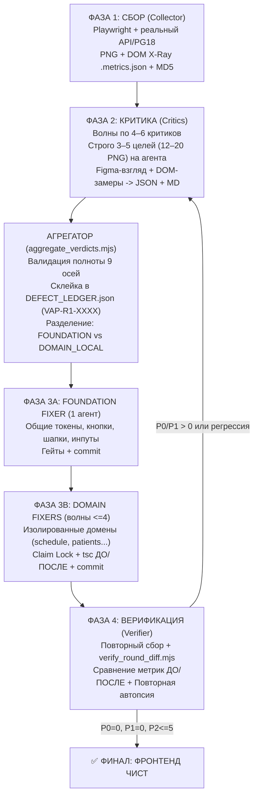

# 🔬 VISUAL AUDIT PIPELINE — ПРОМЫШЛЕННЫЙ КОНВЕЙЕР ТОТАЛЬНОЙ ПОЛИРОВКИ ФРОНТЕНДА

> **Статус:** 🟡 Инфраструктура полностью собрана, протестирована и ждёт боевого запуска.
> **Цель:** Вычистить ВСЁ визуальное и UX-говно фронтенда за **2–4 итерации**, не сломав ни бизнес-логику, ни типы, ни работающие клинические модули.
> **Рекомендуемая команда запуска (в будущем):** `/goal Запустить Visual Audit Pipeline — Раунд 1` или `/teamwork`

---

## 1. ПОЧЕМУ ПРОШЛЫЕ ПОДХОДЫ НЕ РАБОТАЛИ (АНАЛИЗ УРОКОВ DENTE CRM)

Предыдущие попытки навести порядок во фронтенде проваливались по 6 конкретным системным причинам:

1. **«Алиби одного бага» и потеря мелочей:** Агент открывал экран, замечал один явный косяк (например, съехавшую кнопку), чинил только его и гордо рапортовал `[ЧИСТО]`. При этом на том же экране оставались ещё 10 мелких дефектов: наезд лупы на placeholder, слово капсом, кнопка `38px` рядом с `32px`, слепящая тень в dark mode, обрезка `...` на табе, двойной дефис.
2. **Провалы передачи контекста между агентами:** Когда критик писал длинный текстовый отзыв, а агрегатор выдирал оттуда 1 строчку регуляркой, фиксер терял точный DOM-селектор, скриншот, контекст зоны и дизайнерское предложение «как должно быть» — в итоге фиксер правил наугад.
3. **Деструктивность массовых правок:** Когда несколько фиксеров одновременно лезли в общие стили (`dente-redesign.css`, `canonicalButtons.css`) или удаляли «лишние» кнопки ради красоты, ломались смежные экраны, падал `tsc`, затирались чужие правки в worktree или под нож попадали живые клинические функции (нарушение Мандата `8bj`).
4. **Слепота одного зрения:** Взгляд ИИ по PNG иногда не замечает `2px` горизонтальный скролл, кнопку `41x41px` вместо `44x44px` на мобайле или `scrollWidth > clientWidth`. А одни лишь скрипты без глаз не видят визуального «колхоза», каши, конфетти из бейджей и полых карточек.
5. **Потёмкинская маршрутизация:** Скрипты без знания реального роутера (`routeResolver.ts`, `WorkspaceStudioOverlayHost.tsx`) ходили по вымышленным URL и снимали один и тот же fallback-экран 20 раз под разными именами.
6. **Контекстная усталость критика:** Когда критику скармливали 20–30 скринов за раз, после 10-го скрина его внимание размывалось и начинались штампы «выглядит аккуратно».

**Этот пайплайн решает все 6 проблем архитектурно — на уровне скриптов, схем данных и жёсткого порядка волн.**

---

## 2. АРХИТЕКТУРА КОНВЕЙЕРА (4 ФАЗЫ × 2–4 РАУНДА)



---

## 3. 6 АНТИ-ДЕСТРУКТИВНЫХ ПРЕДОХРАНИТЕЛЕЙ (КАК СДЕЛАТЬ ПРОДУКТИВНО, А НЕ РАЗРУШИТЕЛЬНО)

1. **Двухслойный ремонт (`FOUNDATION` → `DOMAIN_LOCAL`):**
   - Критик классифицирует каждый дефект: это проблема **общей дизайн-системы** (`FOUNDATION`: токен, `canonicalButtons.css`, `AppTopBar`, глобальный CSS инпутов/модалок) или **локального компонента** (`DOMAIN_LOCAL`).
   - В Фазе 3А работает **строго 1 `Foundation Fixer`** ДО запуска доменных фиксеров. Он чинит корень проблемы в дизайн-системе, чтобы 5 доменных фиксеров не плодили 50 локальных `!important`-костылей и не перезаписывали общие CSS-файлы друг друга.
2. **Двойное зрение критика (PNG + DOM X-Ray `.metrics.json`):**
   - Коллектор для каждого скриншота снимает PNG **и** запускает `dom-xray-probe.mjs` прямо в браузере, сохраняя рядом `.metrics.json` с точными координатами и текстами: `horizontalOverflowPx`, `topChromeHeightPx`, `clippedTexts`, `undersizedTargets`, `primaryCtaCount`, `allCapsViolations`, `inputIconOverlaps`, `rawMachineLeaks`, `darkModeWhiteBlobs`, `overlappingControls`, `consoleErrors`.
   - Критик обязан проверить **оба источника** — это исключает и галлюцинации, и пропуск «мелочей на 2px».
3. **Атомарная сохранность каждого мелкого дефекта (`DEFECT_LEDGER.json`):**
   - Ни один косяк не теряется в пересказах: каждый дефект имеет стабильный сквозной ID `VAP-R{N}-{XXXX}`, привязку к зоне экрана, DOM-селектор, `[ФАЙЛ:СТРОКА]`, конкретное наблюдение и дизайнерское решение.
   - При переходе на Раунд `N+1` леджер **помнит все прошлые дефекты**: исправленные проверяются на закрытие (`FIXED` → `VERIFIED`), недоделанные или всплывшие снова переводятся в `REOPENED`.
4. **Анти-усталость (Микро-пачки для критиков):**
   - Один субагент-критик за раз проверяет **строго 3–5 целевых компонентов** (12–20 PNG в 4-State).
   - Валидатор `aggregate_verdicts.mjs` жёстко отклоняет (`REJECTED`) любой вердикт, где пропущена хотя бы одна из 9 осей или дефект записан без `observation`, `designerProposal`, `severity` и `scopeType`.
5. **Запрет слома логики и типов (Zero-Breakage Gate):**
   - Фиксер **не имеет права** удалять рабочие клинические кнопки/поля (Мандат `8bj`: 5 столпов клиники неприкосновенны!), ломать пропсы `useAppLogic.tsx` или оставлять ошибки TS.
   - Перед коммитом каждого батча обязателен прогон:
     `npm run check:diff -- --all && npm run check:buttons && npm run check:css-tokens && npm run check:react-hooks && npm run check:doors && npm run typecheck -w @dental/web`
   - Пофайловый `git add <file>` (никакого `git add .`!) и коммит строго в `main`.
6. **Анти-регрессионный контроль (`verify_round_diff.mjs`) и защита `[ЧИСТО]`:**
   - Экраны, получившие `0` дефектов в Раунде 1, попадают в `protectedCleanTargets` — фиксеры их не трогают.
   - В Раунде 2+ скрипт `verify_round_diff.mjs` автоматически сравнивает `.metrics.json` **ДО и ПОСЛЕ**. Если на каком-то экране стало хуже (например, чинили кнопку, а вылез `overflow-x` на мобилке) — скрипт поднимает красный флаг `REGRESSION` с ненулевым Exit Code.

---

## 4. 9 ОСЕЙ КРИТИКИ (ЧТО ИМЕННО ИЩЕТ КРИТИК)

1. **Ось 1 — Вертикальный бюджет шапок:** Суммарная высота верхних полос ≤ 160–180px на ПК (≤ 110px на мобайле). Никаких 3–5 этажей.
2. **Ось 2 — Геометрическая сетка, воздух и клиппинг:** Зазоры ≥ 6–8px, `padding-left ≥ 38px` у инпутов с иконкой, 0px горизонтального скролла, ноль `...` обрубков, ноль наездов элементов и полых «пустых брюх» карточек.
3. **Ось 3 — Сырые утечки и локализация:** Ноль UUID, `undefined`, `NaN`, `[object Object]`, `--` двойных дефисов, `snake_case`, ISO-дат `YYYY-MM-DD`, форматирование денег через `money.ts` (`tabular-nums`).
4. **Ось 4 — Когерентность состояний и 0px шума для нормы:** Никаких фейковых `0 ₽`, дублей аллергий в 3 местах, мёртвых Empty States без действия и спам-плашек «В норме» на каждой строке.
5. **Ось 5 — Иерархия действий (1 Primary CTA):** Ровно 1 акцентная кнопка на видимый экран. Ноль дублей одинаковых кнопок в шапке и футере, ноль светофоров и градиентов, единая матрица высот (`36px` desktop / `44px+` mobile) и скруглений.
6. **Ось 6 — Токенизация тем и световая гигиена:** В Dark Mode — 0 слепящих белых пятен/дропдаунов (`lum > 205`), в Light Mode — контраст текста ≥ 4.5:1, всё через `var(--paper)`, `var(--ink)`, `var(--line)`.
7. **Ось 7 — Сенсорная эргономика (Fitts & Apple HIG):** Тач-таргеты на 390×844 строго ≥ 44×44px, на ПК ≥ 28–32px, Primary CTA на мобайле в нижней трети (thumb zone), Bottom Sheets с drag handle, никаких плавающих FAB поверх таблиц.
8. **Ось 8 — Чистота терминологии и UPPERCASE BAN:** Строго `Sentence case` на кнопках, табах и чипах. Ноль советского канцелярита (`043/у`, `804н` в UI-контролах), ноль дев-сленга (`в 1 клик`, `Мандат 8e`, `Soft Negative Stock`), ноль эмодзи в медкартах и актах.
9. **Ось 9 — Эстетика Figma (Squint Test 3 сек + Portfolio Test):** Общая визуальная тишина (80% нейтральной базы), визуальный ритм (8px сетка), сбалансированность шапки (без 600px дыр посередине), тактильные отграниченные тайлы вместо блеклых призраков, профессиональное сравнение с уровнем Linear / Apple / Stripe.

Подробнейшая матрица `[БРАК]` vs `[ЭТАЛОН]` — в [`references/CRITIQUE_RUBRIC.md`](references/CRITIQUE_RUBRIC.md).

---

## 5. ФАЙЛОВАЯ СТРУКТУРА ИНФРАСТРУКТУРЫ

```text
.agents/skills/visual-audit-pipeline/
├── SKILL.md                              ← Главная инструкция пайплайна (этот файл)
├── references/
│   ├── CRITIQUE_RUBRIC.md                ← 9-осевая рубрика Арт-Директора + пороги DOM X-Ray
│   ├── SCREEN_REGISTRY.md                ← Полный каталог 70 целей (Views, Overlays, Modals, Portals, Empty = 276 скринов)
│   ├── LEDGER_AND_JSON_SCHEMA.md         ← Строгая JSON-схема вердиктов и сквозного DEFECT_LEDGER.json
│   └── AGENT_PROMPTS.md                  ← Готовые >=5-абзацные промпты для всех 5 ролей роя
└── scripts/
    ├── screen-targets.mjs                ← SSOT список всех целей и реальных hash-URL приложения
    ├── dom-xray-probe.mjs                ← Браузерный DOM-рентген (оверфлоу, обрезки, размеры, белые пятна)
    ├── capture_full_audit.mjs            ← Playwright-коллектор (живая клиника PG18 + PNG + metrics.json + MD5)
    ├── aggregate_verdicts.mjs            ← Валидатор + компилятор DEFECT_LEDGER.json и батчей по доменам
    └── verify_round_diff.mjs             ← Сравнение раундов До/После и детектор регрессий

artifacts/visual-audit/                   ← В .gitignore! Тяжёлые сырые PNG и .metrics.json каждого раунда
└── round_{N}/
    ├── capture_manifest.json
    ├── shots/                            ← {id}_{domain}_{Component}_{WxH}_{theme}.png + .metrics.json
    └── verdicts/                         ← {id}_{Component}_verdict.json + _verdict.md

docs/audits/visual-pipeline/              ← Отслеживается в git! Документальная память между раундами
├── DEFECT_LEDGER.json                    ← Сквозной реестр всех мелких дефектов (VAP-R1-XXXX)
├── ROUND_{N}_MASTER_REGISTRY.md          ← Человекочитаемый сводный реестр раунда
├── ROUND_{N}_VERIFICATION_DIFF.md        ← Автоотчёт До/После и регрессий
└── batches/round_{N}/                    ← Готовые досье-пакеты: FOUNDATION_batch.md, {domain}_batch.md
```

---

## 6. ПОШАГОВЫЙ ОПЕРАЦИОННЫЙ ПРОТОКОЛ (КОГДА ПРИДЁТ ВРЕМЯ ЗАПУСКА)

### Подготовка (1 раз перед Раундом 1)
1. Проверить, что база PG18 и серверы запущены: `npm run dev` (`127.0.0.1:4100` и `127.0.0.1:5173`).
2. Прогнать сухой просмотр целей:
   ```powershell
   node .agents/skills/visual-audit-pipeline/scripts/capture_full_audit.mjs --dry-run
   ```
3. Прогнать unit-тест самой инфраструктуры:
   ```powershell
   node --test scripts/tests/visual-audit-pipeline.test.mjs
   ```

### Запуск каждого раунда (`N = 1..4`)
1. **Фаза 1 (Сбор):** Запустить `capture_full_audit.mjs --round N` (или разбить на 2–3 коллектора по `--group views`, `--group overlays`, `--group modals,portals,empty`). Проверить `capture_manifest.json` (`blankCount === 0`, `duplicateCount === 0`).
2. **Фаза 2 (Критика):** Оркестратор нарезает цели из `capture_manifest.json` на микро-пачки по **3–5 целей (12–20 PNG + их `.metrics.json`)** и запускает критиков волнами по 4–6 субагентов (`TypeName: "self"`, `Model: "inherit"`). Каждый критик пишет `.json` + `.md` в `artifacts/visual-audit/round_{N}/verdicts/`.
3. **Агрегация:** Оркестратор запускает:
   ```powershell
   node .agents/skills/visual-audit-pipeline/scripts/aggregate_verdicts.mjs --round N
   ```
   Скрипт валидирует качество всех вердиктов и формирует `FOUNDATION_batch.md` + `{domain}_batch.md`.
4. **Фаза 3A (Foundation Fixer):** Сначала 1 субагент закрывает `FOUNDATION_batch.md`, прогоняет машинные гейты и коммитит.
5. **Фаза 3B (Domain Fixers):** Волнами ≤ 4 параллельных субагента разбирают доменные батчи (`schedule`, `patients`, `finance`, `visit`, `odontogram`, `settings`, `documents`, `imaging`, `warehouse`, `portal` и др.) с Claim Lock и замером `tsc` ДО/ПОСЛЕ. После завершения каждого батча — пофайловый коммит и обновление статусов в `DEFECT_LEDGER.json`.
6. **Фаза 4 (Верификация):** Повторный сбор в `round_{N+1}` + запуск:
   ```powershell
   node .agents/skills/visual-audit-pipeline/scripts/verify_round_diff.mjs --prev N --curr (N+1)
   ```
   + перепроверка критиками всех экранов, где были фиксы или регрессии.
7. **Критерий выхода из цикла:** После раунда `N` в `DEFECT_LEDGER.json`: `P0 === 0`, `P1 === 0`, `P2 <= 5`, `regressions === 0` по `verify_round_diff.mjs`.

---

> **Документ создан:** 2026-11-27 | **Синхронизирован с:** `THE_HAMMER_MASTER_PROMPT.md`, `DESIGNER_VISUAL_INQUISITION_BIBLE.md`, `MOBILE_DESIGN_APPLE_HIG.md`, `SYSTEMIC_ROT_RATCHET.md`.
