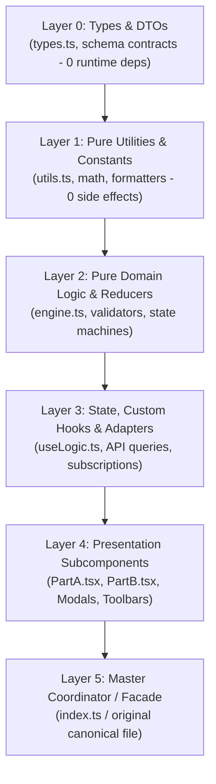
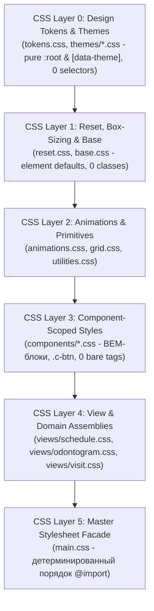
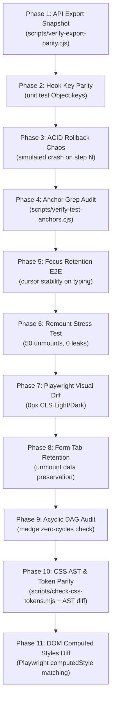

# Skill: Safe Monolith Decomposition (/decomposer)

> 🏛️ **ТЕОРЕМА О СОХРАНЕНИИ ПОВЕДЕНИЯ (BEHAVIORAL CONSERVATION THEOREM):**  
> Декомпозиция монолита — это СТРОГО пространственный перенос существующего кода в файловой системе без малейшего изменения его наблюдаемого поведения, контрактов типов, состояния базы данных, каскада стилей, специфичности селекторов и геометрии интерфейса (0px CLS).
> 
> **Фокус стека:** TypeScript 5+, React 19, Fastify, Drizzle ORM, PostgreSQL 18, Vanilla CSS / CSS Modules & Design Tokens. (Никакого Unity/C# — 100% фокус на боевой веб-стек CRM).

---

## 0. АБСОЛЮТНЫЙ ЗАКОН АНТИ-ОПТИМИЗАЦИИ (ZERO LOGIC MUTATION)
> ⚠️ **ЖЕЛЕЗНЫЙ ИНВАРИАНТ:**  
> При декомпозиции монолита КАТЕГОРИЧЕСКИ ЗАПРЕЩЕНО совмещать перенос кода с «улучшайзингом»!
> 
> - **Запрещено:** менять логику ветвлений `if`, оптимизировать циклы, переименовывать функции, менять селекторы, переписывать формулы или «причесывать» стили во время распила.
> - **Почему:** Если вы изменили структуру И изменили логику одновременно, при первой же ошибке невозможно понять: сломался ли импорт/замыкание или ваша «оптимизация».
> - **Строгая 4-шаговая последовательность:**
>   1. **Шаг 1:** 100% тождественный вынос кода байт-в-байт (Verbatim Extraction).
>   2. **Шаг 2:** Прохождение всех рубежей проверки (компилятор Exit Code 0, тесты зеленые, 0px CLS).
>   3. **Шаг 3:** Фиксация атомарного Git-коммита декомпозиции (`refactor: decompose X into modules`).
>   4. **Шаг 4 (Опционально):** Только теперь, в отдельном коммите, делается изолированный рефакторинг логики с отдельным тест-сьютом.

---

## 1. ИЕРАРХИЯ СЛОЕВ DAG (DIRECTED ACYCLIC GRAPH INVARIANT)

Каждый распиливаемый модуль (TypeScript/TSX или CSS) обязан организовываться в строгий направленный ациклический граф. Любые циклические зависимости (`A -> B -> A`) ЗАПРЕЩЕНЫ.

### А. Иерархия слоев для TypeScript / React / Fastify:



#### Правила слоев TypeScript/TSX:
- **Layer 0 (Types & Contracts):** Чистые `type`, `interface`, Zod-схемы. Не содержат рантайм-логики.
- **Layer 1 (Pure Utils & Constants):** Чистые функции-калькуляторы, парсеры дат, константы. Ноль побочных эффектов.
- **Layer 2 (Pure Domain Logic):** Чистые стейт-машины, редьюсеры, правила прайса, валидаторы без привязки к React DOM или Fastify HTTP.
- **Layer 3 (Custom Hooks & Adapters):** Хуки React (`useState`, `useEffect`, `useCallback`), Fastify-контроллеры, адаптеры к БД.
- **Layer 4 (Presentation Subcomponents):** Изолированные UI-компоненты представления. Получают данные через строго типизированные пропсы.
- **Layer 5 (Master Coordinator / Facade):** Исходный монолитный файл. Сокращается с 2000+ строк до 100–300 строк. Собирает сабкомпоненты и прозрачно реэкспортирует публичный интерфейс.

---

### Б. Иерархия слоев для CSS-стилей (CSS Stylesheet DAG):

Декомпозиция CSS подчиняется строгому порядку каскада (Cascade Ordering). Нарушение порядка слоев вызывает тихую инверсию специфичности (когда сброс стилей случайно перебивает компонент, или компонент перебивает токен темы).



#### Правила слоев CSS:
- **CSS Layer 0 (Design Tokens & Themes):** Объявление переменных дизайна (`var(--paper)`, `var(--ink)`, `var(--teal)`, `var(--radius)`). Строго `:root` и `[data-theme="..."]`. ЗАПРЕЩЕНО объявлять стили элементов или классов.
- **CSS Layer 1 (Reset, Box-Sizing & Base):** Нормализация браузера: `box-sizing: border-box`, базовые стили `body`, дефолтные типографические параметры. Ноль классов компонентов.
- **CSS Layer 2 (Animations & Primitives):** Централизованные `@keyframes` анимации (`@keyframes dente-spin`), сетки макета, атомарные классы-модификаторы. Ноль переопределений глобальных тегов.
- **CSS Layer 3 (Component Styles):** Изолированные стили переиспользуемых компонентов (кнопки, модалки, чипы, инпуты). Строго BEM-классы или CSS Modules. КАТЕГОРИЧЕСКИ ЗАПРЕЩЕНЫ голые теги (`button`, `input`).
- **CSS Layer 4 (View & Domain Assemblies):** Специфичные стили тяжелых клинических экранов (зубная формула, таймлайн расписания, дневник приёма 043/у, кассовый модуль).
- **CSS Layer 5 (Master Stylesheet Facade):** Исходный `main.css`. Превращается в прозрачный сборочный манифест с детерминированным порядком `@import`, либо разбивается на асинхронные чанки роутов Vite с гарантированным базовым каркасом.

---

## 2. ПОЛНАЯ ЭНЦИКЛОПЕДИЯ ЭДЖ-КЕЙСОВ (EDGE CASES & PITFALLS)

### 🌐 ЧАСТЬ 1: REACT 19, DOM & HOOKS (10 ЭДЖ-КЕЙСОВ)

#### 💥 1. Уничтожение DOM-идентичности и сброс каретки инпута (In-Render Component Declaration)
- **Симптом:** Пользователь вводит текст в поле поиска или медкарте, но после КАЖДОЙ введенной буквы фокус слетает, экран подергивается, а каретка прыгает в конец.
- **Корневая причина:** Сабкомпонент объявлен **внутри** функции рендера родителя:
  ```tsx
  // КАТЕГОРИЧЕСКИ ЗАПРЕЩЕНО (АНТИПАТТЕРН):
  function PatientVisitModal() {
    // На каждый ререндер создается новый объект функции SubSearch!
    const SubSearch = () => <input value={query} onChange={e => setQuery(e.target.value)} />;
    return <div><SubSearch /></div>;
  }
  ```
  React 19 видит другой функциональный тип, полностью уничтожает старый DOM-узел (`unmount`), создает новый (`mount`) и сбрасывает фокус и выделение.
- **Закон:** ВСЕ вынесенные сабкомпоненты объявляются СТРОГО на верхнем уровне отдельных файлов. Никогда не объявлять компоненты внутри компонентов!

#### 💥 2. Схлопывание сетки Flex/Grid родителя (The Accidental Wrapper Div)
- **Симптом:** У родителя было `display: grid; grid-template-columns: repeat(3, 1fr); gap: 16px;`. Вынесли 3 карточки в сабкомпонент — сетка схлопнулась в 1 гигантскую колонку.
- **Корневая причина:** Вынесенный сабкомпонент обернул элементы в `<div>`:
  ```tsx
  // СЛОМАЕТ СЕТКУ РОДИТЕЛЯ:
  export function TeethGridCards({ teeth }) {
    return (
      <div> {/* Этот div стал единственным прямым потомком Grid-контейнера! */}
        {teeth.map(t => <ToothCell key={t.id} tooth={t} />)}
      </div>
    );
  }
  ```
- **Закон:** 
  1. Если компонент возвращает группу детей в родительский Flex/Grid — возвращать СТРОГО `<React.Fragment>` (`<>...</>`).
  2. Если обертка неизбежна для внутренних стилей — использовать CSS `display: contents;`, убирающее обертку из топологии Grid-потомков.

#### 💥 3. Взрыв ререндеров при создании общего React Context (Context Splitting Trap)
- **Симптом:** Состояние монолита вынесли в общий `useContext(MonolithContext)`. При вводе одного символа в поиске FPS падает до 10, подвисает весь экран.
- **Корневая причина:** Любое обновление любого поля в объекте контекста вызывает принудительный ререндер ВСЕХ 15 вынесенных сабкомпонентов, подписанных на контекст.
- **Закон:**
  1. **Разделять State и Dispatch:** Создавать два независимых контекста: `StateContext` (данные) и `DispatchContext` (стабильные хендлеры действий).
  2. **Локализация стейта (State Co-location):** Если состояние нужно только внутри вкладки 2 — держать `useState` ВНУТРИ вкладки 2, а не в общем контексте экрана.

#### 💥 4. Потеря ссылок `ref` и поломка геометрических замеров
- **Симптом:** Ломается скролл к выбранному зубу, виртуальный скролл падает с ошибкой, или дропдаун позиционируется в координатах (0, 0).
- **Корневая причина:** Монолит делал `containerRef.current.getBoundingClientRect()` или `containerRef.current.scrollTo()`. После выноса блока `ref` повис в воздухе.
- **Закон:** Если на выносимый компонент снаружи передается `ref` — компонент ОБЯЗАН принимать `ref` и пробрасывать его в целевой DOM-узел (в React 19 как проп `ref`, либо через `forwardRef` для обратной совместимости).

#### 💥 5. Рассинхрон `defaultValue` в неконтролируемых формах
- **Симптом:** Переключаем пациента в списке, но форма редактирования остается заполненной данными предыдущего пациента.
- **Корневая причина:** Вынесенная форма использовала неконтролируемые инпуты с `defaultValue={patient.name}`. Они читают значение ТОЛЬКО при первом монтировании.
- **Закон:** Делать форму строго контролируемой (`value` + `onChange`), либо передавать уникальный ключ сущности: `<PatientForm key={patient.id} patient={patient} />`, принуждающий React к пересозданию формы при смене ID.

#### 💥 6. Мерцание макета при замене `useLayoutEffect` на `useEffect`
- **Симптом:** При открытии шторки элементы на 16 мс появляются в левом верхнем углу, а затем прыгают на свои места (заметный скачок CLS).
- **Корневая причина:** В монолите позиционирование тултипа или расчет высоты считались синхронно ДО отрисовки (pre-paint) в `useLayoutEffect`. Инженер заменил его на `useEffect`, срабатывающий ПОСЛЕ отрисовки первого кадра.
- **Закон:** Все замеры DOM (`getBoundingClientRect`, `offsetHeight`, `scrollLeft`) для установки начальной геометрии выполняются СТРОГО в `useLayoutEffect`.

#### 💥 7. Протухшие замыкания и гонки асинхронных ответов (Stale Closures & Race Conditions)
- **Симптом:** Быстро переключили вкладки — пришел запоздалый ответ первого запроса и перезаписал актуальные данные второй вкладки.
- **Корневая причина:** Вынесенный хук замкнул старое состояние без `AbortController` и без функционального сеттера.
- **Закон:**
  1. Сеттеры стейта писать только функционально: `setState(prev => ({ ...prev, val }))`.
  2. Асинхронные запросы обязаны отменяться в функции очистки `useEffect` через `AbortController`.

#### 💥 8. Обрезание оверлеев Z-Index Stacking Context
- **Симптом:** Календарь даты визита или контекстное меню обрезается рамкой карточки или проваливается под соседний сайдбар.
- **Корневая причина:** На вынесенный сабкомпонент добавили `overflow: hidden`, `opacity: 0.99` или `transform: translate(...)`, породив локальный Stacking Context.
- **Закон:** Все всплывающие меню, модалки и подсказки обязаны монтироваться через React Portals (`createPortal(content, document.body)`).

#### 💥 9. Нарушение порядка каскада стилей и специфичности CSS
- **Симптом:** После распила CSS на отдельные файлы кнопки изменили цвет или размер.
- **Корневая причина:** При равной специфичности селекторов побеждает правило, объявленное позже в бандле. Изменение порядка импортов нарушило каскад.
- **Закон:** Использовать BEM-классы или CSS Modules. Запретить переопределение голых тегов (`button`, `input`).

#### 💥 10. Коллизии ключей `key` при разделении списков
- **Симптом:** Чекбоксы переключаются не у тех зубов или строк при фильтрации.
- **Корневая причина:** Вынесенные компоненты использовали `key={index}`.
- **Закон:** Строго уникальные идентификаторы: `key={item.uuid}`.

#### 💥 11. Ловушка невидимости React 19 `useFormStatus` вне дерева `<form>` (Context Boundary Trap)
- **Симптом:** Кнопка отправки формы или индикатор сохранения в вынесенной плавающей панели не переходят в состояние загрузки (`pending === false`), форма дублирует отправку данных.
- **Корневая причина:** В React 19 хук `useFormStatus` работает ИСКЛЮЧИТЕЛЬНО внутри компонентов, отрендеренных как прямые или вложенные потомки тега `<form action={...}>`. При выносе кнопки в нижний бар (Floating Bottom Bar) или монтировании через `createPortal` компонент оказывается вне дерева `<form>`, и хук молча возвращает пустой дефолтный стейт `{ pending: false, data: undefined }`.
- **Закон:** Если кнопка выносится в портал или за пределы `<form>`, передавать состояние `pending` явно через пропсы (`isPending={isPending}` из родительского `useTransition`/`useActionState`), либо использовать `form="form-id"` со связыванием через хук состояния.

#### 💥 12. Потеря мемоизации при передаче inline-коллбеков (`useCallback` Cache Invalidation)
- **Симптом:** Вынесли 20 строк таблицы в `React.memo(RowItem)`. Ожидали прироста производительности, но при каждом вводе символа в поиск перерисовываются все 200 строк таблицы.
- **Корневая причина:** Родитель передает в вынесенный компонент стрелочную функцию `onSelect={() => handleSelect(item.id)}`. На каждый ререндер родителя создается новый инстанс функции, обесценивающий `React.memo`.
- **Закон:** Оборачивать обработчики в `useCallback`, либо передавать стабильный коллбек `onSelect(id)` и замыкать `id` внутри самого сабкомпонента (`onClick={() => onSelect(id)}`).

#### 💥 13. Разрыв синхронизации с URL-параметрами (Loss of Deep Linking & Browser History)
- **Симптом:** Переключаем вкладки в вынесенном таб-баре («Зубная формула», «Финансы», «Анамнез»), нажимаем кнопку браузера «Назад» или обновляем страницу — и врач вылетает на дефолтную вкладку, теряя текущий рабочий контекст.
- **Корневая причина:** Монолит читал активную вкладку из URL (`useSearchParams` / `new URLSearchParams(window.location.search)`), а при распиле инженер лениво заменил это на изолированный локальный `useState('general')`.
- **Закон:** Все состояния навигации экранов (активная вкладка, фильтр дат, выбранный ID визита) обязаны синхронизироваться с URL search params. Локальный стейт допустим только для эфемерных состояний (открыт ли тултип, фокус инпута).

#### 💥 14. Смещение контейнера скролла и поломка виртуализации списков (`useVirtualizer` Scroll Boundary Drift)
- **Симптом:** При прокрутке вынесенного списка визитов виртуальный скроллер показывает белый экран, дергается или прокручивается рывками.
- **Корневая причина:** Хук виртуализации (`@tanstack/react-virtual` / custom virtualizer) ожидал скролл на внешнем контейнере (`overflow-y: auto`), а при декомпозиции CSS-класс со скроллом случайно перенесли на внутренний сабкомпонент. Замеры `parentRef.current.scrollTop` стали равны 0.
- **Закон:** Контейнер прокрутки и хук виртуализации обязаны находиться на одном архитектурном уровне. Проп `parentRef` передается строго узлу, обладающему свойством `overflow-y: auto`.

#### 💥 15. Скрытая потеря медицинских записей при автосохранении (Debounced Autosave Flush Trap)
- **Симптом:** Врач печатает текст дневника приёма или диагноза, переключает вкладку до истечения 500ms таймера дебаунса — и последнее напечатанное предложение бесследно исчезает из базы данных.
- **Корневая причина:** Вынесенный хук автосохранения в сабкомпоненте отменяет таймер (`clearTimeout`) в функции очистки `useEffect`, не вызывая принудительный синхронный сброс буфера (`flush()`).
- **Закон:** Любой хук отложенного сохранения при размонтировании ОБЯЗАН принудительно сбрасывать несохраненный буфер в хранилище:
  ```typescript
  useEffect(() => {
    return () => {
      debouncedSave.flush(); // Сохраняем последний драфт перед unmount!
    };
  }, [debouncedSave]);
  ```

#### 💥 16. Утечка блокировки скролла (`body.overflow = 'hidden'`) и потеря фокуса (Modal A11y Trap)
- **Симптом:** После закрытия модалки вся страница CRM перестает скроллиться, либо фокус с клавиатуры улетает в начало документа (`<body>`), ломая работу врача с клавиатуры (стрелки, Tab).
- **Корневая причина:** Модалка установила `document.body.style.overflow = 'hidden'`, но при резкой смене роута или размонтировании родителя очистка стилей не сработала. Также не был сохранен `document.activeElement` для возврата фокуса кнопке-триггеру.
- **Закон:** Все модальные окна обязаны восстанавливать исходный `overflow` в функции очистки `useEffect` и возвращать фокус элементу, открывшему модалку.

#### 💥 17. Стирание данных формы при переключении вкладок с условным рендером (Conditional Render Form Wipeout)
- **Симптом:** Врач заполняет вкладку «Осмотр», переключается на вкладку «Диагнозы», возвращается назад — и все введенные зубы и чекбоксы сбросились в дефолтные значения.
- **Корневая причина:** В монолите форма рендерилась целиком, а при декомпозиции вкладки оформили через `{activeTab === 'exam' && <ExamSection />}`. Библиотека форм (или локальный `useState`) при размонтировании ветки уничтожает состояние полей (`shouldUnregister: true`).
- **Закон:** 
  1. Либо держать все вкладки смонтированными в DOM, скрывая их визуально через CSS: `<div hidden={activeTab !== 'exam'} style={{ display: activeTab === 'exam' ? undefined : 'none' }}>`.
  2. Либо поднимать всё состояние формы в фасадный хук (State Hoisting) и передавать контролируемые значения, либо настраивать React Hook Form с `shouldUnregister: false`.

#### 💥 18. Конфликт глобальных горячих клавиш (Global Keyboard Shortcut Collision)
- **Симптом:** Врач нажимает `Escape`, чтобы закрыть селектор зуба в вынесенном дропдауне, но закрывается ВСЯ модалка приёма пациента, уничтожая несохраненный дневник.
- **Корневая причина:** И родительский координатор, и вынесенный сабкомпонент независимо подписались на `window.addEventListener('keydown')`. Сабкомпонент обработал `Escape`, но забыл остановить всплытие.
- **Закон:** В вынесенных обработчиках клавиш ОБЯЗАТЕЛЕН вызов `e.stopPropagation()` и `e.stopImmediatePropagation()`. Глобальные слушатели должны регистрироваться через централизованный стек с приоритетом верхнего слоя.

#### 💥 19. Поломка Fast Refresh / HMR при экспорте констант из компонентов
- **Симптом:** При редактировании кода любого сабкомпонента страница полностью перезагружается (Full Reload) вместо мгновенного React Fast Refresh, сбрасывая всё интерактивное состояние врача.
- **Корневая причина:** Файл сабкомпонента наряду с компонентом экспортирует не-компонентные объекты или константы: `export const TOOTH_PRESETS = [...]`. Инструмент HMR (Vite/Babel) не может изолировать границы компонента.
- **Закон:** Файлы компонентов обязаны экспортировать ИСКЛЮЧИТЕЛЬНО React-компоненты. Все константы, мапперы и типы выносятся строго в `types.ts` (Layer 0) или `utils.ts` (Layer 1).

#### 💥 20. Конфликт многослойных порталов (Nested Portal Z-Index Inversion)
- **Симптом:** Выпадающий календарь даты визита (Datepicker) рендерится ПОД серым бэкдропом модального окна и недоступен для клика.
- **Корневая причина:** И модалка, и дейтпикер монтируются в `document.body` через `createPortal`, но дейтпикер смонтирован раньше в DOM или имеет меньший `z-index`, чем динамический бэкдроп модалки.
- **Закон:** Использовать строгую иерархию дизайн-токенов: `var(--z-modal-backdrop)` (900), `var(--z-modal)` (1000), `var(--z-popover)` (1100), `var(--z-tooltip)` (1200) с шагом $\ge 100$.

#### 💥 21. Крах хука при монтировании вне дерева провайдера (Context Provider Scope Boundary)
- **Симптом:** При открытии вынесенной панели или модалки приложение падает с фатальной ошибкой `useAppLogicContext must be used within an AppLogicProvider`.
- **Корневая причина:** Вынесенный сабкомпонент смонтировали через `createPortal(..., document.body)`, но провайдер контекста обернут только вокруг локального поддерева страницы, а не всего приложения.
- **Закон:** Все глобальные контексты клиники оборачивают корень приложения (`App.tsx`). Если сабкомпонент выносится в портал, провайдер контекста обязан либо находиться выше точки монтирования портала, либо необходимые данные пробрасываются в сабкомпонент через пропсы без прямого обращения к изолированному контексту.

#### 💥 22. Разрыв отката оптимистичного UI в React 19 (`useOptimistic` Disconnect)
- **Симптом:** Врач удаляет процедуру из сметы — строка исчезает, сервер падает с 500 ошибкой, но строка так и не возвращается на экран, создавая иллюзию успешного удаления.
- **Корневая причина:** В React 19 хук `useOptimistic` жестко связан с активным переходом `startTransition` в родительском компоненте. При выносе списка в дочерний компонент локальный `useOptimistic` потерял связь с родительским асинхронным переходом действия.
- **Закон:** Состояние оптимистичного интерфейса управляется СТРОГО на том же уровне, где инициируется `startTransition` / `useActionState`. Дочерние компоненты получают оптимистичное состояние как плоский массив данных через пропсы.

#### 💥 23. Взрыв ререндеров из-за отсутствия `useShallow` в селекторах Zustand
- **Симптом:** После распила экрана на 10 сабкомпонентов производительность интерфейса упала: при любом нажатии клавиши все 10 сабкомпонентов ререндерятся, вызывая задержки ввода до 200 мс.
- **Корневая причина:** Сабкомпоненты вызывают селектор хранилища с возвратом нового составного объекта: `usePatientStore(s => ({ name: s.name, balance: s.balance }))`. В React 19 / Zustand 5 новый ссылочный объект вызывает безусловный ререндер.
- **Закон:** Использовать атомарные селекторы для каждого поля (`usePatientStore(s => s.name)`), либо оборачивать составные селекторы в `useShallow`: `usePatientStore(useShallow(s => ({ name: s.name, balance: s.balance })))`.

#### 💥 24. Сбой динамического чанка при повторном деплое без ErrorBoundary (`React.lazy` Chunk Failure)
- **Симптом:** Клиника работает, произошел деплой новой версии API/Web. Врач кликает по вкладке «Рентген» и видит белый экран с ошибкой `Failed to fetch dynamically imported module`.
- **Корневая причина:** Вынесенный сабкомпонент подключили через `React.lazy()`, но не обернули в `ErrorBoundary` с автоматической перезагрузкой устаревшего ассета.
- **Закон:** Любой динамический импорт обязан оборачиваться в специализированный предохранитель `ChunkErrorBoundary`, который при ошибке 404 на хеш бандла делает мягкую перезагрузку страницы с сохранением черновика.

---

### 🗄️ ЧАСТЬ 2: TYPESCRIPT, FASTIFY, DRIZZLE ORM & POSTGRESQL (24 ЭДЖ-КЕЙСА)

#### 💥 25. Разорванные границы транзакций БД (ACID Boundary Fracture)
- **Симптом:** Шаг 1 (создание счёта) записался в БД, шаг 2 (списание со склада) упал с ошибкой, но счёт остался в базе, породив финансовую дыру.
- **Корневая причина:** Монолит держал `await db.transaction(async tx => { ... })`. При декомпозиции шаг 2 вынесли в сервис и внутри вызвали глобальный `db.update()` вместо переданного транзакционного клиента `tx`.
- **Закон:**
  ```typescript
  // ОБЯЗАТЕЛЬНЫЙ СТАНДАРТ:
  export async function applyWarehouseDeduction(
    tx: DatabaseTransaction, // Экземпляр транзакции обязателен первым аргументом!
    items: DeductionItem[]
  ): Promise<void> {
    await tx.update(inventoryTable)...; // Строго через tx!
  }
  ```

#### 💥 26. Взаимные дедлоки строк СУБД (Row Lock Ordering Deadlock)
- **Симптом:** При одновременной оплате двух счетов PostgreSQL падает: `deadlock detected: Process 12345 waits for ShareLock on transaction...`.
- **Корневая причина:** Сервис 1 блокирует счет A, затем кошелек B. Сервис 2 блокирует кошелек B, затем счет A.
- **Закон:** Все `SELECT ... FOR UPDATE` в разделенных сервисах обязаны блокировать записи в едином каноническом порядке (сортировка первичных ключей `ids.sort()`).

#### 💥 27. Ловушка деструктивных миграций Drizzle ORM
- **Симптом:** Забыли реэкспортировать сателлит схемы в `schema/index.ts`. Команда `drizzle-kit generate` считает, что таблицы удалены, и генерирует `DROP TABLE "invoices";`.
- **Корневая причина:** Потеря экспорта таблицы в главном индексном файле схемы.
- **Закон:** После любой декомпозиции схем обязателен запуск холостой проверки миграций: `npx drizzle-kit check`. Дифф миграций обязан быть ПУСТЫМ (0 новых миграций)!

#### 💥 28. Циклические связи таблиц Drizzle (Circular Foreign Key Relations)
- **Симптом:** Файл `patients.ts` импортирует таблицу `appointments`, а `appointments.ts` импортирует `patients`. Node.js падает с ошибкой циклического импорта или `ReferenceError: Cannot access 'patients' before initialization`.
- **Корневая причина:** Жесткая взаимная связь таблиц на верхнем уровне модуля.
- **Закон:** В Drizzle ORM связи определяются через ленивые функции в файле связей или через фабрики:
  ```typescript
  export const patientsRelations = relations(patients, ({ many }) => ({
    appointments: many(appointments), // Вычисляется лениво!
  }));
  ```

#### 💥 29. Утечка контекста тенанта Fastify (AsyncLocalStorage Drift)
- **Симптом:** Фоновая отправка чека или генерация отчета обращается к БД без фильтрации по `organizationId` или падает с `TenantContext missing`.
- **Корневая причина:** Вызов фоновой функции через «оголенный» промис `void processJob()` без ожидания и без связывания с AsyncLocalStorage Fastify.
- **Закон:** Явный проброс `organizationId`, либо оборачивание в `withTenantCtx(ctx, async () => { ... })`.

#### 💥 30. Fastify Plugin Encapsulation Breakdown
- **Симптом:** Вынесли роуты в саб-плагин `fastify.register(subRoutes)`. Зарегистрированные в нем декораторы (например, `fastify.authenticate`) перестали быть видны соседним роутам.
- **Корневая причина:** Fastify создает изолированный контекст инкапсуляции для каждого плагина.
- **Закон:** Если плагин регистрирует общие декораторы или хуки, оборачивать его в `fastify-plugin` (`import fp from 'fastify-plugin'`). Если плагин регистрирует изолированные маршруты — использовать стандартную инкапсуляцию с префиксом `{ prefix: '/api/v1/...' }`.

#### 💥 31. Исчерпание пула соединений БД при слепом Promise.all
- **Симптом:** При вызове вынесенного сервиса сервер зависает на 30 секунд и падает с `Connection pool timeout`.
- **Корневая причина:** Вынесенный код делает `await Promise.all(items.map(async item => await db.query...))` — 100 одновременных запросов исчерпывают пул `max: 20` в PostgreSQL.
- **Закон:** Пакетные операции выполняются единым SQL-запросом (`WHERE id IN (...)`), либо через чанки с лимитом параллелизма (p-limit $\le 5$).

#### 💥 32. Barrel File Circular Import Deadlock
- **Симптом:** Сабкомпонент импортирует утилиту из `@/components`, которая реэкспортирует этот же сабкомпонент через `index.ts`. В рантайме компонент оказывается `undefined`.
- **Корневая причина:** Импорт из собственного barrel-файла папки.
- **Закон:** Сабкомпоненты НИКОГДА не должны импортировать ничего из своего собственного `index.ts`. Использовать СТРОГО прямые относительные импорты (`./types`, `../otherModule`).

#### 💥 33. Type-Only Re-exports под `isolatedModules`
- **Симптом:** Vite/esbuild при сборке падает: `Cannot re-export type as value when isolatedModules is enabled`.
- **Корневая причина:** Реэкспорт TypeScript-типов без модификатора `type`.
- **Закон:** Всегда строго: `export type * from './types';` для контрактов и `export * from './utils';` для рантайм-кода.

#### 💥 34. Потеря дженериков и неявное сужение типов (Generic Parameter Erasure)
- **Симптом:** Вынесенный компонент таблицы `Table<T>` начал ругаться на типы строк или требовать приведения `as any`.
- **Корневая причина:** При выносе интерфейса пропсов забыли передать параметр типа: `interface TableProps` вместо `interface TableProps<T>`.
- **Закон:** Сохранять все типовые параметры 1:1: `export function Table<T extends Record<string, unknown>>(props: TableProps<T>): JSX.Element`.

#### 💥 35. Захват независимого коннекта в Drizzle при вложенных транзакциях (`tx.transaction()` vs `db.transaction()`)
- **Симптом:** Внешний сервис открыл `await db.transaction(async tx => { ... })`. Внутри вызывается вынесенный хелпер `updateLedger()`, который внутри себя делает `await db.transaction(...)` вместо переданного `tx.transaction(...)`. Запрос зависает навечно (deadlock) либо изменения хелпера становятся видны снаружи ДО фиксации внешней транзакции.
- **Корневая причина:** Вызов `db.transaction()` запрашивает НОВОЕ физическое соединение из пула соединений PostgreSQL. Новое соединение не видит незакоммиченные строки транзакции `tx` (изоляция READ COMMITTED) и блокируется при попытке обновить те же строки, на которых `tx` держит блокировку (`FOR UPDATE`).
- **Закон:** Вспомогательные сервисы ОБЯЗАНЫ принимать `tx: DatabaseTransaction` и использовать `await tx.transaction(async subTx => ...)` для создания SQL `SAVEPOINT`, оставаясь в рамках ТОГО ЖЕ физического соединения.

#### 💥 36. Дрифт валидации Zod и потеря типов в разделенных роутах Fastify
- **Симптом:** После выноса обработчиков маршрутов из монолитного файла роутов компилятор перестал проверять типы тела запроса (`request.body` стал `unknown`), и в рантайме начали проходить невалидные данные без выбрасывания 400 Bad Request.
- **Корневая причина:** Обработчик был объявлен как `async function handleCreate(request: FastifyRequest, reply: FastifyReply)` без строгой привязки к схеме валидации.
- **Закон:** Все вынесенные контроллеры типизируются через схему Zod:
  ```typescript
  import type { FastifyRequest, FastifyReply } from 'fastify';
  import type { z } from 'zod';
  import type { createInvoiceSchema } from './schemas';

  export async function handleCreateInvoice(
    request: FastifyRequest<{ Body: z.infer<typeof createInvoiceSchema> }>,
    reply: FastifyReply
  ): Promise<void> { ... }
  ```

#### 💥 37. Утечка памяти при создании Prepared Statements в динамических хелперах
- **Симптом:** При высокой нагрузке на вынесенный сервис память Node.js и PostgreSQL растет, в логах базы появляются ошибки `prepared statement "..." already exists`.
- **Корневая причина:** Вынесенная функция вызывала `db.select().from(...).prepare(statementName)` внутри обработчика запроса, генерируя новые имена стейтментов на каждый HTTP-запрос.
- **Закон:** Подготовленные выражения (`.prepare()`) объявляются СТРОГО на верхнем уровне модуля (статически при старте сервера), либо вынесенный сервис использует стандартные параметризованные запросы без динамического именования стейтментов.

#### 💥 38. Утечка данных между организациями из-за потери составного фильтра `organizationId`
- **Симптом:** Врач клиники А через вынесенный эндпоинт случайно видит расписание или карту пациента клиники Б.
- **Корневая причина:** В монолите стоял глобальный скоуп. При выносе запроса `getPatientById` разработчик написал: `db.select().from(patients).where(eq(patients.id, id))`, потеряв фильтр `eq(patients.organizationId, orgId)`.
- **Закон:** Любой запрос в вынесенных сервисах к мультитенантным сущностям ОБЯЗАН содержать составной фильтр:
  ```typescript
  .where(and(eq(patients.organizationId, organizationId), eq(patients.id, id)))
  ```

#### 💥 39. Взрыв N+1 SQL-запросов при замене JOIN на итеративные хелперы (The N+1 Query Degradation Trap)
- **Симптом:** До распила монолита эндпоинт расписания отдавал ответ за 35ms (один SQL-запрос `leftJoin(doctors)`). После декомпозиции с функцией `async function getDoctor(id)` время ответа выросло до 3800ms, положив API при 60 слотах в сетке.
- **Корневая причина:** Разработчик превратил реляционный `JOIN` в итеративный цикл с N независимыми вызовами к СУБД (`for (const appt of list) appt.doc = await getDoctor(appt.doctorId)`).
- **Закон:** Категорически запрещено разбивать эффективные SQL JOIN на итеративные функции. Если вынос логики необходим — использовать пакетную загрузку (Batch Ingestion через `WHERE id IN (...)` или Drizzle `with: { ... }`).

#### 💥 40. Зависание коннектов СУБД в `idle in transaction` из-за проглоченных ошибок в catch
- **Симптом:** PostgreSQL исчерпывает пул `max_connections: 100`, новые запросы зависают по таймауту, а системный `pg_stat_activity` показывает десятки коннектов в состоянии `idle in transaction`.
- **Корневая причина:** В вынесенном сервисе ошибку поймали в блоке `catch (err) { logger.warn(err); return null; }` внутри транзакции `tx.transaction()`, не пробросив ошибку наверх. PostgreSQL не получил команду `ROLLBACK` и завис в ожидании завершения транзакции.
- **Закон:** Любой блок `catch` внутри транзакционного контекста ОБЯЗАН делать либо явный `throw err`, либо вызывать явный `tx.rollback()`. Запрещено молчаливо глушить ошибки внутри транзакций!

#### 💥 41. Рассинхрон порядка хуков Fastify при разделении плагинов (Lifecycle Hook Scope Ordering)
- **Симптом:** В вынесенном роуте проверка прав доступа (`preHandler: authenticate`) молча не срабатывает — эндпоинт становится публичным или падает с ошибкой отсутствия пользователя.
- **Корневая причина:** Хук аутентификации был зарегистрирован на уровне родительского плагина ПОСЛЕ вызова `fastify.register(extractedRoutes)`. В Fastify хуки применяются только к маршрутам, объявленным после регистрации хука.
- **Закон:** Порядок регистрации в Fastify инвариантен: глобальные декораторы -> общие хуки (`onRequest`, `preHandler`) -> регистрация дочерних роутов.

#### 💥 42. Утечка AsyncLocalStorage в фоновых эмиттерах событий (Event Emitter ALS Detachment)
- **Симптом:** При отправке чека или уведомления через `eventEmitter.emit('order:created', order)` слушатель падает с `TenantContext missing: cannot resolve organizationId`.
- **Корневая причина:** Node.js `EventEmitter` по умолчанию теряет контекст `AsyncLocalStorage` между тиками event loop, если обработчик подписан до входа в контекст запроса.
- **Закон:** Передавать контекст тенанта и пользователя явно в объекте полезной нагрузки события: `emit('order:created', { ...order, tenantId, userId })`, либо использовать `AsyncResource.bind(fn)`.

#### 💥 43. Разрыв атомарности в смешанных операциях «БД + Внешний API» (Distributed Rollback Fallacy)
- **Симптом:** Деньги с карты пациента через эквайринг списались, но следующий шаг записи в БД упал. Транзакция БД откатилась, но деньги пациенту не вернулись (расхождение кассы и базы).
- **Корневая причина:** Вызов внешнего HTTP API (касса, эквайринг, СМС) поместили внутрь `db.transaction()`. Ошибка после HTTP-вызова откатывает БД, но не может откатить внешний мир!
- **Закон:** Любой вызов внешнего не-откатываемого сервиса выполняется ТОЛЬКО ПОСЛЕ успешного коммита транзакции БД (Outbox Pattern или двухфазная схема: статус `PENDING` -> коммит БД -> вызов API -> коммит статуса `CONFIRMED` / компенсация `REFUNDED` при сбое).

#### 💥 44. Циклические JSON-ссылки в реляционных запросах Drizzle (`fast-json-stringify` crash)
- **Симптом:** Запрос расписания падает с `TypeError: Converting circular structure to JSON` или Fastify падает с кодом 500.
- **Корневая причина:** В Drizzle ORM вытащили `with: { patient: { with: { appointments: true } } }`. Реляционная вложенность создала циклическую ссылку, которую сериализатор Fastify не может распарсить.
- **Закон:** Строгий DTO маппинг в Layer 0 / Layer 1: сервис возвращает плоский или явно сериализуемый объект без взаимных циклов связей ORM.

#### 💥 45. Состояние гонки при расчете баланса до взятия блокировки (`pg_advisory_xact_lock`)
- **Симптом:** Пациент производит оплату одновременно из двух вкладок (или сплит-платеж) — баланс депозита уходит в минус или списывается дважды.
- **Корневая причина:** Вынесенный сервис сначала прочитал баланс `getBalance(patientId)`, а блокировку взял только перед записью.
- **Закон:** Блокировка (`pg_advisory_xact_lock(hashtext('wallet:' || patientId))` или `SELECT ... FOR UPDATE`) берется САМЫМ ПЕРВЫМ выражением транзакции ДО любых расчетов и чтений.

#### 💥 46. Переполнение оперативной памяти Node.js при буферизации файлов (Fastify Streaming Trap)
- **Симптом:** При загрузке томографии (DICOM 400MB) вынесенный сервис роняет Fastify с `JavaScript heap out of memory`.
- **Корневая причина:** Монолит обрабатывал файл через поток (`request.raw.pipe(...)`), а при «упрощении» сервиса инженер прочитал файл в память целиком через `await request.file().toBuffer()`.
- **Закон:** Потоковые эндпоинты передачи больших файлов (КТ, рентген, архивы) обязаны сохранять потоковую передачу данных без буферизации всего объема в память Node.js.

#### 💥 47. Коллизии частичных уникальных индексов Drizzle ORM при конкурентных операциях
- **Симптом:** Сервер падает с `23505 unique_violation` при попытке перенести визит в расписании.
- **Корневая причина:** В таблице создан частичный индекс: `UNIQUE (chair_id, start_time) WHERE status != 'cancelled'`. Вынесенный сервис пытается сначала вставить новый слот, а затем отменить старый.
- **Закон:** Операции переноса и замещения слотов обязаны соблюдать правильный порядок: сначала освобождение старого уникального ресурса (смена статуса на cancelled/перенос времени), затем занятие нового, либо использование `INSERT ... ON CONFLICT DO UPDATE`.

#### 💥 48. Частичный сбой пакетной вставки и отсутствие идемпотентных ключей (Bulk Partial Failure)
- **Симптом:** При пакетном выставлении 50 счетов за смену на 23-м счете возникла ошибка. Первые 22 счета созданы, остальные нет; при повторной отправке создаются дубликаты первых 22 счетов.
- **Корневая причина:** Вынесенный хелпер запускал цикл без единой транзакции и без заголовка/ключа идемпотентности `Idempotency-Key`.
- **Закон:** Пакетные операции обязаны выполняться либо атомарно целиком внутри единой транзакции `tx`, либо использовать уникальный детерминированный ключ операции (`operation_hash = sha256(batchId + index)`) для безопасного повтора.

---

### 🎨 ЧАСТЬ 3: CSS, КАСКАД, СПЕЦИФИЧНОСТЬ И РАСПИЛ СТИЛЕЙ (17 ЭДЖ-КЕЙСОВ 49–65)

#### 💥 49. Инверсия специфичности при изменении порядка импортов (Cascade Order Inversion Trap)
- **Симптом:** После распила монолита `main.css` на отдельные файлы кнопки изменили цвет, карточки получили неправильные паддинги или рамки стали другой толщины.
- **Корневая причина:** В CSS при равной специфичности селекторов (`(0, 1, 0)` против `(0, 1, 0)`) побеждает правило, объявленное **позже** в итоговом сборочном бандле. В монолите правило B стояло ниже правила A. При распиле на `moduleA.css` и `moduleB.css` порядок их подключения в JS/CSS случайно поменялся, и правило A перебило правило B.
- **Закон:** 
  1. Детерминированный порядок сборки: все доменные CSS подключаются строго через единый координатор `main.css` с зафиксированной последовательностью `@import`.
  2. Миграция на строгий BEM (`.btn--primary`) или CSS Modules. Категорический запрет на конфликтующие селекторы одинаковой специфичности, чья победа зависит от позиции в файле.

#### 💥 50. Коллизии пространств имен `@keyframes` (Keyframe Global Namespace Collision)
- **Симптом:** Вынесли спиннер модалки и индикатор зуба в разные CSS-файлы. Спиннер стал пульсировать вместо вращения или анимация зуба сломалась.
- **Корневая причина:** Имена `@keyframes` в CSS глобальны. Если `modal.css` объявил `@keyframes pulse { ... }`, а `odontogram.css` объявил `@keyframes pulse { ... }` с другими процентами трансформаций — последний загруженный файл перезаписывает анимацию для ВСЕГО приложения.
- **Закон:** Все общие анимации объявляются СТРОГО в централизованном `animations.css` (Layer 2). Доменные анимации компонентов ОБЯЗАНЫ иметь уникальный BEM-префикс: `@keyframes od-tooth-pulse`, `@keyframes modal-fade-in`.

#### 💥 51. Разрыв относительных путей в `url(...)` (Broken Asset Path Relocation)
- **Симптом:** После перемещения куска CSS из `apps/web/src/styles/main.css` в `apps/web/src/views/schedule/schedule.css` отвалились фоновые SVG-паттерны, медицинские маркеры или шрифты (в консоли 404 на ассеты).
- **Корневая причина:** Относительный путь `background-image: url('../images/marker.svg')` вычисляется относительно файла стилей, в котором он объявлен. Перемещение CSS-файла на другой уровень вложенности ломает путь.
- **Закон:** Использовать корневые path-алиасы бандлера Vite (`url('/assets/images/...')` или `url('@/assets/...')`), либо явно проверять и пересчитывать глубину путей `../` при переносе файла.

#### 💥 52. Теневое переопределение токенов `:root` и рассинхрон тем (Root Token Shadowing & Theme Drift)
- **Симптом:** Врач переключает тему на тёмную (`data-theme="dark"`), но вынесенная панель остаётся слепяще-белой, либо цвет текста становится серым на сером фоне.
- **Корневая причина:** При распиле монолита разработчик скопировал в начало вынесенного `panel.css` блок `:root { --paper: #ffffff; --ink: #111827; }`. Локальный `:root` заново переопределил переменные с максимальным весом псевдокласса и сломал селектор темы `[data-theme="dark"]`.
- **Закон:** Все токены дизайна объявляются ИСКЛЮЧИТЕЛЬНО в CSS Layer 0 (`tokens.css` и `themes/*.css`). Категорически запрещено объявлять `:root` в компонентных и доменных файлах стилей Layer 3/4. Любые цвета задаются СТРОГО через `var(--token)`.

#### 💥 53. Эскалация войны `!important` (The !important Escalation Disease)
- **Симптом:** При переносе стиля правило не применилось. Инженер добавил `color: var(--teal) !important;`. Через месяц для переопределения пришлось писать `.parent .card .title { color: var(--ink) !important; }`, и CSS превратился в неуправляемую мину.
- **Корневая причина:** Лечение симптомов нарушенного каскада через `!important` вместо исправления специфичности или порядка слоев.
- **Закон:** Полный запрет на добавление новых `!important` при декомпозиции монолита. Если селектор перебивается — повышать специфичность через легитимный класс предка (`.schedule-view .btn`) либо использовать CSS Cascade Layers (`@layer`).

#### 💥 54. Загрязнение глобальных HTML-тегов из модулей (Bare Tag Scope Pollution)
- **Симптом:** Вынесли стили зубной формулы в `odontogram.css`, где было написано `svg { overflow: visible; display: block; }` и `button { min-width: 80px; }`. Внезапно все SVG-иконки Lucide в шапке клиники растянулись, а кнопки навбара раздулись до 80px.
- **Корневая причина:** Стилизация голых HTML-тегов (`svg`, `button`, `input`, `table`) без классового селектора внутри модульного файла.
- **Закон:** Голые HTML-теги разрешены ИСКЛЮЧИТЕЛЬНО в файлах сброса CSS Layer 1 (`reset.css`, `base.css`). Во всех модульных CSS Layer 3/4 стилизуются СТРОГО целевые BEM-классы: `.od-svg-canvas`, `.od-cell-button`.

#### 💥 55. Фрагментация медиа-запросов и поломка мобильного брейкпоинта (Responsive Breakpoint Fragmentation)
- **Симптом:** На экранах смартфонов (390×844) часть элементов перестроилась в мобильный вид, а часть осталась раздутой в 3 колонки с горизонтальным скроллом.
- **Корневая причина:** В монолите `@media (max-width: 768px)` стоял в самом конце файла. При распиле на 10 мелких файлов медиа-запросы были разорваны, и в итоговом сборочном CSS десктопное правило из позднего файла `widgetB.css` оказалось ниже мобильного правила из раннего файла `widgetA.css`.
- **Закон:** В каждом вынесенном CSS-модуле мобильные `@media` блоки располагаются СТРОГО в конце файла после всех десктопных правил данного блока, либо мобильные адаптивные слои собираются в отдельный суверенный модуль `mobile.css` по стандарту Apple HIG.

#### 💥 56. Ловушка динамически формируемых CSS-классов (Dynamic Class Purge & Dead Code Trap)
- **Симптом:** После чистки монолита статусы приёма врача («В кресле», «Оплачен», «Неявка») потеряли цветные фоны и маркеры.
- **Корневая причина:** Инженер искал классы `.visit-status--in_chair` через `grep_search`. В TSX было написано: ``className={`visit-status--${visit.status}`}``. Поиск не нашел точного совпадения, и инженер выкинул «неиспользуемые» классы из CSS.
- **Закон:** Запрещено слепо удалять стили со статусами, модификаторами и клиническими состояниями. Обязателен поиск по корню префикса (например, `visit-status--` или `tooth-condition--`) перед признанием селектора мёртвым кодом.

#### 💥 57. Ловушка неслоистых стилей CSS Cascade Layers (`@layer` Unlayered Dominance Trap)
- **Симптом:** Обернули вынесенные стили в `@layer components { ... }`. Внезапно старый кусок неслоистого CSS из `main.css` с минимальной специфичностью перебил сложный класс из `@layer`.
- **Корневая причина:** По спецификации CSS, ЛЮБОЕ неслоистое (unlayered) правило ВСЕГДА побеждает layered-правило, независимо от специфичности селектора!
- **Закон:** Если в проекте используются `@layer`, структура слоев объявляется централизованно в `main.css`: `@layer reset, base, components, views, utilities;`. Не смешивать unlayered и layered стили для одних и тех же компонентов.

#### 💥 58. Всплеск CLS и FOUC при асинхронной загрузке CSS роутов (Route-Level CSS FOUC & CLS Jump)
- **Симптом:** При переходе на вкладку «Касса» или «Рентген» экран на 50 мс мигает без стилей, шрифт и кнопки скачут, а Google Lighthouse фиксирует CLS > 0.3.
- **Корневая причина:** CSS-модуль страницы подключен через асинхронный динамический импорт (`import('./FinanceView.css')`), который загружается позже HTML-разметки первого кадра.
- **Закон:** Каркасные стили макета (Layout, сайдбар, высоты строк, размеры сеток) обязаны загружаться синхронно в критическом базовом бандле. Дочерние асинхронные чанки обязаны содержать только декоративные стили (цвета, тени, бордеры) и иметь зафиксированные размеры через `min-height` и `contain: layout`.

#### 💥 59. Разлом блочной модели при потере глобального `box-sizing` (Box-Sizing Reset Loss)
- **Симптом:** Вынесенный автономный компонент (например, модалка в iframe или изолированная панель) распирает экран вправо, появляется паразитный горизонтальный скролл.
- **Корневая причина:** Элемент полагался на `*, *::before, *::after { box-sizing: border-box; }`, объявленный в корне монолита. В изолированном окружении сброс отсутствовал, и паддинги прибавились к ширине `width: 100%`.
- **Закон:** CSS Layer 1 (`reset.css`) гарантирует `box-sizing: border-box` на уровне всех элементов приложения.

#### 💥 60. Рассинхрон вендорных библиотечных оверрайдов (Vendor Library Override Detachment)
- **Симптом:** Переопределения темы для внешних библиотек (Froala Editor, FullCalendar, React-Select) отвалились, в тёмной теме появились ядовито-белые поля календаря или редактора.
- **Корневая причина:** Переопределения стилей вендора лежали в середине монолита после вендорного CSS. При распиле вендорный CSS импортировали позже оверрайдов.
- **Закон:** Вендорные стили импортируются СТРОГО ДО локальных файлов оверрайдов: `vendor.css` -> `vendor-overrides.css`.

#### 💥 61. Потеря изоляции Stacking Context при распиле панелей (`z-index` Cascade Breakdown)
- **Симптом:** Дропдаун из вынесенного тулбара прячется под контентом соседней панели, хотя его `z-index: 9999`.
- **Корневая причина:** На родительский контейнер вынесенной панели в новом CSS добавили `opacity: 0.99`, `transform: translate3d(0,0,0)` или `contain: paint`, породив новый локальный Stacking Context. Значение `z-index: 9999` замкнулось внутри контейнера и не может пробить соседей на странице.
- **Закон:** Оверлеи, тултипы и дропдауны монтируются через React Portal в `document.body` с использованием глобальной шкалы токенов `var(--z-popover)`.

#### 💥 62. Невидимый отказ `var()` без запаса при переносе файлов (Silent Fallback-less `var()` Failure)
- **Симптом:** Текст стал прозрачным или исчезла граница кнопки, но сборка собралась с кодом 0 и линтеры молчат.
- **Корневая причина:** В CSS-выражении использован `var(--token-missing)` без фолбэка. По спецификации CSS, неразрешенная переменная делает объявление недействительным на этапе вычисления (`invalid at computed-value time`), сбрасывая свойство в `initial`/`inherit`.
- **Закон:** Запуск валидатора токенов `node scripts/check-css-tokens.mjs` ДО и ПОСЛЕ любых перемещений CSS. 100% переменных дизайна обязаны быть объявлены в Layer 0.

#### 💥 63. Дублирование CSS-кода при параллельном импорте в сабкомпоненты (Duplicate CSS Chunk Bloat)
- **Симптом:** Бандл CSS вырос на 40%, хотя код не добавлялся. Одинаковые классы утилит скомпилировались по 5 раз в разных чанках.
- **Корневая причина:** Каждый сабкомпонент делал `@import './shared-styles.css';` вместо подключения через единый корневой граф сборщика.
- **Закон:** Файлы стилей импортируются ровно один раз через архитектурный DAG. Переиспользуемые утилиты подключаются в корневом `main.css`, а не внутри каждого листового файла через `@import`.

#### 💥 64. Конфликт псевдоклассов `:focus-visible` и `:hover` при расщеплении интерактивных правил (State Pseudo-class Ordering Trap)
- **Симптом:** При навигации с клавиатуры фокус на кнопке не подсвечивается, если курсор мыши случайно находится над элементом.
- **Корневая причина:** Нарушен канонический порядок интерактивных состояний в вынесенном файле: правило `:hover` объявлено после `:focus-visible` и перебивает клавиатурное выделение.
- **Закон:** Строгий порядок псевдоклассов: `:link` -> `:visited` -> `:hover` -> `:active` -> `:focus-visible`.

#### 💥 65. Нарушение `contain: layout style` и поломка изолированного перерендера (CSS Containment Fracture)
- **Симптом:** При изменении текста в вынесенной карточке браузер пересчитывает макет (Layout Thrashing / Reflow) всего 10 000-пиксельного холста CRM.
- **Корневая причина:** В монолите на блоке стояло `contain: layout style;`. При выносе в модуль свойство забыли перенести или контейнеру выставили `display: contents`, аннулировавший изоляцию.
- **Закон:** Независимые тяжелые виджеты (зубная формула, таймлайн расписания) обязаны сохранять CSS Containment (`contain: layout style` или `content-visibility: auto`) для предотвращения каскадного рефлоу всего DOM-дерева.

---

## 3. ИНДУСТРИАЛЬНЫЙ 11-ФАЗНЫЙ ТЕСТОВЫЙ КОМПЛЕКС (HOW TO TEST)

Декомпозиция считается завершенной ТОЛЬКО после прохождения всех 11 проверок (9 фаз кода + 2 фазы стилей):




### 🧪 Тест 1: Автоматический аудит экспортов (Public API Export Snapshot)
Скрипт проверяет, что ни один публичный метод, интерфейс или константа не исчезли из фасада:
```bash
# Запуск готового проверочного скрипта из репозитория:
node scripts/verify-export-parity.cjs apps/web/src/OriginalMonolith.tsx apps/web/src/NewFacade.tsx
```

Код скрипта (`scripts/verify-export-parity.cjs`):
```javascript
// scripts/verify-export-parity.cjs

const ts = require('typescript');
const fs = require('fs');

function extractExports(filePath) {
  const code = fs.readFileSync(filePath, 'utf8');
  const source = ts.createSourceFile(filePath, code, ts.ScriptTarget.Latest, true);
  const exports = new Set();

  source.forEachChild(node => {
    if (ts.isExportDeclaration(node)) {
      node.exportClause?.elements?.forEach(el => exports.add(el.name.text));
    }
    if (node.modifiers?.some(m => m.kind === ts.SyntaxKind.ExportKeyword)) {
      if (node.name) exports.add(node.name.text);
      if (node.declarationList) {
        node.declarationList.declarations.forEach(d => exports.add(d.name.text));
      }
    }
  });
  return Array.from(exports).sort();
}

const baseline = extractExports(process.argv[2]); // До декомпозиции
const current = extractExports(process.argv[3]);  // После декомпозиции

const missing = baseline.filter(x => !current.includes(x));
if (missing.length > 0) {
  console.error('❌ КРИТИЧЕСКИЙ БРАК: Потеряны публичные экспорты:', missing);
  process.exit(1);
}
console.log('✅ 100% ПАРИТЕТ ЭКСПОРТОВ СОБЛЮДЕН (' + baseline.length + ' символов).');
```

### 🧪 Тест 2: Проверка паритета ключей хука (Hook Key Parity Test)
Гарантирует, что вынесенный фасадный хук возвращает 100% тех же свойств и функций:
```typescript
test('Фасадный хук useAppLogic возвращает 100% исходных ключей', () => {
  const { result } = renderHook(() => useAppLogic());
  const actualKeys = Object.keys(result.current).sort();
  
  // Базовый эталон, зафиксированный до правок:
  const expectedKeys = [
    'activeTab', 'billing', 'clinicSchedule', 'currentPatient',
    'handleCreateInvoice', 'handleSaveVisit', 'odontogram', 'telephony'
    /* ... полный список */
  ].sort();

  expect(actualKeys).toEqual(expectedKeys);
});
```

### 🧪 Тест 3: Тест отката транзакции при хаосе (ACID Rollback Chaos Test)
Интеграционный тест проверяет, что при сбое на любом вынесенном шаге база данных откатывается чисто:
```typescript
test('Искусственный сбой на шаге 3 полностью откатывает шаги 1 и 2', async () => {
  const patientId = 'test-patient-uuid';
  const initialBalance = await getPatientBalance(patientId);

  await expect(
    db.transaction(async tx => {
      await executeInvoiceCreationStep(tx, { patientId, amount: 5000 });
      await executeWarehouseDeductionStep(tx, { patientId, items: [stockItem] });
      throw new Error('SIMULATED_CRASH_STEP_3'); // Имитируем сбой
    })
  ).rejects.toThrow('SIMULATED_CRASH_STEP_3');

  // Проверяем, что в базе не осталось фантомных записей:
  const finalBalance = await getPatientBalance(patientId);
  expect(finalBalance).toBe(initialBalance);
  
  const createdInvoices = await getInvoicesByPatient(patientId);
  expect(createdInvoices).toHaveLength(0);
});
```

### 🧪 Тест 4: Аудит сохранения тест-якорей (Test Anchor Grep Audit)
Скрипт проверяет, что ни один `data-testid`, `id` или селектор не был потерян при переносе:

```javascript
// scripts/verify-test-anchors.cjs
const fs = require('fs');
const path = require('path');

function getAnchorsFromFile(filePath) {
  if (!fs.existsSync(filePath)) return new Set();
  const content = fs.readFileSync(filePath, 'utf8');
  const matches = content.matchAll(/data-testid=["']([^"']+)["']/g);
  return new Set(Array.from(matches, m => m[1]));
}

function getAnchorsFromDir(dirPath) {
  const anchors = new Set();
  function walk(currentDir) {
    const entries = fs.readdirSync(currentDir, { withFileTypes: true });
    for (const entry of entries) {
      const fullPath = path.join(currentDir, entry.name);
      if (entry.isDirectory()) {
        walk(fullPath);
      } else if (/\.(tsx|jsx|ts|js)$/.test(entry.name)) {
        for (const a of getAnchorsFromFile(fullPath)) anchors.add(a);
      }
    }
  }
  walk(dirPath);
  return anchors;
}

const originalFile = process.argv[2];
const decomposedTarget = process.argv[3];

if (!originalFile || !decomposedTarget) {
  console.error('Использование: node scripts/verify-test-anchors.cjs <исходный_файл> <папка_декомпозиции>');
  process.exit(1);
}

const expected = getAnchorsFromFile(originalFile);
const actual = fs.statSync(decomposedTarget).isDirectory()
  ? getAnchorsFromDir(decomposedTarget)
  : getAnchorsFromFile(decomposedTarget);

const lost = Array.from(expected).filter(id => !actual.has(id));

if (lost.length > 0) {
  console.error('❌ ПОТЕРЯНЫ ТЕСТ-ЯКОРЯ data-testid (всего ' + lost.length + '):');
  lost.forEach(id => console.error('  - ' + id));
  process.exit(1);
}

console.log('✅ 100% ТЕСТ-ЯКОРЕЙ СОХРАНЕНО (проверено ' + expected.size + ' data-testid).');
```

**Запуск:**
```bash
node scripts/verify-test-anchors.cjs apps/web/src/OriginalMonolith.tsx apps/web/src/components/targetModule/
```
*(Также поддерживается bash-команда для Linux: `comm -23 <(git show HEAD:file | grep -o 'data-testid="[^"]*"' | sort -u) <(grep -ro 'data-testid="[^"]*"' dir/ | cut -d: -f2 | sort -u)`)*


### 🧪 Тест 5: Тест стабильности фокуса ввода (Focus & Selection Stability Test)
E2E-тест Playwright проверяет, что ввод в инпуты не сбрасывает фокус:
```typescript
test('Ввод текста в вынесенный инпут не теряет фокус', async ({ page }) => {
  await page.goto('/clinical/visit');
  const searchInput = page.locator('input[data-testid="service-search-input"]');
  
  await searchInput.focus();
  await searchInput.pressSequentially('Кариес дентина', { delay: 50 });
  
  // Проверяем, что поле ввода всё ещё находится в активном фокусе браузера:
  await expect(searchInput).toBeFocused();
  await expect(searchInput).toHaveValue('Кариес дентина');
});
```

### 🧪 Тест 6: Стресс-тест монтирования и утечек памяти (Remount Stress Loop)
Проверяет, что вынесенные компоненты не оставляют зомби-таймеров и слушателей:
```typescript
test('50 циклов монтирования/размонтирования не вызывают утечек слушателей', () => {
  const initialListeners = window.eventListeners?.()?.length ?? 0;

  for (let i = 0; i < 50; i++) {
    const { unmount } = render(<DecomposedRootComponent />);
    unmount();
  }

  const finalListeners = window.eventListeners?.()?.length ?? 0;
  expect(finalListeners).toBe(initialListeners);
});
```

### 🧪 Тест 7: Playwright 4-State Visual Diffing (0px CLS Proof)
Съемка и автоматическое попиксельное сравнение интерфейса до и после декомпозиции в 4 ключевых состояниях:

```typescript
// tests/e2e/decomposed_visual_parity.spec.ts
import { test, expect } from '@playwright/test';

const CONFIGS = [
  { device: 'pc', width: 1440, height: 900 },
  { device: 'mobile', width: 390, height: 844 },
];

const THEMES = ['light', 'dark'] as const;

for (const cfg of CONFIGS) {
  for (const theme of THEMES) {
    test(`Визуальный 0px паритет: ${cfg.device} [${theme}]`, async ({ page }) => {
      await page.setViewportSize({ width: cfg.width, height: cfg.height });
      await page.emulateMedia({ colorScheme: theme });
      
      // Открываем тестируемый модуль:
      await page.goto('/clinical/visit');
      await page.waitForLoadState('networkidle');
      
      // Ждем скрытия скелетонов и спиннеров:
      await page.locator('[data-testid="loading-spinner"]').waitFor({ state: 'detached', timeout: 5000 }).catch(() => {});
      
      // Автоматическое попиксельное сравнение с эталоном, снятым на базовом коммите HEAD:
      await expect(page).toHaveScreenshot(`parity-${cfg.device}-${theme}.png`, {
        maxDiffPixelRatio: 0.00, // Строго 0% допустимого отклонения макета!
        animations: 'disabled',
      });
    });
  }
}
```

### 🧪 Тест 8: Тест сохранения данных формы при переключении вкладок (Form Tab Unmount Retention Test)
Проверяет, что условный рендеринг вынесенных секций формы не стирает введенные пользователем данные:

```typescript
// tests/unit/formTabRetention.test.tsx
import { render, screen, fireEvent } from '@testing-library/react';
import { PatientVisitModal } from '@/components/visit/PatientVisitModal';

test('Переключение вкладок формы не стирает введенные клинические данные', async () => {
  render(<PatientVisitModal patientId="test-patient-uuid" />);
  
  // 1. Заполняем текстовое поле на вкладке "Осмотр":
  const complaintsInput = screen.getByTestId('complaints-textarea');
  fireEvent.change(complaintsInput, { target: { value: 'Острая боль в зубе 36 при накусывании' } });
  expect(complaintsInput).toHaveValue('Острая боль в зубе 36 при накусывании');
  
  // 2. Переключаемся на соседнюю вкладку "Диагноз":
  const diagnosisTabBtn = screen.getByTestId('tab-diagnosis-button');
  fireEvent.click(diagnosisTabBtn);
  expect(screen.getByTestId('diagnosis-selector')).toBeInTheDocument();
  
  // 3. Возвращаемся обратно на вкладку "Осмотр":
  const examTabBtn = screen.getByTestId('tab-exam-button');
  fireEvent.click(examTabBtn);
  
  // 4. Проверяем, что введенный текст не стёрся при unmount/mount:
  const restoredInput = screen.getByTestId('complaints-textarea');
  expect(restoredInput).toHaveValue('Острая боль в зубе 36 при накусывании');
});
```

### 🧪 Тест 9: Инструментальная верификация ацикличности графа (Acyclic DAG Audit via `madge`)
Проверяет топологическую чистоту вынесенных модулей без циклических петель (`A -> B -> A`):

```bash
# Проверка отсутствия циклических зависимостей внутри новой папки с учетом path aliases проекта:
npx madge --ts-config tsconfig.base.json --circular --extensions ts,tsx apps/web/src/components/targetModule/
```

**Критерий приёмки:**
- Вывод команды обязан содержать: `✔ No circular dependency found!`.
- Любой циклический цикл классифицируется как фатальный архитектурный дефект и блокирует коммит.

### 🧪 Тест 10: Аудит токенов и селекторов CSS через AST (CSS AST & Token Parity Audit)
Скрипт проверяет, что при переносе стилей не потеряны селекторы и не появились неизвестные токены:

```bash
# 1. Запуск проекта на валидацию CSS-переменных и токенов (неизвестные var(--token)):
node scripts/check-css-tokens.mjs

# 2. Проверка соответствия CSS-токенов design system:
npm run check:css-tokens
```

**Критерий приёмки:**
- `check-css-tokens.mjs` завершается с `0 unknown tokens`.
- Ни один токен темы (`var(--paper)`, `var(--ink)`, `var(--line)`) не заменен на хардкодный hex `#fff` или `#000`.

### 🧪 Тест 11: Попиксельное и вычисленное диффирование DOM (DOM Computed Style & Layout Parity)
Playwright E2E-тест сверяет ключевые вычисленные стили (`window.getComputedStyle`) на критических компонентах до и после декомпозиции CSS:

```typescript
// tests/e2e/computed_style_parity.spec.ts
import { test, expect } from '@playwright/test';

test('Вычисленные CSS-стили ключевых элементов идентичны после распила стилей', async ({ page }) => {
  await page.goto('/clinical/visit');
  await page.waitForLoadState('networkidle');

  const primaryBtn = page.locator('button.btn--primary').first();
  const styles = await primaryBtn.evaluate((el) => {
    const cs = window.getComputedStyle(el);
    return {
      display: cs.display,
      position: cs.position,
      height: cs.height,
      borderRadius: cs.borderRadius,
      backgroundColor: cs.backgroundColor,
      color: cs.color,
      fontSize: cs.fontSize,
      boxSizing: cs.boxSizing,
    };
  });

  // Проверяем соответствие эталонным дизайн-токенам DENTE:
  expect(styles.boxSizing).toBe('border-box');
  expect(styles.display).not.toBe('none');
  expect(parseInt(styles.height, 10)).toBeGreaterThanOrEqual(28); // Высота по плотной сетке клиники
});
```

### 🛡️ Мастер-аудитор: All-in-One CLI Health Check
Для автоматической верификации всех инвариантов декомпозиции за один вызов:
```bash
node scripts/verify-decomposition-health.cjs <исходный_файл> <фасад_файл> [папка_декомпозиции]
```
Скрипт последовательно валидирует 5 ворот:
1. **Gate 1 (Бюджет строк):** $\le 800$ строк на файл (тестовые сьюты и фикстуры исключаются).
2. **Gate 2 (AST-паритет):** 100% публичных экспортов и типов сохранены в фасаде.
3. **Gate 3 (Тест-якоря):** 100% `data-testid`, `id` и `aria-label` перенесены без потерь.
4. **Gate 4 (UTF-8):** Отсутствие битых байтов и кракозябр (Mojibake).
5. **Gate 5 (Граф DAG):** 0 циклических зависимостей по данным `madge`.

---

## 4. ПОШАГОВЫЙ ПРАКТИЧЕСКИЙ ПЛЕЙБУК ДЕКОМПОЗИЦИИ

### А. Декомпозиция TypeScript / React / Fastify монолитов

#### Шаг 1: Инвентаризация монолита
- Запусти сборку (`tsc -b --noEmit`). Зафиксируй `Exit Code 0`.
- Сними снепшот публичных экспортов через `scripts/verify-export-parity.cjs`.
- Определи доменные границы (например: `types`, `pricingRules`, `tableRenderer`, `actionToolbar`, `stageModal`).

#### Шаг 2: Создание целевой директории и вынос типов (Layer 0)
- Создай папку `src/components/targetModule/`.
- Вынеси все `interface`, `type`, `enum` в `src/components/targetModule/types.ts`.
- В исходном монолите замени локальные типы на:
  ```typescript
  export type * from './targetModule/types';
  ```
- Проверь `tsc --noEmit`. Коммит: `refactor(target): extract domain types to types.ts`.

#### Шаг 3: Вынос чистых функций-утилит (Layer 1)
- Вынеси калькуляторы и мапперы в `src/components/targetModule/utils.ts`.
- В исходном файле: `export * from './targetModule/utils';`.
- Запусти юнит-тесты. Коммит: `refactor(target): extract pure utils`.

#### Шаг 4: Вынос доменной логики и редьюсеров (Layer 2)
- Вынеси чистые правила валидации и стейт-машины в `targetModule/engine.ts`.
- Проверь отсутствие зависимостей от React DOM. Коммит: `refactor(target): extract domain engine`.

#### Шаг 5: Вынос состояния в кастомные хуки (Layer 3)
- Вынеси `useState`, `useEffect` в `targetModule/useTargetModuleLogic.ts`.
- Проверь функциональные сеттеры (`setState(prev => ...)`).
- Проверь паритет ключей возвращаемого объекта (`Key Parity Test`). Коммит: `refactor(target): extract useTargetModuleLogic hook`.

#### Шаг 6: Вынос листовых сабкомпонентов представления (Layer 4)
- Выноси компоненты снизу вверх (от тулбаров и карточек к родительским панелям).
- Проверяй отсутствие лишних `<div>` (используй `<React.Fragment>`).
- Сохраняй все `data-testid` и `aria-*`. Коммит: `refactor(target): extract SubViews`.

#### Шаг 7: Превращение монолита в канонический Координатор/Фасад (Layer 5)
- Исходный файл сокращается с 2500 до 150–300 строк.
- Он вызывает фасадные хуки, монтирует вынесенные сабкомпоненты и реэкспортирует публичный интерфейс.
- Запусти полный цикл тестов (Phase 1–7). Проверь скриншоты во всех темах.

---

### Б. Специализированный плейбук декомпозиции CSS-монолита (CSS Stylesheet Splitting)

При распиле гигантских файлов стилей (`main.css` >10 000 строк) работа строится строго сверху вниз по уровням CSS DAG:

#### Шаг C1: Аудит токенов и селекторов до правок
- Запусти проверку токенов: `node scripts/check-css-tokens.mjs`. Зафиксируй baseline (0 ошибок).
- Сними эталонные скриншоты ключевых экранов (Schedule, Odontogram, Visit, Billing) в 4 состояниях (PC Light/Dark, Mobile Light/Dark).

#### Шаг C2: Вынос Layer 0 (Design Tokens & Themes)
- Создай папку `src/styles/tokens/` или `src/styles/themes/`.
- Вынеси ВСЕ объявления `:root { --paper: ...; }` и `[data-theme="..."]` в `src/styles/tokens/tokens.css` и файлы тем `src/styles/themes/theme-*.css`.
- В `main.css` подключи их первыми строками:
  ```css
  @import './tokens/tokens.css';
  @import './themes/theme-dark.css';
  ```
- Проверь `check-css-tokens.mjs`. Коммит: `refactor(css): extract tokens and themes to Layer 0`.

#### Шаг C3: Вынос Layer 1 (Reset, Box-Sizing & Base)
- Вынеси глобальный сброс (`*, *::before, *::after { box-sizing: border-box; }`) и базовые стили `body`, `html` в `src/styles/base/reset.css` и `base.css`.
- Проверь, что в вынесенных файлах НЕТ стилей компонентов и классов.
- В `main.css`:
  ```css
  @import './base/reset.css';
  @import './base/base.css';
  ```
- Коммит: `refactor(css): extract reset and base to Layer 1`.

#### Шаг C4: Вынос Layer 2 (Shared Animations & Utility Primitives)
- Вынеси все `@keyframes` в `src/styles/primitives/animations.css`.
- Вынеси сетки и атомарные утилиты в `src/styles/primitives/utilities.css`.
- Убедись, что имена `@keyframes` дедуплицированы и имеют уникальные префиксы.
- Коммит: `refactor(css): extract animations and utilities to Layer 2`.

#### Шаг C5: Вынос Layer 3 (Переиспользуемые компоненты BEM)
- Для каждого переиспользуемого UI-блока (кнопки, инпуты, модалки, бейджи, карточки) создай `src/styles/components/btn.css`, `modal.css`, `badge.css`.
- Гарантируй отсутствие голых тегов (`button`, `input`) — только селекторы классов (`.btn`, `.modal-overlay`).
- Коммит: `refactor(css): extract UI components to Layer 3`.

#### Шаг C6: Вынос Layer 4 (Доменные клинические экраны / Views)
- Вынеси крупные предметные блоки в модульные файлы:
  - `src/views/schedule/schedule.css` (таймлайн, сетка кресел)
  - `src/components/odontogram/odontogram.css` (зубная формула, поверхности)
  - `src/views/visit/visit.css` (дневник приёма 043/у)
  - `src/views/finance/finance.css` (касса, терминал, 54-ФЗ)
- Проверь, чтобы мобильные `@media` блоки находились строго в конце каждого файла.
- Проверь относительные пути `url(...)` к иконкам и SVG.
- Коммит: `refactor(css): extract domain views to Layer 4`.

#### Шаг C7: Сборка фасадного `main.css` с детерминированным каскадом
- В корневом `main.css` собираются импорты в строгом каноническом порядке:
  ```css
  /* Layer 0: Tokens & Themes */
  @import './tokens/tokens.css';
  @import './themes/theme-dark.css';

  /* Layer 1: Reset & Base */
  @import './base/reset.css';
  @import './base/base.css';

  /* Layer 2: Animations & Primitives */
  @import './primitives/animations.css';
  @import './primitives/utilities.css';

  /* Layer 3: Reusable UI Components */
  @import './components/btn.css';
  @import './components/modal.css';
  @import './components/card.css';

  /* Layer 4: Domain Views */
  @import '../views/schedule/schedule.css';
  @import '../views/visit/visit.css';
  @import '../views/finance/finance.css';
  ```
- Исходный `main.css` сокращается с 15 000+ строк до чистого декларативного манифеста импортов.

#### Шаг C8: Финальная верификация стилей и 4-State Visual Proof
- Запусти `node scripts/check-css-tokens.mjs` (0 ошибок).
- Сними свежие Playwright скриншоты в PC Light, PC Dark, Mobile Light, Mobile Dark.
- Проверь отсутствие 0px CLS и совпадение с исходными эталонами.

---

## 5. ЧЕК-ЛИСТ ПРИЁМКИ ДЕКОМПОЗИЦИИ (DEFINITION OF DONE)

Перед сдачей задачи проверь каждый чекбокс:

- [ ] **1. Запрет на «улучшайзинг» соблюден:** Бизнес-логика, условия `if` и расчеты перенесены 1:1 без модификаций.
- [ ] **2. Бюджет строк соблюден:** Ни один из созданных файлов не превышает 800 строк (рекомендуется 150–350 строк).
- [ ] **3. Фасад работает:** Исходный файл остался на месте и реэкспортирует публичный API; во всем репозитории не сломан ни один внешний импорт.
- [ ] **4. Иерархия без циклов (DAG):** Зависимости текут строго сверху вниз (Types -> Utils -> Domain -> State/Hooks -> UI -> Facade). Запущена проверка:
  `npx madge --ts-config tsconfig.base.json --circular --extensions ts,tsx apps/api/src apps/web/src`.
- [ ] **5. Тестовые якоря сохранены:** Все `data-testid`, `id`, `aria-*` и горячие клавиши сохранены (проверено через `node scripts/verify-test-anchors.cjs`).
- [ ] **6. Фокус и каретка инпутов стабильны:** Нет функций компонентов, объявленных внутри других компонентов.
- [ ] **7. Нет паразитных оберток:** В верстке отсутствуют лишние `<div>`, ломающие CSS Grid/Flex родителя (использован `<React.Fragment>` или `display: contents`).
- [ ] **8. Транзакции БД сохранены (Savepoint Invariant):** Экземпляр `tx: DatabaseTransaction` проброшен во все вынесенные функции работы с СУБД. Вложенные транзакции используют `tx.transaction()` (Savepoint), а не `db.transaction()` (захват отдельного коннекта из пула).
- [ ] **9. Z-Index и порталы в порядке:** Всплывающие меню, шторки и тултипы не обрезаются родительскими `overflow: hidden` (использован `createPortal`).
- [ ] **10. Изоляция тенантов и составные фильтры:** Нет потерянных фоновых промисов без `withTenantCtx`. Все SQL-запросы в хелперах содержат обязательный составной фильтр `and(eq(table.organizationId, orgId), eq(table.id, id))`.
- [ ] **11. Drizzle-миграции чистые:** Запущен `drizzle-kit check`; дифф миграций пустой (0 удаленных таблиц).
- [ ] **12. Формы React 19 и URL-навигация:** Если использован `useFormStatus`, кнопка смонтирована внутри `<form>`, либо статус `isPending` передан через пропсы. Активные вкладки и фильтры синхронизированы с URL-параметрами (Deep Linking).
- [ ] **13. Автосохранение и очистка скролла:** Все дебаунс-хуки вызывают `.flush()` при размонтировании. Модальные окна сбрасывают `overflow: hidden` и возвращают фокус кнопке-триггеру.
- [ ] **14. Отсутствие деградации N+1:** Реляционные выборки БД сохранены в виде эффективных единых JOIN/Batch запросов; нет циклов с итеративным `await db.query`.
- [ ] **15. Обработка ошибок в транзакциях:** В блоках `catch` внутри транзакций нет проглоченных ошибок — гарантирован либо `throw err`, либо `await tx.rollback()`.
- [ ] **16. Кодировка UTF-8:** В файлах нет следов кракозябр (Mojibake), проверено через `scripts/check-encoding.mjs`.
- [ ] **17. Компиляция и тесты зеленые:** `tsc -b --noEmit` дает `Exit Code 0`, юнит- и смоук-тесты проходят.
- [ ] **18. Визуальный пруф:** Реальные скриншоты в Light и Dark подтверждают 100% пиксельную идентичность экрана (0px CLS).
- [ ] **19. Сохранение данных вкладок формы:** Условный рендеринг вкладок не сбрасывает введенные данные врача (проверено тестом Phase 8).
- [ ] **20. Комплексный аудит здоровья модуля:** Запуск `node scripts/verify-decomposition-health.cjs` дает 100% прохождение всех 5 ворот качества без единой ошибки.
- [ ] **21. Токены CSS валидны:** Запуск `node scripts/check-css-tokens.mjs` дает 0 неизвестных переменных `var()`.
- [ ] **22. Детерминированный порядок каскада CSS:** Все импорты в фасадном `main.css` упорядочены по CSS DAG (Tokens -> Reset -> Primitives -> Components -> Views).
- [ ] **23. Селекторная гигиена CSS:** В вынесенных модулях Layer 3/4 отсутствуют стилизации голых HTML-тегов (`button`, `input`, `svg`, `table`); используются BEM-классы.
- [ ] **24. Запрет на эскалацию `!important`:** В ходе декомпозиции CSS не добавлено ни одного нового директивы `!important`.
- [ ] **25. Корректность ассетов и относительных путей:** Все `url(...)` для SVG, шрифтов и паттернов валидны и не отдают 404 в браузере.

---

## 6. ИНЦИДЕНТНЫЙ РЕГЛАМЕНТ ОТКАТА (ZERO-LOSS EMERGENCY ROLLBACK)

Если на этапе сборки или прогона тестов выявились скрытые рантайм-ошибки, которые невозможно устранить за 1–2 атомарные правки:

1. **Не делать слепой `git reset --hard`!** Это уничтожит написанные юнит- и E2E-тесты.
2. **Изолировать новые тесты:**
   ```bash
   git add apps/web/src/**/__tests__/* tests/* scratch/*
   git stash --keep-index
   ```
3. **Откатить исходный код модуля к базовому состоянию:**
   ```bash
   git checkout HEAD -- apps/web/src/TargetMonolith.tsx apps/web/src/styles/TargetMonolith.css
   git clean -fd apps/web/src/components/targetModule/ apps/web/src/styles/modules/
   ```
4. **Применить тесты обратно и запустить их на исходном монолите:**
   ```bash
   git stash pop
   npm test
   ```
   Убедиться, что тесты успешно проходят на монолите, подтверждая корректность тест-сьюта.
5. **Повторить декомпозицию меньшими безопасными квантами:**
   Начать заново строго по слоям: только Layer 0 (Types / Tokens) -> коммит -> только Layer 1 (Utils / Reset) -> коммит.

---

## 7. КАТАЛОГ ДЕФЕКТОВ ДЛЯ КОД-РЕВЬЮЕРА (ADVERSARIAL REVIEW CHECKLIST)

При ревью PR или коммита с декомпозицией монолита ревьюер обязан немедленно **БРАКОВАТЬ** работу при обнаружении любого из следующих дефектов:

1. ❌ **Появление приведений типов:** Наличие новых `as any`, `as unknown as T` или `!` (non-null assertion), маскирующих сломанные типы.
2. ❌ **Паразитные `<div>`:** Появление промежуточных `<div>` между Flex/Grid родителем и дочерними карточками.
3. ❌ **Глобальный `db` в транзакциях:** Любой вызов `db.insert`/`db.update` внутри функции, получающей аргумент `tx`.
4. ❌ **Одиночный фильтр `id` в СУБД:** Запросы вида `.where(eq(table.id, id))` без проверки `organizationId`.
5. ❌ **Потерянные тест-якоря:** Удаление или переименование хотя бы одного атрибута `data-testid`.
6. ❌ **Компоненты внутри компонентов:** Объявление функций сабкомпонентов внутри тела функции родительского компонента.
7. ❌ **Потерянный `.flush()`:** Хук `useDebounce` без вызова сброса буфера в функции очистки `useEffect`.
8. ❌ **Итеративные циклы в БД:** Появление конструкций `for (...) { await getDetails(...) }` вместо реляционных выборок (деградация N+1).
9. ❌ **Стирание данных формы:** Условный рендеринг `{activeTab === 'x' && <Form />}` без сохранения состояния между вкладками.
10. ❌ **Конфликты хоткеев:** Слушатели `keydown` без `e.stopPropagation()`, закрывающие родительские модалки.
11. ❌ **Загрязнение Fast Refresh:** Экспорт не-компонентных констант или утилит из файлов `.tsx` сабкомпонентов.
12. ❌ **Проглоченные транзакции:** Блоки `catch` внутри транзакций СУБД без `throw err` или `tx.rollback()`.
13. ❌ **Нарушение порядка каскада CSS и появление `!important`:** Изменение порядка слоев CSS DAG, приведшее к инверсии стилей, или попытка замять дефект через `!important`.
14. ❌ **Загрязнение глобальных тегов из CSS-модулей:** Наличие селекторов вида `button { ... }`, `svg { ... }`, `input { ... }` вне слоя `reset.css`/`base.css`.
15. ❌ **Теневой `:root` в доменных стилях:** Объявление `:root` с переопределением цветов вне канонического `tokens.css`.
16. ❌ **Слепое удаление динамических CSS-классов:** Удаление селекторов состояний и модификаторов, формируемых конкатенацией строк в TSX.


