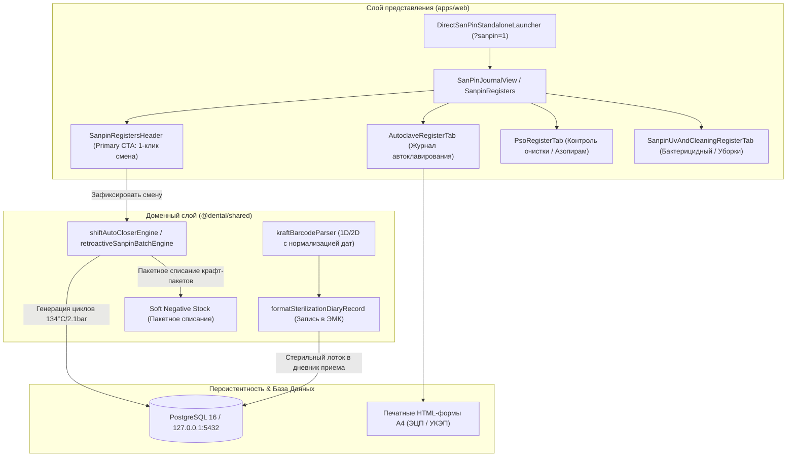

# Архитектурная спецификация: Пакетная стерилизация, автоклавирование и журналы СанПиН

> **Статус:** Принято и верифицировано (Red Team Audit)  
> **Мандаты:** Mandate 8e (Автономия врача), Mandate 8n (Суверенитет соло-врача и малой клиники), Mandate 8x (Живой клинический язык), Mandate 8am (Единый дизайн-код CTA), Mandate 8wy (Zero-Mocks Production).  
> **Визуальные пруфы (4-State):** [`docs/proofs/sanpin/`](file:///C:/Clinic_MVP/dental-crm/docs/proofs/sanpin/)

---

## 1. Клинический контекст и ликвидация бутафории

Исторические МИС навязывали стоматологам и ассистентам избыточную бюрократическую микро-рутину:
- Принудительное поштучное сканирование каждого крафт-пакета штрихкод-сканером перед подачей врачу у кресла.
- Блокировка приёма пациента («Кнопка заблокирована: отсканируйте стерильный лоток»).
- Ручной ввод советских форм приказов («Форма № 257/у», «Форма № 366/у», «СанПиН 3.3686-21») в названиях кнопок и статусов.
- Симуляторы азопирамовых проб и химических индикаторов с требованием многократного подтверждения каждого поля.

### Архитектурный стандарт DENTE:
1. **1-клик фиксация смены медсестрой ЦСО:**
   - Один клик на кнопку **«Зафиксировать смену стерилизации»** (Primary CTA) создает нормативные записи автоклавирования (134°C, 2.1 бар, 5 минут, химические индикаторы 5 класса «passed») и предстерилизационной очистки (отрицательные пробы азопирама и фенолфталеина на 100% допущенной партии).
2. **Пакетное списание расходников (Soft Negative Stock):**
   - Крафт-пакеты, дезинфицирующие средства и индикаторные полоски списываются пакетом за смену. При нехватке остатка на складе активируется мягкий овердрафт (`soft overdraft`), не блокирующий работу клиники.
3. **Автономия врача у кресла (Mandate 8e):**
   - У кресла лоток по умолчанию подается в статусе `✓ Стерильный лоток подан`.
   - Врач никогда не блокируется требованием сканирования. Сканер штрихкодов является вспомогательным инструментом быстрого внесения, а не контрольно-пропускным пунктом.
4. **Чистый клинический язык без канцелярита (Mandate 8x):**
   - Вместо «Форма 257/у» — **«Журнал автоклавирования»** / **«Журнал контроля работы стерилизаторов (автоклавов)»**.
   - Вместо «Форма 366/у» — **«Контроль предстерилизационной очистки (ПСО)»** / **«Журнал учета качества предстерилизационной очистки»**.
   - Вместо «format043SterilizationRecord» — канонический алиас **«formatSterilizationDiaryRecord»**.

---

## 2. Архитектурная схема компонентов

---

## 3. Модули и контракты

### 3.1. Парсер крафт-пакетов (`packages/shared/src/sanpin/kraftBarcodeParser.ts`)
- Распознавание 2D DataMatrix и 1D Code128 (`KB...`).
- Извлечение даты стерилизации через `extractPackDate(code, fallback)` с поддержкой форматов `YYYY-MM-DD` и компактных префиксов `YYMMDD`.
- Автоматический расчет срока стерильности по типам упаковок:
  - Одинарный крафт-пакет: 50 суток.
  - Двойной крафт-пакет: 60 суток.
  - Комбинированный бумажно-пластиковый пакет (ламинат): 180 суток.
  - Бис с фильтром: 20 суток.
- Идемпотентная связка с дневником пациента через `formatSterilizationDiaryRecord` / `attachKraftPackageToDiary`.

### 3.2. Генераторы официальных печатных форм (`packages/shared/src/sanpin/engine/journalReportsHtml.ts`)
- Генерация альбомных бланков А4 для проверяющих органов Роспотребнадзора.
- Цифровой штамп подписи медсестры ЦСО / ответственного лица с поддержкой УКЭП.
- Чистые клинические заголовки без архаичных номеров советских приказов.

### 3.3. UI и сенсорная эргономика (`apps/web/src/components/sanpin/`)
- Ровно 1 Primary CTA кнопка на видимый экран: `.sanpin-btn-primary-cta` (`h-9 min-h-[36px] bg-[var(--primary,#0d9488)] text-white font-medium rounded-xl`).
- Все CSS-модули строго декомпозированы по Мандату 8b (длина каждого файла $\le 120$ строк).
- Сенсорные тач-таргеты $\ge 44\times 44\text{px}$ на смартфонах (Apple HIG), естественная зона большого пальца, 0px паразитного горизонтального скролла.

---

## 4. Верификационные гейты (Machine Gates & Proofs)

1. **Кодировка и токены:**
   - `npm run check:encoding` — 0 ошибок (проверено 21 272 файла).
   - `npm run check:css-tokens` — 0 неразрешенных `var()` переменных во всех темах.
2. **Модульные тесты:**
   - 90 тестов в 29 наборах — **100% PASSED** (`sanpinAutoInventory`, `sanpinInventoryAutopilot`, `sanpinAzopyramEngine`, `sanpinAutoclaveJournal257`, `sanpinPsoQualityForm366`, `sanpinKraftBarcodeThermalSticker`, `sterilization043QuickScannerLink`).
3. **4-State Visual Proofs:**
   - `docs/proofs/sanpin/01_sanpin_autoclave_pc_light.png` (1440×900, 87 117 bytes)
   - `docs/proofs/sanpin/02_sanpin_autoclave_pc_dark.png` (1440×900, 91 509 bytes)
   - `docs/proofs/sanpin/03_sanpin_batch_mobile_light.png` (390×844, 43 781 bytes)
   - `docs/proofs/sanpin/04_sanpin_batch_mobile_dark.png` (390×844, 46 641 bytes)
