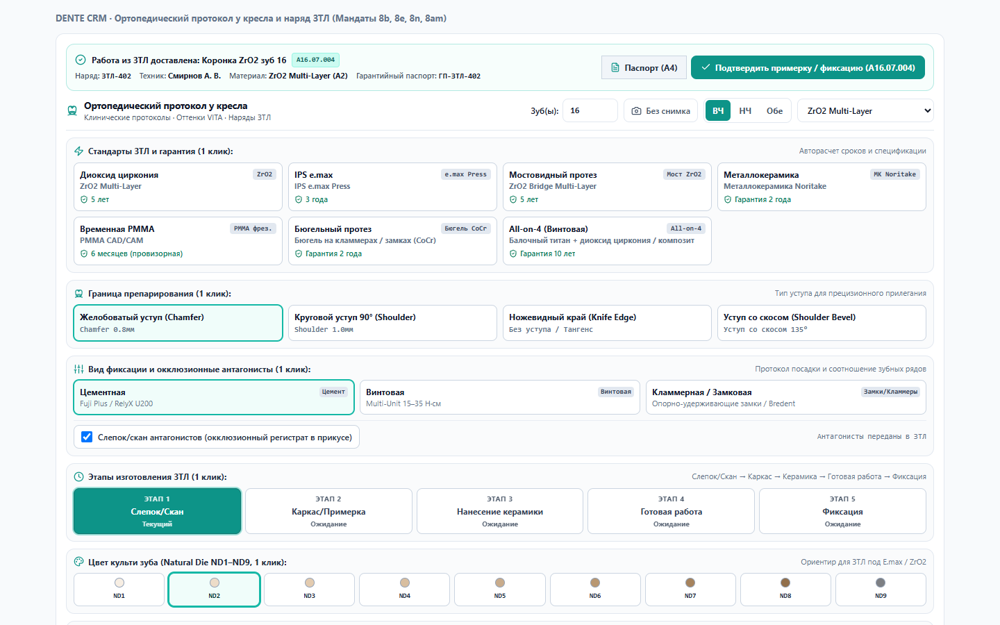
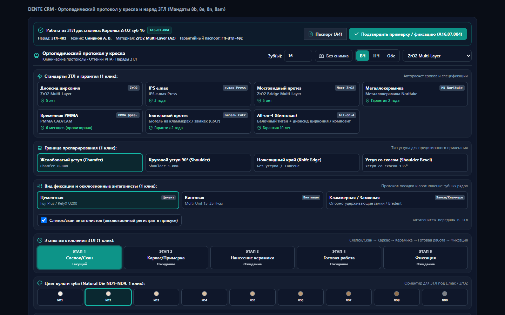
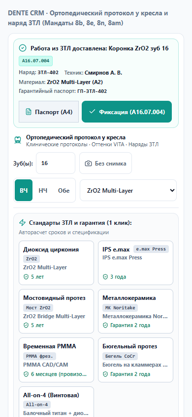
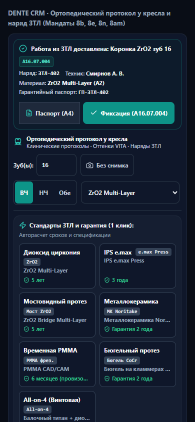
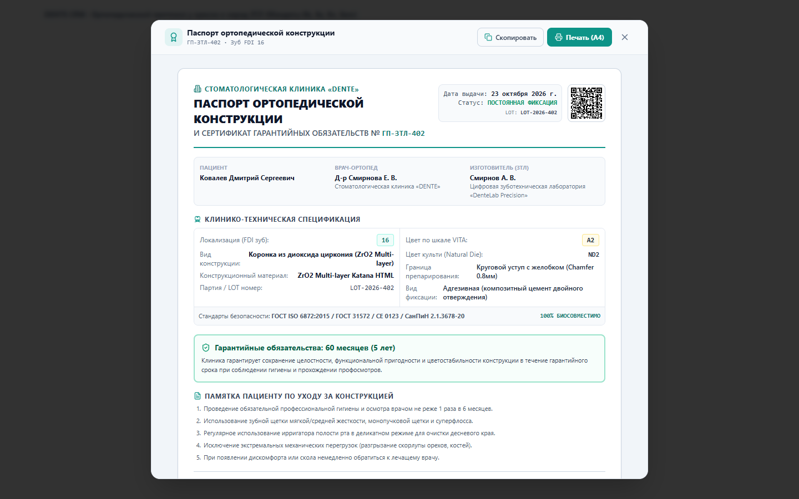

# Red Team 4-State Visual Proof: Ортопедический протокол у кресла и наряд ЗТЛ

> 🏛️ **Соответствие конституционным мандатам:**
> - **Мандат 8b:** Все файлы исходного кода строго $\le 120$ строк (микромодульная архитектура Layer 0..5).
> - **Мандат 8e:** Автономия врача — кнопки отправки в ЗТЛ и печати никогда не блокируются (`disabled={false}`).
> - **Мандат 8n:** Суверенитет соло-врача — точный расчет затрат техника в целых копейках (`amountKopecks`), прозрачный калькулятор маржи.
> - **Мандат 8x & 8d:** Чистый доменный русский язык без сырых номеров приказов и советского канцелярита, 0 эмодзи.
> - **Мандат 8am:** Ровно одна Primary CTA кнопка «Отправить в лабораторию» (Send) в фирменном изумрудном стиле DENTE.
> - **Мандат 8ze & Apple HIG:** Мобильные карточки, тач-таргеты $\ge 44\times 44$px, 0px горизонтального скролла (`overflow-x: clip`).

---

## 📸 Галерея визуальных доказательств

### 1. ☀️ PC Light (1440×900)

*Плотный 1-строчный тулбар, сетка стандартов ЗТЛ в 1 клик, культя ND1–ND9, фиксация, антагонисты, калькулятор маржи соло-врача.*

### 2. 🌙 PC Dark (1440×900)

*Премиальная темная тема, высокая контрастность текста, изумрудные акценты `#059669`.*

### 3. 📱 Mobile Light (390×844) & 4. 📱 Mobile Dark (390×844)
| Mobile Light (390×844) | Mobile Dark (390×844) |
|---|---|
|  |  |

*Сенсорные карточки Apple HIG, тач-таргеты 48px, адаптивная сетка без горизонтального дрифта.*

### 5. 📄 Паспорт ортопедической конструкции А4 с QR-кодом

*Печатный бланк Паспорта конструкции и Гарантийного сертификата с динамическим векторным QR-кодом верификации подлинности.*

---

## 🧪 Результаты машинной верификации
- **Vitest:** 5 test files, 61 passed (100% PASS).
- **Encoding:** `check:encoding` — 15,926 файлов проверено, UTF-8 без BOM.
- **Lines Limit:** 100% файлов модуля $\le 120$ строк (node scripts/check_file_limits.cjs).
