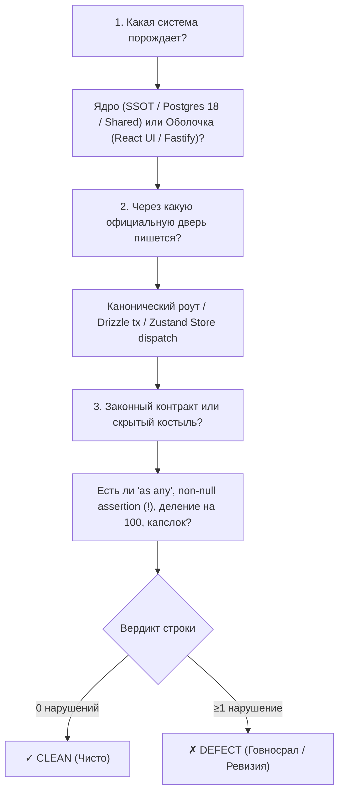

# Стандартная операционная процедура (SOP): Monte Carlo Reality Audit Engine («Кубик-Тест»)

> 🎲 ФИЛОСОФИЯ ТИМАЭРТА И МАНДАТ СОЗДАТЕЛЯ:
> *«Если у вас большой код проекта... хороший способ проверить говносраки — пишите агенты сгенери случайные числа (кинь кубик) и посмотри что там в тех строках и опиши в рамках архитектуры и системности... если всё под контролем, то ожидается 0 говносралов. Если хотя бы один или больше, то у вас ПРОБЛЕМЫ с агентами...»*
> *«Кубик по строкам взвешен объёмом: чаще всего попадёт в оболочку, а не в ядро. Поэтому у нас три списка — двери и писатели колонок, поля памяти, утверждения законов. Строки ловят локальный мусор, списки — структурный: вторую дверь, колонку без читателя, закон, которому код не соответствует».*
>
> 🏛️ СЫРЫЕ СЛОВА СОЗДАТЕЛЯ (1:1 VERBATIM):
> *«Внедряем полезные системы жесткого контроля, санитарной проверки и т.п., адаптированных для нас. Вперед. Без шизы и хуйни, только то, что будет работать».*

---

## 1. Назначение и Архитектурная Роль

В монорепозитории DENTE Dental CRM (>11 500 боевых файлов, Fastify, PostgreSQL 18, React 19, TypeScript) агентный рой и разработчики генерируют большие объёмы кода. Традиционные линтеры и компиляторы (`tsc`) проверяют лишь синтаксическую валидность, но слепы к архитектурным эрозиям, костылям, дублирующим модалкам и нарушению доменных инвариантов.

**Monte Carlo Reality Audit Engine (`scripts/dice-audit.mjs`)** — это неподкупный Red Team инквизитор с презумпцией брака 100%, который:
1. Бросает кубик по строкам всей боевой кодовой базы (`packages/shared/src`, `apps/api/src`, `apps/web/src`), взвешивая вероятность объёмом файлов (оболочка vs ядро).
2. Прогоняет 3 Структурных Списка Тимаэрта:
   - Список 1 (Двери и Мутации): эндпоинты `POST/PUT/PATCH/DELETE` в `apps/api/src/routes/` на наличие Idempotency-Key, ACID-транзакций и копеечных DTO.
   - Список 2 (Поля памяти и Контракты): схемы Drizzle и Zod в `apps/api/src/db/schema/` и `packages/shared/src/` на наличие `.strict()`, отсутствие `any` и соблюдение `exactOptionalPropertyTypes`.
   - Список 3 (Точки входа UI): контролы в `apps/web/src/components/` и `App.tsx` на соответствие матрице кнопок Мандата 8am (36px desktop / 44px mobile), отсутствие `uppercase` и истребление модалок-клонов (`*Modal2`, `*DrawerV2`).

---

## 2. Три Инквизиторских Вопроса Реальности

К каждой строке, выпавшей на кубике, аудитор обязан применить 3 вопроса:



### Вопрос 1: «Какая система порождает?»
- Определение домена: Биллинг, Касса 54-ФЗ, ЭМК (SOAP), Расписание, Одонтограмма Wheeler 2.5D, Склад (Soft Stock), Телефония, Картотека.
- Разделение слоёв:
  * Ядро (Core SSOT): чистая математика, реляционная схема Drizzle, канонические Zod-контракты.
  * Оболочка (Shell): адаптеры Fastify, UI-компоненты React 19, обработчики событий.

### Вопрос 2: «Через какую официальную дверь пишется?»
- Запись данных не может происходить хаотично.
- Должна быть зафиксирована официальная точка входа:
  * Fastify Mutation Route Gateway (`Idempotency-Key` обязателен).
  * Postgres ACID Transaction Boundary (`await db.transaction(async tx => ...)`).
  * Zustand Store Action Dispatcher.
  * React Touch/Desktop Interaction Point (строго по матрице кнопок Мандата 8am).

### Вопрос 3: «Законный контракт или скрытый костыль?»
- Проверка кода строки и 3 строк контекста вокруг:
  * ❌ `as any` или `: any` или `as unknown as` (Мандат 8be — тотальный запрет `any`).
  * ❌ `user!.id` или `item!.price` (Мандат 8be — запрет Non-Null assertions).
  * ❌ `price / 100` прямо в компоненте или роуте (Мандат 8bm — суммы строго через `money.ts`).
  * ❌ `uppercase` на кнопках/табах (Мандат 8am — запрет капслока, строго Sentence case).
  * ❌ `#0d9488` или `bg-amber-100` (Мандат 8am — строго CSS-токены `var(--primary)`).
  * ❌ Текст «1 клик», «Мандат 8e», «modeFit» в лейбле (Мандат 8bi — запрет утечек ТЗ в прод-UI).

---

## 3. Регламент запуска перед коммитом

Каждый разработчик и агент перед оформлением коммита обязан прогнать кубик:

```bash
# Базовый запуск (20 случайных строк + 3 списка Тимаэрта)
npm run audit:dice

# Быстрая проверка на 10 сэмплов
npm run audit:dice -- --samples 10

# Детерминированный воспроизводимый прогон по сиду
npm run audit:dice -- --samples 20 --seed 42

# Проверка конкретного структурного списка
npm run audit:dice -- --list doors      # Только Двери и Мутации API
npm run audit:dice -- --list fields     # Только Поля памяти и Контракты
npm run audit:dice -- --list ui         # Только Точки входа UI

# Строгий гейт для CI/CD (Exit Code 1 при наличии дефектов)
npm run audit:dice -- --strict

# Вывод чистого JSON для скриптов и субагентов
npm run audit:dice -- --json
```

---

## 4. Интерпретация Отчёта и Действия при Дефектах

Отчёт выводит показатель Dice Reality Integrity Score (в процентах):

$$\text{Score} = \left(\frac{\text{Clean Samples}}{\text{Total Evaluated}}\right) \times 100\%$$

| Результат | Значение | Действие |
|---|---|---|
| **100% (0 дефектов)** | Полный порядок | Разрешен коммит и пуш по Conventional Commits |
| **90–99% (1–2 дефекта)** | Локальный костыль | Немедленно открыть `[ФАЙЛ:СТРОКА]` через `read_file`, исправить по канону и перепроверить |
| **< 90% (3+ дефектов)** | Системный сбой | Блокировка релиза. Провести ревизию модуля по 6 гейтам `/decomposer` |

### Пример реального обнаружения дефекта:
```
💾 СПИСОК 2 (ПОЛЯ ПАМЯТИ И КОНТРАКТЫ СХЕМЫ):
   ✗ [packages/shared/src/schemas/installmentAndLabOrderSchemas.ts:369] (Zod Contract Schema)
      Контракт: export const prescriptionMedicationPayloadSchema = z.object({
      ⚠ Мутационная Zod-схема без .strict() (риск проброса нетипизированных полей)
```
Что делать: открыть `packages/shared/src/schemas/installmentAndLabOrderSchemas.ts`, добавить `.strict()` к схеме, убедиться в прохождении тестов.

---

## 5. Юнит-тестирование движка Кубика

Движок покрыт детерминированными тестами на нативном раннере Node.js:

```bash
node --test scripts/tests/dice-audit.test.mjs
```

Тест верифицирует:
1. Воспроизводимость PRNG Mulberry32 байт-в-байт по сиду.
2. Парсер всех CLI флагов (`--samples`, `--seed`, `--list`, `--strict`, `--json`).
3. Детекцию всех видов брака (`any`, `!`, `/ 100`, `uppercase`).
4. Формат агрегированного JSON-отчёта.
5. Время прогона (<2 секунд).
