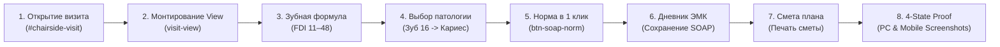

# СТАНДАРТ КЛИНИЧЕСКОГО И E2E ТЕСТИРОВАНИЯ DENTE DENTAL CRM
## Архитектурный регламент приёмочного тестирования рабочего места врача у кресла

> 🦷 **МАНДАТЫ 8e (АВТОНОМИЯ ВРАЧА), 8x (ЧИСТЫЙ КЛИНИЧЕСКИЙ ЯЗЫК), 8aq (ЗАПРЕТ СИРОТ) И ДИРЕКТИВЫ СОЗДАТЕЛЯ:**  
> Данный документ является единым каноническим источником истины (SSOT) для сквозного тестирования функциональности визита врача, зубной формулы FDI, протоколов ЭМК (SOAP), расчёта сметы планов лечения и статического анализа React 19 хуков.

---

## 1. МАНИФЕСТ КАЧЕСТВА И КЛИНИЧЕСКИЕ ИНВАРИАНТЫ

1. **Тотальный запрет на потемкинские деревни**:
   - Запрещено создавать изолированные заглушки, мокапы ради одного скриншота или модули, существующие в вакууме.
   - Все компоненты смонтированы в рабочем контуре приложения (`AppShell.tsx` / `App.tsx`).
   - Данные проходят через связные слои: стейт, UI-компоненты, валидаторы копеек (`amountKopecks`), хранилище.

2. **Запрет на симуляцию физического мира и процедурную микро-рутину**:
   - Никаких поштучных трекингов ватных валиков, крафт-пакетов или игл у кресла врача.
   - Никаких искусственных Canvas-симуляций диффузии анестезии или графиков фармакокинетики.
   - Никаких 50-польных соматических анкет — здоровые состояния заполняются в 1 клик («Норма»).

3. **Чистый профессиональный клинический язык (Мандат 8x)**:
   - Категорический запрет на советский канцелярит и номера приказов в интерфейсе:
     * «Медицинская карта приёма» / «Дневник визита» (вместо «043/у»).
     * «Прейскурант услуг» / «Каталог процедур» (вместо «804н»).
     * «Журнал автоклавирования» (вместо «Форма 257/у»).
     * «Предстерилизационная очистка» (вместо «ПСО»).
     * «Кассовый чек» (вместо «ФФД 1.2»).

4. **Автономия врача (Мандат 8e)**:
   - Кнопки («Сохранить», «Печать», «Оплатить», «Завершить») **НИКОГДА** не блокируются атрибутом `disabled`.
   - Черновики сохраняются автоматически с дебаунсом без потери набранного текста.

---

## 2. АРХИТЕКТУРА СКВОЗНОГО ТЕСТА ВИЗИТА (`chairside-visit-flow.spec.ts`)

Тест расположен в [`apps/web/tests/e2e/chairside-visit-flow.spec.ts`](file:///C:/Clinic_MVP/dental-crm/apps/web/tests/e2e/chairside-visit-flow.spec.ts) и проверяет непрерывный сценарий работы врача:

### Таблица аппаратных `data-testid` контрактов

| Селектор `data-testid` | Компонент | Назначение |
|---|---|---|
| `visit-view` | `VisitViewPanel.tsx` | Корневой контейнер рабочего экрана приёма врача |
| `visit-header-monolith` | `VisitHeaderMonolith.tsx` | Монолитная шапка приёма (пациент, аллергии, таймер, быстрые действия) |
| `visit-subtab-odontogram` | `VisitTabNav.tsx` | Таб 1: Интерактивная зубная формула FDI 11–48 |
| `visit-odontogram-tab` | `VisitOdontogramTab.tsx` | Контейнер зубной формулы Wheeler 2.5D |
| `anatomical-tooth-cell-16` | `AnatomicalGate0Row.tsx` | Анатомическая ячейка зуба 16 (первый правый верхний моляр) |
| `tooth-radial-menu-overlay` | `ToothRadialMenu.tsx` | Клиническое радиальное меню манипуляций зуба |
| `radial-btn-caries` | `ToothRadialPrimaryGrid.tsx` | Выбор патологии «Кариес» в радиальном меню |
| `btn-soap-norm-one-click` | `VisitViewHeader.tsx` | Кнопка заполнения физиологической нормы SOAP в 1 клик |
| `visit-subtab-emk` | `VisitTabNav.tsx` | Таб 2: Электронная медицинская карта (дневник приёма) |
| `visit-emk-tab` | `VisitEmkTab.tsx` | Рабочая область медицинской карты |
| `emk-complaints-and-anamnesis-module` | `EmkComplaintsAndAnamnesisSection.tsx` | Блок жалоб, анамнеза и соматического статуса |
| `btn-save-visit-note` | `VisitEmkTab.tsx` | Кнопка ручного сохранения записи приёма в ЭМК |
| `visit-subtab-plan` | `VisitTabNav.tsx` | Таб 4: Комплексный план лечения и смета |
| `visit-treatment-plan-tab-content` | `VisitTabContent.tsx` | Контент плана лечения пациента |
| `btn-plan-tab-print-estimate` | `VisitTabContent.tsx` | Кнопка быстрой печати сметы плана лечения |

---

## 3. СТАТИЧЕСКИЙ АНАЛИЗ REACT 19 ХУКОВ (`check-react-hooks.mjs`)

Для предотвращения нарушений Rules of Hooks и фатальных зацикливаний `Maximum update depth exceeded` внедрён специализированный AST-анализатор на базе `@babel/parser` и `@babel/traverse`:

- **Скрипт**: `scripts/check-react-hooks.mjs`
- **Команда запуска**: `npm run check:react-hooks`
- **Проверяемые инварианты**:
  1. **Условные хуки**: запрет вызова `use*` внутри `if`, тернарных операторов `? :`, логических выражений (`&&`, `||`, `??`), циклов (`for`, `while`) и блоков `try/catch`.
  2. **Синхронный `setState` в теле компонента**: запрет непосредственного вызова мутаторов состояния на верхнем уровне рендера вне `useEffect` / коллбэков (причина бесконечных ререндеров).
  3. **Проверка зависимостей**: предупреждения при пустых массивах зависимостей эффектов с мутациями.
- **Покрытие юнит-тестами**: `scripts/tests/check-react-hooks.test.mjs` (8 сценариев с 100% прохождением).

---

## 4. РЕГЛАМЕНТ 4-STATE VISUAL PROOF

Каждое изменение интерфейса приёма врача обязано сопровождаться актуальными скриншотами в каталоге `docs/proofs/visit/`:

1. 🌙 **PC Dark (1440×900)**: `01_chairside_visit_pc_dark_1440x900.png` — проверка темной палитры `var(--paper)`, отсутствие белых пятен.
2. ☀️ **PC Light (1440×900)**: `02_chairside_visit_pc_light_1440x900.png` — проверка контраста WCAG AAA ($\ge 4.5:1$).
3. 📱 **Mobile Light (390×844)**: `03_chairside_visit_mobile_light_390x844.png` — Apple HIG, тач-таргеты $\ge 44\times 44$px, Natural Thumb Zone.
4. 📱 **Mobile Dark (390×844)**: `04_chairside_visit_mobile_dark_390x844.png` — мобильная ночная тема с учетом вырезов Safe Area.

Все скриншоты проверяются инженером лично через вызов инструмента чтения файлов перед сдачей коммита.
