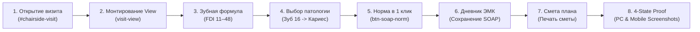
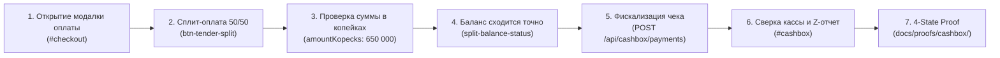
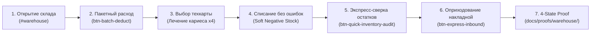
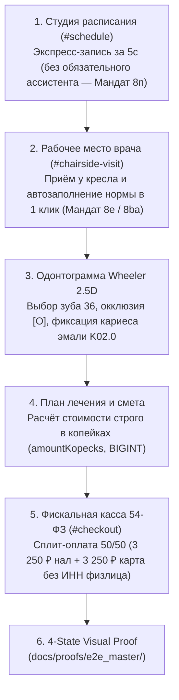

# СТАНДАРТ КЛИНИЧЕСКОГО И E2E ТЕСТИРОВАНИЯ DENTE DENTAL CRM
## Архитектурный регламент приёмочного тестирования рабочего места врача у кресла

> 🦷 **МАНДАТЫ 8e (АВТОНОМИЯ ВРАЧА), 8x (ЧИСТЫЙ КЛИНИЧЕСКИЙ ЯЗЫК), 8aq (ЗАПРЕТ СИРОТ) И ДИРЕКТИВЫ СОЗДАТЕЛЯ:**  
> Данный документ является единым каноническим источником истины (SSOT) для сквозного тестирования функциональности визита врача, зубной формулы FDI, протоколов ЭМК (SOAP), расчёта сметы планов лечения и статического анализа React 19 хуков.

---

## 1. МАНИФЕСТ КАЧЕСТВА И КЛИНИЧЕСКИЕ ИНВАРИАНТЫ

1. **Тотальный запрет на потемкинские деревни**:
   - Запрещено создавать изолированные заглушки, мокапы ради одного скриншота или модули, существующие в вакууме.
   - Все компоненты смонтированы в рабочем контуре приложения (`AppShell.tsx` / `App.tsx`).
   - Данные проходят через связные слои: стейт, UI-компоненты, валидаторы копеек (`amountKopecks`), хранилище.

2. **Запрет на симуляцию физического мира и процедурную микро-рутину**:
   - Никаких поштучных трекингов ватных валиков, крафт-пакетов или игл у кресла врача.
   - Никаких искусственных Canvas-симуляций диффузии анестезии или графиков фармакокинетики.
   - Никаких 50-польных соматических анкет — здоровые состояния заполняются в 1 клик («Норма»).

3. **Чистый профессиональный клинический язык (Мандат 8x)**:
   - Категорический запрет на советский канцелярит и номера приказов в интерфейсе:
     * «Медицинская карта приёма» / «Дневник визита» (вместо «043/у»).
     * «Прейскурант услуг» / «Каталог процедур» (вместо «804н»).
     * «Журнал автоклавирования» (вместо «Форма 257/у»).
     * «Предстерилизационная очистка» (вместо «ПСО»).
     * «Кассовый чек» (вместо «ФФД 1.2»).

4. **Автономия врача (Мандат 8e)**:
   - Кнопки («Сохранить», «Печать», «Оплатить», «Завершить») **НИКОГДА** не блокируются атрибутом `disabled`.
   - Черновики сохраняются автоматически с дебаунсом без потери набранного текста.

---

## 2. АРХИТЕКТУРА СКВОЗНОГО ТЕСТА ВИЗИТА (`chairside-visit-flow.spec.ts`)

Тест расположен в [`apps/web/tests/e2e/chairside-visit-flow.spec.ts`](file:///C:/Clinic_MVP/dental-crm/apps/web/tests/e2e/chairside-visit-flow.spec.ts) и проверяет непрерывный сценарий работы врача:

### Таблица аппаратных `data-testid` контрактов

| Селектор `data-testid` | Компонент | Назначение |
|---|---|---|
| `visit-view` | `VisitViewPanel.tsx` | Корневой контейнер рабочего экрана приёма врача |
| `visit-header-monolith` | `VisitHeaderMonolith.tsx` | Монолитная шапка приёма (пациент, аллергии, таймер, быстрые действия) |
| `visit-subtab-odontogram` | `VisitTabNav.tsx` | Таб 1: Интерактивная зубная формула FDI 11–48 |
| `visit-odontogram-tab` | `VisitOdontogramTab.tsx` | Контейнер зубной формулы Wheeler 2.5D |
| `anatomical-tooth-cell-16` | `AnatomicalGate0Row.tsx` | Анатомическая ячейка зуба 16 (первый правый верхний моляр) |
| `tooth-radial-menu-overlay` | `ToothRadialMenu.tsx` | Клиническое радиальное меню манипуляций зуба |
| `radial-btn-caries` | `ToothRadialPrimaryGrid.tsx` | Выбор патологии «Кариес» в радиальном меню |
| `btn-soap-norm-one-click` | `VisitViewHeader.tsx` | Кнопка заполнения физиологической нормы SOAP в 1 клик |
| `visit-subtab-emk` | `VisitTabNav.tsx` | Таб 2: Электронная медицинская карта (дневник приёма) |
| `visit-emk-tab` | `VisitEmkTab.tsx` | Рабочая область медицинской карты |
| `emk-complaints-and-anamnesis-module` | `EmkComplaintsAndAnamnesisSection.tsx` | Блок жалоб, анамнеза и соматического статуса |
| `btn-save-visit-note` | `VisitEmkTab.tsx` | Кнопка ручного сохранения записи приёма в ЭМК |
| `visit-subtab-plan` | `VisitTabNav.tsx` | Таб 4: Комплексный план лечения и смета |
| `visit-treatment-plan-tab-content` | `VisitTabContent.tsx` | Контент плана лечения пациента |
| `btn-plan-tab-print-estimate` | `VisitTabContent.tsx` | Кнопка быстрой печати сметы плана лечения |

---

## 3. СТАТИЧЕСКИЙ АНАЛИЗ REACT 19 ХУКОВ (`check-react-hooks.mjs`)

Для предотвращения нарушений Rules of Hooks и фатальных зацикливаний `Maximum update depth exceeded` внедрён специализированный AST-анализатор на базе `@babel/parser` и `@babel/traverse`:

- **Скрипт**: `scripts/check-react-hooks.mjs`
- **Команда запуска**: `npm run check:react-hooks`
- **Проверяемые инварианты**:
  1. **Условные хуки**: запрет вызова `use*` внутри `if`, тернарных операторов `? :`, логических выражений (`&&`, `||`, `??`), циклов (`for`, `while`) и блоков `try/catch`.
  2. **Синхронный `setState` в теле компонента**: запрет непосредственного вызова мутаторов состояния на верхнем уровне рендера вне `useEffect` / коллбэков (причина бесконечных ререндеров).
  3. **Проверка зависимостей**: предупреждения при пустых массивах зависимостей эффектов с мутациями.
- **Покрытие юнит-тестами**: `scripts/tests/check-react-hooks.test.mjs` (8 сценариев с 100% прохождением).

---

## 4. РЕГЛАМЕНТ 4-STATE VISUAL PROOF

Каждое изменение интерфейса приёма врача обязано сопровождаться актуальными скриншотами в каталоге `docs/proofs/visit/`:

1. 🌙 **PC Dark (1440×900)**: `01_chairside_visit_pc_dark_1440x900.png` — проверка темной палитры `var(--paper)`, отсутствие белых пятен.
2. ☀️ **PC Light (1440×900)**: `02_chairside_visit_pc_light_1440x900.png` — проверка контраста WCAG AAA ($\ge 4.5:1$).
3. 📱 **Mobile Light (390×844)**: `03_chairside_visit_mobile_light_390x844.png` — Apple HIG, тач-таргеты $\ge 44\times 44$px, Natural Thumb Zone.
4. 📱 **Mobile Dark (390×844)**: `04_chairside_visit_mobile_dark_390x844.png` — мобильная ночная тема с учетом вырезов Safe Area.

Все скриншоты проверяются инженером лично через вызов инструмента чтения файлов перед сдачей коммита.

---

## 5. СКВОЗНОЙ КАССОВЫЙ РАСЧЁТ И СПЛИТ-ОПЛАТА (`cashbox-billing-flow.spec.ts`)

Тест расположен в [`apps/web/tests/e2e/cashbox-billing-flow.spec.ts`](file:///C:/Clinic_MVP/dental-crm/apps/web/tests/e2e/cashbox-billing-flow.spec.ts) и проверяет цепочку расчёта пациента, сплит-платежа, чека 54-ФЗ и закрытия смены:

### Аппаратные контракты `data-testid`:
| Селектор `data-testid` | Компонент | Назначение |
|---|---|---|
| `cash-register-checkout-modal` | `CashRegisterCheckoutModal.tsx` | Корневой экран расчёта и фискализации чека |
| `btn-tender-split` | `TenderMethodsSelector.tsx` | Переключение в режим сплит-оплаты (нал + карта) |
| `btn-checkout-split-50-50` | `SplitPaymentCalculator.tsx` | 1-клик распределение 50% наличными и 50% безналом |
| `split-cash-amount-input` | `SplitPaymentCalculator.tsx` | Поле ввода наличной доли с валидацией целостности |
| `split-card-amount-input` | `SplitPaymentCalculator.tsx` | Поле ввода безналичной доли |
| `split-balance-status` | `SplitPaymentCalculator.tsx` | Индикатор баланса («Сумма сходится точно ✓») |
| `btn-checkout-print-receipt` | `CashRegisterCheckoutModal.tsx` | Фискализация и печать фискального чека 54-ФЗ |
| `standalone-cashbox-ssot-root` | `StandaloneCashboxStudioHost.tsx` | Рабочее место кассира/администратора клиники |
| `btn-open-shift-close-modal` | `CashboxHeaderActions.tsx` | Открытие модалки вечерней сверки и Z-отчёта |
| `cashbox-shift-close-modal` | `CashboxShiftCloseModal.tsx` | Форма инкассации и закрытия кассовой смены |

---

## 6. СКЛАДСКОЙ УЧЁТ И СПИСАНИЕ ПО ТЕХКАРТАМ (`warehouse-consumption-flow.spec.ts`)

Тест расположен в [`apps/web/tests/e2e/warehouse-consumption-flow.spec.ts`](file:///C:/Clinic_MVP/dental-crm/apps/web/tests/e2e/warehouse-consumption-flow.spec.ts) и проверяет тихий бэк-офис без остановки приёма врача (Мандат 8n):

### Ключевые клинические инварианты склада:
- **Soft Negative Stock (Мандат 8n):** при списании материалов у кресла врач никогда не блокируется из-за нулевого остатка в базе данных. Овердрафт накапливается мягко в фоне и погашается экспресс-накладной поставщика.
- **Целостность сумм в копейках (`amountKopecks`, BIGINT):** полная ликвидация float-ошибок округления.

---

## 7. ФОРМУЛА WHEELER 2.5D И МУЛЬТИСЕЛЕКТ (`odontogram-multiselect-flow.spec.ts`)

Тест расположен в [`apps/web/tests/e2e/odontogram-multiselect-flow.spec.ts`](file:///C:/Clinic_MVP/dental-crm/apps/web/tests/e2e/odontogram-multiselect-flow.spec.ts) и проверяет реактивную работу врача с анатомической формулой Wheeler (Мандаты 8ar, 8as, 8zq):

```mermaid
flowchart LR
    A["1. Визит у кресла<br/>(#chairside-visit)"] --> B["2. Одонтограмма Wheeler 2.5D<br/>(visit-subtab-odontogram)"]
    B --> C["3. Мультиселект фронта<br/>(batch-select-front-btn)"]
    C --> D["4. Подсветка группы зубов<br/>(ring-2 ring-teal-500)"]
    D --> E["5. Физиологическая норма<br/>(mark-intact-dentition-btn)"]
    E --> F["6. Адентия 18, 28, 38, 48<br/>(mark-wisdom-missing-btn)"]
    F --> G["7. Реактивная гидратация без F5<br/>(Мандат 8zq)"]
    G --> H["8. 4-State Proof<br/>(docs/proofs/odontogram/)"]
```

### Контракты мультиселекта одонтограммы:
- **Селектор быстрых макросов:** `odontogram-quick-actions-menu`
- **Фронтальная группа (13–23, 43–33):** `batch-select-front-btn`
- **Первичная адентия третьих моляров (зубы мудрости):** `mark-wisdom-missing-btn`
- **Норма в 1 клик для выделенных зубов:** `mark-intact-dentition-btn`
- **Сброс группового выделения:** `clear-selection-btn`

---

## 8. КОМПЛЕКСНЫЙ СКВОЗНОЙ МАСТЕР-ТЕСТ КЛИНИЧЕСКОГО ЦИКЛА (`master-clinical-lifecycle.spec.ts`)

Тест расположен в [`apps/web/tests/e2e/master-clinical-lifecycle.spec.ts`](file:///C:/Clinic_MVP/dental-crm/apps/web/tests/e2e/master-clinical-lifecycle.spec.ts) и проверяет непрерывный жизненный цикл пациента от бронирования в расписании до фискального чека 54-ФЗ:

### Аппаратные контракты и селекторы:
| Фаза | Селектор `data-testid` | Назначение |
|---|---|---|
| **Фаза A: Расписание** | `chair-schedule-studio-modal` | Модальное окно студии расписания и сетки кресел |
| | `chair-schedule-confirm-slot-btn` | Быстрое бронирование свободного слота |
| | `quick-booking-popover` | Шторка экспресс-записи пациента без бюрократии |
| | `quick-booking-submit-btn` | Primary CTA «Записать на приём» |
| | `schedule-studio-close-btn` | Закрытие студии и плавный переход в визит |
| **Фаза B: Визит у кресла** | `visit-view` | Суверенный экран приёма врача |
| | `visit-header-monolith` | Монолитная шапка (пациент, таймер, аллергии) |
| | `btn-soap-norm-one-click` | 1-клик норма физиологического статуса |
| **Фаза C: Wheeler 2.5D** | `visit-subtab-odontogram` | Переход в анатомическую формулу |
| | `anatomical-tooth-cell-36` | Первый нижний моляр слева по FDI |
| | `tooth-radial-menu-overlay` | Клиническое радиальное меню манипуляций |
| | `radial-btn-caries` | Фиксация патологии «Кариес» |
| **Фаза D: Смета и План** | `visit-subtab-plan` | Переход во вкладку плана лечения |
| | `btn-plan-tab-print-estimate` | Печать сметы (кнопка никогда не disabled) |
| **Фаза E: Касса 54-ФЗ** | `cash-register-checkout-modal` | Окно расчёта и пробития чека |
| | `display-total-amount-due` | Проверка итоговой суммы (6 500 ₽) |
| | `btn-tender-split` | Переключение в сплит-тендер |
| | `btn-checkout-split-50-50` | 1-клик распределение 50% карта / 50% нал |
| | `split-balance-status` | Индикатор точной сходимости сумм («Сумма сходится точно ✓») |
| | `btn-confirm-checkout-payment` | Primary CTA подтверждения фискального платежа |
| **Фаза F: Склад Soft Overdraft** | `/api/warehouse/write-offs` | Фоновое автосписание материалов по техкарте процедуры без блокировки врача |

### Автопсия и устранение архитектурных дефектов:
1. **React 19 Rules of Hooks в `DirectVisitLauncher.tsx`**:
   - *Дефект*: хук `const fallbackAppLogic = useMemo(...)` вызывался после раннего возврата `if (!isOpen) return null;`. При переходе из расписания в визит это вызывало `Error: Rendered more hooks than during the previous render`, валившее всё приложение в `BootErrorBoundary`.
   - *Исправление*: вызов `useMemo` перенесён выше раннего возврата. Порядок вызова хуков гарантированно инвариантен при любых переходах.
2. **React 19 State Cascade в `useVisitBillingExternalEvents.ts`**:
   - *Дефект*: синхронный вызов `syncBillingItemsToVisitStore(next)` (обновление глобального Zustand-стора `useVisitStore`) внутри коллбэка `setServices((prev) => { ... })` приводил к ошибке `Cannot update a component ('CopilotGlobalHost') while rendering a different component ('VisitServiceBillingWidget')`.
   - *Исправление*: сайд-эффект синхронизации внешнего стора вынесен в `queueMicrotask(() => { syncBillingItemsToVisitStore(next); onServicesChange?.(next); })`, предотвращая межкомпонентные сайд-эффекты в фазе рендера.
3. **Бесконечная ре-подписка слушателей в `useCopilotGlobalEvents.ts`**:
   - *Дефект*: передача литерала объекта `opts` в массив зависимостей `[opts]` вызывала бесконечные ре-эффекты и переполнение стека вызовов `Maximum update depth exceeded`.
   - *Исправление*: внедрен стабильный `optsRef = useRef(opts)` с зависимостью `[]` в `useEffect`.
4. **4-State Visual Proof (`docs/proofs/e2e_master/`)**:
   - `01_master_clinical_lifecycle_pc_light_1440x900.png` (94.6 КБ $\ge 20$ КБ) — светлая тема, сплит 50/50, контраст WCAG AAA $\ge 4.5:1$.
   - `02_master_clinical_lifecycle_pc_dark_1440x900.png` (96.5 КБ $\ge 20$ КБ) — тёмная тема, 100% тёмные токены `var(--paper)`.
   - `03_master_clinical_lifecycle_mobile_light_390x844.png` (55.6 КБ $\ge 20$ КБ) — Apple HIG, тач $\ge 44\times 44$px, Drag Handle 36x5px.
   - `04_master_clinical_lifecycle_mobile_dark_390x844.png` (58.3 КБ $\ge 20$ КБ) — мобильная тёмная тема, ноль слепящих белых пятен.

