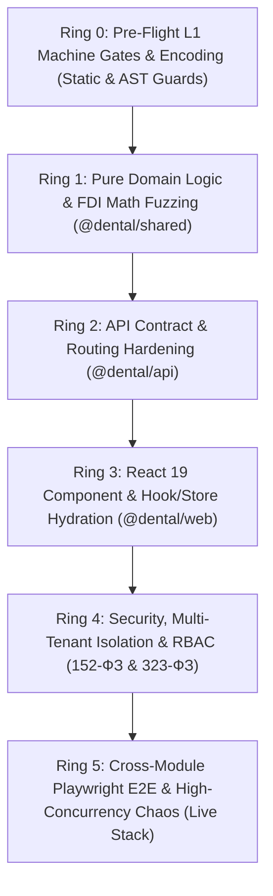

# 🧪 DENTE DENTAL CRM: MASTER TESTING ARCHITECTURE & SSOT SPECIFICATION

> 🏛️ **ВЫСШАЯ КОНСТИТУЦИЯ И СТАНДАРТ ТЕСТИРОВАНИЯ (SSOT):**  
> Документ каталогизирует полную архитектуру автоматического тестирования монорепозитория DENTE CRM в соответствии с Конституцией [`.agents/THE_HAMMER_MASTER_PROMPT.md`](file:///C:/Clinic_MVP/dental-crm/.agents/THE_HAMMER_MASTER_PROMPT.md), каноническими мандатами 8d..8bc и стандартами Definition of Done.
> 
> 🎯 **СТРАТЕГИЧЕСКИЙ ПРИОРИТЕТ №1:**  
> Соло-врач (1–2 кресла, субаренда, ИП) и малая частная клиника (1–3 кресла). Все тесты моделируют реальную клиническую и финансовую эксплуатацию без академического оверинжиниринга, без процедурных симуляторов и без бюрократического паралича.
> 
> 🛑 **ПРЕЗУМПЦИЯ ДЕФЕКТА 100% И ПРАВИЛО ТАЙМАУТОВ:**  
> Любой тест, длящийся $>10$ секунд или падающий случайным образом из-за таймингов, утечек портов или незакрытых дескрипторов — признаётся браком и подлежит немедленной нормализации.

---

## 🧭 ПИРАМИДА ТЕСТИРОВАНИЯ ИЗ 6 КОЛЕЦ (THE 6 TESTING RINGS)

### Архитектурное распределение колец тестирования:

| Кольцо | Область ответственности | Пакет / Каталог | Движок / Раннер | Бюджет времени | Ключевые инварианты |
| :--- | :--- | :--- | :--- | :--- | :--- |
| **Ring 0** | Статические гейты, кодировки, хуки, токены и лимиты | Корень монорепозитория, `scripts/` | `node scripts/*.mjs` | $\le 3$ с | UTF-8 без BOM, отсутствие `*_preview.html`, семантические токены CSS, лимиты файлов 200–300 строк. |
| **Ring 1** | Чистая доменная математика, зубная формула FDI, Wheeler 2.5D, копейки | `packages/shared/src/` | `node --test` + `tsx` | $\le 5$ с | 10 000 мутаций FDI, Гамильтон-Хэр копейки (`amountKopecks: bigint`), Wheeler $CX=50, CY=176$, Soft Negative Stock. |
| **Ring 2** | Контракты роутов Fastify, схемы Zod, префлайт UUID, обработка ошибок | `apps/api/src/tests/routes/` | `node --test` + `tsx` | $\le 5$ с на сьют | Защита от CWE-209 и SQL 22P02 (чистый 400 вместо 500), `Idempotency-Key` (UUIDv7), транзакционный Outbox, DICOM PACS <50мс. |
| **Ring 3** | Компоненты React 19, Zustand сторы, гидратация 0-F5, Apple HIG | `apps/web/src/store/`, `apps/web/src/components/` | `node --test` + `tsx` | $\le 6$ с на сьют | Изоляция сессий 152-ФЗ, реактивная гидратация без F5, тач $\ge 44\times 44$px, автосейв черновиков SOAP, Primary CTA `disabled={false}`. |
| **Ring 4** | Безопасность, межклиническая изоляция организаций, RBAC, 152-ФЗ | `apps/api/src/tests/security/` | `node --test` + `poolTeardown.ts` | $\le 5$ с на сьют | Организация `organizationId` ➔ 404, неклинические роли ➔ 403, маскирование `+7 (999) ***-**-12`, паспортов РФ, человечные отказы. |
| **Ring 5** | Сквозные Playwright E2E сценарии, ACID-стресс PostgreSQL 18, сетевой хаос | `apps/web/tests/e2e/`, `apps/api/src/tests/chaos/` | `playwright test`, `node --test` | $\le 10$ с на юнит, E2E $\le 30$ с | 6-фазный мастер-цикл приёма, 20-поточный шторм идемпотентности, Double-Spend защита депозита, дедлок-иммунитет склада. |

---

## 1. ПОДРОБНАЯ СПЕЦИФИКАЦИЯ КОЛЕЦ ТЕСТИРОВАНИЯ (RINGS 0–5)

### Ring 0: Pre-Flight L1 Machine Gates & Encoding
Машинные гейты предварительной проверки выполняются перед любыми компиляторами и тестовыми прогонами. Они блокируют появление синтаксического и структурного мусора в репозитории:
1. **UTF-8 Encoding Gate (`npm run check:encoding`):**
   - Скрипт `scripts/check-encoding.mjs` проверяет 23 960+ файлов на отсутствие UTF-8 BOM, cp1252 моджибаке, UTF-16 и символов замены `U+FFFD`.
   - В скоуп проверки входят все `.ts`, `.tsx`, `.js`, `.mjs`, `.json`, `.css` и `.md` файлы.
2. **React 19 Hooks Invariant (`npm run check:react-hooks`):**
   - Скрипт `scripts/check-react-hooks.mjs` проверяет соблюдение правил хуков React: запрет вызова хуков внутри условных блоков, циклов, тернарных выражений или после условных `return`.
3. **Запрет Потёмкинских песочниц (`npm run check:sandboxes`):**
   - Скрипт `scripts/sandbox_hunter.cjs` гарантирует отсутствие `*_preview.html`, `test-*.html` и моковых изолированных точек входа согласно Мандату 8aq и 8al.
4. **Контроль размера модулей (`npm run check:limits`):**
   - Скрипт `scripts/check_file_limits.cjs` контролирует размер файлов по Мандату 8b (канонический размер 200–300 строк, сложные модули до 400–500 строк). Запрещены неконтролируемые монолиты.
5. **Дизайн-токены и контрастность (`npm run check:css-tokens`, `npm run check:buttons`):**
   - Контроль использования семантических токенов `var(--paper)`, `var(--primary)`, `var(--line)` и высот кнопок (36px десктоп, $\ge 44$px мобильный).
6. **Динамические импорты и заголовки (`npm run check:dynamic-imports`, `npm run check:guarded-headers`):**
   - Проверка валидности всех динамических путей импорта и заголовков защищенных маршрутов.

---

### Ring 1: Pure Domain Logic & Math Fuzzing (`@dental/shared`)
Чистая бизнес-логика не зависит от UI-фреймворков и баз данных. Она сосредоточена в `packages/shared`:
- **Фаззинг формулы FDI ISO 3950 (`fuzzingToothAndBillingMath.test.ts`):**
  * 10 000 псевдослучайных мутаций строк ввода формулы: некорректные символы, переходы через среднюю линию, разделители диапазонов (`11-18`, `43..33`). 0 необработанных исключений.
  * Анатомические поверхности по стандарту Wheeler: M (мезиальная), O (окклюзионная), D (дистальная), V (вестибулярная), L (язычная).
- **Финансовая арифметика неделимых копеек (`fuzzingToothAndBillingMath.test.ts`, `priceRounding.test.ts`):**
  * Все расчеты ведутся строго в целых копейках (`amountKopecks: bigint` или целое `number`).
  * Метод наибольших остатков Гамильтона-Хэра (`splitKopecks`): сумма долей строго равна исходной сумме (`sum === totalKopecks`) на 10 000 комбинациях.
  * Мандат 8e: 100% скидка врача даёт ровно 0 копеек без деления на ноль.
- **Геометрия одонтограммы Wheeler 2.5D:**
  * Пропорциональные ширины коронок по Уиллеру: резцы 48px, клыки 54px, премоляры 60px, моляры 68px.
  * Фронтальная дуга 43..33 укладывается в 300px $\le 320$px безопасной зоны iPhone 390px (0px горизонтального скролла).
- **Анестезиологическая безопасность и СанПиН 3.3686-21 (`anesthesiaPkuDisposal.test.ts`):**
  * Пакетное списание карпул анестетика в 1 клик без бюрократических комиссий из 3 человек (Мандат 8e).
  * Мягкий овердрафт склада (Soft Negative Stock): при нулевом остатке списание фиксируется в минус без прерывания врача у кресла.
- **Стоматологический пост-процессор распознавания речи Whisper (`dentalSpeechPostProcessor.test.ts`):**
  * Нормализация стоматологических терминов, номеров зубов FDI и клинических формулировок при диктовке.

---

### Ring 2: Fastify API Contract & Routing Hardening (`@dental/api`)
Слой маршрутов Fastify обеспечивает строгую валидацию входных/выходных контрактов Zod и защиту от сбоев:
- **Префлайт-валидация UUID и ликвидация CWE-209 (`apiContractsAndErrorHardening.test.ts`):**
  * 37 тестов по 11 доменам (`visits`, `billing`, `appointments`, `inventory`, `staff`, `documents`, `consents`, `family`, `labOrders`, `xray`, `anesthesia`).
  * Полное искоренение ошибки SQL 22P02 (`invalid input syntax for type uuid`). Передача невалидного UUID (например `undefined`, `null`, `invalid-uuid-format`) возвращает чистый HTTP 400 Bad Request с русскоязычным описанием вместо 500 ошибки с утечкой внутреннего стека БД.
- **Идемпотентность клиентских запросов (`idempotencyAndOfflineStorm.test.ts`):**
  * Мутации сопровождаются клиентским ключом `Idempotency-Key` (UUIDv7).
  * 20 одновременных запросов с одинаковым ключом выполняются ровно 1 раз: 1x 201 Created + 19x 409 Conflict.
- **Автоматическое списание по техкартам (`warehouseSoftOverdraftAndTechCardInquisitor.test.ts`):**
  * При оказании услуги со склада автоматически списываются расходные материалы по технологической карте.
  * При нехватке материалов активируется Soft Negative Stock (отрицательный остаток в бэк-офисе без остановки приёма).
- **Омниканальная телефония и транзакционный Outbox (`omnichannelTelephonyAndOutbox.test.ts`):**
  * 20 тестов коммуникаций: тихий режим софтфона врача (`doctor` на `VisitView` не получает всплывающих окон), транзакционный Outbox с экспоненциальным backoff и jitter, очередь недоставленных сообщений (DLQ) на 5-й попытке, вебхуки Telegram и WhatsApp HMAC-SHA256, SSRF защита аудиозаписей.
- **Радиология, DICOM PACS и наряды ЗТЛ (`radiologyAndLabOrdersLifecycle.test.ts`):**
  * Парсинг DICOM заголовков (<50мс), эндодонтическая калибровка линейки (35/40 мкм), плотность кости по шкале Миша (HU D1–D5), наряды зуботехнической лаборатории по шкале VITA (A1–D4, BL1–BL4).

---

### Ring 3: React 19 Component & Hook/Store Hydration (`@dental/web`)
Тестирование поведения фронтенда в среде DOM (JSDOM/happy-dom или компонентные тесты):
- **Изоляция сессий и анти-амнезия (`appStoreBehavioral.test.ts`):**
  * 12 тестов: очистка персональных данных при смене сессии пациента (152-ФЗ), переключение кабинетов `switchDoctorChair`, сохранение рабочего экрана (`currentView`) и табов визита (`VISIT_VIEW_TABS`).
- **Реактивная гидратация состояния 0-F5 (`clinicalWorkflowStateHydration.test.tsx`):**
  * 13 тестов по Мандату 8zq: любое действие в модалке (добавление услуги, прием оплаты, списание) мгновенно обновляет родительский экран без необходимости ручной перезагрузки страницы (F5).
- **Одонтограмма Wheeler 2.5D (`odontogramRealBehavioralSuite.test.tsx`):**
  * 16 тестов: реактивность формулы FDI, контекстные шторки, мультиселект, пакетное назначение статусов, деление дуги по средней линии (`splitArchAtMidline`).
- **Визит и дневник приёма SOAP (`visitRealBehavioralSuite.test.tsx`):**
  * 10 тестов: debounced autosave черновика в локальное хранилище, восстановление свежего драфта (`isChairsideDraftRecent`), заполнение нормы в 1 клик («✓ Норма»), Primary CTA кнопка завершения визита никогда не блокируется (`disabled={false}`).
- **Касса 54-ФЗ и сплит (`cashboxSsotScreens.test.tsx`):**
  * 18 тестов: мульти-тендерная оплата (нал + карта + СБП + семейный депозит), 0 заблокированных кнопок, отсутствие требования ИНН у физлиц (Мандат 8n).
- **Сенсорные паттерны Apple HIG (`scheduleGridSSOT.test.tsx`):**
  * Все тач-таргеты на мобильных экранах $\ge 44\times 44$px (нижняя панель действий — 52px с учетом `env(safe-area-inset-bottom)`), повестка дня Agenda View без горизонтального дрифта.

---

### Ring 4: Security, Multi-Tenant Isolation & RBAC
Тесты безопасности и соответствия законодательству РФ (152-ФЗ «О персональных данных», 323-ФЗ «Об основах охраны здоровья граждан» ст. 13 «Врачебная тайна»):
- **Межклиническая изоляция организаций (`deepRoutesPrivacyAudit.test.ts`):**
  * 17 тестов: строгая проверка изоляции тенантов. Запрос к сущностям другой клиники возвращает HTTP 404 Not Found (не 403, чтобы не раскрывать факт существования чужого ID).
  * RBAC-блокировки: роли без медицинского допуска получают 403 Forbidden при попытке доступа к медицинским картам.
  * Все попытки несанкционированного доступа логируются в `audit_events`.
- **Маскирование персональных данных 152-ФЗ (`payloadStripping152Fz.test.ts`):**
  * 14 тестов: маскирование номеров телефонов (`+7 (999) ***-**-12`), очистка серий и номеров паспортов РФ, валидация и маскирование СНИЛС, санитизация сетевых журналов.
- **Человечные отказы в доступе по Мандату 8zg (`roleRefusalText.test.ts`):**
  * 13 тестов: сообщения об ошибках доступа формулируются на спокойном русском языке без латиницы, без стектрейсов SQL/Fastify и без дев-жаргона (`RBAC_DENIED`). Пользователю выдается ясный следующий шаг (к кому обратиться для выдачи прав).

---

### Ring 5: Playwright E2E & High-Concurrency Chaos
Сквозные приёмочные сценарии на работающем стеке (Vite + Fastify + PostgreSQL 18):
- **Сквозной 6-фазный мастер-цикл приёма (`master-clinical-lifecycle.spec.ts`):**
  1. *Бронирование:* быстрая запись за 5 секунд без обязательного выбора ассистента (Мандат 8n).
  2. *Начало приёма:* открытие карты, соматический статус нормой в 1 клик («Соматически здоров»).
  3. *Одонтограмма:* выбор зуба 36, окклюзионная поверхность [O], диагноз К02.0.
  4. *Смета:* расчет без микро-расходников (валики и перчатки скрыты от пациента).
  5. *Касса:* сплит-чекаут 50% карта / 50% наличные, фискальный чек 54-ФЗ без ИНН физлица.
  6. *Склад:* фоновое автоматическое списание композита и анестетика с мягким овердрафтом (Soft Negative Stock).
- **Мульти-сервисный клинический приём 3+ услуг (`multi-service-visit-lifecycle.spec.ts`):**
  * Сквозной визит пациента у кресла: терапия (лечение кариеса K02.0) + радиовизиография (RVG снимок) + инфильтрационная анестезия (Ультракаин Д-С).
  * Дебаунс-автосейв черновика SOAP-дневника без потери букв (жалобы, анамнез, объективно, диагноз, лечение) и норма в 1 клик (Мандаты 8e, 8ba).
  * Пакетное списание расходников со склада по технологическим картам с мягким овердрафтом (Soft Negative Stock).
  * Переход в кассу (#checkout), проверка 100% сходимости копеек и разблокированного Primary CTA.
- **Семейный баланс, депозит и сплит-чек 54-ФЗ (`family-balance-and-split-payment.spec.ts`):**
  * Чекаут пациента с использованием семейного баланса / депозита и раздельной оплаты (сплит-тендер).
  * Распределение сумм: депозит + банковская карта + наличные без копеечных расхождений по Гамильтону-Хэру (Hamilton-Hare exact math).
  * Автоматический расчет сдачи при переплате наличными купюрами (2000 ₽ при доле 1500 ₽ ➔ сдача 500 ₽).
  * Фискализация чека 54-ФЗ без барьера ИНН для физлиц, верификация записи платежа в смене кассы (#cashbox).
- **Детский приём и цефалометрия ортодонтии (`pediatric-and-orthodontic-flow.spec.ts`):**
  * Детская студия (#pediatric): молочный прикус FDI (51–85), сменный прикус с первыми молярами (16, 26, 36, 46).
  * Разметка кариеса на молочном моляре 54, физиологическая смена зубов / резорбция корней на резце 71.
  * Расчет безопасной детской дозы анестезии по весу ребенка (22 кг), фиксация поведения по шкале Франкла (Франкл 3 — позитивный контакт), диплом маленького героя.
  * Ортодонтическая студия (#orthodontics): дуги (NiTi, CuNiTi, Сталь, ТМА), межчелюстные эластики (Fox, Bear), цефалометрический анализ ТРГ без сбоев Canvas, 1-клик фиксация активации этапа.
- **Высококонкурентные стресс-тесты ACID (`acidTransactionStress.test.ts`):**
  * 20 параллельных потоков на один временной слот расписания (1x 201 Created + 19x 409 Conflict).
  * Атомарный дебет семейного депозита через `SELECT ... FOR UPDATE` (защита от Double-Spend).
  * Дедлок-иммунитет пакетного списания материалов со склада через гарантированную сортировку `ORDER BY id ASC`.

---

## 2. МАТРИЦА КОМАНД ЗАПУСКА ДЛЯ СУБАГЕНТОВ (CLI COMMAND MATRIX)

> ⚠️ **РЕСУРСНЫЙ ИНВАРИАНТ (МАНДАТ 8t / 8af):**  
> Все команды запускаются с флагами ограничения памяти `--max-old-space-size=2048` и таймаута `--test-timeout=10000`.  
> Субагентам **КАТЕГОРИЧЕСКИ ЗАПРЕЩЕНО** запускать глобальный `npm run typecheck` на весь монорепозиторий!

| Пакет / Домен | Тип теста | Боевая команда запуска | Бюджет времени |
| :--- | :--- | :--- | :--- |
| **Корень** | Машинные гейты (Ring 0) | `npm run check:encoding` `npm run check:react-hooks` `npm run check:stub-overrides` `npm run check:dynamic-imports` | $\le 3$ с |
| **Корень** | Тестовая инфраструктура | `npm run test:infra` | $\le 4$ с |
| **packages/shared** | Фаззинг FDI и копейки | `node --max-old-space-size=2048 --test-timeout=10000 --import tsx --test packages/shared/src/__tests__/fuzzingToothAndBillingMath.test.ts` | $\le 1$ с |
| **packages/shared** | Все юнит-тесты shared | `npm run test -w @dental/shared` | $\le 40$ с (3480+ тестов) |
| **packages/shared** | Фильтрация по имени | `node --max-old-space-size=2048 --test-timeout=10000 --import tsx --test packages/shared/src/__tests__/*.test.ts --test-name-pattern="Hamilton-Hare"` | $\le 2$ с |
| **apps/api** | Контракты роутов и UUID | `node --max-old-space-size=2048 --test-timeout=10000 --import tsx --import ./apps/api/src/tests/support/poolTeardown.ts --test apps/api/src/tests/routes/apiContractsAndErrorHardening.test.ts` | $\le 4$ с |
| **apps/api** | Шторм идемпотентности | `node --max-old-space-size=2048 --test-timeout=10000 --import tsx --import ./apps/api/src/tests/support/poolTeardown.ts --test apps/api/src/tests/chaos/idempotencyAndOfflineStorm.test.ts` | $\le 4$ с |
| **apps/api** | ACID стресс PostgreSQL 18 | `node --max-old-space-size=2048 --test-timeout=10000 --import tsx --import ./apps/api/src/tests/support/poolTeardown.ts --test apps/api/src/tests/concurrency/acidTransactionStress.test.ts` | $\le 5$ с |
| **apps/api** | ЭМК, дневники SOAP и ПЭП | `node --max-old-space-size=2048 --test-timeout=10000 --import tsx --import ./apps/api/src/tests/support/poolTeardown.ts --test apps/api/src/tests/clinical/clinicalEmrLifecycle.test.ts` | $\le 4$ с |
| **apps/api** | Касса 54-ФЗ и склад | `node --max-old-space-size=2048 --test-timeout=10000 --import tsx --import ./apps/api/src/tests/support/poolTeardown.ts --test apps/api/src/tests/routes/cashboxFiscalAndWarehouseDeduction.test.ts` | $\le 2$ с |
| **apps/api** | Телефония и Outbox | `node --max-old-space-size=2048 --test-timeout=10000 --import tsx --import ./apps/api/src/tests/support/poolTeardown.ts --test apps/api/src/tests/routes/omnichannelTelephonyAndOutbox.test.ts` | $\le 4$ с |
| **apps/api** | Безопасность и 152-ФЗ | `node --max-old-space-size=2048 --test-timeout=10000 --import tsx --import ./apps/api/src/tests/support/poolTeardown.ts --test apps/api/src/tests/security/deepRoutesPrivacyAudit.test.ts` | $\le 3$ с |
| **apps/api** | ИИ-Копайлот и харнесс | `node --max-old-space-size=2048 --test-timeout=10000 --import tsx --import ./apps/api/src/tests/support/poolTeardown.ts --test apps/api/src/ai/__tests__/copilotAutonomousHarness.test.ts` | $\le 3$ с |
| **apps/web** | Сторы Zustand и сессии | `node --max-old-space-size=2048 --test-timeout=10000 --import tsx --import ./apps/web/testCssStub.mjs --test apps/web/src/store/__tests__/appStoreBehavioral.test.ts` | $\le 3$ с |
| **apps/web** | Реактивная гидратация 0-F5 | `node --max-old-space-size=2048 --test-timeout=10000 --import tsx --import ./apps/web/testCssStub.mjs --test apps/web/src/components/__tests__/clinicalWorkflowStateHydration.test.tsx` | $\le 3$ с |
| **apps/web** | Одонтограмма Wheeler | `node --max-old-space-size=2048 --test-timeout=10000 --import tsx --import ./apps/web/testCssStub.mjs --test apps/web/src/components/odontogram/__tests__/odontogramRealBehavioralSuite.test.tsx` | $\le 4$ с |
| **apps/web** | Дневник SOAP и норма | `node --max-old-space-size=2048 --test-timeout=10000 --import tsx --import ./apps/web/testCssStub.mjs --test apps/web/src/components/visit/__tests__/visitRealBehavioralSuite.test.tsx` | $\le 3$ с |
| **E2E Playwright** | Мастер-цикл приёма | `npx playwright test apps/web/tests/e2e/master-clinical-lifecycle.spec.ts` | $\le 40$ с |
| **E2E Playwright** | Мульти-сервисный визит (3+ услуг) | `npx playwright test apps/web/tests/e2e/multi-service-visit-lifecycle.spec.ts` | $\le 45$ с |
| **E2E Playwright** | Семейный баланс и сплит 54-ФЗ | `npx playwright test apps/web/tests/e2e/family-balance-and-split-payment.spec.ts` | $\le 45$ с |
| **E2E Playwright** | Детство FDI и ортодонтия ТРГ | `npx playwright test apps/web/tests/e2e/pediatric-and-orthodontic-flow.spec.ts` | $\le 30$ с |
| **E2E Playwright** | Кросс-модульные тесты | `npx playwright test apps/web/tests/e2e/cashbox-billing-flow.spec.ts` `npx playwright test apps/web/tests/e2e/warehouse-consumption-flow.spec.ts` | $\le 20$ с |

---

## 3. СОГЛАШЕНИЯ ОБ ИЗОЛЯЦИИ СИНТЕТИЧЕСКИХ КЛЮЧЕЙ (МАНДАТ 8af)

1. **Категорический запрет на боевые ключи в тестах:**
   - Ни один тест монорепозитория не имеет права читать или использовать реальные ключи внешних API (`GEMINI_API_KEY`, `GROQ_API_KEYS`, `OPENAI_API_KEY`, `CLOUDFLARE_API_TOKEN` и др.).
2. **Принудительная зачистка окружения в `poolTeardown.ts`:**
   - Модуль `apps/api/src/tests/support/poolTeardown.ts` импортируется при старте каждого тестового сьюта.
   - Метод `purgeLiveApiKeys()` принудительно удаляет все ключи по маске `SENSITIVE_LIVE_KEY_PATTERN` из `process.env`.
   - Загрузка боевых `.env` файлов блокируется перехватом `dotenv.config()` при `NODE_ENV=test`.
3. **Локальные синтетические мок-ключи:**
   - Все тесты ротации, failover и каскадов моделей обязаны настраивать собственные локальные ключи вида `mock-gemini-key-1`, `mock-groq-primary` строго в блоках `beforeEach` и удалять их в `afterEach`.
4. **Тотальный мок внешней сети:**
   - Все внешние HTTP/WebSocket запросы (`fetch`, `undici`, `https.request`, `ws`) перехватываются детерминированными моками. Утечка запроса в сторону внешнего провайдера расценивается как дефект безопасности.

---

## 4. ПРАВИЛА ФИКСТУР И ТЕСТОВОЙ БАЗЫ ДАННЫХ POSTGRESQL 18

1. **Живой PostgreSQL 18 на `127.0.0.1:5432` (Мандат 8z):**
   - Интеграционные тесты API работают с реальной базой данных PostgreSQL 18, развернутой локально по TCP на порту `5432`.
   - Категорически запрещены эмуляторы PGlite или моковые in-memory базы данных в боевых контурах тестов.
2. **Изоляция арендаторов через `createTenantTestApp()`:**
   - Тесты маршрутов используют обвязку `apps/api/src/tests/support/tenantTestApp.ts`.
   - Хук `onRoute` автоматически оборачивает каждый обработчик в `withTenantCtx(tenantId, ...)`, воспроизводя боевой контур RLS.
3. **Гарантированное закрытие соединений Fastify и пула Postgres (Anti-Hang Law):**
   - Все тестовые приложения Fastify регистрируются в реестре `activeTenantTestApps`.
   - При завершении тестового процесса хук `beforeExit` в `poolTeardown.ts` вызывает `await closeAllTenantTestApps()` и закрывает пул PostgreSQL через `await endPool()`.
   - Каждый тестовый сьют обязан содержать явный блок `after(async () => { await app.close(); })`.
4. **Детерминированные фикстуры и запрет `Math.random()`:**
   - Генерация тестовых данных выполняется строго через утилиты `packages/shared/src/utils/idGenerators.ts`:
     * `generateUuidV7(timestampMs)` — RFC 9562 UUIDv7 с монотонным таймстампом.
     * `fixtureUuid(seed, index)` — детерминированный UUID на основе FNV-1a хеша.
     * `generateSecureAlphanumericId()` — криптографический генератор Web Crypto API без `Math.random()`.

---

## 5. МАШИННЫЕ ГЕЙТЫ DEFINITION OF DONE (DOD) ПРИ СДАЧЕ ТЕСТОВ

Перед сдачей любого изменения в кодовую базу или тестовые сьюты подтверди прохождение 9 гейтов:
1. **UTF-8 Encoding:** `npm run check:encoding` ➔ Exit Code 0 (0 ошибок, ноль BOM).
2. **React 19 Hooks:** `npm run check:react-hooks` ➔ Exit Code 0 (ноль условных вызовов).
3. **Стабы компонентов:** `npm run check:stub-overrides` ➔ Exit Code 0.
4. **Сетевые перехватчики:** `npm run check:fetch-response` ➔ Exit Code 0.
5. **Динамические импорты:** `npm run check:dynamic-imports` ➔ Exit Code 0.
6. **Мьютекс на компилятор (Мандат 8t):** Воркеры проверяют свой скоуп точечно. Глобальный `npm run typecheck` запускает единолично L1 Оркестратор.
7. **Точечные тесты:** Время выполнения $\le 10$ с на сьют, 100% PASS (`node --test`).
8. **4-State Visual Proof:** Для изменений интерфейса — реальные скриншоты $\ge 20$ КБ в `docs/proofs/` (☀️ PC Light, 🌙 PC Dark, 📱 Mobile Light, 📱 Mobile Dark), личный просмотр через `read_file`.
9. **Git Dual-Push:** Пофайловый `git add <file>`, подробный Conventional Commit, пуш в `origin` и `gitlab`.
