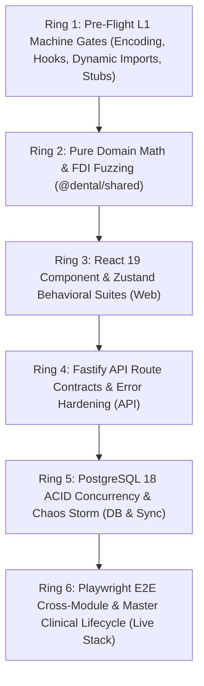

# 🧪 DENTE DENTAL CRM: MASTER TESTING ARCHITECTURE & SPECIFICATION

> 🏛️ **ВЫСШАЯ КОНСТИТУЦИЯ И СТАНДАРТ ТЕСТИРОВАНИЯ (SSOT):**  
> Документ каталогизирует полную архитектуру тестирования монорепозитория DENTE CRM в соответствии с Конституцией [`.agents/THE_HAMMER_MASTER_PROMPT.md`](file:///C:/Clinic_MVP/dental-crm/.agents/THE_HAMMER_MASTER_PROMPT.md) и каноническими мандатами 8d..8bc.  
> 
> 🎯 **СТРАТЕГИЧЕСКИЙ ПРИОРИТЕТ №1:**  
> Соло-врач (1–2 кресла, субаренда, ИП) и малая частная клиника (1–3 кресла). Все тесты моделируют реальную клиническую и финансовую эксплуатацию без академического оверинжиниринга и бюрократического паралича.

---

## 🧭 6 ЭШЕЛОНОВ ТЕСТИРОВАНИЯ (THE 6 TESTING RINGS)



---

## 1. РЕЕСТРЫ И ПРОФИЛЬНЫЕ СТАНДАРТЫ ТЕСТИРОВАНИЯ (SSOT REGISTRY MAP)

| Направление тестирования | Канонический реестр документации | Основные тестовые файлы | Ключевые проверяемые инварианты |
| :--- | :--- | :--- | :--- |
| **Сквозной E2E Master Flow** | [`docs/testing/E2E_CLINICAL_TESTING_STANDARD.md`](file:///C:/Clinic_MVP/dental-crm/docs/testing/E2E_CLINICAL_TESTING_STANDARD.md) | `apps/web/tests/e2e/master-clinical-lifecycle.spec.ts` | 5-сек бронь ➔ 0-клик норма ➔ Wheeler 36 [O] ➔ Смета ➔ Сплит 50/50 ➔ Чек 54-ФЗ. |
| **Кросс-модульные сценарии E2E** | [`docs/testing/E2E_CLINICAL_TESTING_STANDARD.md`](file:///C:/Clinic_MVP/dental-crm/docs/testing/E2E_CLINICAL_TESTING_STANDARD.md) | `cashbox-billing-flow.spec.ts`<br>`warehouse-consumption-flow.spec.ts`<br>`odontogram-multiselect-flow.spec.ts` | Сплит-оплата в копейках, списание по техкартам (Soft Negative Stock), мультиселект одонтограммы. |
| **Сетевой хаос и идемпотентность** | [`docs/testing/CHAOS_AND_IDEMPOTENCY_TEST_REGISTRY.md`](file:///C:/Clinic_MVP/dental-crm/docs/testing/CHAOS_AND_IDEMPOTENCY_TEST_REGISTRY.md) | `apps/api/src/tests/chaos/idempotencyAndOfflineStorm.test.ts` | 20-поточный шторм `Idempotency-Key` (UUIDv7), Double-Spend defense, FIFO офлайн-очередь, CRDT LWW зубов. |
| **Контракты роутов Fastify** | [`docs/testing/API_ROUTES_INQUISITION_REGISTRY.md`](file:///C:/Clinic_MVP/dental-crm/docs/testing/API_ROUTES_INQUISITION_REGISTRY.md) | `apps/api/src/tests/routes/apiContractsAndErrorHardening.test.ts` | Защита CWE-209 & SQL 22P02, валидация UUID, строгие коды 400/404/409/422 вместо 500 краша. |
| **ACID-транзакции и дедлоки** | [`docs/testing/ACID_CONCURRENCY_TEST_REGISTRY.md`](file:///C:/Clinic_MVP/dental-crm/docs/testing/ACID_CONCURRENCY_TEST_REGISTRY.md) | `apps/api/src/tests/concurrency/acidTransactionStress.test.ts` | 20 потоков бронирования (1x 201 + 19x 409), дебет семейного депозита (3x 200 + 12x 402), дедлок-иммунитет склада через `ORDER BY id ASC`. |
| **Фаззинг формулы FDI и копеек** | [`docs/testing/CLINICAL_MATH_FUZZING_REGISTRY.md`](file:///C:/Clinic_MVP/dental-crm/docs/testing/CLINICAL_MATH_FUZZING_REGISTRY.md) | `packages/shared/src/__tests__/fuzzingToothAndBillingMath.test.ts` | 10 000 мутаций ввода FDI (0 крашей), анатомические поверхности Wheeler, 10 000 сплитов и скидок Мандата 8e (`sum === totalKopecks`). |
| **Жизненный цикл ЭМК и дневников** | [`docs/testing/CLINICAL_EMR_TEST_REGISTRY.md`](file:///C:/Clinic_MVP/dental-crm/docs/testing/CLINICAL_EMR_TEST_REGISTRY.md) | `apps/api/src/tests/clinical/clinicalEmrLifecycle.test.ts` | Дневники SOAP, автосохранение черновиков (Мандат 8e), ПЭП криптохеш SHA-256, аудит «Исправленному верить», печать A4. |
| **Планы лечения, 3 тарифа и ПЭП** | [`docs/testing/TREATMENT_PLANS_TEST_REGISTRY.md`](file:///C:/Clinic_MVP/dental-crm/docs/testing/TREATMENT_PLANS_TEST_REGISTRY.md) | `apps/api/src/tests/routes/treatmentPlanStudioAndPep.test.ts`<br>`treatmentPlanMultiTierAndSigning.test.ts` | 3 тарифа (Эконом/Оптимум/Премиум), скрытие микро-расходников, копеечная математика рассрочки 0%, вычет 13% НДФЛ, ПЭП SHA-256, 30-дней без блокировок (Мандат 8e). |
| **React 19 & Zustand сторы** | [`docs/testing/WEB_COMPONENTS_TEST_REGISTRY.md`](file:///C:/Clinic_MVP/dental-crm/docs/testing/WEB_COMPONENTS_TEST_REGISTRY.md) | `appStoreBehavioral.test.ts`<br>`clinicalWorkflowStateHydration.test.tsx` | Изоляция сессий пациентов (ноль утечек данных), 0-F5 реактивная гидратация, Apple HIG $\ge 44\times 44$px. |
| **Расписание и быстрая запись (3 сек)** | [`docs/testing/SCHEDULE_QUICK_BOOKING_TEST_REGISTRY.md`](file:///C:/Clinic_MVP/dental-crm/docs/testing/SCHEDULE_QUICK_BOOKING_TEST_REGISTRY.md) | `redTeamSchedule3SecondBookingInquisition.test.tsx`<br>`quickBookingSoloDoctor.test.tsx` | 3-сек запись без ассистента (Мандат 8n), `disabled={false}`, UUIDv7 Idempotency-Key, Apple HIG Agenda View. |
| **ИИ-Копайлот и Workstation-Харнесс** | [`docs/testing/AI_COPILOT_TEST_REGISTRY.md`](file:///C:/Clinic_MVP/dental-crm/docs/testing/AI_COPILOT_TEST_REGISTRY.md) | `apps/api/src/ai/__tests__/copilotAutonomousHarness.test.ts` | 3 уровня доверия (cautious/supervised/autonomous), ротация ключей и 429 cooldown, чистый клинический язык (Мандат 8x), изоляция Web vs Desktop. |
| **Очищение тестовой базы** | [`docs/testing/TEST_SUITES_INQUISITION_REGISTRY.md`](file:///C:/Clinic_MVP/dental-crm/docs/testing/TEST_SUITES_INQUISITION_REGISTRY.md) | 11 очищенных сьютов (`labOrders`, `radiology`, `fns`, `bom`, `speech`) | Ликвидация тестов с `fs.readFileSync`, искоренение проглоченных `catch {}`, строгие `node:assert/strict`. |

---

## 2. ПОЛНЫЙ КАТАЛОГ СЬЮТОВ ТЕСТИРОВАНИЯ ПО СЛОЯМ

### Слой 1: Чистая доменная математика и алгоритмы (`packages/shared`)
- **Путь**: `packages/shared/src/__tests__/`
- **Команда запуска**: `npx tsx --test packages/shared/src/__tests__/<filename>.test.ts`
- **Ключевые сьюты**:
  * `fuzzingToothAndBillingMath.test.ts` — 10 000 псевдослучайных мутаций формулы FDI ISO 3950, разбор сокращений поверхностей MODVL, точный финансовый расчет Гамильтона-Хэра и сплит-чеков без float-дрифта, геометрия Wheeler 2.5D ($CX=50$, $CY=176$, посадка 43..33 в 300px $\le 320$px под iPhone 390px).
  * `clinicalInquisitionStress.test.ts` — стресс-тесты клинических классификаторов и словарей СтАР.
  * `priceRounding.test.ts`, `discountAllocation.test.ts` — целочисленная арифметика копеек (`amountKopecks: bigint` / `number`).

### Слой 2: Бэкенд Fastify, API роуты и контракты (`apps/api`)
- **Путь**: `apps/api/src/tests/`
- **Команда запуска**: `npx tsx --test apps/api/src/tests/<filename>.test.ts`
- **Ключевые поддиректории и сьюты**:
  * **Контракты и защита от крашей (`apps/api/src/tests/routes/`)**:
    - `apiContractsAndErrorHardening.test.ts` — защита от CWE-209 и SQL 22P02 (`invalid input syntax for type uuid`). Префлайт-валидация UUID возвращает 400/404 вместо неконтролируемого 500 с утечкой стека БД.
    - `visits.test.ts`, `visitSignAuditTrail.test.ts`, `visitFlowPayloadValidation.test.ts` — сквозной поток приёма пациента.
    - `warehouseSoftOverdraftAndTechCardInquisitor.test.ts`, `warehouseStockEndpoint.test.ts` — автоматическое фоновое списание по техкартам с мягким овердрафтом (Soft Negative Stock, Мандат 8aa).
    - `splitPaymentTreatmentConsumablesE2E.test.ts` — одновременный чекаут и списание расходников.
    - `telephonyCallerLookup.test.ts`, `telephonyCallLifecycle.test.ts` — софтфон без блокирующих модалок для врача (Мандат 8v).
  * **Высококонкурентные стресс-тесты (`apps/api/src/tests/concurrency/`)**:
    - `acidTransactionStress.test.ts` — 20 параллельных потоков на слот расписания, дебет семейного депозита с `SELECT ... FOR UPDATE`, дедлок-иммунитет склада через сортировку `ORDER BY id ASC`.
    - `billingDoubleSpendDefense.test.ts` — защита от двойного списания при быстрых кликах.
    - `scheduleSlotLockConcurrency.test.ts` — 4D-разрешение конфликтов временных окон.
    - `inventoryStockDeductionStress.test.ts` — параллельное списание партий материалов.
  * **Сетевой хаос и устойчивость (`apps/api/src/tests/chaos/`)**:
    - `idempotencyAndOfflineStorm.test.ts` — 20 одновременных POST с одинаковым `Idempotency-Key` (UUIDv7) выполняются ровно 1 раз (1x 201 + 19x 409), офлайн FIFO очередь, CRDT LWW одонтограммы.
  * **Клинический жизненный цикл ЭМК (`apps/api/src/tests/clinical/`)**:
    - `clinicalEmrLifecycle.test.ts` — валидация номеров FDI постоянного (11..48) и молочного (51..85) прикуса, связывание с МКБ-10, соматическая безопасность (аллергии, кардиориски), debounced autosave черновика (Мандат 8e), ПЭП подпись с SHA-256 хешем и ревизии «Исправленному верить».
  * **Планы лечения, 3 тарифа и электронная подпись ПЭП (`apps/api/src/tests/routes/`, `apps/api/src/services/`)**:
    - `treatmentPlanStudioAndPep.test.ts` — интеграционный CRUD планов, 3-тарифное сравнение, скрытие микро-расходников, точная копеечная математика (`amountKopecks`), 30-дневная автономия врача (Мандат 8e), SMS OTP ПЭП подписание с SHA-256 хешем и валидация статусов.
    - `treatmentPlanMultiTierAndSigning.test.ts` — доменная математика тарифов, расчет 13% налогового вычета НДФЛ (КНД 1151156, коды 01 и 02), SHA-256 Frozen Snapshot и генерация бланка A4 в 1 клик.
  * **Безопасность и RBAC (`apps/api/src/tests/security/`)**:
    - `deepRoutesPrivacyAudit.test.ts`, `payloadStripping152Fz.test.ts`, `roleRefusalText.test.ts` — защита персональных данных пациентов (152-ФЗ), изоляция арендаторов (`organizationId`).

### Слой 3: Пользовательский интерфейс и состояние React 19 (`apps/web`)
- **Путь**: `apps/web/src/store/__tests__/`, `apps/web/src/components/__tests__/`
- **Команда запуска**: `npx tsx --test <filename>`
- **Ключевые сьюты**:
  * `appStoreBehavioral.test.ts` — изоляция состояний между сессиями пациентов, отсутствие амнезии при смене вкладок.
  * `clinicalWorkflowStateHydration.test.tsx` — реактивная гидратация 0-F5 без необходимости ручной перезагрузки страницы (Мандат 8zq).
  * `odontogramRealBehavioralSuite.test.tsx` — реактивность зубной формулы FDI, зубоспецифичные меню, мультиселект.
  * `visitRealBehavioralSuite.test.tsx` — автосохранение черновиков SOAP, кнопка «✓ Норма» в 1 клик, Primary CTA никогда не disabled.
  * `cashboxSsotScreens.test.tsx` — сплит-чеки, комбинированная оплата (нал/карта/СБП/депозит).

### Слой 4: Сквозные Playwright E2E сценарии (`apps/web/tests/e2e`)
- **Путь**: `apps/web/tests/e2e/`
- **Команда запуска**: `npx playwright test apps/web/tests/e2e/<filename>.spec.ts`
- **Ключевые сьюты**:
  * `master-clinical-lifecycle.spec.ts` (524 строки) — 5-фазный мастер-цикл: бронирование за 5 секунд без ассистента ➔ приём врача с 1-клик нормой ➔ разметка кариеса 36 [O] K02.0 ➔ смета в копейках ➔ чекаут сплитом 50% карта / 50% нал.
  * `cashbox-billing-flow.spec.ts` — проведение фискального чека 54-ФЗ, сплит-оплата.
  * `warehouse-consumption-flow.spec.ts` — автосписание анестетика и пломбировочного материала.
  * `odontogram-multiselect-flow.spec.ts` — пакетное выделение зубов и применение статусов.

---

## 3. МАШИННЫЕ ГЕЙТЫ DEFINITION OF DONE (9 ШАГОВ)

Перед сдачей любого изменения в код или тесты проект обязан пройти 9 гейтов:
1. **UTF-8 Encoding:** `npm run check:encoding` ➔ Exit Code 0 (23 960+ файлов без BOM).
2. **React 19 Hooks:** `npm run check:react-hooks` ➔ Exit Code 0 (ноль вызовов хуков в тернарниках или после `return`).
3. **Стабы компонентов:** `npm run check:stub-overrides` ➔ Exit Code 0.
4. **Сетевой перехват:** `npm run check:fetch-response` ➔ Exit Code 0.
5. **Динамические импорты:** `npm run check:dynamic-imports` ➔ Exit Code 0 (ноль битых путей).
6. **Мьютекс на компилятор (Мандат 8t):** Воркеры НЕ запускают глобальный `typecheck`. Полный `npm run typecheck` запускает единолично L1 Оркестратор.
7. **Точечные тесты:** Время выполнения $\le 10$ секунд на сьют, 100% PASS (`npx tsx --test <file>` или `npx vitest run <file>`).
8. **4-State Visual Proof:** Скриншоты $\ge 20$ КБ в `docs/proofs/` (☀️ PC Light, 🌙 PC Dark, 📱 Mobile Light, 📱 Mobile Dark), личный осмотр через `read_file`.
9. **Git Dual-Push:** Пофайловый `git add <file>`, подробный Conventional Commit, пуш в `origin/main`.

---

## 4. БОЕВЫЕ КОМАНДЫ ДЛЯ СУБАГЕНТОВ (CLI CHEATSHEET)

### Быстрые точечные запуски (время прогона $\le 5$ с):
```bash
# 1. Запуск E2E мастер-теста клинического цикла:
npx playwright test apps/web/tests/e2e/master-clinical-lifecycle.spec.ts

# 2. Запуск кросс-модульных Playwright E2E:
npx playwright test apps/web/tests/e2e/cashbox-billing-flow.spec.ts
npx playwright test apps/web/tests/e2e/warehouse-consumption-flow.spec.ts
npx playwright test apps/web/tests/e2e/odontogram-multiselect-flow.spec.ts

# 3. Фаззинг формулы FDI, геометрии Wheeler и копеек (278 мс):
npx tsx --test packages/shared/src/__tests__/fuzzingToothAndBillingMath.test.ts

# 4. Стресс-тест хаоса и идемпотентности (3.29 с):
npx tsx --test apps/api/src/tests/chaos/idempotencyAndOfflineStorm.test.ts

# 5. Тесты контрактов роутов Fastify (3.6 с):
npx tsx --test apps/api/src/tests/routes/apiContractsAndErrorHardening.test.ts

# 6. Стресс-тест ACID-транзакций и дедлоков PostgreSQL 18 (4.1 с):
node --import tsx --import ./src/tests/support/poolTeardown.ts --test apps/api/src/tests/concurrency/acidTransactionStress.test.ts

# 7. Жизненный цикл ЭМК, дневников SOAP и ПЭП (4.1 с):
npx tsx --test apps/api/src/tests/clinical/clinicalEmrLifecycle.test.ts

# 8. Поведенческие тесты React 19 компонентов и Zustand (4.07 с):
npx tsx --test apps/web/src/store/__tests__/appStoreBehavioral.test.ts
npx tsx --test apps/web/src/components/__tests__/clinicalWorkflowStateHydration.test.tsx

# 9. Проверка базовой тестовой инфраструктуры:
npm run test:infra

# 10. Планы лечения, 3 тарифа, копеечная математика и ПЭП (5.3 с):
npx tsx --test apps/api/src/tests/routes/treatmentPlanStudioAndPep.test.ts
npx tsx --test apps/api/src/services/treatmentPlan/__tests__/treatmentPlanMultiTierAndSigning.test.ts
```

### Комплексные гейты монорепозитория (строго единолично L1 Оркестратор):
```bash
npm run check:encoding
npm run check:react-hooks
npm run check:stub-overrides
npm run check:fetch-response
npm run check:dynamic-imports
npm run typecheck
```

---

## 5. НЕПРИКОСНОВЕННЫЕ ИНВАРИАНТЫ ТЕСТИРОВАНИЯ (THE IRONCLAD RULES)

1. **Запрет моков в живых путях (Мандат 8z):** Никаких моковых заглушек или синтетических симуляций `setTimeout(..., 1500)` в боевом контуре. Все тесты работают с реальным Fastify API и PostgreSQL 18 на `127.0.0.1:5432`.
2. **Запрет чтения исходников через `fs.readFileSync` (Мандат 8aj, Ось №7):** Тесты обязаны проверять реальное поведение в рантайме, а не парсить текст файлов регулярными выражениями.
3. **Изоляция боевых ключей (Мандат 8af):** Тесты никогда не используют реальные ключи из `.env`. Все внешние интеграции перехвачены детерминированными мок-хэндлерами.
4. **Финансовая математика strictly BigInt (Мандат 8b):** Все финансовые расчеты ведутся в неделимых копейках (`amountKopecks: bigint` или `number`). Запрещен `float` и `Math.round()`.
5. **Автономия врача (Мандат 8e):** Кнопки («Сохранить», «Печать», «Оплатить») в UI и тестах никогда не должны быть `disabled` из-за незаполненных второстепенных полей.
6. **Apple HIG тач-стандарт:** Сенсорные тач-таргеты на мобильных устройствах строго $\ge 44\times 44$px (кнопки в нижней зоне — 52px с `env(safe-area-inset-bottom)`).
7. **Одиночный тяжелый компилятор (Мандат 8t):** Субагентам роя категорически запрещено параллельно запускать глобальный `npm run typecheck` или сборку монорепозитория. Проверка выполняется строго точечно.
8. **Анти-поллинг фоновых задач (Мандат 8zu / 8r):** Запрещен цикл `status`. Установил таймер `schedule DurationSeconds=20..60, TimerCondition="<task_id>"` ➔ мгновенно отдал ход (Yield Turn).
