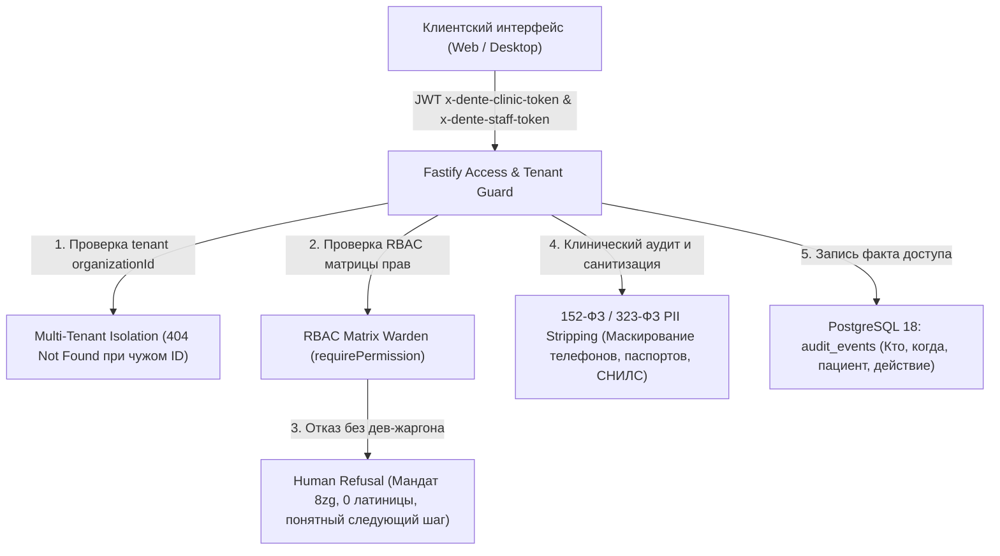

# 🛡️ REESTR ТЕСТОВ БЕЗОПАСНОСТИ, RBAC И ПРИВАТНОСТИ ПЕРСОНАЛЬНЫХ ДАННЫХ (152-ФЗ / 323-ФЗ)

> 🏛️ **ВЫСШАЯ КОНСТИТУЦИЯ И СТАНДАРТ ТЕСТИРОВАНИЯ (SSOT):**  
> Документ каталогизирует комплексный аудит безопасности, ролевой модели доступа (RBAC), межклинической изоляции арендаторов (`organizationId` Multi-Tenant Isolation) и защиты персональных данных (152-ФЗ) и врачебной тайны (323-ФЗ ст. 13) в DENTE Dental CRM в соответствии с Конституцией [`.agents/THE_HAMMER_MASTER_PROMPT.md`](file:///C:/Clinic_MVP/dental-crm/.agents/THE_HAMMER_MASTER_PROMPT.md) и каноническими мандатами 8d, 8e, 8n, 8z, 8zg.

---

## 🧭 АРХИТЕКТУРА И ЭШЕЛОНЫ ЗАЩИТЫ БЕЗОПАСНОСТИ



---

## 1. КАТАЛОГ СЬЮТОВ ТЕСТИРОВАНИЯ БЕЗОПАСНОСТИ (`apps/api/src/tests/security/`)

| Тестовый сьют | Файл | Кол-во тестов | Время | Статус | Основные проверяемые инварианты |
| :--- | :--- | :--- | :--- | :--- | :--- |
| **1. Межклиническая изоляция и пентест роутов** | `deepRoutesPrivacyAudit.test.ts` | 17 | ~2.4 с | 🟢 100% PASS | Межклиническая изоляция 5 сущностей (пациенты, дневники, планы лечения, наряды ЗТЛ, счета). Блокировка маркетолога по 9 роутам (403 Forbidden). Запись в `audit_events`. 404 вместо утечки PII чужой клиники. |
| **2. Санитизация ПДн и маскирование (152-ФЗ)** | `payloadStripping152Fz.test.ts` | 14 | ~0.2 с | 🟢 100% PASS | Маскирование телефонов `+7 (999) ***-**-12`, очистка паспортов РФ (`** ** ******56`) и СНИЛС (`***-***-*** 12`), вырезание полей врачебной тайны (`diagnosis`, `emr_records`, `odontogram`, `mkb10`) для неклинических ролей. Очистка логов аудита. |
| **3. Человечные отказы в доступе (Мандат 8zg)** | `roleRefusalText.test.ts` | 13 | ~0.4 с | 🟢 100% PASS | Ноль латиницы в тексте 403, прохождение сквозь клиентский фильтр `technicalWorkflowFailurePattern` в `AppHelpers.tsx`. Указание причины и следующего шага («кого просить»). Отсутствие дев-жаргона (`RBAC_DENIED`, SQL, FastifyError). |

---

## 2. ДЕТАЛЬНЫЙ РАЗБОР ТЕСТОВЫХ СЬЮТОВ

### Сьют 1: `deepRoutesPrivacyAudit.test.ts` (17 тестов)
Тестирование проводится на реальном Fastify инстансе (`app.inject()`) с подключением к PostgreSQL 18 на `127.0.0.1:5432`:
1. `GET /api/diaries/visit/:visitId` — блокировка маркетолога с кодом 403.
2. `GET /api/diaries/:id/revisions` — блокировка маркетолога с кодом 403.
3. `GET /api/xray/scans` — блокировка маркетолога с кодом 403.
4. `GET /api/xray/scans/:id` — блокировка маркетолога с кодом 403.
5. `GET /api/anesthesia/patients/:patientId/logs` — блокировка маркетолога с кодом 403.
6. `POST /api/anesthesia/patients/:patientId/logs` — блокировка маркетолога с кодом 403.
7. `GET /api/clinical/implants/patient/:patientId` — блокировка маркетолога с кодом 403.
8. `POST /api/clinical/implants/installations` — блокировка маркетолога с кодом 403.
9. `POST /api/documents` — блокировка маркетолога с кодом 403.
10. **Позитивный контроль врача**: Доступ врача к медицинской документации разрешен (200 OK) с регистрацией записи в `audit_events`.
11. **Multi-Tenant Isolation (Пациенты)**: `GET /api/patients/:patientIdB` от имени клиники А возвращает 404 (ноль утечки персональных данных).
12. **Multi-Tenant Isolation (Мутация пациента)**: `PUT /api/patients/:patientIdB` от имени клиники А отклоняется с кодом 404.
13. **Multi-Tenant Isolation (Дневники приёма)**: `GET /api/diaries/visit/:visitIdB` от имени клиники А возвращает 404 `VisitNotFound`.
14. **Multi-Tenant Isolation (Планы лечения)**: `GET /api/treatment-plans/:planIdB` от имени клиники А возвращает 404 `TreatmentPlanNotFound`.
15. **Multi-Tenant Isolation (Наряды ЗТЛ)**: `PUT /api/clinical/lab-orders/:labOrderIdB` от имени клиники А возвращает 404 `LabOrderNotFound`.
16. **Multi-Tenant Isolation (Счета и касса)**: `GET /api/invoices/:invoiceIdB` от имени клиники А возвращает 404 `InvoiceNotFound`.
17. **Позитивный контроль многоклиничности**: Врач клиники А успешно читает своего пациента, план лечения и счет (200 OK).

---

### Сьют 2: `payloadStripping152Fz.test.ts` (14 тестов)
1. **Физическое вырезание полей врачебной тайны**: Удаление `diagnosis`, `emr_records`, `odontogram`, `clinicalNotes`, `mkb10` из JSON-ответов для немедицинского персонала.
2. **Рекурсивное усечение**: Очистка вложенных объектов, массивов и коллекций.
3. **Клинический допуск**: Маркетолог и регистратор лишены клинического доступа к врачебной тайне.
4. **Администратор без квалификации**: Системный администратор (`admin`) без подтвержденного медицинского диплома лишен доступа к врачебной тайне.
5. **Законный доступ врача и ассистента**: Врач и ассистент обладают штатным доступом к клиническим данным.
6. **Квалифицированный администратор**: Администратор с подтвержденной клинической квалификацией получает доступ.
7. **Куратор лечения с квалификацией**: Куратор лечения (`curator`) с подтвержденной клинической квалификацией имеет доступ (Мандат 8e).
8. **Управляющий с квалификацией**: Управляющий (`manager`) с клинической квалификацией имеет доступ (Мандат 8e).
9. **Fastify Hook усечения**: Автоматическое применение фильтрации на уровне хука `onSend` для неклинических ролей.
10. **Аудит факта доступа**: Сохранение факта доступа к диагнозам в таблице аудита (кто, когда, пациент, сущность).
11. **Маскирование телефонов (152-ФЗ)**: Функция `maskPhoneDisplay` форматирует телефон как `+7 (999) ***-**-12` (виден только код оператора и 2 последние цифры).
12. **Санитизация свободных строк**: Функция `sanitizeString` маскирует паспортные данные РФ (`** ** ******56`) и номера СНИЛС (`***-***-*** 12`) в произвольном тексте.
13. **Очистка сетевых логов аудита**: Функция `sanitizePayload` безопасно маскирует объекты и массивы перед логированием.
14. **Детектор чувствительных ключей**: Предикат `isSensitiveKey` надежно идентифицирует пароли, токены, паспортные данные, номера карт и телефоны.

---

### Сьют 3: `roleRefusalText.test.ts` (13 тестов)
1. **Самопроверка клиентского фильтра**: Проверка того, что реальный фильтр `technicalWorkflowFailurePattern` из `apps/web/src/AppHelpers.tsx` действительно гасит старые тексты с латиницей (`doctor`, `finance.write`).
2. **Тотальное отсутствие латиницы**: Ни в одном отказе из матрицы прав нет латинских символов, названий ролей и машинных ключей прав.
3. **Причина и следующий шаг**: Каждый отказ содержит формулу: «[Роль] не может [действие]. Это могут [кому разрешено]. Попросите кого-то из них...».
4. **Русские подписи ролей и действий**: У каждой роли есть русский лейбл (`ROLE_LABELS`), у каждого права — человеческое описание действия (`PERMISSION_ACTIONS`).
5. **Динамическая генерация подсказки**: Список ролей «кого просить» строится динамически из матрицы `ROLE_PERMISSIONS`.
6. **Отказ для ненастроенной роли**: Роль вне матрицы получает специальный отказ с предложением обратиться к владельцу клиники для выбора роли.
7. **Сканер исходного кода**: Тест сканирует каталоги `routes/` и `security/` на отсутствие антипаттерна подстановки `${identity.role}` или `${permission}` в текст ошибок.
8. **Чистота живого дерева**: В кодовой базе отсутствуют прямые шаблонные интерполяции ключей ролей в текст ошибок.
9. **Тело ответа 403 (`requirePermission`)**: Возврат чистого человеческого текста в поле `message` при сохранении машинных полей `error: "PermissionDenied"`.
10. **Мягкий режим (`enforcePermissionWhenStaffKnown`)**: Корректная работа отказа при неполном контексте сотрудника.
11. **Охрана «кроме врача» (`requireNonDoctorAccess`)**: Человечный отказ врачу при попытке чисто административных операций.
12. **Мандат 8zg (Отсутствие дев-жаргона)**: Полное отсутствие токенов `RBAC_DENIED`, `ORGANIZATION_SCOPE_MISMATCH`, `FastifyError`, SQL или стектрейсов в отказах.
13. **Клинические и финансовые сценарии**: Понятные формулировки для кассы, зарплат, настроек клиники и медицинской карты.

---

## 3. БОЕВЫЕ КОМАНДЫ ДЛЯ ЗАПУСКА СЬЮТОВ БЕЗОПАСНОСТИ

```bash
# 1. Запуск пентеста маршрутов и межклинической изоляции (PostgreSQL 18):
node --import tsx --import ./apps/api/src/tests/support/poolTeardown.ts --test apps/api/src/tests/security/deepRoutesPrivacyAudit.test.ts

# 2. Запуск санитизации ПДн и маскирования 152-ФЗ:
npx tsx --test apps/api/src/tests/security/payloadStripping152Fz.test.ts

# 3. Запуск тестов человечных отказов в доступе (Мандат 8zg):
npx tsx --test apps/api/src/tests/security/roleRefusalText.test.ts

# 4. Проверка всех 3 сьютов безопасности одной цепочкой:
node --import tsx --import ./apps/api/src/tests/support/poolTeardown.ts --test apps/api/src/tests/security/deepRoutesPrivacyAudit.test.ts && \
npx tsx --test apps/api/src/tests/security/payloadStripping152Fz.test.ts && \
npx tsx --test apps/api/src/tests/security/roleRefusalText.test.ts
```

---

## 4. НЕПРИКОСНОВЕННЫЕ ИНВАРИАНТЫ БЕЗОПАСНОСТИ (SECURITY INVARIANTS)

1. **Многоклиничность (Tenant Isolation)**: Запрос к сущности другой организации ВСЕГДА возвращает `404 Not Found`, а не `403 Forbidden`, чтобы предотвратить утечку существования ID чужих пациентов.
2. **Врачебная тайна (323-ФЗ ст. 13)**: Маркетологи, регистраторы и системные администраторы без клинической роли не имеют доступа к одонтограмме, дневникам SOAP, визиографу и диагнозам МКБ-10.
3. **Маскирование ПДн (152-ФЗ)**: В публичных ответах и логах телефоны маскируются по стандарту `+7 (999) ***-**-12`, паспорта РФ — `** ** ******56`, СНИЛС — `***-***-*** 12`.
4. **Мандат 8zg (Чистый человеческий язык)**: Ноль латиницы и системных кодов ошибок в сообщениях 403 для пользователя.
5. **Непрерывный аудит**: Любой просмотр медицинской документации фиксируется в таблице `audit_events` с идентификатором врача, пациента и временной меткой.
