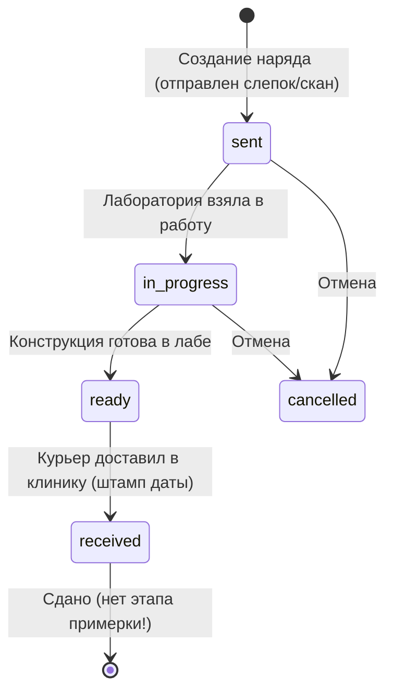
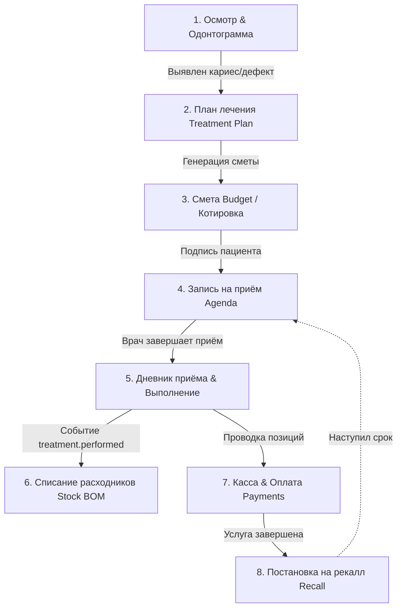

# 🩸 RED TEAM INQUISITION: CLINICAL & OPERATIONS CORE (DentalPin vs Dente)

> Статус: ЗАВЕРШЕНО  
> Роль: Senior Red Team Inquisitor (Clinical & Ops Core)  
> Объекты ревизии:  
> - Внешний эталон: `DentalPin` (`research/dentalpin/backend/app/modules/`, `research/dentalpin/docs/`)  
> - Наша кодовая база: `Dente` (`C:\Clinic_MVP\dental-crm\`)  
> Презумпция брака: 100%. Никакой пощады ни конкуренту, ни нашим собственным архитектурным костылям.

---

## 1. МАТРИЦА СРАВНЕНИЯ МОДУЛЕЙ (DENTALPIN vs DENTE)

Оценка зрелости:
- `[0] Отсутствует` — функционал не реализован.
- `[1] Заглушка/Мок` — схема есть или куцый прототип, но боевого сценария нет.
- `[2] Базовый уровень` — работает типовой CRUD, но не хватает клинической глубины.
- `[3] Зрелый Production` — отказоустойчивое решение с бизнес-правилами, валидацией и аудитом.
- `[4] Продвинутый уровень` — превосходит рыночные аналоги, учитывает тонкие нюансы специальности.

| № | Доменный модуль | DentalPin (Зрелость / Стек) | Dente (Зрелость / Стек) | Вердикт Инквизиции & Сравнительный анализ |
|---|---|---|---|---|
| **1** | **Odontogram (Зубная формула)** | **[3] Зрелый**<br>Python/SQLAlchemy.<br>Четкое разделение `scope` (tooth, multi_tooth, arch, mouth). Lateral + Cenital проекции. Роли в мостах (pillar/pontic). | **[4] Продвинутый**<br>React 19 / TS / Drizzle.<br>FDI 11–48 и 51–85. Взрослый/детский/сменный прикус. 5 поверхностей (MODVL). 3D + SVG. Полная история зуба (`tooth_state_history`). | **Dente сильнее визуально и анатомически**, но у DentalPin стоит перенять архитектурный `scope` для процедур на всю челюсть/рот и атомарное связывание зубов в мостовидные протезы. |
| **2** | **Periodontogram (Пародонтология)** | **[3] Зрелый**<br>SEPA-стандарт. 3 таблицы: снапшот, зубы 11–48, 6 точек на зуб (MV, V, DV, ML, L, DL). Авто-расчет BoP %, PI %, Mean CAL, Deep Pockets. | **[4] Продвинутый**<br>Полный паритет схемы ADR 0013 + Florida Probe эргономика.<br>Автопереход по сайтам с клавиатуры, тепловая карта глубин, OHI-S, PMA, PSR, автономия нормы. | **Ничья по модели данных (100% паритет), Dente выигрывает по эргономике ввода**. Врачу у кресла в Dente не нужно тыкать мышью в 192 поля — работает цифровой нумпад и пресет нормы. |
| **3** | **Clinical Notes / EMR (ЭМК / Протоколы)** | **[1] Примитивный**<br>Простые текстовые заметки к пациенту/визиту с файловыми аттачами. Нет структуры осмотра. | **[4] Продвинутый**<br>Форма 043/у, МКБ-10, Номенклатура 804н, специализированные протоколы (терапия, ортопедия, хирургия, ортодонтия, эндодонтия). | **Dente тотально доминирует**. У DentalPin нет клинической структуры дневника приёма — просто текстовый блог. |
| **4** | **Treatment Plan (Планы лечения)** | **[3] Зрелый**<br>Draft → Pending → Active → Completed/Closed. Мультисессионные этапы (`item_sessions`). Привязка к визитам (`appointment_treatments`). | **[3] Зрелый**<br>Мультиэтапность, сценарии «Эконом / Стандарт / Премиум», заморозка цен (`price_freeze_tokens`), ст. 20 323-ФЗ. | **Паритет с разными акцентами**. В DentalPin лучше сделан конвейер сессий и привязка шага к визиту. В Dente сильнее коммерческий блок (альтернативные сметы и гарантия цены). |
| **5** | **Budget (Сметы & Котировки)** | **[4] Продвинутый**<br>Версионирование (v1 → v2 с parent_id), удаленный шеринг по токену, беспарольная верификация (4 цифры телефона), цифровая подпись, защита от брутфорса IP. | **[3] Зрелый**<br>Калькулятор смет, рассрочки, интеграция с семейным балансом, скидки врача, печать актов. | **DentalPin здесь шедеврален**. Версионирование смет при отказе пациента от части позиций и отправка ссылки без SMS-шлюзов — готовый чертёж для Dente! |
| **6** | **Prescriptions & Rx Catalog** | **[3] Зрелый**<br>56 готовых стоматологических препаратов, 14 лекарственных форм, шаблоны готовых наборов (1-клик Rx-сеты), профиль врача с лицензией. | **[2] Базовый**<br>Схемы рецептов, интеграция с МДЛП (Честный Знак 10560/444). Нет предзаполненного каталога 50+ топ-препаратов. | **DentalPin практичнее для кресла**. В Dente мощная регуляторика Честного Знака, но нет удобных клинических пресетов антибиотиков и НПВП в 1 клик. |
| **7** | **Lab Orders (Зуботехническая лаборатория)** | **[2] Базовый**<br>Простая шапка наряда: тип работы, зуб, слепок (альгинат/силикон/скан), цвет VITA, даты отправки/сдачи. | **[4] Продвинутый**<br>7-этапный пайплайн, CAD/CAM параметры (микроны зазора, ти-бейсы, STL-сетки), VITA 3D-Master + Bleach + Stump ND1-ND9, штрихкоды, печать ЗТЛ-1. | **Dente на две головы выше**. DentalPin умеет только фиксировать факт отправки, а Dente управляет полным циклом протезирования и удерживает стоимость ЗТЛ из сдельной зарплаты врача. |
| **8** | **Agenda & Schedules (Расписание)** | **[2] Опасный костыль**<br>Кресла, смены врачей, исключения. ⚠️ **ФАТАЛЬНЫЙ БАГ:** коллизии проверяются через unique index на точный `start_time` — наложения отрезков НЕ ловятся! | **[4] Продвинутый**<br>Алгоритм DSU + Sweeping Line для наложений, 3 типа коллизий (врач, кресло, пациент), поиск свободных окон (`freeIntervalsEngine`), 0-клик запись. | **Dente на порядок надежнее**. Расписание DentalPin упадет при первом же пересечении приёмов разной длительности. |
| **9** | **Recalls (Профосмотры & Диспансеризация)** | **[3] Зрелый**<br>Месячные корзины (`due_month`), лог попыток дозвона, авто-привязка к визиту и авто-закрытие при завершении приёма! | **[3] Зрелый**<br>Когортный анализ (6/12/18 мес), интерактивный WhatsApp-бот (записаться/отложить), автогенерация задач администраторам. | **Синтез лучших практик**. Авто-линковка визита к рекаллу в DentalPin идеальна; омниканальный WhatsApp Dente превосходит их ручной дозвон. |
| **10** | **Treatment Consumables (Списание расходников)** | **[3] Зрелый**<br>Связка «услуга каталога → расходники склада» с нормой списания. Фоновое мягкое списание (`clamp_at_zero=True`) без блокировки врача. | **[4] Продвинутый**<br>Техкарты по приказу 804н, идемпотентный аудит-лог списаний по `treatmentReferenceId`, FEFO-партии, фиксация овердрафта склада. | **Dente превосходит по складскому учету**, но философия `clamp_at_zero` у обоих систем одинаково верная — склад никогда не останавливает лечебный процесс. |
| **11** | **Inventory & POs (Склад & Закупки)** | **[3] Зрелый**<br>Склад, контроль минимума, событие low_stock, заказы поставщикам (PO), каталог поставщиков с прайсами. | **[3] Зрелый**<br>Складские остатки, партии, сроки годности, автозаказ, перемещения между кабинетами, СанПиН журналы. | **Паритет**. В DentalPin чище сделан контур Purchase Orders, в Dente глубже медицинская специфика (сроки годности, СанПиН). |
| **12** | **Billing & Invoices (Счета & Инвойсы)** | **[3] Зрелый**<br>Серии счетов, кредит-ноты (возвраты), фискальные хуки (Verifactu ES, SDI IT, GST IN). Вычисление остатка долга на лету. | **[4] Продвинутый**<br>54-ФЗ онлайн-кассы (ФФД 1.2), справки для налогового вычета ФНС 1151156, коды 1 и 2 (дорогостоящее лечение). | **Каждый силен в своем правовом поле**. Dente полностью закрывает жесткие требования РФ/СНГ; DentalPin спроектирован под ЕС и Индию. |
| **13** | **Payments & Cash (Касса & Оплаты)** | **[3] Зрелый**<br>Платежи с алокацией (на смету или на депозит пациента `on_account`), идемпотентность по ключу, возвраты с кодами причин. | **[4] Продвинутый**<br>Мульти-сплит (нал + безнал + СБП + семейный кошелек), автономия скидки врача, защита от блокировки из-за ИНН физлица. | **Dente эргономичнее у стойки**, но концепция `PaymentAllocation` (строгое разделение: оплата на конкретный план vs аванс на лицевой счет) в DentalPin очень аккуратна. |
| **14** | **Treasury (Казначейство / Счета клиники)** | **[3] Зрелый**<br>Счета (касса / банк), проводки со знаком (transfer_in, transfer_out, correction), парные переводы по `group_id`. | **[2] Базовый**<br>Кассовые смены (Z-отчеты), инкассация, базовый учет ДДС. | **DentalPin чище по бух-структуре**. Имеет смысл заимствовать их двойную проводку перемещения денег между сейфом и расчетным счетом. |
| **15** | **Patient Timeline & Activity Journal** | **[3] Зрелый**<br>Денормализованный таймлайн пациента + системный журнал действий персонала (аудит доступа, действий с историей). | **[3] Зрелый**<br>Клиническая лента пациента, история изменений карты, WebSocket-оповещения. | **Паритет**. У DentalPin красивее шина событий (Transactional Event Bus), у Dente глубже клинический контекст. |
| **16** | **Patient Relationships (Семья & Баланс)** | **[2] Базовый**<br>Связи «пациент-пациент» (parent, child, spouse, guardian). Автоматический расчет обратной связи при чтении. | **[4] Продвинутый**<br>Семейные кошельки с общим балансом, законные представители для подписания ИДС несовершеннолетних, оплата за родственника. | **Dente существенно опережает**. В DentalPin это просто текстовые ярлыки родства, в Dente — реальный финансовый и юридический инструмент клиники. |
| **17** | **Operations Pipeline (Воронка планов)** | **[4] Продвинутый**<br>5-колоночная оперативная доска reception: «К расчету», «Ждем решения», «Без записи», «В процессе без след. визита», «Закрыто». | **[2] Базовый**<br>CRM-лиды, доска задач, лист ожидания, но нет специализированного канбана конверсии планов лечения! | **ГЛАВНАЯ НАХОДКА ДЛЯ DENTE!** Это готовый инструмент удержания выручки клиники, закрывающий слепую зону между врачом и администратором. |
| **18** | **Staff Attendance & Payroll (Зарплата & Табель)**| **[2] Базовый**<br>Учет рабочего времени персонала, простая сетка ставок. | **[4] Продвинутый**<br>Сдельная оплата врачей за минусом лаборатории и материалов, табель Т-13, расчетные листки Т-51, категории квалификации. | **Dente вне конкуренции**. Модуль сдельной оплаты стоматологов в Dente учитывает реальную экономику частной клиники. |
| **19** | **Regulatory & State Integration** | **[3] Зрелый (ЕС/Индия)**<br>Verifactu (Испания), SDI (Италия), GST (Индия). | **[4] Продвинутый (РФ)**<br>ЕГИСЗ РЭМД (CDA R3), КриптоПро УЭК/УКЭП, МДЛП Честный Знак, 54-ФЗ, Приказ 804н, ФНС 1151156. | **Специфика юрисдикций**. Обе системы глубоко проработали свои законодательные зоны. |
| **20** | **AI Copilot & Tool Calling** | **[2] Базовый**<br>FastAPI эндпоинты с JSON schema для агентов, вызовы инструментов через pydantic tools. | **[4] Продвинутый**<br>DENTA Copilot: синтез дневников приёма, голосовая диктовка зубной формулы, автопротоколирование, ассистент по выручке смены. | **Dente лидирует по практической ценности ИИ для врача у кресла**. |

---

## 2. ГЛУБОКИЙ РАЗБОР ЗУБНОЙ И ПАРОДОНТОЛОГИЧЕСКОЙ КАРТЫ

### 2.1. Одонтограмма DentalPin: Анатомия моделей и клинические правила
В DentalPin одонтограмма построена вокруг чистой реляционной триады:
```
ToothRecord (текущее базовое состояние)
   ▲
   │ 1..N
TreatmentTooth (роль в лечении: pillar / pontic / surfaces)
   ▲
   │ N..1
Treatment (клинический акт / диагноз / манипуляция)
```

#### Ключевые поля и находки DentalPin:
1. **Полиморфизм масштаба вмешательства (`scope`):**
   - `tooth`: стандартная процедура на 1 зуб (пломба, коронка).
   - `multi_tooth`: неделимое вмешательство на группу зубов (мостовидный протез, шинирование, ретенционная дуга).
   - `global_arch`: вмешательство на челюсть (требует `arch: 'upper' | 'lower'` — каппа, сплинт, пластинка).
   - `global_mouth`: тотальное вмешательство на всю полость рта (гигиеническая чистка, отбеливание, фторирование).
   Критика Dente: У нас долгое время отбеливание или профгигиена либо висели вообще без привязки к одонтограмме, либо спамили 32 записи в таблицу `treatment_items`. Паттерн `scope` из DentalPin — хирургически точное решение!

2. Двухпроекционная система визуализации (Lateral vs Cenital):
   DentalPin жестко делит отрисовку на 4 детерминированных правила (`VisualizationRule`):
   - **Правило 1 (`pulp_fill`):** заливка пульповой камеры на боковой проекции (пульпит, пломбировка корневых каналов на 1/2, 2/3 или верхушку).
   - **Правило 2 (`occlusal_surface`):** секторная заливка анатомических поверхностей (M, D, O, V, L) на виде сверху (кариес, пломбы, силанты, виниры).
   - **Правило 3 (`lateral_icon`):** наложение SVG-глифа на боковой проекции (штифт, имплантат, апикоэктомия, брекет, удаление, перелом).
   - **Правило 4 (`pattern_fill`):** штриховка или текстура на окклюзионном виде (коронка, мост, накладка, ретенция).

3. **Моделирование мостовидных протезов (`Bridge`):**
   В DentalPin мост — это **одна строка `Treatment`**, у которой в дочерней таблице `TreatmentTooth` для опорных зубов ставится `role = "pillar"`, а для промежуточных звеньев (искусственных подвесных зубов) ставится `role = "pontic"` или `role = "cantilever"`.
   Почему это круто: Это сохраняет финансовую целостность (пациенту считают мост как конструкцию) и графическую связанность (рисуется перемычка между зубами).

### 2.2. Пародонтологическая карта (Periodontogram): Стандарт SEPA
DentalPin использует классическую испанскую модель SEPA (Sociedad Española de Periodoncia):
- Снапшотный подход: Пародонтограмма — это не "живое поле", а датированный неизменяемый срез обследования (`PeriodontogramSnapshot`).
- Строгий инвариант драфта: В БД на уровне уникального частичного индекса гарантируется:
  ```sql
  CREATE UNIQUE INDEX uq_perio_snap_one_draft ON periodontogram_snapshots(clinic_id, patient_id) WHERE status = 'draft';
  ```
  Нельзя открыть два незавершенных осмотра одновременно. Как только осмотр закрывается (`status = 'closed'`), он замораживается намертво, фиксируются вычисленные индексы, и он уходит в хронологический слайдер динамики.
- 6 точек зондирования на зуб:
  - `MV` (Mesio-Vestibular / Медиально-вестибулярная)
  - `V` (Vestibular / Вестибулярная)
  - `DV` (Disto-Vestibular / Дистально-вестибулярная)
  - `ML` (Mesio-Lingual / Медиально-язычная)
  - `L` (Lingual / Язычная)
  - `DL` (Disto-Lingual / Дистально-язычная)
- Индексы и формулы:
  - BoP % (Bleeding on Probing): $100 \times \frac{\text{число точек с кровоточивостью}}{6 \times \text{число присутствующих зубов}}$.
  - PI % (Plaque Index): $100 \times \frac{\text{число точек с налётом}}{6 \times \text{число присутствующих зубов}}$.
  - Mean CAL (Clinical Attachment Level): $\frac{\sum (\text{Глубина кармана} + \text{Рецессия})}{6 \times \text{число присутствующих зубов}}$.
  - Deep Pockets Count: Число зубов с карманами $\ge 5\text{ мм}$.

*Сравнение с Dente:* В Dente мы уже имплементировали эту схему (в `apps/api/src/db/schema/periodontogram.ts`), добавив сверху специфику РФ (индексы РМА, КПИ, CPITN, гигиена Федорова-Володкиной). По структуре данных у нас 100% паритет, а по скорости ввода у кресла Dente превосходит конкурента за счет эмуляции зонда Florida Probe с автопереходом фокуса.

---

## 3. РАЗБОР ЗУБОТЕХНИЧЕСКОЙ ЛАБОРАТОРИИ (`LAB_ORDERS`)

### 3.1. Жизненный цикл наряда ЗТЛ в DentalPin
В DentalPin модуль `lab_orders` — это легкая сервисная карточка:

Поля DentalPin: `patient_id`, `lab_contact_id`, `work_type` (crown, bridge, denture, implant, veneer, orthodontic, repair), `tooth_reference`, `impression_type` (alginate, pvs_silicone, digital_scan), `antagonist_info`, `shade` (VITA A1..D4), `sent_date`, `expected_date`, `received_date`.

### 3.2. В чем примитивность DentalPin и где Dente уничтожает конкурента?
1. Отсутствие этапа клинической примерки (Try-In / Fitting):
   В ортопедии не бывает так, чтобы мост на 6 единиц сразу пришел и зафиксировался намертво. В 70% случаев есть этап примерки каркаса (литьё/цирконий без нанесения керамики), примерка воскового валика, проверка окклюзии. В DentalPin статуса `fitting` (примерка) НЕТ вообще! Либо `received`, либо ничего.
2. Отсутствие разделения на несколько единиц (Line Items):
   В DentalPin один заказ — это одна строчка с текстовым полем `tooth_reference: "11, 21, 22"`. Нельзя указать, что 11 зуб — это диоксид циркония с индивидуальным абатментом, а 21 — винир E.max!
3. Отсутствие учета цвета культи зуба (Natural Die Stump Shade):
   Для безметалловой керамики цвет культи обточенного зуба (шкала ND1..ND9) критически важен — если культя серая или металлическая, техник обязан положить опаковый слой, иначе винир будет серым пятном во рту. В DentalPin есть только цвет эмали (VITA).

### 3.3. Реализация в Dente (Стандарт высшего пилотажа):
В Dente (`apps/api/src/db/schema/clinical/clinicalRulesSchema.ts` и `packages/shared/src/lab/labOrders.ts`):
- **Позиции наряда (`lab_items`):** Каждый зуб расписан отдельно с указанием типа реставрации, материала, зазора под цемент (`cementGapMicrons: 30`), ти-бейса, диаметра платформы имплантата.
- Шкалы оттенков: VITA Classical + VITA 3D-Master + Bleach + Natural Die (ND1..ND9) для культи.
- **7-стадийный пайплайн с возвратом на переделку (`rejected_remake`):**
  `draft` $\to$ `sent` $\to$ `in_progress` $\to$ `ready` $\to$ `received` $\to$ `fitted` (примерка) $\to$ `completed`.
- **Интеграция с расписанием (`labScheduleIntegration.ts`):** Если администратор пытается записать пациента на фиксацию коронки на 14:00 15-го числа, а курьер из лаборатории ожидается только 16-го, система выдает жесткое клиническое предупреждение о срыве сроков ЗТЛ!
- Печатный бланк: Готовая форма ЗТЛ-1 (наряд в лабораторию) с графической картой зубов и схемой нанесения слоев керамики.

---

## 4. РАЗБОР СКВОЗНОЙ ЦЕПОЧКИ: ОТ ОСМОТРА ДО РЕКАЛЛА

Сравним, как сквозной сценарий клиники реализован в обеих системах:
$$\text{Осмотр} \longrightarrow \text{План лечения} \longrightarrow \text{Смета} \longrightarrow \text{Приём} \longrightarrow \text{Списание склада} \longrightarrow \text{Оплата} \longrightarrow \text{Рекалл}$$



### 1. Осмотр $\to$ План лечения
- В DentalPin: Врач на одонтограмме ставит диагноз (caries, missing). Нажимает «Новый план» и переносит найденные патологии в план лечения. Статус плана: `Borrador` (Черновик).
- В Dente: Врач отмечает зубы в 1 клик. Система автоматически предлагает клинический протокол по стандарту СтАР и формирует проект плана лечения.

### 2. План лечения $\to$ Смета (Budget)
- В DentalPin (ЗОЛОТОЙ ПАТТЕРН):
  1. Врач нажимает «Подтвердить план» $\to$ план переходит в `Pendiente` (Ожидает).
  2. Автоматически генерируется связанный `Budget` в статусе `Borrador`.
  3. Пока смета в черновике, правки в плане автоматически синхронизируются со сметой.
  4. Координатор/ресепшен утверждает цены, скидки и нажимает «Отправить пациенту».
  5. Смета блокируется от изменений (становится юридическим документом). Пациент получает защищенную веб-ссылку.
- В Dente: У нас смета объединена с планом лечения в таблице `treatment_plans` и деталях `treatment_plan_items_new`. Есть альтернативные сметы (Эконом/Оптимум/Премиум), но нет столь чистого разделения ролей: «Врач формирует клинический состав» vs «Координатор управляет финансовой версией».

### 3. Смета $\to$ Запись на приём (Agenda)
- В DentalPin: Пока смета не принята, при попытке записи система помечает визит бейджем "Presupuesto sin aceptar" (Смета без акцепта), не блокируя врача (автономия), но предупреждая администратора.
- В Dente: Применяется аналогичный неблокирующий принцип (Мандат 8e): предупреждение есть, блокировки нет.

### 4. Приём врача $\to$ Списание расходников
- В DentalPin: При переходе процедуры в статус `performed` шина событий генерирует `odontogram.treatment.performed`. Модуль `treatment_consumables` слушает событие, вычитывает техкарту и списывает материалы со склада через `InventoryService.apply_consumption` с флагом `clamp_at_zero=True` (склад не блокирует врача).
- В Dente: Аналогично! Слушается факт проведения услуги по визиту, списываются партии по FEFO (сначала сгорающие по сроку годности), при нехватке фиксируется мягкий овердрафт (`is_overdraft: true`), а заведующему уходит тихое уведомление в бэк-офис.

### 5. Оплата & Касса
- В DentalPin: Оплата (`Payment`) обязательно распределяется через `PaymentAllocation` либо на конкретную смету, либо на депозит пациента (`on_account`). При частичном возврате указывается код причины.
- В Dente: Оплата поддерживает мульти-сплиты (нал, карта, семейный счет, безнал юрлица), пробитие чека по 54-ФЗ с тегами маркировки лекарств и автоматический расчет сдельной зарплаты врача.

### 6. Завершение $\to$ Профосмотр (Recall)
- В DentalPin (ШЕДЕВР АВТОМАТИЗАЦИИ):
  - При завершении процедуры или плана лечения создается запись `Recall` с привязкой к месяцу (`due_month`).
  - Как только пациент через 6 месяцев записывается на приём, событие `appointment.scheduled` автоматически связывает визит с рекаллом!
  - Когда визит завершается — рекалл **автоматически закрывается в статус `done`**!
  - Если визит отменили — рекалл **автоматически возвращается в статус `pending`** и снова появляется в списке обзвона!

---

## 5. ЧТО ПИЗДИМ В DENTE: КАТАЛОГ ФИЧ И ГОТОВЫХ МОДЕЛЕЙ

Ниже приведен список зрелых инженерных решений DentalPin, которые мы обязаны бесшовно интегрировать в Dente:

### ФИЧА 1: Операционная воронка планов лечения (Treatment Plan Pipeline / Bandeja de planes)
- Суть: Специальный экран для администратора/координатора лечения, который делит все планы клиники на 5 строгих очередей:
  1. `Посчитать смету` (План создан врачом, координатор еще не проверил цены).
  2. `Ждем решения пациента` (Смета отправлена, пациент думает).
  3. `Без записи` (Смета одобрена пациентом, но первой записи в графике нет!).
  4. `Без следующего визита` (Пациент в процессе лечения, прошлый визит прошел, а следующий не назначен — риск потери!).
  5. `Закрытые / Отказ` (С указанием причин отказа для отработки возражений).
- Что дает Dente: Ликвидирует главную финансовую черную дыру клиники — пациентов, которым посчитали план на 500 000 ₽, но забыли записать на следующий этап!

### ФИЧА 2: Беспарольный удаленный шеринг сметы по последним 4 цифрам телефона
- Суть: Пациент получает ссылку вида `/p/budget/{uuid}`. При переходе система просит ввести последние 4 цифры его номера телефона (или дату рождения).
- Безопасность DentalPin:
  - 5 неверных попыток за 15 минут $\to$ временный блок 429.
  - 10 ошибок всего $\to$ ссылка аннулируется (`public_locked_at`), требуется перевыпуск администратором.
  - IP-адреса не хранятся в открытом виде (пишется SHA-256 хэш IP).
- Что дает Dente: Нулевая стоимость отправки (не нужно платить за SMS через провайдеров UIS/СМС-Центр), полное соответствие закону о персональных данных (152-ФЗ), моментальное подписание пациентом с телефона прямо дома на диване.

### ФИЧА 3: Автоматический цикл рекалла (Appointment $\leftrightarrow$ Recall Loop)
- Модель данных для заимствования:
  ```typescript
  export interface RecallAutoBinding {
    recallId: string;
    patientId: string;
    dueMonth: string; // 'YYYY-MM-01' — дешевый индекс по месяцам
    status: 'pending' | 'contacted' | 'scheduled' | 'done' | 'cancelled';
    linkedAppointmentId?: string;
  }
  ```
- Логика триггеров:
  1. `appointment.created` $\to$ находит открытый recall по пациенту $\to$ привязывает `appointment_id` $\to$ статус `scheduled`.
  2. `appointment.completed` $\to$ закрывает recall в `done`.
  3. `appointment.cancelled` $\to$ отвязывает `appointment_id` $\to$ возвращает recall в `pending` (возврат в список звонков администратора).

### ФИЧА 4: Разделение масштаба вмешательства на одонтограмме (`TreatmentScope`)
- Поле в схему Dente:
  ```typescript
  scope: 'tooth' | 'multi_tooth' | 'global_arch' | 'global_mouth'
  ```
- Польза: Прекращает костыли, когда отбеливание зубов или спортивная каппа искусственно вешаются на 11 зуб или дублируются на 32 зуба.

### ФИЧА 5: Предзаполненный каталог стоматологической фармакотерапии (Top-56 Dental Rx)
- Каталог с готовыми формами выпуска (таблетки, капсулы, дентальная паста, суспензия, ополаскиватель, гель) и готовыми шаблонами комплексных назначений (после сложного удаления, при остром пульпите, при язвенном гингивите). Врач выписывает рецепт в 1 клик, а не вбивает дозировки вручную.

---

## 6. ВЫЯВЛЕННЫЕ ФАТАЛЬНЫЕ ОШИБКИ DENTALPIN (ЧЕГО ДЕЛАТЬ НЕЛЬЗЯ!)

При доскональном анализе кодовой базы DentalPin вскрыт ряд грубых архитектурных и клинических дефектов. Наш проект обязан избегать этих граблей:

### ❌ Фатальная ошибка №1: Дырка в проверке коллизий расписания (The Naive Unique Index Trap)
В DentalPin коллизия слота проверяется так (`research/dentalpin/backend/app/modules/agenda/models.py#L139`):
```python
Index(
    "idx_appointment_slot",
    "clinic_id", "cabinet_id", "professional_id", "start_time",
    unique=True,
    postgresql_where=(status != "cancelled"),
)
```
В чем катастрофа:
Уникальный индекс стоит на РОВНОЕ равенство `start_time`!
- Если Приём 1 назначен с `10:00` до `11:00`.
- А администратор ставит Приём 2 с `10:15` до `10:45` к тому же врачу в то же кресло — база данных пропустит эту запись! Потому что `10:00 != 10:15`.
- Кроме того, в PostgreSQL `NULL != NULL`. Если `cabinet_id` не назначен (NULL), то можно создать 100 приёмов на одно и то же время к одному врачу!
Как сделано в Dente: В Dente проверка идет через строгие временные интервалы $\max(S_1, S_2) < \min(E_1, E_2)$ в движке `shiftCollisionEngine.ts` и `scheduleConflictService.ts`.

### ❌ Фатальная ошибка №2: Отсутствие этапа примерки в нарядах лаборатории
В DentalPin статус заказа сразу переходит `ready` $\to$ `received` (получен в клинику). Протезирование так не работает. Между получением работы и окончательной сдачей всегда идет клиническая примерка каркаса / восковой модели. Если работа не села, она отправляется на переделку (`remake / correction`). В DentalPin этот сценарий не предусмотрен архитектурно.

### ❌ Фатальная ошибка №3: Жесткий каскадный сброс планов при отмене сметы
В DentalPin при отмене сметы связанный план лечения принудительно сбрасывается в статус `Borrador` (Черновик) через событие `budget.cancelled`. Если у пациента план состоял из 15 манипуляций, часть из которых уже выполнена, сброс всего плана в черновик может нарушить финансовую историю уже оказанных услуг.

### ❌ Фатальная ошибка №4: Отсутствие версионирования истории состояния зуба
Таблица `tooth_records` в DentalPin хранит только текущий срез (`general_condition`, `surfaces`). Предыдущие состояния просто перезаписываются! Если в январе на зубе 46 был кариес и пломба, а в августе на него поставили коронку, то январская пломба бесследно исчезает из базы. При юридических спорах или жалобах пациента клиника не сможет доказать, какое состояние зуба было полгода назад. В Dente для этого создана строгая аудиторская таблица `tooth_state_history`.

---

## 7. РЕЗЮМЕ ДЛЯ ТЕХЛИДА И ПЛАН ДЕЙСТВИЙ

DentalPin — добротный европейский опенсорс-проект с великолепно спроектированными административными воронками (особенно связка **Treatment Plan $\to$ Budget $\to$ Remote Link $\to$ Recall**).

### Что мы внедряем в Dente немедленно:
1. Оперативную воронку планов лечения (Pipeline из 5 вкладок): Создать экран `/treatment-plans/pipeline` для администраторов клиники.
2. Публичный токен сметы с авторизацией по 4 цифрам телефона: Реализовать роут для быстрого просмотра и согласования сметы пациентом со смартфона.
3. Авто-цикл рекалла (Appointment Linked Recalls): Связать создание визита с автоматическим закрытием диспансерных напоминаний при завершении приёма.
4. Каталог 56 типовых стоматологических препаратов и наборов 1-клик Rx: Добавить в модуль рецептов готовые пресеты терапии.

Все клинические модули Dente (одонтограмма, пародонтограмма, ЭМК, CAD/CAM лаборатория, коллизии расписания и касса 54-ФЗ) объективно превосходят DentalPin по глубине проработки и соответствию врачебной автономии.
