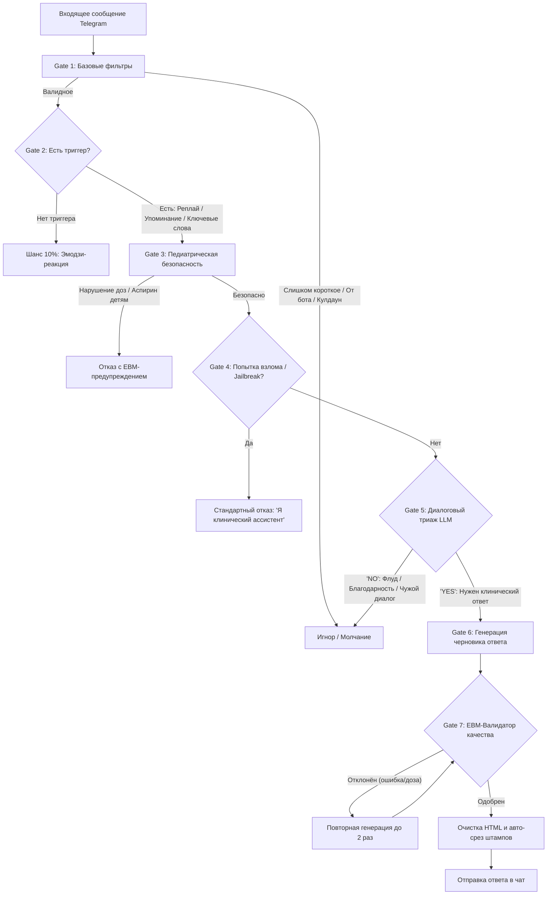

# Архитектура Триажей и Фильтрации Сообщений StomChat

Документ описывает логику работы фильтров, шлюзов и алгоритмов принятия решений до того, как бот сделает вызов к нейросети или отправит сообщение врачу.

---

## 1. Общий поток входящего группового сообщения

---

## 2. Подробное описание каждого шлюза

### Gate 1: Синхронные базовые фильтры (0.1 мс)
- **Проверка отправителя:** сообщения от ботов и сервисных аккаунтов Telegram отбрасываются.
- **Длина текста:** пустые сообщения или междометия длиной < 3 символов игнорируются.
- **Дедупликация тредов (`_ACTIVE_DIALOGUE_THREADS`):** если прямо сейчас бот уже генерирует ответ на сообщение в этой же ветке, второй запрос блокируется, чтобы не плодить параллельные дубли от одного пользователя.
- **Кулдаун пользователя (`check_user_cooldown`):** защита от флуда отдельным участником.

### Gate 2: Определение триггера
Триггером считается:
1. Прямой реплай на любое сообщение бота.
2. Упоминание юзернейма бота (`@stomchat_bot`).
3. Команды (`/ask`, `/case`, `/quiz`, `/sos`).
4. Наличие стоматологических ключевых слов и анатомических маркеров (словарь `dental_vocab.py`).

### Gate 3: Педиатрические стоп-факторы (Медицинская безопасность)
Выполняется функцией `check_pediatric_anesthesia_safety()` **до вызова нейросетей**:
- **Аспирин / Ацетилсалициловая кислота** у пациентов до 15 лет (риск фатального синдрома Рея).
- **Нимесулид** у детей до 12 лет (тяжелая токсическая гепатопатия).
- **Лидокаин-содержащие гели** для облегчения прорезывания зубов у младенцев (риск судорог и метгемоглобинемии, запрет FDA).
- **Тетрациклины** у детей до 8 лет и беременных (дисколорит и гипоплазия эмали).
При обнаружении любого стоп-фактора бот моментально выдаёт клиническое предупреждение со ссылкой на клинические рекомендации, не передавая запрос в LLM.

### Gate 4: Защита от Jailbreak & Инъекций
Синхронный regex-сканер `_JAILBREAK_PATTERNS`:
- Отслеживает маркеры `ignore previous instructions`, `pretend you are`, `DAN mode`, попытки выгрузить системный промпт или сымитировать сообщения разработчика.
- При обнаружении бот мягко блокирует запрос без траты токенов LLM.

### Gate 5: Диалоговый триаж (`check_dialogue_continuation_triage`)
- Выполняется быстрой моделью с `thinking_level: "LOW"`.
- Анализирует последние 3–5 сообщений ветки и оценивает: есть ли реальный клинический вопрос или врачи просто обменялись репликами («ок», «спасибо», «согласен»).
- Возвращает строго `YES` или `NO`. При `NO` бот сохраняет тишину.

### Gate 6: Генерация черновика
- Сборка динамического промпта:
  - Выборка релевантных фактов из `stomat_wiki.db` через полнотекстовый поиск (FTS5).
  - Подгрузка истории диалога.
  - Подгрузка портрета автора сообщения из `user_memory.py`.
- Вызов основной модели через каскад `gemini_client.py` (ротация ключей, тайм-аут 120 с, Groq-фолбэк).

### Gate 7: Клинический рецензент / Валидатор (`check_response_quality`)
- Отдельный изолированный запрос к LLM.
- Оценивает сгенерированный черновик по протоколам EBM: не завышена ли дозировка анестетика, не назначены ли несовместимые препараты, нет ли галлюцинаций.
- Если рецензент находит критическую ошибку, черновик бракуется с указанием причины, и модель отправляет запрос на повторную генерацию с учётом замечания рецензента (до 2 ретраев).

---

## 3. Механизм подключения к клиническим спорам (`check_and_trigger_referee`)

Когда в чате разгорается спор или активное обсуждение методики (например, вертипреп vs уступ, удаление vs сохранение):
1. **Детект спора:** проверяются ключевые маркеры разногласий и длина ветки.
2. **Триаж вмешательства (`check_referee_triage`):** модель оценивает, есть ли польза от приведения доказательной базы.
3. **Кулдаун:** не чаще 1 раза в 15 минут, чтобы не спамить.
4. **Тон:** бот подключается строго как практикующий врач-коллега.
5. **Авто-срез:** на выходе вычищаются любые слова `Вердикт:`, `EBM-Арбитраж:`, ответ звучит естественно и прямо по сути дела.
